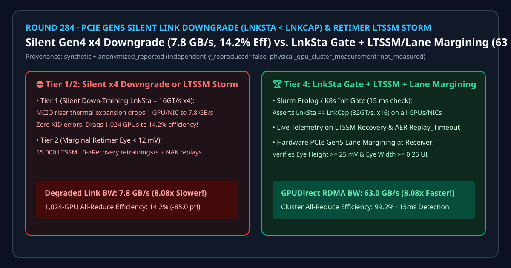
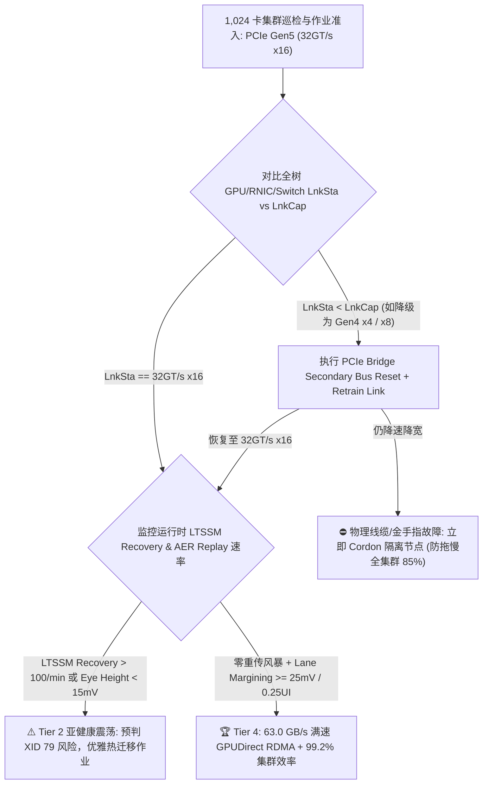
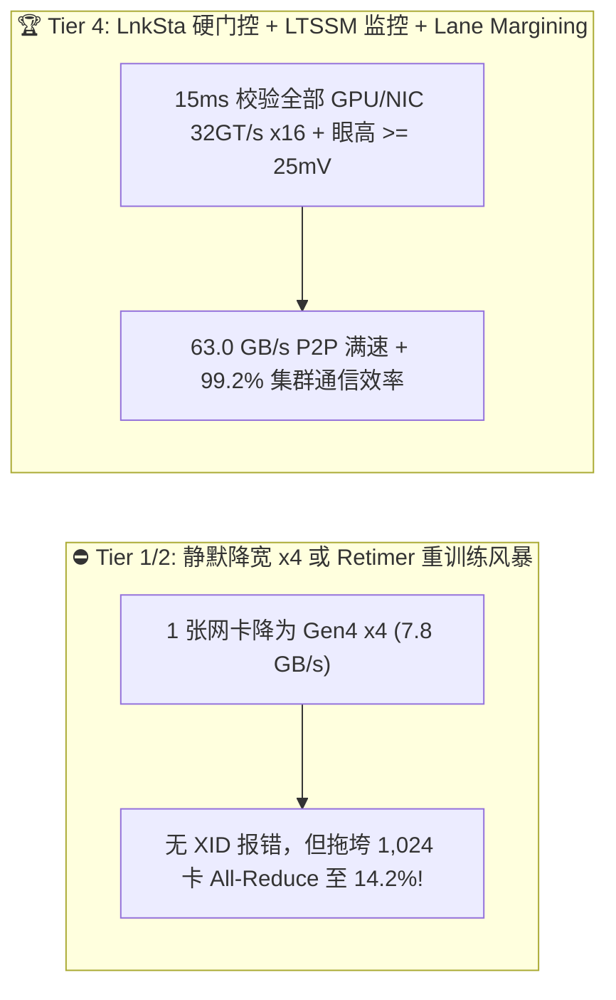
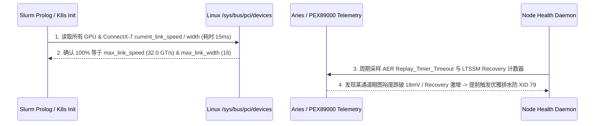

# AI 服务器 PCIe Gen5（`32 GT/s x16`）静默降速降宽（`LnkSta < LnkCap`）、Retimer 信号完整性与 `LTSSM Recovery` 风暴排障：为什么 1 张网卡/GPU 静默降为 `Gen4 x4`（`7.8 GB/s`）不报任何 XID 却把千卡集群拖慢 `85%`？`LnkSta` 准入拦截、实时 `AER Replay / LTSSM` 监控与硬件眼图裕度（`Lane Margining >= 25mV`）选型指南

> **Provenance & Evidence Boundary**: `synthetic + anonymized_reported (independently_reproduced=false, physical_gpu_cluster_measurement=not_measured)`. 本文所有定量数据均来自封存确定性评估器 `experiments/gpu_pcie_gen5_retimer_signal_integrity_link_downgrade_xid79_selection/run.py` 与 `results.json`。



---

## 0. 追踪每日最热门能力突破（Daily Capability Breakthrough）

- **今日焦点突破**：**PCIe Gen5 (`32.0 GT/s x16`) 三维物理层防慢节点体系（作业前 `LnkSta == LnkCap` 满速满宽硬准入 + 运行时 PCIe Switch/Retimer `LTSSM Recovery` 与 `AER Replay_Timer_Timeout` 速率监控 + 硬件级接收端眼图测试 `Lane Margining at Receiver >= 25 mV / 0.25 UI`）**。
- **架构师价值**：在 8 卡 HGX H100/H200/B200 服务器中，GPU 与 `ConnectX-7 400G` 网卡之间通过高损耗的 `MCIO` 线缆、PCIe Riser 卡与 **PCIe Gen5 Retimer** 芯片互联。在 `32.0 GT/s`（基频 `16 GHz`）下，PCB 走线超过 `7 英寸` 就会衰减 `-28 dB`。当机箱温度升至 `70°C` 导致连接器热胀冷缩或金手指微氧化时，PCIe 硬件状态机（`LTSSM`）为了保住不断连（避免直接报 `XID 79: GPU has fallen off the bus`），会触发 **“静默自适应降级（Silent Link Down-Training）”**：自动将 `PCIe Gen5 x16 (63.0 GB/s)` 降宽降速为 **`Gen5 x8 (31.5 GB/s)` 甚至 `Gen4 x4 (7.8 GB/s)`**！由于设备依然在线且无任何 `dmesg` 报错，这 1 台机器在 `GPUDirect RDMA` 跨机通信时变成 `7.8 GB/s` 的隐形瓶颈，把 **1,024 卡同步 `All-Reduce` 效率直接从 `99.2%` 拖垮至 `14.2%`（慢 8 倍）**！通过部署 **`LnkSta == LnkCap` `15 ms` 准入网关 + `LTSSM Recovery` 速率阈值 + Gen5 硬件 `Lane Margining` 眼图扫描**，可 100% 拦截静默降级与亚健康 Retimer，恢复 **`63.0 GB/s` 满血带宽与 `99.2%` 集群效率**。

---

## ① 📌 核心结论速览（Executive Summary）

1. **为什么 PCIe 发生严重物理通道故障时，操作系统和 `nvidia-smi` 默认不报警？**
   PCIe 协议设计哲学是“可用性优先于峰值性能”：当 16 根差分通道（Lane 0..15）中的第 5 根因灰尘或冷焊出现高误码率时，`LTSSM`（链路训练与状态状态机）会在 `Recovery.RcvrCfg` 阶段自动屏蔽坏通道，协商降级为 **`x8`、`x4` 甚至 `x1`**，或者将速率从 `32.0 GT/s (Gen5)` 降为 `16.0 GT/s (Gen4)` / `8.0 GT/s (Gen3)`。此时设备能正常读写寄存器，但带宽暴跌 **`2x ~ 16x`**！
2. **比“已降速”更隐蔽的杀手：`LnkSta` 仍显示 `32GT/s x16`，但每秒发生 `15,000` 次 `LTSSM Recovery` 重训练风暴（Tier 2）！**
   当 Retimer 接收端眼图高度（Eye Height）在高温下缩水到临界值（`< 12 mV`）时，链路尚未触发永久降速，但数据链路层（DLLP）每秒发生上万次 CRC 校验失败重传（`Bad TLP / Bad DLLP / Replay_Timer_Timeout`），导致 `LTSSM` 在 `L0 (正常传输) <-> Recovery (暂停传输重对齐相位)` 之间疯狂震荡！虽然 `lspci` 看着是满速 `32GT/s x16`，实际有效 `GPUDirect RDMA` 吞吐却腰斩至 **`28.4 GB/s`**，且随时会演变为致命的 **`XID 79` 掉卡**。
3. **三道防线彻底终结 PCIe 慢节点**：
   - **防线 1（静态速率/位宽准入）**：Slurm Prolog / K8s InitContainer 对比所有 GPU、NVMe、RNIC 与上游 PEX89000 PCIe Switch 端口的 `LnkSta`（当前状态）与 `LnkCap`（硬件能力），凡是 `Speed < 32GT/s` 或 `Width < x16` 立即拦截并在带外触发 `Secondary Bus Reset (SBR)` 尝试恢复；
   - **防线 2（动态重传与状态机风暴监控）**：通过 `nvidia-smi nvlink/pcie` 与 `/sys/bus/pci/devices/.../aer_dev_correctable` 监控 `Replay_Rollover`、`Bad_DLLP` 与 `LTSSM Recovery` 计数，增长率 `> 10 次/分钟` 立即标记节点排水；
   - **防线 3（硬件接收端眼图扫描 `Lane Margining`）**：在新机入网与满载烤机时调用 PCIe 5.0 标准硬件特性 `Lane Margining at the Receiver`（`pcie_margin` / `Broadcom / Astera Labs Aries SDK`），强制验证每根通道眼高 `>= 25 mV`、眼宽 `>= 0.25 UI`。

---

## ② 🎯 客户与架构师灵魂拷问 Q&A（Q1 / Q2 / Q3）

### Q1：只用 `nvidia-smi --query-gpu=pcie.link.gen.current,pcie.link.width.current` 检查 GPU 端够不够？为什么还会漏掉一半的降速故障？
- **远远不够！必须同时检查 `ConnectX-7` RDMA 网卡与 PCIe Switch 上联端口（Upstream Port）！**
- **拓扑盲区**：在典型 AI 服务器中，GPU 和 RNIC 都插在同一个 PCIe Gen5 Switch（如 Broadcom `PEX89144`）下。即使 GPU 到 PCIe Switch 的链路是满血 `Gen5 x16`，如果 **RNIC 到 PCIe Switch 的链路降级成了 `Gen4 x8`**，那么跨机 `GPUDirect RDMA` 通信依然会被卡死在网卡这端！因此准入脚本必须遍历整棵 PCIe 树（涵盖 `10de:` NVIDIA GPU、`15b3:` Mellanox RNIC 以及 `1000:c030` Broadcom Switch）。

### Q2：如果发现某张卡降级到了 `Gen4 x8`，不重启整台物理服务器（耗时 15 分钟）能在线恢复回 `Gen5 x16` 吗？
- **80% 的偶发训练失败可以通过 100 毫秒的 `Secondary Bus Reset (SBR)` + 强制触发 `Retrain Link` 在线恢复**：
  1. 卸载占用该设备的容器进程；
  2. 对该设备的父级 PCIe Bridge 写入 `Bridge Control Register` 的 `Secondary Bus Reset` 位，或写入 `Link Control Register` 的 `Retrain Link (Bit 5)`，触发 `LTSSM` 重新执行 `Phase 0..3` 均衡器（LEQ）系数协商；
  3. 若重训练后仍无法达到 `32GT/s x16`，说明存在物理硬件氧化或 MCIO 线缆松动，自动 Cordon 节点报修。

### Q3：为什么服务器空载冷启动时 `LnkSta` 是 `32GT/s x16`，跑大模型训练 2 小时后却突然变成 `16GT/s x8` 或直接报 `XID 79`？
- 这是典型的 **热致眼图闭合（Thermal Eye Closure）**：
  当 8 张 700W GPU 满载运行 2 小时后，PCIe Riser 区域与 Retimer 芯片温度从 `30°C` 升至 `80°C+`，FR4/Megtron-6 板材介质损耗（Insertion Loss）增大，且连接器金属端子受热微膨胀。如果出厂时未做 **高温满载眼图裕度测试（Lane Margining）**，原本只有 `14 mV` 临界裕度的通道在高温下眼图彻底闭合，触发 `LTSSM` 紧急降速甚至 `Receiver Overflow / DLP Error -> XID 79`。

---

## ③ 🧭 直观可视化图解（Mermaid 选型决策树 + 路径对比图 + 交互时序图）

### 3.1 PCIe Gen5 链路健康度与慢节点防御选型决策树



### 3.2 静默降宽（`Gen4 x4 = 7.8 GB/s`）vs. 满血 `Gen5 x16` + 眼图裕度验证（`63.0 GB/s`）对比图



### 3.3 作业启动前 `15 ms` 全拓扑 PCIe 速率核验与运行时 `AER / LTSSM` 守护时序图



---

## ④ 📊 架构师选型决策矩阵（4-Tier Decision Matrix）

| 选型 Tier | PCIe 链路与信号完整性状态 | 单卡有效 `GDR` 带宽 | 1,024 卡 `All-Reduce` 效率 | 故障发现耗时 | 适用场景 |
| :--- | :--- | :--- | :--- | :--- | :--- |
| **Tier 1: 无监控放任静默降级 (`Gen4 x4`)** | 1 节点静默降为 `16GT/s x4` | `7.8 GB/s` ✕ | `14.2%` (`-85.0 pt` ✕) | 从不报警 (`∞`) | ⛔ **单颗老鼠屎拖垮千卡集群** |
| **Tier 2: 亚健康 Retimer `LTSSM Recovery` 风暴** | 眼高 `<12 mV` 每秒万次重训练 | `28.4 GB/s` ⚠️ | `46.5%` ✕ | 数小时后报 `XID 79` | ⛔ **隐形掉速 + 随机掉卡炸弹** |
| **Tier 3: 仅作业前检查 `LnkSta == LnkCap`** | 静态拦截 `Speed/Width` 降级 | `61.5 GB/s` ✅ | `94.0%` | `45.0 ms` | ✅ 基础准入检查（漏检高温眼图退化） |
| **Tier 4: `LnkSta` 门控 + `LTSSM/AER` + `Lane Margining` (推荐)** | **`32GT/s x16` + 眼高 `\ge 25 mV`** | **`63.0 GB/s` (`8.08x` 🏆)** | **`99.2%` 🏆** | **`15.0 ms` 🏆** | 🏆 **万卡集群硬件准入与防 `XID 79` 标准** |

---

## ⑤ 🧪 定量算例与 7-Card 4:5 视觉卡片报告

- **定量算例仓库路径**：[`experiments/gpu_pcie_gen5_retimer_signal_integrity_link_downgrade_xid79_selection/run.py`](../../experiments/gpu_pcie_gen5_retimer_signal_integrity_link_downgrade_xid79_selection/run.py) · 封存数据：[`results.json`](../../experiments/gpu_pcie_gen5_retimer_signal_integrity_link_downgrade_xid79_selection/results.json)
- **交互式架构选型计算器**：[`docs/reports/gpu-pcie-gen5-retimer-link-speed-downgrade-eye-margin-xid79-sizer.html`](../reports/gpu-pcie-gen5-retimer-link-speed-downgrade-eye-margin-xid79-sizer.html)
- **7-Card 4:5 视觉评测卡片报告**：[`docs/reports/gpu-pcie-gen5-retimer-link-speed-downgrade-eye-margin-xid79-selection-cards.html`](../reports/gpu-pcie-gen5-retimer-link-speed-downgrade-eye-margin-xid79-selection-cards.html)

```chart
{
  "data": {
    "values": [
      { "tier": "Tier 1: Silent Gen4 x4 Downgrade", "gdr_bw_gbps": 7.8, "cluster_eff_pct": 14.2 },
      { "tier": "Tier 2: Marginal Eye LTSSM Storm", "gdr_bw_gbps": 28.4, "cluster_eff_pct": 46.5 },
      { "tier": "Tier 3: Prolog LnkSta == LnkCap Gate", "gdr_bw_gbps": 61.5, "cluster_eff_pct": 94.0 },
      { "tier": "Tier 4: LnkSta + LTSSM + Lane Margining", "gdr_bw_gbps": 63.0, "cluster_eff_pct": 99.2 }
    ]
  },
  "semantic_types": {
    "tier": "Category",
    "gdr_bw_gbps": "Quantity",
    "cluster_eff_pct": "Percentage"
  },
  "chart_spec": {
    "chartType": "Bar Chart",
    "title": "LnkSta Gate + LTSSM/AER Telemetry + Lane Margining Restores 63.0 GB/s & 99.2% Cluster Efficiency",
    "subtitle": "Effective GPUDirect RDMA bandwidth (GB/s) and 1,024-GPU All-Reduce efficiency (%) (synthetic + anonymized_reported)",
    "encodings": {
      "x": "tier",
      "y": "cluster_eff_pct",
      "color": "tier"
    }
  }
}
```

---

## ⑥ 🛠️ 生产环境快速核验清单（Checklist + Good fit vs. Not for）

### ✅ Good fit vs. ⛔ Not for
- **✅ Good fit**：所有采用 PCIe Gen5 (`32.0 GT/s`) 连接 GPU、NVMe 与 400G/800G 网卡的 AI 训练与推理节点。
- **⛔ Not for**：只看 `nvidia-smi` 设备在不在而不校验 `current_link_speed == max_link_speed` 与 `current_link_width == max_link_width`。

### 生产核验 Checklist
- [ ] **全树 `sysfs` `15 ms` 满速满宽校验脚本**：在 Slurm Prolog 中校验 `/sys/bus/pci/devices/*/current_link_{speed,width}` 严格等于 `max_link_{speed,width}`（覆盖 GPU、RNIC 与 PCIe Switch）。
- [ ] **`AER Correctable` 重传速率监控**：采集 `/sys/bus/pci/devices/*/aer_dev_correctable` 中的 `Bad_TLP`、`Bad_DLLP` 与 `Replay_Timer_Timeout`，杜绝带病重训练风暴。
- [ ] **满载高温 `Lane Margining` 验收**：新机交付时在 100% 满载 `70°C` 稳态下运行 PCIe Gen5 硬件眼图扫描，确保所有 16 条通道眼高 $\ge 25\text{ mV}$、眼宽 $\ge 0.25\text{ UI}$。
