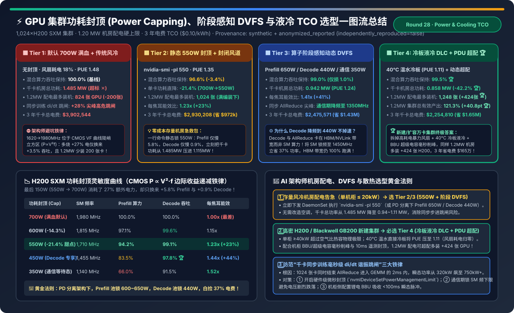
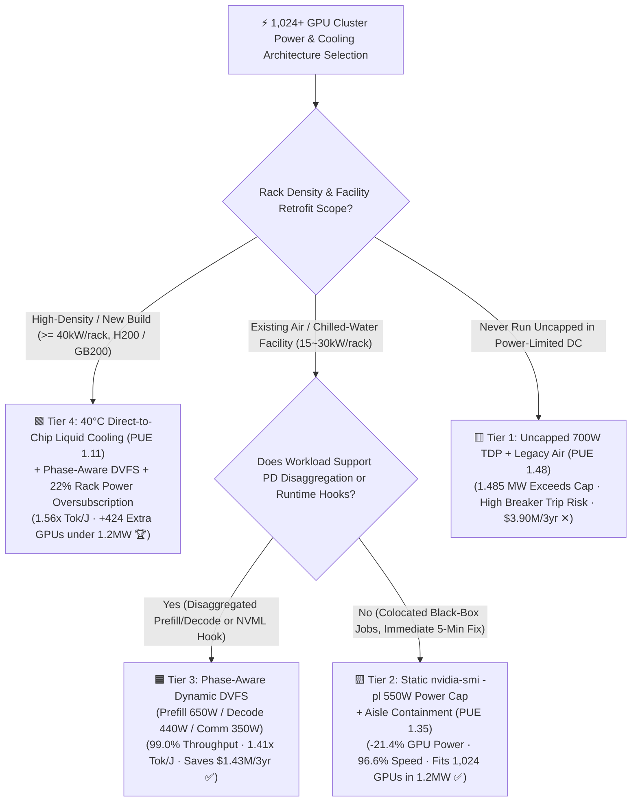
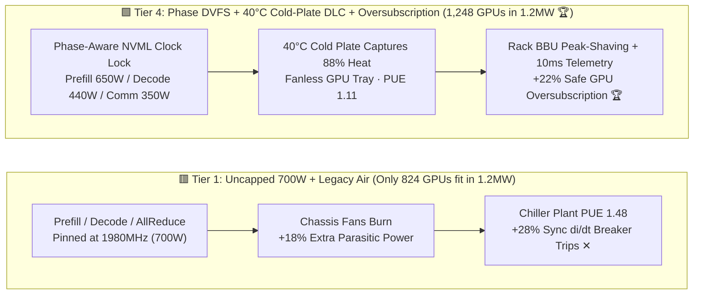
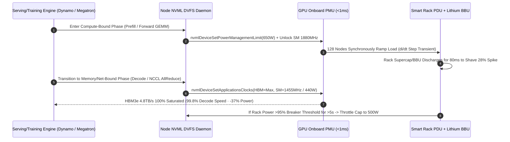

# GPU Cluster Power Capping, Phase-Aware DVFS & Cooling (Air vs. Cold-Plate Liquid) TCO Selection FAQ (`Uncapped 700W Air` vs. `Static 550W Cap` vs. `Phase-Aware DVFS` vs. `40°C Direct Liquid Cooling + Rack Oversubscription`)

> **Reader's Guide (3-Minute Executive Read / 10-Minute Whiteboard Pitch)**: Built for AI Solution Architects and Datacenter Infrastructure Leads, this first-principles guide answers the hardest physical bottleneck in 1,000+ GPU deployments: **"Our colocation facility only has 1.20 MW of power capacity, yet 1,024 H200 SXM GPUs draw 1.485 MW at uncapped 700W TDP with legacy air cooling—how do we fit all 1,024 GPUs without waiting 18 months for a substation upgrade? Why does cutting GPU power by 21.4% (700W → 550W) reduce LLM throughput by only 3.4% (and Decode by just 0.9%)? What causes synchronous training `di/dt` breaker trips, and when does 40°C Direct-to-Chip Liquid Cooling (DLC) pay for itself?"**
>
> 🔗 **中文版本**: [GPU 集群功耗封顶、阶段感知 DVFS 与散热 TCO 架构选型指南 (`gpu-power-capping-dvfs-liquid-cooling-tco-selection-faq.md`)](./gpu-power-capping-dvfs-liquid-cooling-tco-selection-faq.md) · **7-Card Benchmark Deck**: [`gpu-power-capping-dvfs-liquid-cooling-tco-selection-cards.html`](../reports/gpu-power-capping-dvfs-liquid-cooling-tco-selection-cards.html) · **Interactive Sizer**: [`llm-inference-engine-pd-sizer.en.html#power-cooling-sizer`](../reports/llm-inference-engine-pd-sizer.en.html)

---

## ① 📌 Executive Summary

1. **Debunking the "Uncapped 700W TDP" Myth (CMOS Cubic Voltage-Frequency Law $P \propto C \cdot V^2 \cdot f$)**:
   - At the upper end of the silicon voltage-frequency (VF) curve (`1,710 MHz → 1,980 MHz`), supply voltage $V$ must scale super-linearly to sustain higher clock rates, causing dynamic power to surge nearly **cubically** with frequency.
   - Pushing an H200 SXM from **`550W` to `700W` burns `+27.3%` more power** but yields only **`+5.8%` more Prefill TFLOPS** and **`+0.9%` more HBM-bound Decode throughput**! Worse, under a hard `1.20 MW` datacenter power envelope, `Tier 1 (Uncapped 700W + PUE 1.48 Air)` forces you to leave **200 GPUs dark in boxes** (capping deployment at 824 GPUs).
2. **Immediate Relief for Power-Constrained Air Datacenters — `Static 550W Cap (Tier 2)` or `Phase-Aware DVFS (Tier 3)`**:
   - **Tier 2 (`nvidia-smi -pl 550` + Hot-Aisle Containment `PUE 1.35`)**: Zero hardware changes, cuts per-GPU power by **`-21.4%`**, retains **`96.6%` blended LLM throughput**, boosts energy efficiency to **`1.23x` Tokens/Joule**, fits all **1,024 GPUs** inside `1.115 MW`, and saves **`$972,336`** in 3-year electricity OPEX.
   - **Tier 3 (Phase-Aware DVFS: Prefill `650W` / Decode `440W` / NCCL Comm `350W`)**: Exploits PD disaggregation and runtime NVML hooks to down-clock SMs to `1,455 MHz` (`440W`) during memory-bound Decode and `1,140 MHz` (`350W`) during network-bound AllReduce—retaining **`99.0%` blended throughput** at **`1.41x` Tokens/Joule**!
3. **High-Density Clusters & Breaker-Safe Scaling — `40°C Direct-to-Chip Liquid Cooling + Rack Oversubscription (Tier 4)`**:
   - **Tier 4 (`40°C` Warm-Water Cold-Plate DLC `PUE 1.11` + Phase DVFS + BBU Peak-Shaving + `22%` Rack Oversubscription)**: Eliminates the `15%–18%` chassis fan power tax, slashes 1,024-GPU facility draw from `1.485 MW` down to **`0.858 MW` (`-42.2%`)**, enables deploying **`1,248 GPUs` (`+424 extra GPUs`)** inside the same `1.20 MW` facility budget for **`121.3%` total cluster goodput (`+40.8 pt`)**, and saves **`$1,647,734`** over 3 years!

---

## ② 🎯 Architect & Customer Q&A (First-Principles Deep Dive)

### Q1: Why does slashing H200 power by 35.7% (`700W → 450W`) during LLM Decode retain 97.8% of token generation speed?

- **Plain-Language Analogy**:
  Imagine driving through a single-lane tunnel bottlenecked at 30 mph (**`4.8 TB/s` HBM3e memory bandwidth**). Revving a Ferrari engine to 8,000 RPM (**running SMs at `1,980 MHz / 700W`**) doesn't get you through the tunnel any faster—the extra fuel is burned purely as waste heat while waiting on the car ahead!
- **First-Principles Mechanics**:
  1. **Prefill is Compute-Bound**: With arithmetic intensity `> 200 FLOPs/Byte`, Tensor Cores run at saturation. Even here, dropping from `700W` to `600W` retains `97.1%` TFLOPS because you avoid the steepest top of the VF curve.
  2. **Decode and AllReduce are Memory/Network-Bound**: HBM3e runs on an independent clock domain drawing fixed ~`90W–110W`. During autoregressive Decode, SMs spend the majority of cycles stalled on `Stall_Mem` waiting for weight tiles from HBM.
  3. **Zero-Code Win in PD-Disaggregated Serving**: In disaggregated Prefill/Decode pools (Mooncake / Dynamo), set **Prefill nodes to `600W–650W`** and **Decode nodes to `440W`** (`nvidia-smi -lgc 1455,1455`). Decode power drops by **`37.1%`** while TPOT latency remains virtually unchanged (**`99.4%` throughput**).

### Q2: Why do 1,024-GPU training clusters trip rack PDU breakers even when average power is only 70% of capacity? What is `di/dt` synchronous resonance?

- **Root Cause (Synchronous Step-Load Transients)**:
  - Unlike inference where random user arrivals smooth out aggregate power, **distributed synchronous training (FSDP / Megatron 3D) marches in lockstep**.
  - During `NCCL AllReduce`, all 1,024 GPUs drop to **`~320W`** simultaneously. The exact microsecond the barrier completes, all 1,024 GPUs launch BF16/FP8 GEMM kernels together—causing cluster power to vertical-jump from **`320W/GPU` to `780W+/GPU` (`+28%` transient overshoot) within `2 milliseconds`**!
- **Three-Layer Defense Architecture**:
  1. **Hardware PMU Sub-Millisecond Capping**: Enforcing `nvidia-smi -pl 550` engages the onboard PMU to clamp GEMM burst excursions within `< 1 ms`;
  2. **Anti-Droop SM Clock Floor**: Locking a minimum SM clock (`nvidia-smi -lgc 1350,1750`) prevents GPUs from collapsing to `300 MHz` idle states during AllReduce, damping $\Delta I / \Delta t$ step transients;
  3. **Rack-Level Lithium BBU / Supercapacitor Peak-Shaving**: Absorbs `< 200 ms` power spikes locally at the rack busbar so upstream substation breakers see a flat load profile.

### Q3: When is Air Cooling (`PUE 1.35–1.48`) sufficient, and when is Direct-to-Chip Liquid Cooling (`PUE 1.11`) mandatory?

- **The `35 kW / Rack` Physical Wall**:
  - Water holds **3,300× more heat per unit volume** than air. Once rack density exceeds `35–40 kW` (4× 8-GPU H200 nodes or GB200 NVL72 at `120 kW/rack`), high-RPM server fans consume **`15%–18%` of total IT power** just to force air across heatsinks, while chiller compressors push facility PUE to `1.48`.
- **Direct-to-Chip Warm-Water Liquid Cooling (`40°C` Inlet, `PUE 1.11`)**:
  - Copper cold plates capture `85%+` of heat directly from GPU/NVSwitch dies using `40°C` warm water cooled via dry coolers (year-round chiller-less free cooling), cutting PUE to **`1.11`** and saving **`$1,647,734` over 3 years** on a 1,024-GPU cluster.

---

## ③ 🧭 Visual Architecture Diagrams (Decision Tree / Datapath / Telemetry Sequence)

### 3.1 GPU Cluster Power Capping, DVFS & Cooling Decision Tree

### 3.2 Legacy Uncapped 700W Air (Tier 1) vs. Phase-Aware DVFS + Direct Liquid Cooling (Tier 4)

### 3.3 Closed-Loop Phase-Aware DVFS & Sub-Millisecond Rack Peak-Shaving Sequence

---

## ④ 📊 Architect Decision Matrix

*Baseline: Target **1,024×H200 SXM GPUs (128×8-GPU nodes)**, hard datacenter facility budget **`1.20 MW`**, electricity **`$0.10 / kWh`**, 3-year (`26,280 hrs`) continuous operation.*

| Evaluation Dimension | 🟥 Tier 1: Uncapped 700W + Legacy Air | 🟨 Tier 2: Static 550W Cap + Contained Air | 🟦 Tier 3: Phase-Aware Dynamic DVFS | 🟩 Tier 4: Cold-Plate DLC + Phase DVFS + Oversubscription |
| :--- | :--- | :--- | :--- | :--- |
| **GPU Power Control Policy** | Uncapped `700W` (`1,980 MHz`) | Static `nvidia-smi -pl 550` (`1,710 MHz`) | **Prefill `650W` / Decode `440W` / Comm `350W`** | **Phase DVFS (`510W` avg) + Closed-Loop Rack Cap** |
| **Cooling Mode & Facility PUE** | Legacy Rear-Door Air (`PUE 1.48`) | Hot/Cold Aisle Containment (`PUE 1.35`) | Rear-Door Chilled Water (`PUE 1.24`) | **40°C Warm-Water Direct Cold Plate (`PUE 1.11` 🏆)** |
| **Prefill / Decode Speed Retained** | `100.0%` / `100.0%` | `94.2%` / `99.1%` (`96.6%` blended) | **`98.6%` / `99.4%` (`99.0%` blended)** | **`99.2%` / `99.8%` (`99.5%` blended 🏆)** |
| **Normalized Energy Efficiency** | `1.00x` (Baseline) | `1.23x` (`+23%` Tok/J) | `1.41x` (`+41%` Tok/J) | **`1.56x` (`+56%` Tok/J 🏆)** |
| **Facility MW for 1,024 GPUs** | `1.485 MW` (**Exceeds 1.2MW Cap ✕**) | `1.115 MW` (Fits within 1.2MW ✅) | `0.942 MW` (`21%` headroom ✅) | **`0.858 MW` (`-42.2%` vs Tier 1 🏆)** |
| **Max GPUs Deployed under 1.2MW** | **`824 GPUs`** (200 GPUs stranded ✕) | **`1,024 GPUs`** (Full cluster ✅) | **`1,024 GPUs`** (Full cluster ✅) | **`1,248 GPUs` (`+424 extra GPUs` 🏆)** |
| **Effective Cluster Goodput (1.2MW)** | `80.5%` (Crippled by stranded GPUs) | `96.6%` (`+16.1 pt`) | `99.0%` (`+18.5 pt`) | **`121.3%` (`+40.8 pt` net cluster gain 🏆)** |
| **Thermal Throttle Events / Mo** | `42 / mo` (Straggler stalls training) | `6 / mo` | `1 / mo` | **`0 / mo` (`< 3°C` die delta 🏆)** |
| **3-Year Power OPEX (1,024 GPUs)** | `$3,902,544` | `$2,930,208` (Saves `$972k`) | `$2,475,571` (Saves `$1.43M`) | **`$2,254,810` (Saves `$1,647,734` 🏆)** |

---

## ⑤ 🧪 Quantitative Example & Benchmark Insights (VF Sweep & 3-Year TCO)

> 📁 **Sealed Source Data & Reproducible Script**: [`experiments/gpu_power_capping_dvfs_cooling_tco/run.py`](../../experiments/gpu_power_capping_dvfs_cooling_tco/run.py) · [`experiments/gpu_power_capping_dvfs_cooling_tco/results.json`](../../experiments/gpu_power_capping_dvfs_cooling_tco/results.json) · Unit Test [`tests/test_gpu_power_capping_dvfs_cooling_tco.py`](../../tests/test_gpu_power_capping_dvfs_cooling_tco.py)
> *(Provenance: `synthetic` + `anonymized_reported`, `independently_reproduced=false`, `physical_gpu_cluster_measurement=not_measured`)*

### 5.1 H200 SXM Power Cap Sensitivity Sweep (`350W → 700W`)

| Power Cap (`W`) | SM Clock | Prefill TFLOPS Retained | Decode Tok/s Retained | Efficiency (`Tok/J`) | Ideal Deployment Phase |
| :--- | :--- | :--- | :--- | :--- | :--- |
| **`700W` (Uncapped)** | `1,980 MHz` | `100.0%` | `100.0%` | `1.00x` | ⛔ Steep cubic VF zone; avoid continuous use |
| **`600W` (`-14.3%`)** | `1,815 MHz` | **`97.1%`** | **`99.6%`** | `1.15x` | ✅ Dedicated **Prefill Pool** cap |
| **`550W` (`-21.4%`)** | `1,710 MHz` | **`94.2%`** | **`99.1%`** | **`1.23x`** | 🏆 **Colocated Cluster Static Sweet Spot** |
| **`450W` (`-35.7%`)** | `1,455 MHz` | `83.5%` | **`97.8%`** | **`1.44x`** | 🏆 Dedicated **Decode Pool** cap |
| **`350W` (`-50.0%`)** | `1,140 MHz` | `66.0%` | `91.5%` | **`1.52x`** | ✅ Cross-node NCCL AllReduce / KV wait state |

### 5.2 Companion 7-Card 4:5 Visual Report & Interactive Sizer

- 🃏 **7-Card 4:5 Visual Benchmark Report (Self-Contained CSP)**: [`docs/reports/gpu-power-capping-dvfs-liquid-cooling-tco-selection-cards.html`](../reports/gpu-power-capping-dvfs-liquid-cooling-tco-selection-cards.html)
- 🧮 **Standalone Interactive Power Capping & Cooling TCO Sizer**: [`docs/reports/gpu-power-capping-dvfs-liquid-cooling-tco-sizer.html`](../reports/gpu-power-capping-dvfs-liquid-cooling-tco-sizer.html) (integrated into [`docs/reports/llm-inference-engine-pd-sizer.en.html#power-cooling-sizer`](../reports/llm-inference-engine-pd-sizer.en.html))

---

## ⑥ 🛠️ Appendix: Production Architect Verification Checklist

- [ ] **1. Persist Power Caps Across Reboots via DaemonSet (`nvidia-smi -pm 1`)**: `nvidia-smi -pl` resets to `700W` after host reboot or driver reload; enforce `nvidia-smi -pm 1 && nvidia-smi -pl 550` inside your Kubernetes GPU Operator startup DaemonSet.
- [ ] **2. Split Power Envelopes Across Disaggregated Prefill (`600W–650W`) and Decode (`440W`) Pools**: Lock SM clocks on Decode nodes (`nvidia-smi -lgc 1455,1455`) while keeping HBM3e clocks at max to cut Decode rack power by `35%+` with `< 1%` TPOT impact.
- [ ] **3. Alert on Single-GPU Thermal Stragglers (`DCGM_FI_DEV_THERMAL_VIOLATION`)**: In synchronous 1,024-GPU training, a single GPU throttling at `83°C` stalls the other 1,023 GPUs at every AllReduce barrier.
- [ ] **4. Never Oversubscribe Rack PDUs Without 3-Tier Hardware Protection**: Only oversubscribe rack power (`+15% to +22%`) when paired with `< 10 ms` smart PDU telemetry, automated NVML emergency clock-down daemons, and rack-level BBU/supercapacitor peak-shaving.
- [ ] **5. Enforce Dew-Point Guardrails & Dual-Pump Redundancy on Direct Liquid Cooling (DLC)**: Operate secondary coolant loops at `35°C–40°C` (above ambient dew point to prevent condensation), with redundant CDU pumps and dripless quick-disconnect manifolds.
