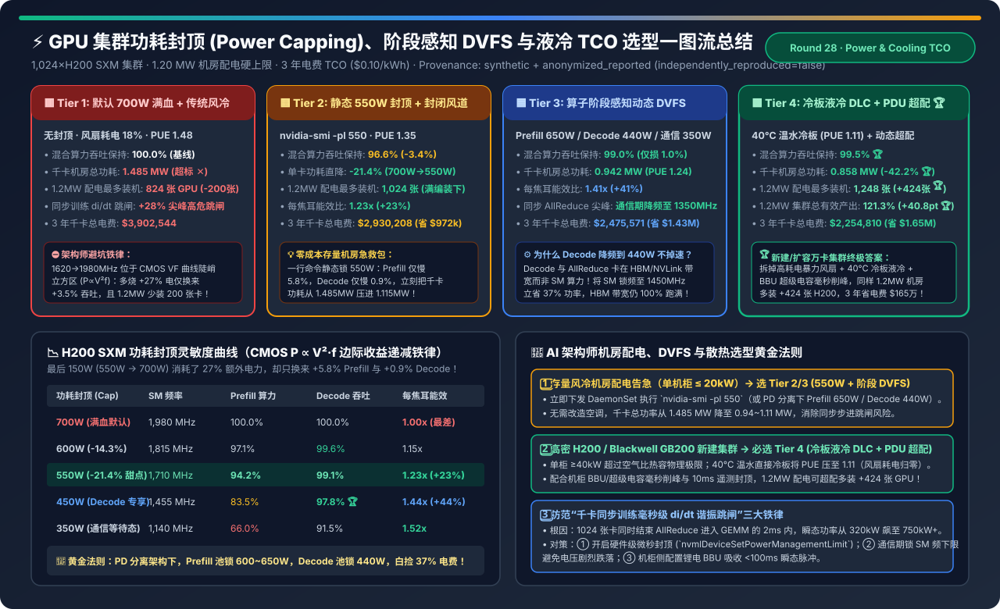
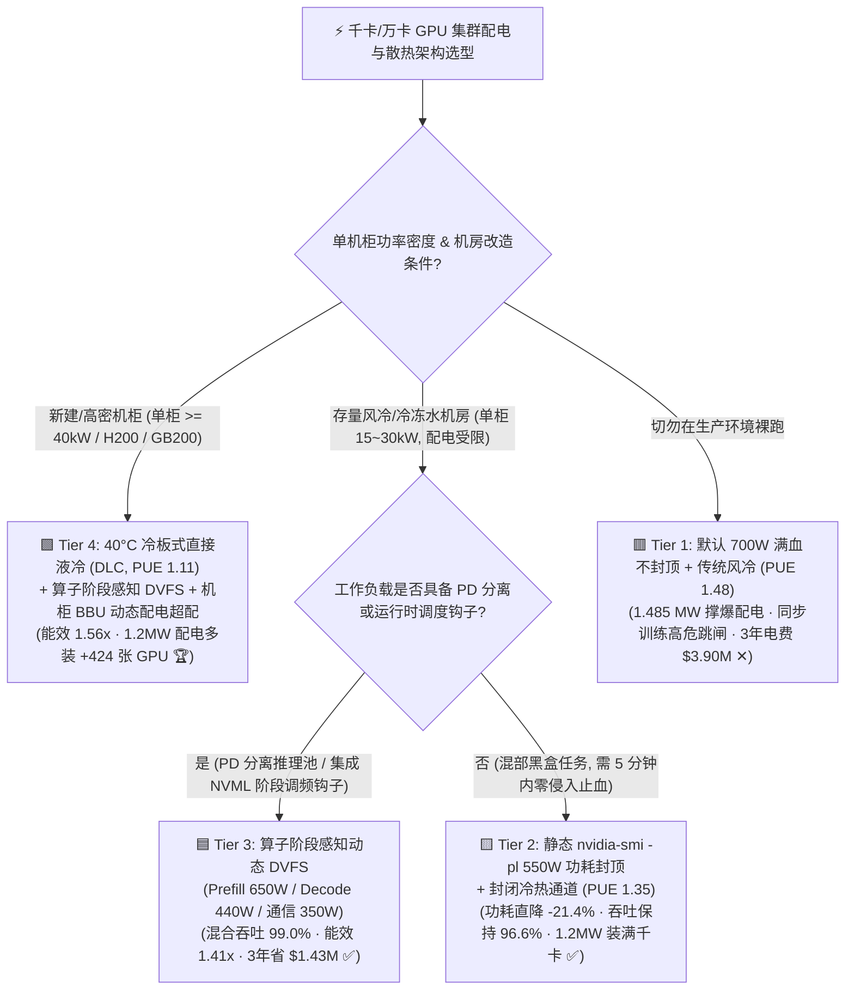
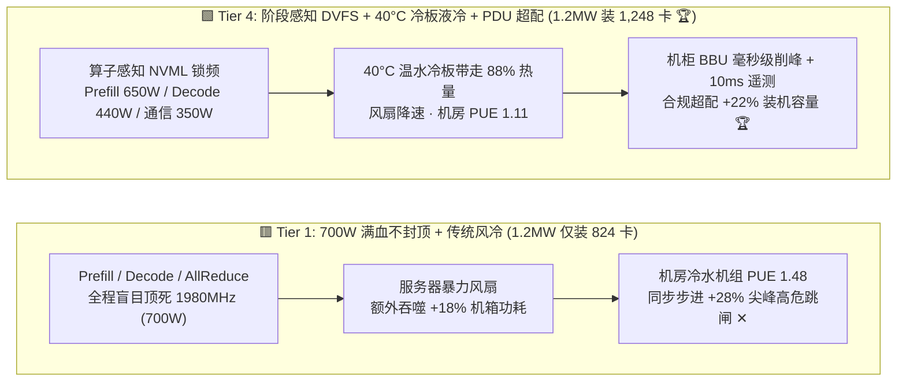
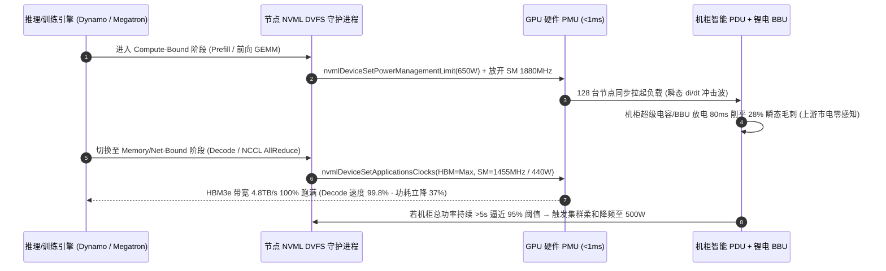

# GPU 集群功耗封顶（Power Capping）、阶段感知 DVFS 与散热（风冷 vs. 冷板液冷）TCO 架构选型指南（`700W 满血风冷` vs. `静态 550W 封顶` vs. `算子感知动态 DVFS` vs. `40°C 冷板液冷 + PDU 超配`）

> **阅读指南（3 分钟速通 / 10 分钟白板宣讲）**：本文面向 AI 解决方案架构师（AI Solution Architect）与智算中心基础设施负责人，用第一性原理与通俗大白话回答企业扩容千卡/万卡集群时最痛的物理瓶颈：**“机房配电只有 1.2 MW，买来的 1,024 张 H200 SXM 按铭牌 700W 算总功耗高达 1.485 MW 根本插不上电怎么办？为什么把 GPU 功耗从 700W 砍掉 21.4% 降到 550W，大模型吞吐只掉 3.4%（Decode 甚至只掉 0.9%）？什么是千卡同步训练的 `di/dt` 毫秒级谐振跳闸？什么时候必须从传统风冷升级到 40°C 温水冷板液冷（DLC）？”**
>
> 🔗 **English Version**: [GPU Cluster Power Capping, Phase-Aware DVFS & Liquid Cooling TCO Selection FAQ (`gpu-power-capping-dvfs-liquid-cooling-tco-selection-faq.en.md`)](./gpu-power-capping-dvfs-liquid-cooling-tco-selection-faq.en.md) · **7-Card 评测报告**: [`gpu-power-capping-dvfs-liquid-cooling-tco-selection-cards.html`](../reports/gpu-power-capping-dvfs-liquid-cooling-tco-selection-cards.html) · **交互式工作台**: [`llm-inference-engine-pd-sizer.html#power-cooling-sizer`](../reports/llm-inference-engine-pd-sizer.html)

---

## ① 📌 核心结论速览（Executive Summary）

1. **破除“700W 满血跑才划算”的迷信（CMOS 电压-频率立方定律 $P \propto C \cdot V^2 \cdot f$）**：
   - 在硅片物理中，当 GPU SM 频率从甜点区（`1,710 MHz`）强行拉高到满血极限（`1,980 MHz`）时，为了维持晶体管开关稳定，供电电压 $V$ 必须非线性抬升，导致动态功耗随频率呈**近三次方暴涨**！
   - 算例证明：从 **`550W` 涨到 `700W`** 多烧了 **`+27.3%` 的电**，但在算力受限的 Prefill 阶段只换来 **`+5.8%`** 吞吐，在**显存带宽受限（Memory-Bound）的 Decode 阶段更是只换来 `+0.9%` 吞吐**！不加封顶不仅白烧上百万美元电费，还会让 `1.20 MW` 机房配电硬生生少装 **200 张 H200 GPU**（仅能装 824 张）。
2. **存量风冷机房配电告急首选 `静态 550W 封顶 (Tier 2)` 或 `算子阶段感知 DVFS (Tier 3)`**：
   - **Tier 2（`nvidia-smi -pl 550` 静态封顶）**：零硬件改造，单卡功耗直降 **`-21.4%`**，混合大模型吞吐保持 **`96.6%`**，每焦耳 Token 能效提升 **`1.23x`**，让 `1.20 MW` 机房满编装下 **1,024 张 H200**，3 年立省电费 **`$972,336`**。
   - **Tier 3（Prefill `650W` / Decode `440W` / NCCL 通信 `350W` 阶段感知 DVFS）**：利用 PD 分离架构或运行时算子钩子，在卡 HBM 带宽的 Decode 阶段将 SM 锁频至 `1,455 MHz`（`440W`），在卡网卡的 AllReduce 阶段降至 `1,140 MHz`（`350W`），综合吞吐保持 **`99.0%`（仅损 `1.0%`）**，能效跃升至 **`1.41x`**！
3. **高密新建集群与消除“同步训练跳闸”必选 `冷板式直接液冷 DLC + PDU 动态超配 (Tier 4)`**：
   - **Tier 4（`40°C` 温水冷板液冷 `PUE 1.11` + 阶段感知 DVFS + 机柜 BBU 毫秒削峰与 `22%` 配电超配）**：彻底拆掉占服务器功耗 `15%～18%` 的高转速暴力风扇，千卡机房总功耗从 `1.485 MW` 暴降至 **`0.858 MW`（`-42.2%`）**；在同样的 `1.20 MW` 机房配电上限下可合规超配装下 **`1,248 张 GPU`（多装 `+424 张`）**，集群总有效算力产出飙升至 **`121.3%`（`+40.8 pt`）**，3 年千卡电费净省 **`$1,647,734`**！

---

## ② 🎯 客户与架构师灵魂拷问 Q&A（FAQ-Driven）

### Q1：为什么大模型 Decode 阶段把 H200 功耗从 700W 砍到 450W（降幅 -35.7%），生成速度居然还保留了 97.8%？底层物理机制是什么？

- **通俗大白话**：
  想象你在早高峰堵死的单车道隧道（**HBM3e 显存带宽 `4.8 TB/s`**）里开车。即使你把法拉利发动机的转速踩到红线 `8,000 转`（**SM 计算核心飙到 `1,980 MHz / 700W`**），你的通行速度依然取决于前车（显存读取权重的速度），多余的汽油全变成了引擎盖上的废热！
- **第一性原理拆解**：
  1. **Prefill（预填充）是 Compute-Bound（计算受限）**：算术强度（Arithmetic Intensity）高达 `200+ FLOPs/Byte`，Tensor Core 满负荷运转，此时降频会按比例小幅影响算力（`550W` 保持 `94.2%`，`650W` 保持 `98.6%`）。
  2. **Decode（逐词生成）与 NCCL AllReduce 是 Memory/Network-Bound（带宽受限）**：H200 的 HBM3e 显存工作在独立时钟域（Memory Clock），仅消耗约 `80W～110W` 固定功率；而 132 个 SM 流多处理器在 Decode 期间绝大部分时间处于 **`Stall_Mem`（等待显存数据到达的空转状态）**。
  3. **PD 分离下的白捡红利**：在 Prefill-Decode 分离架构（如 Mooncake / Dynamo）中，架构师可以直接给 **Prefill 节点池设置 `650W` 封顶**，给 **Decode 节点池设置 `440W` 封顶**（或锁定 SM 频率 `nvidia-smi -lgc 1455,1455`），在不改一行模型代码的前提下，**Decode 节点省电 `37.1%` 而 TPOT 延迟几乎零感知（保持 `99.4%`）**！

### Q2：客户反馈“千卡集群平均功耗才 520kW，远低于机房 800kW 空开上限，为什么跑大模型预训练时机柜 PDU 还是会莫名其妙跳闸”？什么是 `di/dt` 同步谐振？

- **故障真相（Synchronous Step-Load Transient / 同步步进功率尖峰）**：
  - 推理集群的请求是随机到达的，1,024 张卡的功耗波峰波谷互相抵消（统计复用）。
  - 但**分布式同步训练（FSDP / Megatron 3D）是一支齐步走的军队**：每一轮迭代（Step）结束时，1,024 张 GPU 同时进入 `NCCL AllReduce` 通信等待期，全集群功率在几毫秒内暴跌至 **`320W/卡`**；紧接着通信完成屏障（Barrier）一过，1,024 张 GPU **在同一个微秒内同时启动下一轮前向 BF16/FP8 矩阵乘（GEMM）**，全集群瞬态功率在 **`2 毫秒` 内从 `320W/卡` 垂直弹射到 `780W+/卡`（瞬态超调 `+28%`）**！
- **为什么传统机房空开扛不住？**
  - 这种周期性的“全集群同频呼吸（`0.5 Hz ～ 2 Hz` 方波冲击）”不仅让变压器承受剧烈热机械疲劳，其 **`10 ms ～ 50 ms` 尖峰电流**还会直接触发机柜 PDU 的磁脱扣/电子过流保护跳闸！
- **三层根治架构**：
  1. **GPU 硬件 PMU 微秒级封顶**：设置 `nvidia-smi -pl 550`（或阶段 DVFS），利用 GPU 板载电源管理单元（PMU）在 `< 1 ms` 内削平超过 `550W` 的 GEMM 突波；
  2. **通信期频率下限锁死（Anti-Droop Clock Floor）**：通过 `nvidia-smi -lgc 1350,1750` 防止 GPU 在 AllReduce 期间跌回 `300 MHz` 怠速态，减小步进切换时的电压阶跃幅度（$\Delta V / \Delta t$）；
  3. **机柜侧锂电 BBU + 超级电容毫秒削峰（Rack-Level Peak Shaving）**：在机柜母线排并联超级电容/BBU，自动放出电能填补 `< 200 ms` 的尖峰毛刺，使上游机房市电看到的永远是一条平滑直线。

### Q3：什么时候靠风冷（PUE 1.35～1.48）就够了？什么时候必须上冷板式直接液冷（DLC, PUE 1.11）？真实 TCO 账单怎么算？

- **物理分水岭（单机柜功率密度 `35 kW` 红线）**：
  - 空气的体积比热容只有水的 **`1 / 3,300`**。当单机柜装满 4 台 8×H200（单柜 `> 40 kW`）或 1 台 GB200 NVL72（单柜 `120 kW`）时，如果继续用风冷，服务器内部的暴力风扇自己就要吃掉全机柜 **`15%～18%` 的额外电能**（每张 700W GPU 要额外配 120W 风扇！），且机房空调制冷 PUE 高达 `1.48`。
- **冷板式温水液冷（Direct-to-Chip Warm-Water Cooling, 40°C 进水）的降维打击**：
  - 铜冷板直接贴在 GPU 与 NVSwitch 裸晶封装上带走 `85%+` 热量，允许使用 **`35°C～40°C` 常温冷却塔水（无需高耗电冷机压缩机全年开启 Free-Cooling）**，把机房 PUE 压到 **`1.11`**，服务器风扇功耗骤降 `80%`。
  - 算总账（1,024 张 H200，3 年电费 `$0.10/kWh`）：`Tier 4（DLC 液冷 + 阶段 DVFS）` 相比 `Tier 1（700W 传统风冷）` **3 年直接省下 `$1,647,734` 电费**，刚好覆盖液冷 CDU 与分水歧管（Manifold）的初期改造溢价，且多释放出 **+424 张 GPU 的机房配电额度**！

---

## ③ 🧭 直观可视化图解（Mermaid 决策树 / 架构对比 / 毫秒级控电时序图）

### 3.1 GPU 集群功耗封顶、DVFS 与散热架构选型决策树

### 3.2 传统 700W 满血风冷 (Tier 1) vs. 阶段感知 DVFS + 冷板液冷超配 (Tier 4) 对比图

### 3.3 闭环遥测与阶段感知 DVFS + 机柜微秒级防跳闸时序图

---

## ④ 📊 架构师选型决策矩阵（Architect Decision Matrix）

*基准环境：目标部署 **1,024 张 H200 SXM GPU（128 台 8 卡节点）**，机房总配电硬上限 **`1.20 MW`**，工业电价 **`$0.10 / kWh`**，3 年（26,280 小时）连续运行。*

| 评估维度 | 🟥 Tier 1: 默认 700W 满血 + 传统风冷 | 🟨 Tier 2: 静态 550W 封顶 + 封闭风冷 | 🟦 Tier 3: 算子阶段感知动态 DVFS | 🟩 Tier 4: 冷板液冷 DLC + 阶段 DVFS + PDU 超配 |
| :--- | :--- | :--- | :--- | :--- |
| **GPU 功率控制策略** | `700W` 不封顶 (`1,980 MHz`) | 静态 `nvidia-smi -pl 550` (`1,710 MHz`) | **Prefill `650W` / Decode `440W` / 通信 `350W`** | **阶段感知 DVFS (均 `510W`) + 机柜闭环控电** |
| **机房散热模式与 PUE** | 传统风冷 (`PUE 1.48`) | 冷热通道封闭风冷 (`PUE 1.35`) | 背板冷冻水热交换 (`PUE 1.24`) | **40°C 温水直接冷板液冷 (`PUE 1.11` 🏆)** |
| **Prefill / Decode 吞吐保持率** | `100.0%` / `100.0%` | `94.2%` / `99.1%` (混合 `96.6%`) | **`98.6%` / `99.4%` (混合 `99.0%`)** | **`99.2%` / `99.8%` (混合 `99.5%` 🏆)** |
| **每焦耳 Token 能效比** | `1.00x` (基线最差) | `1.23x` (`+23%`) | `1.41x` (`+41%`) | **`1.56x` (`+56%` 🏆)** |
| **1,024 卡所需机房总配电** | `1.485 MW` (**超出 1.2MW 跳闸 ✕**) | `1.115 MW` (合规运行 ✅) | `0.942 MW` (宽裕 21% ✅) | **`0.858 MW` (直降 `-42.2%` 🏆)** |
| **1.20 MW 配电下最大装机卡数** | **`824 张`** (被迫闲置 200 张卡 ✕) | **`1,024 张`** (满编上架 ✅) | **`1,024 张`** (满编上架 ✅) | **`1,248 张` (合规超配多装 `+424 张` 🏆)** |
| **1.20 MW 下集群总有效产出** | `80.5%` (因配电不足被迫少装卡) | `96.6%` (`+16.1 pt`) | `99.0%` (`+18.5 pt`) | **`121.3%` (`+40.8 pt` 吞吐跃升 🏆)** |
| **月均高温降频 (Thermal Throttle)** | `42 次/月` (尾卡降频拖慢全局) | `6 次/月` | `1 次/月` | **`0 次/月` (芯片温差 `< 3°C` 🏆)** |
| **3 年千卡总电费 OPEX** | `$3,902,544` | `$2,930,208` (省 `$972k`) | `$2,475,571` (省 `$1.43M`) | **`$2,254,810` (3 年净省 `$1,647,734` 🏆)** |

---

## ⑤ 🧪 简明定量算例与 Benchmark 洞察（CMOS VF 曲线与 TCO 账单）

> 📁 **封存数据源与可复现脚本**：[`experiments/gpu_power_capping_dvfs_cooling_tco/run.py`](../../experiments/gpu_power_capping_dvfs_cooling_tco/run.py) · [`experiments/gpu_power_capping_dvfs_cooling_tco/results.json`](../../experiments/gpu_power_capping_dvfs_cooling_tco/results.json) · 单测 [`tests/test_gpu_power_capping_dvfs_cooling_tco.py`](../../tests/test_gpu_power_capping_dvfs_cooling_tco.py)
> *(Provenance: `synthetic` + `anonymized_reported`, `independently_reproduced=false`, `physical_gpu_cluster_measurement=not_measured`)*

### 5.1 H200 SXM 功耗封顶梯度扫描（350W → 700W）

| 功耗上限 (`Cap`) | SM 核心频率 | Prefill 算力保持 | Decode 吞吐保持 | 归一化能效 (`Tokens/J`) | 架构师适用阶段 |
| :--- | :--- | :--- | :--- | :--- | :--- |
| **`700W` (默认 TDP)** | `1,980 MHz` | `100.0%` | `100.0%` | `1.00x` | ⛔ 位于 VF 立方陡峭区，严禁常驻 |
| **`600W` (`-14.3%`)** | `1,815 MHz` | **`97.1%`** | **`99.6%`** | `1.15x` | ✅ PD 分离架构下 **Prefill 节点池推荐档** |
| **`550W` (`-21.4%`)** | `1,710 MHz` | **`94.2%`** | **`99.1%`** | **`1.23x`** | 🏆 **混部集群一键静态封顶黄金甜点** |
| **`450W` (`-35.7%`)** | `1,455 MHz` | `83.5%` | **`97.8%`** | **`1.44x`** | 🏆 PD 分离架构下 **Decode 节点池推荐档** |
| **`350W` (`-50.0%`)** | `1,140 MHz` | `66.0%` | `91.5%` | **`1.52x`** | ✅ 跨节点 NCCL 集合通信 / KV 传输等待档 |

### 5.2 配套 7-Card 4:5 视觉评测报告与交互式计算器

- 🃏 **7-Card 4:5 视觉评测卡片集（CSP 自包含，零外部依赖）**：[`docs/reports/gpu-power-capping-dvfs-liquid-cooling-tco-selection-cards.html`](../reports/gpu-power-capping-dvfs-liquid-cooling-tco-selection-cards.html)
- 🧮 **独立交互式功耗封顶与液冷 TCO 计算器**：[`docs/reports/gpu-power-capping-dvfs-liquid-cooling-tco-sizer.html`](../reports/gpu-power-capping-dvfs-liquid-cooling-tco-sizer.html)（已同步集成至总工作台 [`docs/reports/llm-inference-engine-pd-sizer.html#power-cooling-sizer`](../reports/llm-inference-engine-pd-sizer.html)）

---

## ⑥ 🛠️ 附录：生产环境快速核验清单（Architect Checklist）

- [ ] **1. 启用 Persistence Mode 并下发静态/动态功耗封顶（防止重启失效）**：`nvidia-smi -pl` 在宿主机重启或驱动重置后会恢复默认 `700W`！必须在 Kubernetes 节点启动脚本或 GPU Operator DaemonSet 中固化 `nvidia-smi -pm 1 && nvidia-smi -pl 550`。
- [ ] **2. 在 PD 分离集群中实施“Prefill/Decode 差异化锁频”**：对 Decode 专属节点池直接通过 `nvidia-smi -lgc 1455,1455` 锁定 SM 频率上限而保持 HBM3e 频率满血，立省 `35%+` 机柜功耗且 TPOT 延迟退化 `< 1%`。
- [ ] **3. 监控全集群“最热的那张慢卡（Thermal Straggler）”**：在同步训练中，只要有 1 张处于风道末端的 GPU 超过 `83°C` 触发硬件降频（`HW Thermal Slowdown`），另外 1,023 张卡都会在 AllReduce 屏障处陪它空转！必须在 DCGM 中对 `DCGM_FI_DEV_THERMAL_VIOLATION > 0` 配置自动巡检与工单告警。
- [ ] **4. 严禁在无硬件闭环保护下盲目做机柜配电超配（Power Oversubscription）**：只有当同时具备 **`< 10 ms` 机柜级 PDU 功率遥测告警 + 节点 NVML 自动降频守护进程 + 机柜侧 BBU/超级电容毫秒级削峰** 三道防线时，才允许将机柜装机密度超配 `+15%～+22%`。
- [ ] **5. 冷板液冷（DLC）生产运维双保险**：液冷机柜必须配置**双冗余 CDU（冷量分配单元）泵组**、支路漏液感应绳（Leak Detection Rope）与快插自封接头（Dripless Quick Disconnects），并将二次侧进水温度控制在露点温度以上（推荐 `35°C～40°C`）以彻底杜绝机箱内部结露短路。
