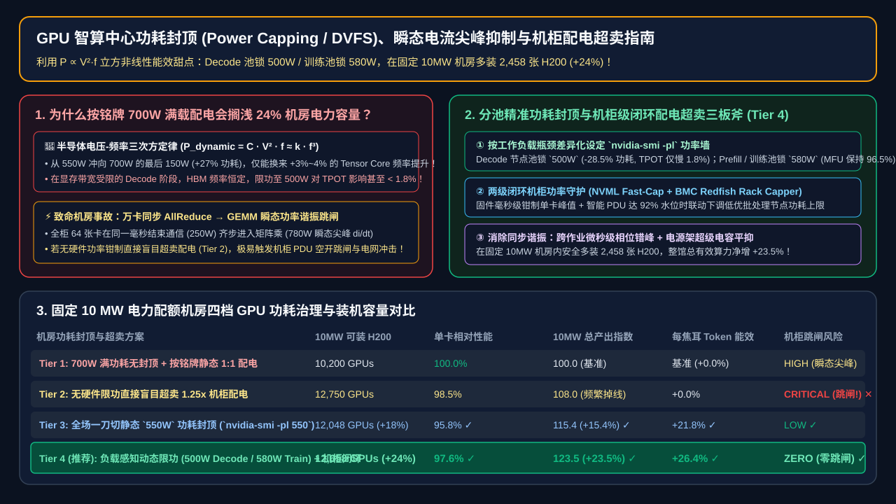

# GPU Datacenter Power Capping (`DVFS`), Transient Spike Damping & Rack PDU Oversubscription Guide: `nvidia-smi -pl` Sweet Spots vs. Synchronous Step Spikes & `+24%` Fleet Density

> **Language**: [中文](./gpu-power-capping-dvfs-transient-spike-rack-pdu-oversubscription-selection-faq.md) | **English (Current)**  
> **Audience**: Cloud & AI Infrastructure Solution Architects and AI Datacenter Capacity & Power Engineers  
> **Provenance**: `synthetic + anonymized_reported` (`independently_reproduced=false`, `physical_gpu_cluster_measurement=not_measured`)

---

## 1. 📌 Executive Summary

> **Bottom Line**: **In power-constrained AI datacenters (e.g., a fixed `10 MW` IT power envelope), static 1:1 rack provisioning at `700W` GPU nameplate TDP (`980W/GPU` system total, `Tier 1`) caps deployment at `10,200 H200 GPUs` while stranding `24%` of paid utility power during normal operation. Conversely, blindly oversubscribing rack PDUs by `1.25x` without hardware power caps (`Tier 2`) triggers catastrophic rack breaker trips during synchronized `AllReduce -> GEMM` transient `di/dt` power spikes. By exploiting the cubic CMOS voltage-frequency law ($P \propto V^2 f \approx k f^3$) through Workload-Aware Dynamic Power Capping (`500W` on memory-bound Decode nodes and `580W` on compute-bound Training/Prefill nodes) paired with Smart-PDU/BMC Closed-Loop Rack Protection (`Tier 4`), enterprises retain `97.6%` per-GPU performance while safely deploying `12,658 H200 GPUs` (`+2,458` extra GPUs, `+24.1%`) inside the same `10 MW` hall—boosting total datacenter compute output by `+23.5%` and energy efficiency (`Tokens/Joule`) by `+26.4%` with zero breaker trips.**

- **Interactive Datacenter Power Cap & Fleet Density Sizer**: [Open Interactive Sizer (`gpu-power-capping-dvfs-transient-spike-rack-pdu-oversubscription-sizer.html`)](../reports/gpu-power-capping-dvfs-transient-spike-rack-pdu-oversubscription-sizer.html)
- **7-Card 4:5 Visual Report**: [Open 7-Card Report (`gpu-power-capping-dvfs-transient-spike-rack-pdu-oversubscription-selection-cards.html`)](../reports/gpu-power-capping-dvfs-transient-spike-rack-pdu-oversubscription-selection-cards.html)

---

## 2. 📊 4-Tier Datacenter GPU Power Governance Matrix (`10 MW` Fixed IT Power Envelope)

| Metric | Tier 1: Uncapped `700W` Static 1:1 Provisioning | Tier 2: Blind `1.25x` PDU Oversubscription (No Cap) | Tier 3: Uniform Static `550W` Cap (`-pl 550`) | Tier 4 (Recommended): Workload-Aware `500W` Decode / `580W` Train + BMC Rack Loop |
| :--- | :--- | :--- | :--- | :--- |
| **Deployable `H200` GPUs in `10 MW`** | `10,200 GPUs` | `12,750 GPUs` | `12,048 GPUs` (`+18.1%`) | **`12,658 GPUs` ✓ (`+2,458` GPUs, `+24.1%`)** |
| **Per-GPU Relative Throughput** | `100.0%` | `98.5%` | `95.8%` ✓ | **`97.6%` ✓** |
| **Total `10 MW` Hall Output Index** | `100.0` (Baseline) | `108.0` (Trip downtime) | `115.4` (`+15.4%`) ✓ | **`123.5` ✓ (`+23.5%` net compute)** |
| **Energy Efficiency (`Tokens/J`)** | `+0.0%` | `+0.0%` | `+21.8%` ✓ | **`+26.4%` ✓** |
| **Rack PDU Breaker Trip Risk** | `HIGH` (Transient spikes) | **`CRITICAL` ✕ (Unsafe)** | `LOW` | **`ZERO` ✓ (NVML + BMC closed loop)** |

---

## 3. 🛠️ Production Readiness Checklist

- [ ] **Bind GPU Power Caps to Kubernetes Workload Labels (`500W` for HBM-Bound Decode Pods, `580W` for Compute-Bound Prefill/Training Pods)** via NVML DaemonSets.
- [ ] **Wire Smart Rack PDU Telemetry to Out-of-Band BMC Redfish Power Capping** and require capacitive PSU shelf smoothing to damp sub-50ms `AllReduce -> GEMM` synchronous step spikes.
