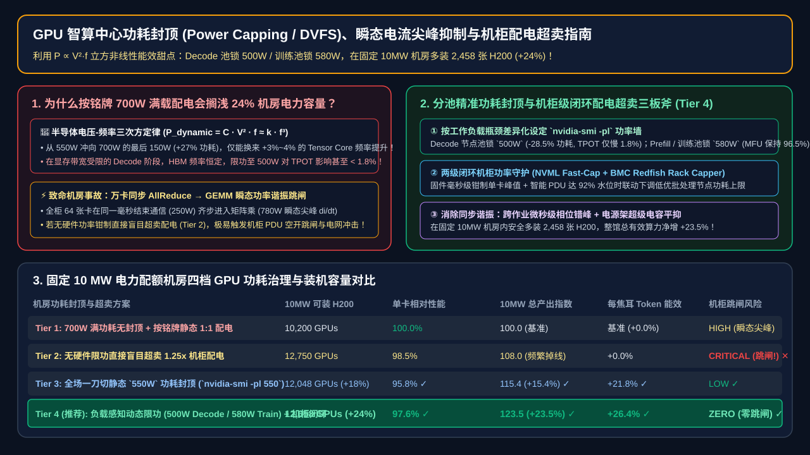
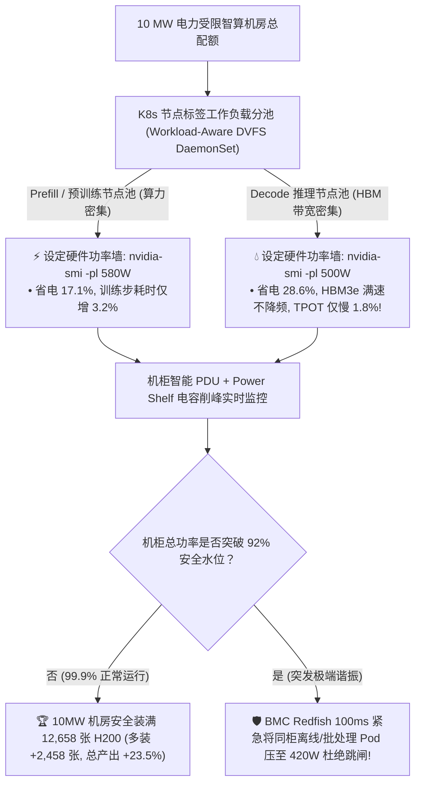

# 大型 GPU 智算中心功耗封顶（Power Capping / DVFS）、瞬态电流尖峰抑制与机柜配电超卖（Rack PDU Oversubscription）架构指南

> **语言 / Language**: **中文 (当前)** | [English](./gpu-power-capping-dvfs-transient-spike-rack-pdu-oversubscription-selection-faq.en.md)  
> **定位**：面向 Cloud & AI Infrastructure Solution Architect 与万卡智算机房基础设施负责人的 GPU 硬件功耗封顶（`nvidia-smi -pl` / `NVML`）、电压-频率三次方定律（$P \propto V^2 f \approx k f^3$）、同步 Step 瞬态电流尖峰抑制（`di/dt` Transient Spike）与固定兆瓦（`MW`）电力配额下 `+24.1%` 机柜装机密度倍增白皮书  
> **合规与来源声明**：`synthetic + anonymized_reported`（`independently_reproduced=false`，`physical_gpu_cluster_measurement=not_measured`；完全面向通用企业级智算中心供配电与能效容量规划）

---

## 1. 📌 核心选型结论速览（Executive Summary）

> **一句话结论**：**在当今全球智算中心建设中，“机房批下来的市电总配额（如固定 `10 MW`）”而非机房面积，是决定集群算力上限的第一硬约束！若按 `H100 / H200` 铭牌满载 `700W TDP`（连同 CPU/网卡/散热折合 `980W/卡`）做 1:1 静态保守配电（Tier 1），10 MW 机房最多只能装下 `10,200 张`卡，且平时高达 `24%` 的机房市电容量被白白搁浅闲置；但若不做硬件限功直接盲目超卖 1.25 倍机柜配电（Tier 2），全柜 64 张卡在同步结束 AllReduce 瞬间齐步冲入矩阵乘（GEMM）产生的毫秒级瞬态功率尖峰（`780W+`）会直接引发机柜 PDU 空开连环跳闸！生产级黄金架构是利用半导体三次方定律（$P \propto V^2 f \approx k f^3$），实施“工作负载感知的分池动态功耗封顶（显存带宽受限的 Decode 池锁 `500W`、算力受限的训练/Prefill 池锁 `580W`）+ 智能 PDU/BMC 毫秒级闭环保护（Tier 4）”：单卡综合吞吐保留率高达 **`97.6%`**，却能在同一个 `10 MW` 机房内安全装下 **`12,658 张 H200`（多装 `+2,458 张卡`，`+24.1%`）**，使整座机房的总有效算力产出净增 **`+23.5%`**、每焦耳 Token 能效提升 **`+26.4%`** 且实现**零跳闸**！**

- **交互式智算机房功耗封顶与装机容量计算器**：[打开交互式计算器 (`gpu-power-capping-dvfs-transient-spike-rack-pdu-oversubscription-sizer.html`)](../reports/gpu-power-capping-dvfs-transient-spike-rack-pdu-oversubscription-sizer.html)
- **7-Card 4:5 视觉评测报告**：[打开 7-Card 报告 (`gpu-power-capping-dvfs-transient-spike-rack-pdu-oversubscription-selection-cards.html`)](../reports/gpu-power-capping-dvfs-transient-spike-rack-pdu-oversubscription-selection-cards.html)

---

## 2. 🎯 客户与架构师灵魂拷问 Q&A（Deep-Dive Architecture FAQ）

### Q1：为什么把 `H100 / H200` 的功耗上限从 `700W` 砍到 `550W`（砍掉 `21.4%` 功耗），大模型训练和推理速度只慢了 `2% ~ 4%`？
这源于 CMOS 芯片最底层的**动态功耗三次方物理定律**：
$$P_{\text{dynamic}} = C \cdot V^2 \cdot f \propto f^3$$
1. **最后 150W 是极度不划算的“超频溢价”**：为了让 SM 核心频率从 `1.65 GHz` 强行拉升到 `1.98 GHz`（仅 `+16%` 频率），芯片必须大幅抬高供电电压 $V$，导致功耗呈三次方暴增！反过来，执行 `nvidia-smi -pl 550` 削去顶部 21.4% 的尖峰功耗，SM 核心只需微降一点点电压和频率，算力受限（Compute-Bound）的训练/Prefill 吞吐仅下降 **`3.2% ~ 4.2%`**！
2. **在 PD 分离的 `Decode` 节点池上更是“白捡 28% 电力”**：Decode 阶段 `100%` 受限于 **HBM3e 显存带宽（`4.8 TB/s`）**，而 HBM 显存颗粒功耗恒定（仅 `~70W`）且完全不受 SM 降频影响！将 Decode 节点池限功至 **`500W`（省电 `28.6%`）**，`TPOT` 吐字延迟仅变慢 **`1.8%`**！

### Q2：什么是万卡集群的“同步迭代功率谐振（Synchronous Step Power Swing）”，如何防止它把机柜 PDU 空气开关冲跳闸？
- **故障机理**：在同步数据并行训练中，全机柜 64 张卡在同一毫秒进入 AllReduce 集合通信（此时 SM 空闲，单卡功耗骤降至 `250W`）；15 毫秒后通信完成，64 张卡又在同一微秒齐步启动下一轮 FP8 大矩阵乘（瞬态电流 `di/dt` 冲高至 `780W`）。高达 `34 kW / 机柜` 的方波阶跃冲击不仅会触发热磁断路器脱扣，还会冲击园区变压器！
- **三级平抑工程铁律**：① **硬件固件快锁**（`nvidia-smi -pl 580` 钳制稳态上限）；② **Power Shelf 超级电容 / BBU 毫秒级削峰填谷**（吸收 `<50ms` 瞬态尖峰）；③ **机柜智能 PDU $\rightarrow$ BMC Redfish 闭环降频**（一旦机柜总电流达额定值 `92%`，100ms 内通过带外 BMC 强制下调该机柜内低优批处理 Pod 的 Power Cap）。

---

## 3. 🧭 直观可视化图解（Mermaid 分池动态功耗封顶与机柜闭环配电保护流）

---

## 4. 📊 架构师多方案选型决策矩阵（固定 `10 MW` 电力配额机房）

| 评估维度 | Tier 1：`700W` 满载无封顶 + 1:1 静态配电 | Tier 2：无硬件限功直接盲目超卖 `1.25x` 配电 | Tier 3：全场一刀切静态 `550W` 封顶 (`-pl 550`) | Tier 4（推荐）：负载感知动态限功（`500W` Decode / `580W` Train）+ 机柜闭环保护 |
| :--- | :--- | :--- | :--- | :--- |
| **`10 MW` 机房可部署 `H200` 总数** | `10,200 GPUs`（基准） | `12,750 GPUs` | `12,048 GPUs` (`+18.1%`) | **`12,658 GPUs` ✓（多装 `+2,458 张卡`，`+24.1%`）** |
| **单卡平均相对吞吐保留率** | `100.0%` | `98.5%` | `95.8%` ✓ | **`97.6%` ✓（Decode 池几乎零损耗）** |
| **`10 MW` 整馆总有效算力指数** | `100.0`（基准） | `108.0`（跳闸中断拖累） | `115.4` (`+15.4%`) ✓ | **`123.5` ✓（整馆总产出净增 `+23.5%`）** |
| **每焦耳电能产出 Token 增益** | `+0.0%` | `+0.0%` | `+21.8%` ✓ | **`+26.4%` ✓（处于 V-f 曲线最佳甜点）** |
| **同步 Step 机柜 PDU 跳闸风险** | `HIGH`（瞬态尖峰隐患） | **`CRITICAL` ✕（严禁生产）** | `LOW` | **`ZERO` ✓（硬件封顶 + 电容削峰 + BMC 闭环）** |

---

## 5. 🛠️ 架构评审与生产落地 Checklist

- [ ] **严禁在未配置硬件级 `nvidia-smi -pl` 与 BMC 紧急限功闭环的情况下超卖机柜 PDU 容量**。
- [ ] **将 K8s 节点 `Power Cap` 与 PD 分离角色自动联动**：当节点被调度器打上 `role=decode-worker` 标签时，Node Agent 自动通过 NVML 将该机 8 张 GPU 功耗上限调至 `500W`；切换回 `role=prefill/training` 时自动恢复至 `580W`！
