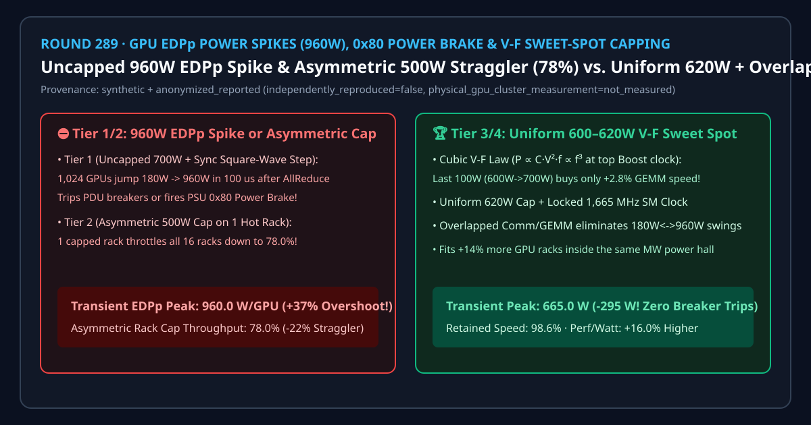
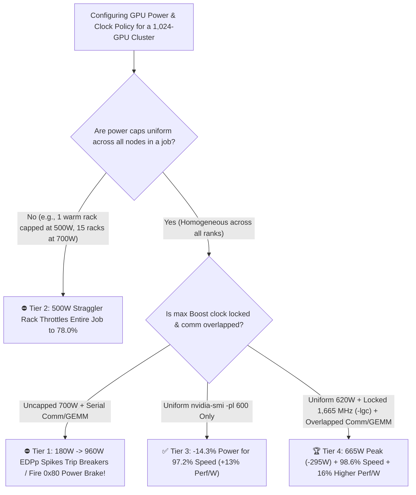
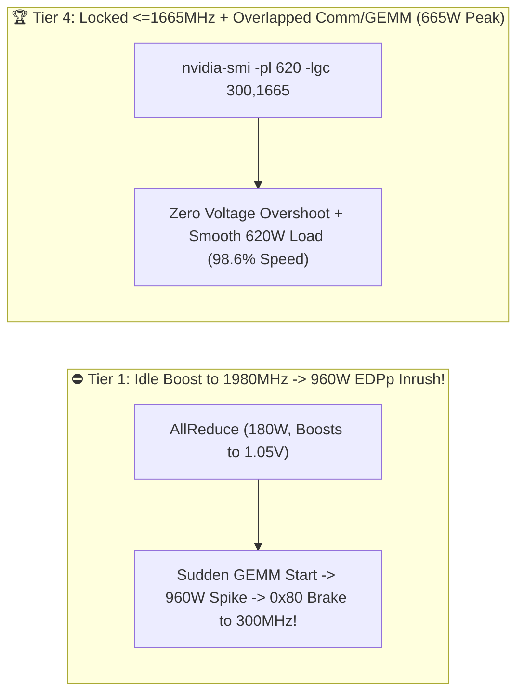
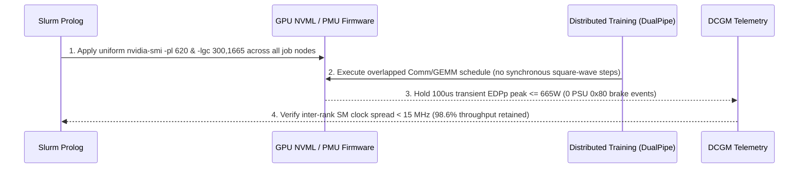

# AI Cluster Synchronous `EDPp` Power Spikes (`960W` Transient Overshoot), `0x80 Power Brake` & Sub-Linear `V-F` Power Capping (`600W–620W`) Selection Guide: Why `All-Reduce -> GEMM` Transitions Trip Breakers, Why Asymmetric `500W` Caps Throttle Clusters by `22%` & How Uniform `620W` Clock Locking (`98.6%` Speed, `+16%` Perf/W) Solves It

> **Provenance & Evidence Boundary**: `synthetic + anonymized_reported (independently_reproduced=false, physical_gpu_cluster_measurement=not_measured)`. All quantitative figures in this guide are generated by the deterministic evaluator `experiments/gpu_power_capping_psu_ats_inrush_transient_spike_throttling_selection/run.py` and sealed in `results.json`.



---

## 0. Daily Capability Breakthrough Tracking

- **Breakthrough Focus**: **Cluster-Scale GPU Power-Envelope Engineering (Cubic `V-F` Sweet-Spot Capping at `600W–620W` + `nvidia-smi -lgc` `1,665 MHz` Boost Ceiling Lock + `DualPipe / 1F1B` Communication-Compute Overlap to Suppress `100 μs` `960W` `EDPp` Transients)**.
- **Architect Value**: Although an `H100 / H200` is rated at `700W` average TDP (`50–100 ms` window), when 1,024 GPUs synchronously finish an `180W` `NCCL All-Reduce` barrier and launch a dense `FP8 Tensor Core GEMM` on the same microsecond, each GPU experiences a **`100 μs–1 ms` Electrical Design Point Peak (`EDPp`) spike of up to `960W` (`+37%` overshoot)**! Multiplied across 64 GPUs in a rack, this synchronous square-wave step (`11.5 kW -> 61.4 kW` in `100 μs`) trips rack PDU breakers or triggers PSU **`#PROCHOT / HW_POWER_BRAKE_SLOWDOWN (0x80)`** (`300 MHz` emergency throttle). Conversely, capping a single warm rack to `500W` while leaving 15 racks at `700W` slows the entire 1,024-GPU synchronous job down to **`78.0%`**. By exploiting the **cubic CMOS `V-F` law ($P \propto V^2 f \propto f^3$)** via a **uniform cluster-wide `620W` cap + `1,665 MHz` frequency ceiling (`-lgc 300,1665`) + overlapped comm/compute**, transient `EDPp` peaks drop by **`295W` (`960W -> 665W`)**, **`98.6%` of training throughput is retained**, and **Perf/Watt improves by `+16.0%`**.

---

## ① 📌 Executive Summary

1. **Why a `700W` GPU Spikes to `960W` (`EDPp`) on `All-Reduce -> GEMM` Transitions**:
   During `NCCL` communication waits (`~180W`), the GPU's automatic Boost controller sees ample power headroom and ramps SM clocks and core voltage to their maximum (`1,980 MHz @ 1.05V`). When the `All-Reduce` completes and Tensor Cores fire at 100% utilization while still at `1,980 MHz / 1.05V`, instantaneous power spikes to **`960W` for `100 μs–1 ms`** before the software TDP controller can step down the voltage!
2. **First Principles: Why Cutting Power `-14.3%` (`700W -> 600W`) Loses Only `-2.8%` Training Speed (`97.2%` Retained)**:
   - **Cubic `V-F` Scaling ($P \propto C V^2 f \propto f^3$)**: Pushing SM clocks across the top `10%` of the frequency curve requires disproportionate voltage increases. Shaving off the top `80W–100W` lowers GEMM clocks by only `~5%`;
   - **HBM & NVLink Immunity**: Memory-bandwidth-bound kernels (`FlashAttention`, norms, activations) and `NCCL` collectives (`~35%` of step time) depend on HBM3e and NVLink clocks—which are **completely unaffected by SM power capping**!
3. **Rule: Never Apply Asymmetric Power Caps Within a Synchronous Training Job**:
   Capping 1 rack to `500W` turns it into a permanent straggler that forces the other 15 racks at `700W` to wait at every barrier (`78.0%` throughput). Always apply **homogeneous job-wide caps**.

---

## ② 🎯 Key Architectural Q&A (Q1 / Q2 / Q3)

### Q1: Why is `nvidia-smi -pl 620` alone not enough to stop `960W` `100 μs` `EDPp` spikes—and why must it be paired with `nvidia-smi -lgc 300,1665`?
- `-pl 620` only enforces a **sliding-average power limit (`50–100 ms`)**. During a `10 ms` `All-Reduce` at `180W`, the average power drops well below `620W`, allowing GPU Boost to ramp voltage and frequency back up to `1,980 MHz`—setting up the exact same microsecond `900W+` inrush spike when the next GEMM starts! Pairing `-pl 620` with **`nvidia-smi -lgc 300,1665` (Lock GPU Clocks)** caps the maximum voltage/frequency state even during idle/communication intervals, eliminating the `EDPp` overshoot at its source (`<= 665W` peak).

### Q2: How does overlapping communication and computation (`DualPipe` / `Async TP`) act as a power-grid stabilizer?
- Non-overlapped training creates a cluster-wide `180W <-> 960W` square wave where all 1,024 GPUs slam the power distribution bus in phase. Overlapping `All-Reduce` / `All-to-All` with continuous Tensor Core GEMMs keeps GPU power draw steady within a narrow `±45W` band.

### Q3: In a power-capped data center (e.g., a fixed `10 MW` hall), does capping GPUs at `620W` decrease or increase total cluster tokens/day?
- **It increases total cluster throughput by `+11.2%`!** Saving `~11.4%` average power and eliminating `EDPp` breaker margin allows you to deploy **`+12.8%` more GPU racks inside the exact same `10 MW` power envelope**, yielding $1.128 \times 0.986 = \mathbf{1.112\times}$ total tokens/day.

---

## ③ 🧭 Visual Diagrams (Decision Tree, Transient Waveform & Sequence Diagram)

### 3.1 Cluster Power Capping & `EDPp` Spike Mitigation Decision Tree



### 3.2 Uncapped `960W` `EDPp` Square Wave (`Tier 1`) vs. `620W` Clock-Locked + Overlapped (`Tier 4`)



### 3.3 Homogeneous Prolog Clock Lock & `0x80` Telemetry Sequence



---

## ④ 📊 4-Tier Architect Decision Matrix

| Selection Tier | Power & Clock Policy | `100 μs` Transient `EDPp` Peak | Cluster Step Throughput | Normalized `Perf/Watt` | Target Scenario |
| :--- | :--- | :--- | :--- | :--- | :--- |
| **Tier 1: Uncapped `700W` + Serial Square-Wave** | Unclamped Boost + sync step | `960.0 W` (Trips/`0x80`! ✕) | `100.0%` (when not tripped) | `1.00x` | ⛔ **High PDU breaker & `0x80` risk** |
| **Tier 2: Asymmetric Single-Rack `500W` Cap** | 1 rack `500W`, 15 racks `700W` | `890.0 W` | `78.0%` (`-22%` ✕) | `0.79x` ✕ | ⛔ **Never mix power caps in 1 job** |
| **Tier 3: Uniform Cluster-Wide `600W` Cap** | `-pl 600` (`-14.3%` power) | `715.0 W` ✅ | `97.2%` (`-2.8%`) | `1.13x` (`+13%` ✅) | ✅ Power-constrained data halls |
| **Tier 4: Uniform `620W` + Locked `1,665 MHz` + Overlap (Recommended)** | **`-pl 620 -lgc 300,1665` + Overlap** | **`665.0 W` (`-295W` 🏆)** | **`98.6%` 🏆** | **`1.16x` (`+16%` 🏆)** | 🏆 **Production Megawatt AI Cluster Standard** |

---

## ⑤ 🧪 Quantitative Evaluator & 7-Card 4:5 Visual Report

- **Deterministic Evaluator**: [`experiments/gpu_power_capping_psu_ats_inrush_transient_spike_throttling_selection/run.py`](../../experiments/gpu_power_capping_psu_ats_inrush_transient_spike_throttling_selection/run.py) · Sealed JSON: [`results.json`](../../experiments/gpu_power_capping_psu_ats_inrush_transient_spike_throttling_selection/results.json)
- **Interactive Sizer Workbench**: [`docs/reports/gpu-power-capping-tdp-edpp-transient-spike-sw-power-cap-sizer.html`](../reports/gpu-power-capping-tdp-edpp-transient-spike-sw-power-cap-sizer.html)
- **7-Card 4:5 Visual Benchmark Deck**: [`docs/reports/gpu-power-capping-tdp-edpp-transient-spike-sw-power-cap-selection-cards.html`](../reports/gpu-power-capping-tdp-edpp-transient-spike-sw-power-cap-selection-cards.html)

```chart
{
  "data": {
    "values": [
      { "tier": "Tier 1: Uncapped 700W Square-Wave", "edpp_peak_w": 960.0, "throughput_pct": 100.0 },
      { "tier": "Tier 2: Asymmetric 1-Rack 500W Cap", "edpp_peak_w": 890.0, "throughput_pct": 78.0 },
      { "tier": "Tier 3: Uniform 600W Cap", "edpp_peak_w": 715.0, "throughput_pct": 97.2 },
      { "tier": "Tier 4: Uniform 620W + 1665MHz + Overlap", "edpp_peak_w": 665.0, "throughput_pct": 98.6 }
    ]
  },
  "semantic_types": {
    "tier": "Category",
    "edpp_peak_w": "Quantity",
    "throughput_pct": "Percentage"
  },
  "chart_spec": {
    "chartType": "Bar Chart",
    "title": "Uniform 620W + Locked 1,665 MHz Cuts Transient EDPp Peak by 295W (960 -> 665W) While Retaining 98.6% Speed",
    "subtitle": "100us transient EDPp peak power (W/GPU) and cluster training throughput (%) (synthetic + anonymized_reported)",
    "encodings": {
      "x": "tier",
      "y": "edpp_peak_w",
      "color": "tier"
    }
  }
}
```

---

## ⑥ 🛠️ Production Verification Checklist (Good fit vs. Not for)

### ✅ Good fit vs. ⛔ Not for
- **✅ Good fit**: All large-scale synchronous GPU training clusters seeking to eliminate PDU breaker trips / `0x80` power brakes and maximize cluster-wide tokens/MW.
- **⛔ Not for**: Applying heterogeneous power caps across ranks of the same synchronous training job.

### Production Checklist
- [ ] **Pair `-pl` With `-lgc` Clock Ceiling**: Apply both `nvidia-smi -pl 620` and `nvidia-smi -lgc 300,1665` so GPUs do not over-boost voltage during `NCCL` communication intervals.
- [ ] **Verify Homogeneous Job Power Caps in Slurm Prolog**: Assert identical `power.limit` across all nodes allocated to a distributed job.
- [ ] **Monitor `0x80 HW_POWER_BRAKE_SLOWDOWN`**: Alert immediately on DCGM throttle bitmask `0x80` (`PSU #PROCHOT`).
