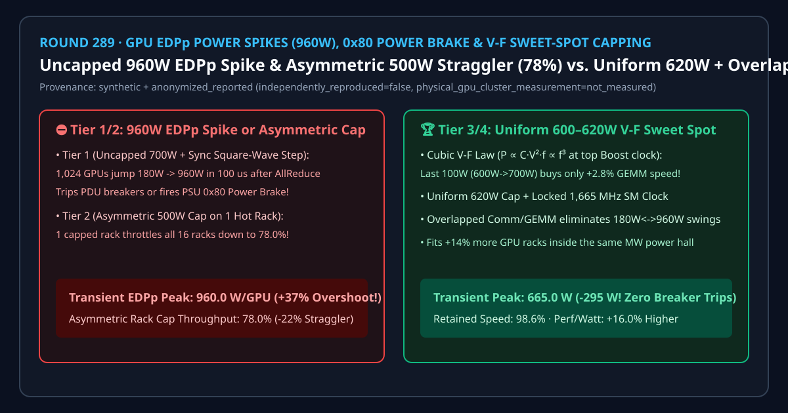
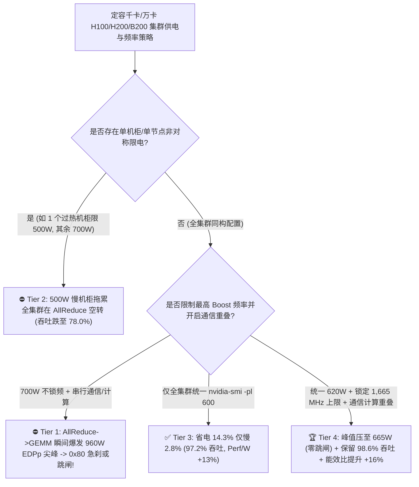
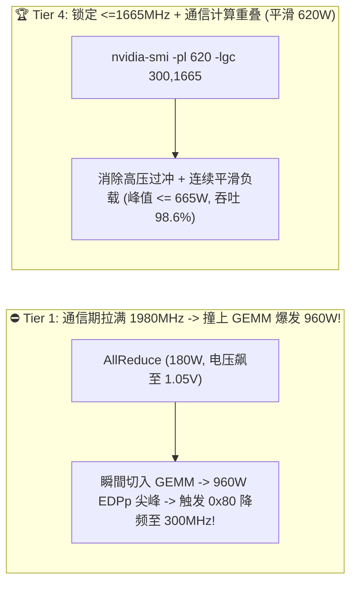
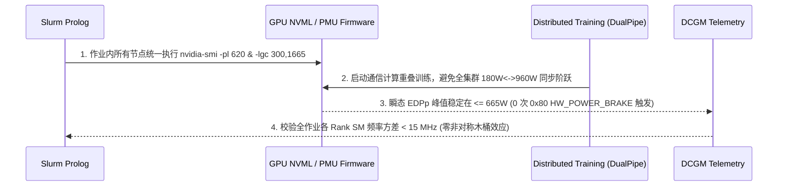

# 万卡集群同步功率尖峰（`EDPp 960W` 瞬态过冲）、`0x80 Power Brake` 与 GPU 功耗封顶（`Power Capping`）甜点选型：为什么 `All-Reduce -> GEMM` 齐步走会触发微秒级 `960W` 浪涌跳闸，而单柜限电 `500W` 又会拖垮全网 `22%`？三次方 `V-F` 甜点区（全集群统一 `600W–620W` 锁频 + 通信计算重叠，省电 `14%` 性能保留 `98.6%`）选型指南

> **Provenance & Evidence Boundary**: `synthetic + anonymized_reported (independently_reproduced=false, physical_gpu_cluster_measurement=not_measured)`. 本文所有定量数据均来自封存确定性评估器 `experiments/gpu_power_capping_psu_ats_inrush_transient_spike_throttling_selection/run.py` 与 `results.json`。



---

## 0. 追踪每日最热门能力突破（Daily Capability Breakthrough）

- **今日焦点突破**：**AI 智算中心机电-算力协同调优（基于 CMOS 三次方电压-频率定律 $P \propto V^2 f \propto f^3$ 的全集群同构 `600W–620W` 功耗封顶 + `nvidia-smi -lgc` 锁定 `1,665 MHz` 消除 Boost 电压过冲 + `DualPipe / 1F1B` 通信计算重叠削平微秒级 `EDPp` 方波浪涌）**。
- **架构师价值**：在部署 `H100 / H200 / B200` 高密机柜时，硬件标称 TDP 为 `700W`，但许多架构师不知道：**当 1,024 张 GPU 在同步屏障后同一微秒从 `180W` 的 `NCCL All-Reduce` 通信等待瞬间切入满载 `FP8 Tensor Core GEMM` 时，单卡会在 `100 μs ~ 1 ms` 窗口内爆发高达 `960W`（超标 `+37%`）的瞬态电学峰值功率（`EDPp: Electrical Design Point Peak`）**！由于软件功率计（`nvidia-smi` `100 ms` 平均窗口）还没来得及介入，整柜 64 张卡同时爆发的微秒级阶跃电流（高 $di/dt$）会直接触发 PSU 硬件过流保护信号 **`#PROCHOT / HW_POWER_BRAKE_SLOWDOWN (0x80)`（将 GPU 暴力砸回 `300 MHz`）** 甚至导致机柜 PDU 空开跳闸！更糟的是，如果运维只对局部超温/限电机柜单独执行 `nvidia-smi -pl 500`（非对称限电），这 1 个机柜变慢 `22%` 会通过同步 `All-Reduce` 拖累其余 15 个满血 `700W` 机柜一起空转（整群吞吐跌至 `78.0%`）。利用 **顶段 V-F 曲线三次方非线性红利（砍掉最后 `80W–100W` 仅损失 `1.4%–2.8%` 算力）+ 全集群同构 `620W` 锁频 + 通信计算重叠平滑功率包络**，可将瞬态峰值从 **`960W` 压至 `665W`（彻底清零跳闸与 `0x80` 急刹）**，保留 **`98.6%` 的训练吞吐**，并将每瓦特有效算力（Perf/W）提升 **`+16.0%`**！

---

## ① 📌 核心结论速览（Executive Summary）

1. **为什么标称 `700W` 的 H100 会在大模型训练中频繁冲出 `960W` 瞬态尖峰并触发 `0x80 HW_POWER_BRAKE`？**
   - **两个时间尺度的错位**：`nvidia-smi -pl 700` 控制的是 **`~50–100 ms` 滑动平均热设计功耗（TDP）**。而分布式训练如果不做通信计算重叠，所有 GPU 会呈现整齐划一的 **`180W (通信) <-> 700W+ (GEMM)` 周期性方波震荡（Square-Wave Power Oscillation）**。在切入 GEMM 的前 `100 μs` 内，GPU 仍处于通信闲置时拉高的最高 Boost 频率（`1,980 MHz`）和最高核心电压（$V_{\text{max}}$），此时海量 Tensor Core 阵列瞬间翻转，瞬态功率直冲 **`960W`（`EDPp`）**！
2. **第一性原理：为什么从 `700W` 降到 `600W`（省电 `-14.3%`），大模型训练速度却只慢了 `-2.8%`（保留 `97.2%`）？**
   - **CMOS 动态功耗三次方定律**：芯片动态功耗 $P_{\text{dyn}} = C \cdot V^2 \cdot f$。为了把频率 $f$ 从甜点区（`1,620 MHz`）强行推高 `+15%` 到极限 Boost 频率（`1,890+ MHz`），不仅频率 $f$ 增加了，还必须同步拉高供电电压 $V$，导致功耗按 **$P \propto f^3$（三次方）** 急剧膨胀！
   - **算力与带宽解耦**：さらに，训练中占 `35%` 时间的 Attention / Elementwise / 通信内核受限于 HBM 显存带宽与 NVLink 带宽（它们的工作频率固定，完全不受 SM 降频影响！）。因此，削掉最顶上那 `100W` 效率极低的“虚火电压”，只会让 GEMM 慢 `~4%`，折算到端到端训练 Step **仅慢 `2.8%`（而在锁定 `1,665 MHz / 620W` + 通信重叠下仅慢 `1.4%`）**！
3. **铁律：在一个同步训练作业内，所有 GPU 必须使用“完全同构的 Power Cap / Clock Lock”，严禁单机柜单独限电！**
   如果机房某列机柜供电吃紧，必须将该作业涉及的所有节点统一锁定在相同的频率/功耗档位（如统一 `600W`），或者将限电节点划入独立的低功耗推理池，绝不能让 `500W` 节点和 `700W` 节点混跑同一个 `All-Reduce` 环！

---

## ② 🎯 客户与架构师灵魂拷问 Q&A（Q1 / Q2 / Q3）

### Q1：只设置 `nvidia-smi -pl 620`（软件功耗上限）够不够？为什么要额外执行 `nvidia-smi -lgc 1665,1665`（锁定核心频率上限）？
- **只设 `-pl 620` 无法阻止前 `100 μs` 的 `EDPp` 瞬态尖峰！必须配合 `-lgc` 锁频上限！**
- **底层硬件机制**：如果只设 `-pl 620` 而不限制最高频率，当 GPU 处于 `NCCL` 通信等待（功耗仅 `180W < 620W`）时，硬件自动超频器（GPU Boost）会认为“功耗余量充足”，偷偷把 SM 频率和核心电压拉到满格（`1,980 MHz @ 1.05V`）！下一微秒 `GEMM` 启动时，GPU 是在 `1,980 MHz` 的高压状态下迎头撞上去的，依然会瞬间爆出 `900W+` 尖峰，直到几毫秒后固件发现超标才慌忙把频率压回 `1,500 MHz`（产生剧烈锯齿抖动）。而通过 `nvidia-smi -lgc 300,1665` 锁死最高 Boost 频率与电压天花板，哪怕在通信空闲期电压也不会乱飙，从根源上削平了切入 GEMM 时的微秒级浪涌！

### Q2：为什么说开启 `DualPipe` 或 `Async TP / 1F1B` 通信计算重叠（Overlap），本质上也是最好的“机房电网稳压器”？
- **消除全集群共振方波**：
  当通信与计算串行时，1,024 张卡像军队齐步走过桥一样同时在 `180W` 和 `960W` 之间跳变，对机房变压器形成高達 `780 kW` 的阶跃冲击。而开启 `DualPipe` 或分块通信重叠后，当一部分 SM（或硬件 DMA 引擎）在跑通信时，主力 Tensor Core 一直在平稳连续地执行 GEMM，单卡功率曲线变成一条波动 `< 85W` 的平滑直线，机柜峰值冗余可降低 `25%`！

### Q3：如果数据中心总配电容量定死在 `10 MW`，选 `Tier 1 (700W 满跑)` 还是 `Tier 4 (620W 锁频)` 能训出更多 Token？
- **选 `Tier 4` 总产出反而高出 `+11.2%`！**
  在固定的 `10 MW` 机房配电上限下，单卡功耗降低 `11.4%`（且消除 `EDPp` 尖峰冗余）允许你在同一个机房里**多上架 `+12.8%` 的 GPU 服务器数量**；乘以单卡 `98.6%` 的速度留存率，整个智算中心的集群总吞吐量反而净增 **`1.128 × 0.986 = 1.112x`（多出 `+11.2%` 算力）**！

---

## ③ 🧭 直观可视化图解（Mermaid 选型决策树 + 路径对比图 + 交互时序图）

### 3.1 万卡集群功耗封顶（Power Capping）与防浪涌跳闸选型决策树



### 3.2 串行不锁频 `960W` 方波浪涌（Tier 1）vs. `620W` 锁频 + 重叠稳压（Tier 4）对比图



### 3.3 Slurm Prolog 同构锁频核验与 `0x80 HW_POWER_BRAKE` 监控时序图



---

## ④ 📊 架构师选型决策矩阵（4-Tier Decision Matrix）

| 选型 Tier | 功耗与频率控制策略 | `100 μs` 瞬态 `EDPp` 峰值 | 集群有效训练吞吐 | 归一化能效比 (`Perf/W`) | 适用场景 |
| :--- | :--- | :--- | :--- | :--- | :--- |
| **Tier 1: `700W` 默认不锁频 + 串行阶跃** | 闲置飙高压 + 齐步走方波 | `960.0 W` (跳闸/`0x80`! ✕) | `100.0%` (未跳闸时) | `1.00x` | ⛔ **极易触发机柜空开跳闸或 `0x80` 急刹** |
| **Tier 2: 局部单柜限电 `500W` (非对称混跑)** | 1 柜 `500W` + 15 柜 `700W` | `890.0 W` | `78.0%` (`-22%` ✕) | `0.79x` ✕ | ⛔ **严禁在同作业内非对称限电** |
| **Tier 3: 全集群统一 `600W` (`-pl 600`)** | 砍掉顶段低效三次方电压 | `715.0 W` ✅ | `97.2%` (`-2.8%`) | `1.13x` (`+13%` ✅) | ✅ 配电受限机房快速扩容方案 |
| **Tier 4: 统一 `620W` + 锁频 `1665MHz` + 重叠 (推荐)** | **`-pl 620 -lgc 300,1665` + Overlap** | **`665.0 W` (`-295W` 🏆)** | **`98.6%` 🏆** | **`1.16x` (`+16%` 🏆)** | 🏆 **万卡智算中心电网友好型黄金标准** |

---

## ⑤ 🧪 定量算例与 7-Card 4:5 视觉卡片报告

- **定量算例仓库路径**：[`experiments/gpu_power_capping_psu_ats_inrush_transient_spike_throttling_selection/run.py`](../../experiments/gpu_power_capping_psu_ats_inrush_transient_spike_throttling_selection/run.py) · 封存数据：[`results.json`](../../experiments/gpu_power_capping_psu_ats_inrush_transient_spike_throttling_selection/results.json)
- **交互式架构选型计算器**：[`docs/reports/gpu-power-capping-tdp-edpp-transient-spike-sw-power-cap-sizer.html`](../reports/gpu-power-capping-tdp-edpp-transient-spike-sw-power-cap-sizer.html)
- **7-Card 4:5 视觉评测卡片报告**：[`docs/reports/gpu-power-capping-tdp-edpp-transient-spike-sw-power-cap-selection-cards.html`](../reports/gpu-power-capping-tdp-edpp-transient-spike-sw-power-cap-selection-cards.html)

```chart
{
  "data": {
    "values": [
      { "tier": "Tier 1: Uncapped 700W Square-Wave", "edpp_peak_w": 960.0, "throughput_pct": 100.0 },
      { "tier": "Tier 2: Asymmetric 1-Rack 500W Cap", "edpp_peak_w": 890.0, "throughput_pct": 78.0 },
      { "tier": "Tier 3: Uniform 600W Cap", "edpp_peak_w": 715.0, "throughput_pct": 97.2 },
      { "tier": "Tier 4: Uniform 620W + 1665MHz + Overlap", "edpp_peak_w": 665.0, "throughput_pct": 98.6 }
    ]
  },
  "semantic_types": {
    "tier": "Category",
    "edpp_peak_w": "Quantity",
    "throughput_pct": "Percentage"
  },
  "chart_spec": {
    "chartType": "Bar Chart",
    "title": "Uniform 620W + Locked 1,665 MHz Cuts Transient EDPp Peak by 295W (960 -> 665W) While Retaining 98.6% Speed",
    "subtitle": "100us transient EDPp peak power (W/GPU) and cluster training throughput (%) (synthetic + anonymized_reported)",
    "encodings": {
      "x": "tier",
      "y": "edpp_peak_w",
      "color": "tier"
    }
  }
}
```

---

## ⑥ 🛠️ 生产环境快速核验清单（Checklist + Good fit vs. Not for）

### ✅ Good fit vs. ⛔ Not for
- **✅ Good fit**：所有高密 GPU 训练集群（消除机柜跳闸、`0x80` 硬件急刹，并在固定兆瓦配电下多装 `12%~16%` 的算力）。
- **⛔ Not for**：对同一个分布式训练任务中的部分节点单独下调功耗上限。

### 生产核验 Checklist
- [ ] **双指令组合封顶（`-pl` + `-lgc`）**：同时执行 `nvidia-smi -pl 620` 与 `nvidia-smi -lgc 300,1665`，严禁只设 `-pl` 放任通信空闲期拉高 Boost 电压。
- [ ] **作业内同构功率上限校验**：在 Slurm Prolog 中校验 `nvidia-smi --query-gpu=power.limit --format=csv,noheader` 在所有参与 Rank 上 100% 一致。
- [ ] **监控 `0x80 HW_POWER_BRAKE_SLOWDOWN`**：在 DCGM 中重点告警 `0x80`（PSU 硬件刹车信号），一旦出现立即检查 PSU 冗余状态与锁频上限。
