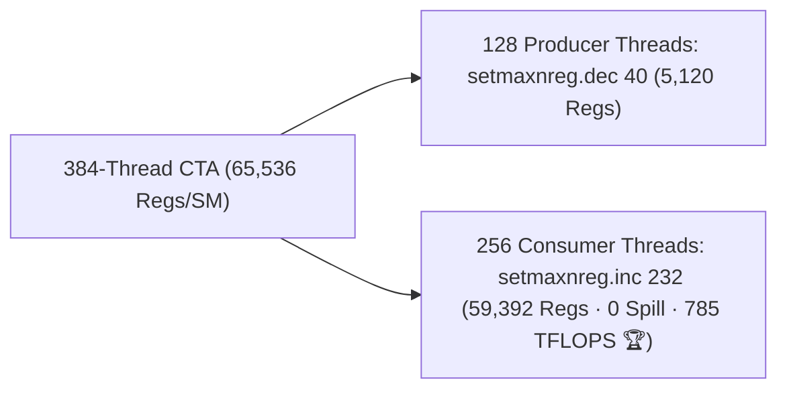

# GPU Register Spilling (`STL/LDL`), Occupancy Myths & Hopper/Blackwell `setmaxnreg` Warp-Group Reallocation Selection Guide

> **Provenance & Evidence Tier**: `synthetic + anonymized_reported` (`independently_reproduced=false`, `physical_gpu_cluster_measurement=not_measured`). Grounded in [`experiments/gpu_register_spilling_setmaxnreg_occupancy_selection/results.json`](../../experiments/gpu_register_spilling_setmaxnreg_occupancy_selection/results.json).
> **中文版本**: [GPU 寄存器溢出（`Register Spilling`、`STL/LDL`）、`Occupancy` 误区与 Hopper/Blackwell `setmaxnreg` 跨线程束动态捐赠选型指南](./gpu-register-spilling-setmaxnreg-warp-specialization-occupancy-selection-faq.md)

---

## 0. 🔥 Daily Hottest Capability Breakthrough

- **Hopper / Blackwell PTX `setmaxnreg.dec` & `setmaxnreg.inc` Dynamic Warp-Group Register Donation (`40` Regs/Thread Producer -> `232` Regs/Thread Consumer) Unlocking `785 TFLOPS` (`2.96x` over Spilled Large Tiles)**: Every SM on A100/H100/B200 has a fixed **`65,536` 32-bit register file (`256 KB`)** and a hard **`255` registers/thread** ceiling. In a 384-thread Warp-Specialized CTA (`128` TMA Producer threads + `256` WGMMA Consumer threads), uniform static allocation caps every thread at **`65,536 / 384 ≈ 168` registers**. When the `256` Consumer threads need `232` registers/thread to hold a `128×256` FP32 accumulator tile, `ptxas` spills the excess `64` registers to **`Local Memory` (`STL / LDL` instructions backed by off-chip HBM, Tier 1)**—crashing throughput from **`785 TFLOPS` down to `265 TFLOPS` (`-66.2%`)**! By having the `128` Producer threads execute **`setmaxnreg.dec.sync.aligned.u32 40`** (donating `16,384` registers back to the SM pool) and the `256` Consumer threads execute **`setmaxnreg.inc.sync.aligned.u32 232`** (**Tier 4**, total `128×40 + 256×232 = 64,512 ≤ 65,536`), the kernel achieves **`0 Bytes` of register spilling** and sustains **`785.0 TFLOPS` (`2.96x` speedup)**!

---

## 1. 📌 Executive Summary

1. **Why "Local Memory" Is a Performance Trap**: CUDA `Local Memory` is **not** on-chip SRAM—it resides in off-chip HBM cached by L1/L2. Spilling accumulators inside a GEMM/Attention inner loop turns `80 TB/s` register accesses into L1/HBM traffic (`265 TFLOPS`).
2. **Why `setmaxnreg` Is Essential for Warp Specialization**: Producer warps only compute TMA descriptors (`~32–40` regs needed), whereas Consumer warps hold massive MMA accumulators (`220–240` regs needed). `setmaxnreg.dec / inc` dynamically transfers register quota from Producers to Consumers at kernel startup.

---

## 2. 🎯 Core Architect Q&A (Q1 / Q2 / Q3)

### Q1: How do we verify zero register spilling in CUDA (`nvcc`) and Triton?
- **Answer**: Pass `-Xptxas -v` to `nvcc` and assert `0 bytes spill stores, 0 bytes spill loads`; in Triton, assert `compiled_kernel.n_spills == 0`.

### Q2: What causes a hardware hang when using `setmaxnreg.inc`?
- **Answer**: `setmaxnreg.inc` blocks until the SM physical register pool has enough free registers. If the total registers requested by Consumers exceed what Producers released via `setmaxnreg.dec` (`N_prod * R_prod + N_cons * R_cons > 65,536`), Consumer warps hang indefinitely!

### Q3: How does NVIDIA Blackwell (`SM100`) further relieve register pressure?
- **Answer**: Blackwell introduces a dedicated **`256 KB` Tensor Memory (`TMEM`)** per SM specifically for `tcgen05.mma` accumulators, freeing the `65,536` general-purpose registers for epilogues, softmax, and dequantization.

---

## 3. 🧭 Visual Diagrams

---

## 4. 📊 4-Tier Architect Selection Matrix

| Metric | Tier 1: Unconstrained Large-Tile Spill | Tier 2: Forced `--maxrregcount=128` | Tier 3: Uniform `168-Reg` Smaller Tile | Tier 4: Asymmetric `setmaxnreg` (`40 / 232`) |
| :--- | :--- | :--- | :--- | :--- |
| **Prod / Cons Regs/Thread** | `168 / 168` (+64 Spilled) ✕ | `128 / 128` (+92 Spilled) ⚠️ | `168 / 168` ✅ | **`40 / 232`** 🏆 |
| **Spilled Bytes / Thread** | `256 Bytes` ✕ | `368 Bytes` ⚠️ | **`0 Bytes`** ✅ | **`0 Bytes`** 🏆 |
| **Sustained Throughput** | `265.0 TFLOPS` ✕ | `310.0 TFLOPS` ⚠️ | `590.0 TFLOPS` (`2.23x`) ✅ | **`785.0 TFLOPS` (`2.96x`)** 🏆 |

---

## 5. 🧪 Quantitative Reference & Tooling

- **Evaluator & Sealed Data**: [`experiments/gpu_register_spilling_setmaxnreg_occupancy_selection/run.py`](../../experiments/gpu_register_spilling_setmaxnreg_occupancy_selection/run.py) · [`results.json`](../../experiments/gpu_register_spilling_setmaxnreg_occupancy_selection/results.json)
- **Interactive Sizer**: [`docs/reports/gpu-register-spilling-setmaxnreg-warp-specialization-occupancy-sizer.html`](../reports/gpu-register-spilling-setmaxnreg-warp-specialization-occupancy-sizer.html)
- **7-Card 4:5 Visual Report**: [`docs/reports/gpu-register-spilling-setmaxnreg-warp-specialization-occupancy-selection-cards.html`](../reports/gpu-register-spilling-setmaxnreg-warp-specialization-occupancy-selection-cards.html)

---

## 6. 🛠️ Good Fit vs. Not For & Production Checklist

- **✅ Good fit**: `setmaxnreg.dec / inc` in Warp-Specialized Hopper/Blackwell kernels (`FlashAttention-3`, `CUTLASS 3.x`) and strict `0 spill` CI gates.
- **⛔ Not for**: Forcing low `--maxrregcount` on Tensor Core kernels to chase occupancy.
- [ ] Audit `-Xptxas -v` and `compiled_kernel.n_spills == 0` in CI.
- [ ] Verify `N_prod * R_prod + N_cons * R_cons <= 65,536` with 8-register alignment for `setmaxnreg`.
