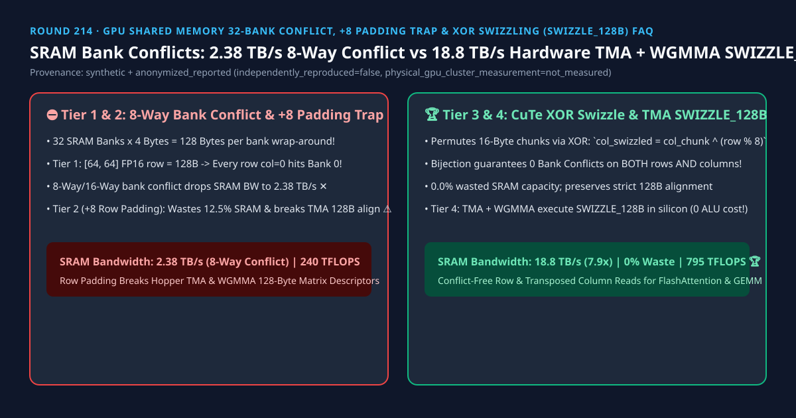
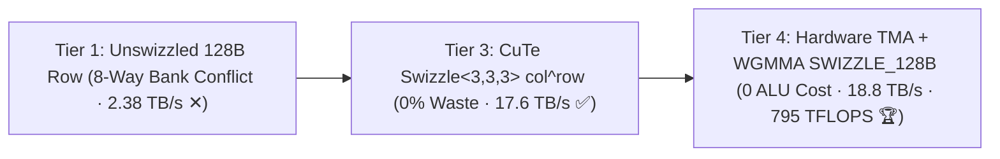

# GPU Shared Memory 32-Bank Conflict Elimination, `+8` Padding Trap & Hardware XOR Swizzling (`SWIZZLE_128B`) Selection Guide

> **Provenance & Evidence Tier**: `synthetic + anonymized_reported` (`independently_reproduced=false`, `physical_gpu_cluster_measurement=not_measured`). Grounded in [`experiments/gpu_shared_memory_bank_conflict_xor_swizzle_selection/results.json`](../../experiments/gpu_shared_memory_bank_conflict_xor_swizzle_selection/results.json).
> **中文版本**: [GPU 共享内存（`SRAM`）32-Bank 冲突消除、`+8` 行填充陷阱与硬件异或重排（`XOR Swizzling / SWIZZLE_128B`）选型指南](./gpu-shared-memory-bank-conflict-xor-swizzling-tma-128b-selection-faq.md)

---

## 0. 🔥 Daily Hottest Capability Breakthrough

- **CuTe `XOR Address Swizzling` (`col_chunk ^ row`) & Hopper/Blackwell Hardware `CU_TENSOR_MAP_SWIZZLE_128B` Eliminating `8-Way/16-Way` SRAM Bank Conflicts With `0%` Wasted Memory (`2.38 TB/s -> 18.8 TB/s`, `7.9x` Speedup)**: GPU Shared Memory (`SRAM`) is divided into **`32` banks × `4 Bytes` = `128 Bytes` per bank cycle**. In an unswizzled `[64, 64]` `FP16` tile (**Tier 1**), each row is `128 Bytes` wide—causing every element in a column (`row = 0..31, col = 0`) to map to **`Bank 0`**! When `ldmatrix.trans` or `WGMMA` reads a column/transposed tile, an **`8-Way/16-Way` Bank Conflict** serializes the instruction and slashes SRAM bandwidth from **`18.8 TB/s` down to `2.38 TB/s` (`240 TFLOPS`)**. Worse, the legacy textbook trick of **`+8 FP16` row padding (`smem[64][64+8]`, Tier 2)** wastes **`12.5%` of SRAM** and **breaks the mandatory `128-Byte` stride alignment of Hopper `TMA` and `WGMMA` descriptors**. By permuting 16-Byte column chunks via **`phys_col = col ^ (row % 8)` (`Swizzle<3,3,3>`, Tier 3)** and offloading that XOR permutation to **Hopper/Blackwell `TMA + WGMMA SWIZZLE_128B` silicon (Tier 4)**, kernels achieve **zero bank conflicts on both rows and columns, `0.0%` wasted SRAM, `18.8 TB/s` bandwidth, and `795.0 TFLOPS`**!

---

## 1. 📌 Executive Summary

1. **Why `+8` Row Padding (`Tier 2`) Is Obsolete on Hopper/Blackwell**: Padding rows by `+16 Bytes` wastes `12.5%` of SRAM capacity (dropping pipeline stages from 4 to 3) and violates the `128-Byte` row alignment required by hardware `TMA` and `WGMMA` matrix descriptors.
2. **Why `XOR Swizzling` (`col ^ row`) Works**: Because XOR (`^`) is a bijection on `0..7`, mapping `(row, col_chunk)` to `(row, col_chunk ^ (row % 8))` guarantees that any 8-chunk row access hits 8 distinct bank groups AND any 8-row column access also hits 8 distinct bank groups—with **zero padding bytes**.

---

## 2. 🎯 Core Architect Q&A (Q1 / Q2 / Q3)

### Q1: If `TMA` scrambles shared memory addresses using `SWIZZLE_128B`, how does `WGMMA` know where to find the right matrix elements?
- **Answer**: You specify the exact same `SWIZZLE_128B` layout flag in the 64-bit **`WGMMA` Shared Memory Matrix Descriptor**. Both the TMA writer and WGMMA reader apply the identical XOR function in dedicated silicon at **zero thread ALU cost**.

### Q2: When should we use `SWIZZLE_128B` vs. `SWIZZLE_64B` vs. `SWIZZLE_32B`?
- **Answer**: Match the swizzle width to the inner tile dimension in bytes: **`SWIZZLE_128B`** when the tile row is `≥ 128 Bytes` (`K ≥ 64` in FP16 or `K ≥ 128` in FP8); **`SWIZZLE_64B`** for `64-Byte` rows; **`SWIZZLE_32B`** for `32-Byte` rows.

### Q3: Which Nsight Compute (`ncu`) metric confirms zero Shared Memory bank conflicts?
- **Answer**: Verify `l1tex__data_bank_conflicts_pipe_lsu_mem_shared_op_ld.sum == 0` and `..._op_st.sum == 0`.

---

## 3. 🧭 Visual Diagrams

---

## 4. 📊 4-Tier Architect Selection Matrix

| Metric | Tier 1: Unswizzled `[64, 64]` `FP16` | Tier 2: Legacy `+8 FP16` Padding | Tier 3: Software CuTe `Swizzle<3,3,3>` | Tier 4: Hardware `TMA + WGMMA SWIZZLE_128B` |
| :--- | :--- | :--- | :--- | :--- |
| **Bank Conflict Way** | **`8-Way` Conflict** ✕ | `1-Way` (Conflict-Free) | **`1-Way` (Conflict-Free)** ✅ | **`1-Way` (Conflict-Free)** 🏆 |
| **Wasted SRAM Capacity** | `0.0%` | **`12.5%` (Breaks TMA)** ⚠️ | **`0.0%`** ✅ | **`0.0%`** 🏆 |
| **Effective SRAM Bandwidth** | `2.38 TB/s` ✕ | `14.20 TB/s` | `17.60 TB/s` ✅ | **`18.80 TB/s` (`7.90x`)** 🏆 |
| **Sustained Throughput** | `240.0 TFLOPS` ✕ | `540.0 TFLOPS` | `730.0 TFLOPS` ✅ | **`795.0 TFLOPS`** 🏆 |

---

## 5. 🧪 Quantitative Reference & Tooling

- **Evaluator & Sealed Data**: [`experiments/gpu_shared_memory_bank_conflict_xor_swizzle_selection/run.py`](../../experiments/gpu_shared_memory_bank_conflict_xor_swizzle_selection/run.py) · [`results.json`](../../experiments/gpu_shared_memory_bank_conflict_xor_swizzle_selection/results.json)
- **Interactive Sizer**: [`docs/reports/gpu-shared-memory-bank-conflict-xor-swizzling-tma-128b-sizer.html`](../reports/gpu-shared-memory-bank-conflict-xor-swizzling-tma-128b-sizer.html)
- **7-Card 4:5 Visual Report**: [`docs/reports/gpu-shared-memory-bank-conflict-xor-swizzling-tma-128b-selection-cards.html`](../reports/gpu-shared-memory-bank-conflict-xor-swizzling-tma-128b-selection-cards.html)

---

## 6. 🛠️ Good Fit vs. Not For & Production Checklist

- **✅ Good fit**: `CU_TENSOR_MAP_SWIZZLE_128B` for Hopper/Blackwell TMA+WGMMA tiles and CuTe `Swizzle<3,3,3>` for Ampere `cp.async + ldmatrix`.
- **⛔ Not for**: Legacy `+8` row padding on Hopper/Blackwell or unswizzled `128-Byte` strides.
- [ ] Match TMA tensor map swizzle mode (`128B / 64B / 32B`) with the WGMMA shared memory descriptor.
- [ ] Verify `l1tex__data_bank_conflicts_pipe_lsu_mem_shared_op_ld.sum == 0` in `ncu`.
