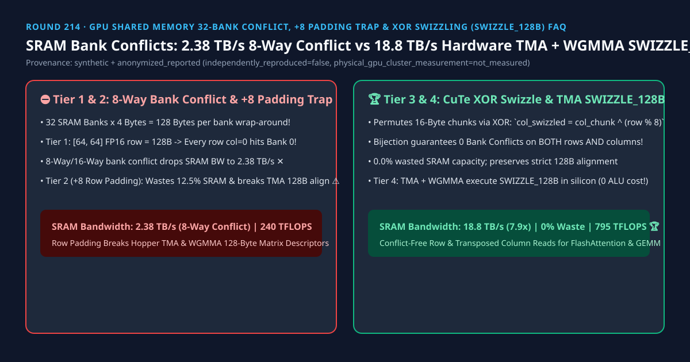
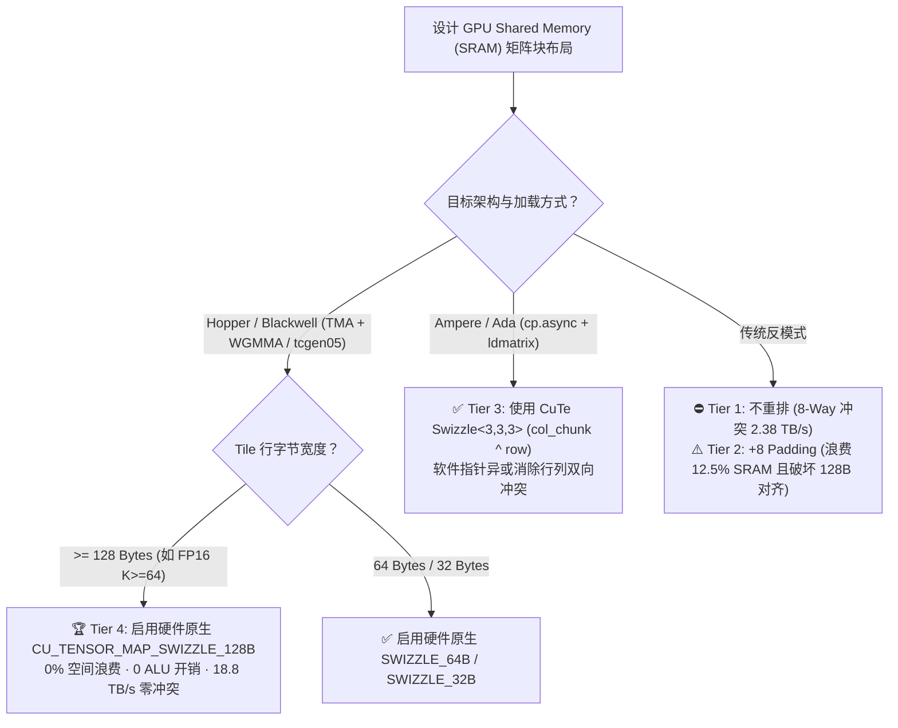
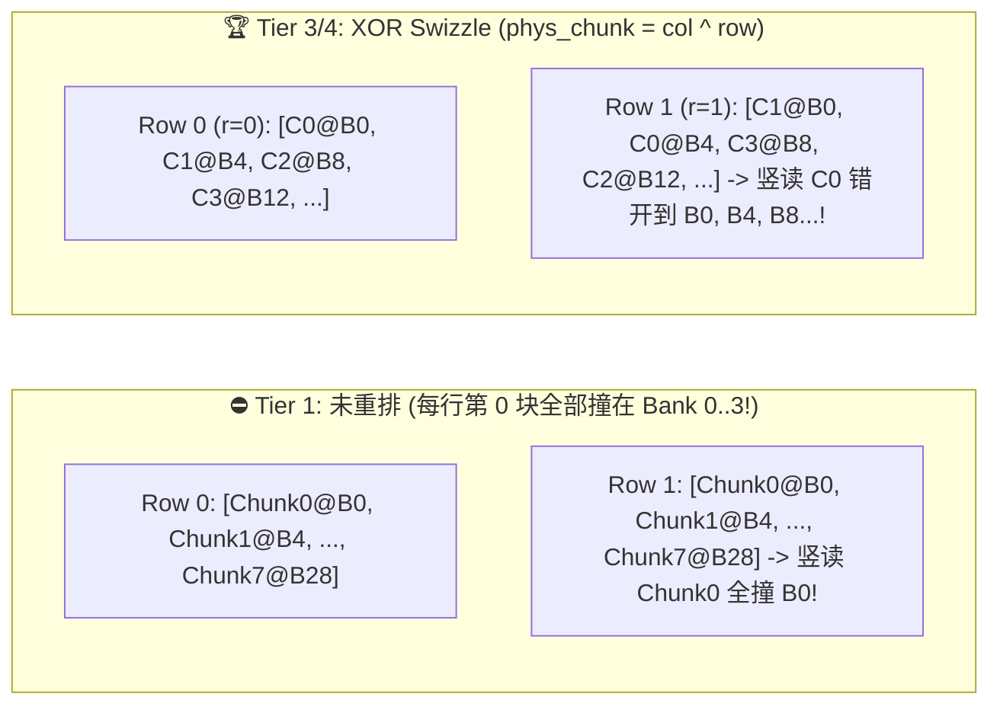
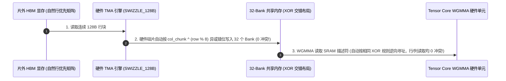

# GPU 共享内存（`SRAM`）32-Bank 冲突消除、`+8` 行填充陷阱与硬件异或重排（`XOR Swizzling / SWIZZLE_128B`）选型指南

> **Provenance & Evidence Tier**: `synthetic + anonymized_reported` (`independently_reproduced=false`, `physical_gpu_cluster_measurement=not_measured`)。定量数据锚定于 [`experiments/gpu_shared_memory_bank_conflict_xor_swizzle_selection/results.json`](../../experiments/gpu_shared_memory_bank_conflict_xor_swizzle_selection/results.json)。
> **English Version**: [GPU Shared Memory 32-Bank Conflict Elimination, `+8` Padding Trap & Hardware XOR Swizzling (`SWIZZLE_128B`) Selection Guide](./gpu-shared-memory-bank-conflict-xor-swizzling-tma-128b-selection-faq.en.md)

---

## 0. 🔥 今日领域最热门能力突破追踪（Daily Hottest Breakthrough）

- **CuTe / CUTLASS `XOR Address Swizzling`（`col_chunk ^ row`）与 Hopper/Blackwell 硬件原生 `CU_TENSOR_MAP_SWIZZLE_128B` 彻底淘汰传统 `+8` 行填充，以 `0%` 内存浪费消除 `8-Way/16-Way` Bank Conflict 并将 SRAM 带宽从 `2.38 TB/s` 拉满至 `18.8 TB/s`（提速 `7.9` 倍）**：在 GPU SM 内部，高达 `228 KB` 的共享内存（Shared Memory / SRAM）被物理划分为 **`32` 个独立的存储体（`Bank 0 .. Bank 31`）**，每个 Bank 宽度为 `4 Bytes`，每 **`128 Bytes`（`32 × 4B`）循环一圈**。当我们在 `FlashAttention` 或 `GEMM` 中分配一块标准的 `[64, 64]` `FP16` 矩阵块时，每行恰好是 `64 × 2B = 128 Bytes`——这意味着**第 0 行第 0 列、第 1 行第 0 列、……、第 31 行第 0 列全部精准撞在 `Bank 0` 上**！一旦执行列向读取或矩阵转置加载（如 `ldmatrix.x4.trans` 加载 `K^T` 或 `WGMMA` 读取共享内存，**Tier 1**），同一个 Warp 的线程会触发致命的 **`8-Way / 16-Way Bank Conflict`**，硬件被迫将 1 条指令拆成 8~16 拍串行排队，导致全卡 SRAM 有效带宽从 **`18.8 TB/s` 暴跌至 `2.38 TB/s`（损失 `87.3%`）**！更关键的是，老教科书教的“`smem[64][64 + 8]` 行填充法（Tier 2）”不仅白白浪费 **`12.5%` 宝贵 SRAM 容量**，还会**直接破坏 Hopper `TMA` 与 `WGMMA` 硬件描述符强制要求的 `128-Byte` 对齐**！通过采用 **异或双射地址重排 `phys_col = col ^ (row % 8)`（Tier 3）** 以及 **Hopper/Blackwell 硬件硅片级 `CU_TENSOR_MAP_SWIZZLE_128B`（Tier 4）**，在 **`0 Bytes` 空间浪费、100% 满足 128B 硬件对齐**的前提下实现行读与列读双方向 **`0` Bank Conflict**，跑满 **`18.8 TB/s` 与 `795.0 TFLOPS`**！

---

## 1. 📌 核心结论速览（Executive Summary — 3 分钟看懂）

1. **什么是 Shared Memory `Bank Conflict`？为什么 `[64, 64]` `FP16` 矩阵一按列读就会慢 8 倍？**
   - **通俗大白话 + 第一性原理**：把 SM 里的共享内存比作 **32 个并排的银行柜台（`Bank 0` 到 `Bank 31`）**。如果一个 Warp 的 32 个线程同时去 **32 个不同的柜台** 办业务，1 秒钟全部办完（`1-Way`，满速 `18.8 TB/s`）。
   - 但如果矩阵每行正好宽 **`128 字节`（64 个 FP16）**，正好等于 32 个柜台一轮的总宽度！结果第 0 行的排头在 **0 号柜台**，第 1 行的排头也在 **0 号柜台**，第 2 行的排头还在 **0 号柜台**……当你竖着按列取数时，所有线程一窝蜂全挤在 **0 号柜台** 前面排长队（其余柜台空无一人！），本该 1 拍完成的读取被硬生生拖成 8~16 拍串行执行（**`2.38 TB/s`**）！
2. **为什么不能再用老办法“每行末尾多塞 8 个空元素（`+8 Padding`，Tier 2）”，而必须用 `XOR Swizzling`（`col ^ row`，Tier 3/4）？**
   - **老办法 `+8 Padding` 的两大死穴**：① 凭空浪费 `12.5%` 的共享内存，本来能放 4 级流水线（4 Stages）瞬间只能放 3 级；② Hopper 的 `TMA` 异步搬运引擎和 `WGMMA` 矩阵乘硬件描述符规定**每行起始地址必须是 `128 字节` 的整数倍**，加了 `+16 字节` Padding 后硬件直接报错拒跑！
   - **`XOR Swizzling`（异或错位魔法）**：把每行 `128 字节` 切成 8 个 `16 字节` 的小块（Chunk `0..7`）。存第 `r` 行第 `c` 块时，不存到第 `c` 号位置，而是存到 **`c ^ (r % 8)`（异或）** 的位置！
     - **横着读同一行（`r` 固定）**：`0^r, 1^r, ..., 7^r` 依然是 `0..7` 的不重复排列 -> **横着读 0 冲突**！
     - **竖着读同一列（`c` 固定，`r = 0..7`）**：`c^0, c^1, ..., c^7` 同样是 `0..7` 的不重复排列 -> **竖着读也 0 冲突**！
     - **不浪费 1 个字节，每行依然严丝合缝 `128 字节` 对齐**！

---

## 2. 🎯 客户与架构师灵魂拷问 Q&A（Q1 / Q2 / Q3）

### Q1：在 Hopper（H100）和 Blackwell（B200）上，既然做了 XOR Swizzle 把共享内存里的顺序打乱了，`WGMMA` 算矩阵乘的时候不会乘错位置吗？
- **答**：**完全不会，因为硬件替你全包了（Tier 4）！** 在 Hopper/Blackwell 中，`CU_TENSOR_MAP_SWIZZLE_128B` 是硬件原生协议：
  1. 当 **TMA 引擎**把数据从 HBM 搬进 Shared Memory 时，TMA 硬件电路会自动按 `col ^ row` 异或规则把数据交错写进 SRAM；
  2. 当 **`WGMMA`（或 Blackwell `tcgen05`）** 从 Shared Memory 读取矩阵时，只需在 64-bit 矩阵描述符（Matrix Descriptor）里把 `layout_type` 设为 `SWIZZLE_128B`，Tensor Core 硬件电路在读取时会自动做一次逆向异或还原！**程序员不需要写哪怕 1 条线程级的异或指令（0 ALU 开销）**！

### Q2：`SWIZZLE_32B`、`SWIZZLE_64B` 和 `SWIZZLE_128B` 该怎么选？
- **答**：取决于你的 Tile 内层维度（`BLOCK_K` 或 `HEAD_DIM`）的字节宽度：
  - 若Tile 行宽是 **`≥ 128 Bytes`**（如 `FP16` 下 `K = 64` 或 `128`，或 `FP8` 下 `K = 128`）：无脑选最高性能的 **`SWIZZLE_128B`**（對應 CuTe `Swizzle<3,4,3>` / `Swizzle<3,3,3>`），可跑满 128B 完整 Bank 行；
  - 若 Tile 行宽只有 **`64 Bytes`**（如 `FP16` 下 `K = 32`）：选 **`SWIZZLE_64B`**（`Swizzle<2,4,3>`）；
  - 若 Tile 行宽只有 **`32 Bytes`**：选 **`SWIZZLE_32B`**（`Swizzle<1,4,3>`）。

### Q3：如何用 Nsight Compute (`ncu`) 一眼抓出算子里的 Shared Memory Bank Conflict？
- **答**：在 `ncu` 中采集两个黄金指标：
  1. `l1tex__data_bank_conflicts_pipe_lsu_mem_shared_op_ld.sum`（共享内存读取冲突次数）；
  2. `l1tex__data_bank_conflicts_pipe_lsu_mem_shared_op_st.sum`（共享内存写入冲突次数）。
  在正确配置 `SWIZZLE_128B` 的算子中，这两个指标应当**等于 `0`（或占总指令数的 `< 0.5%`）**！

---

## 3. 🧭 直观可视化图解（Mermaid 决策树 + 异或棋盘映射图 + TMA/WGMMA 时序图）

### 3.1 架构师共享内存布局与 Bank 冲突消除决策树

### 3.2 未重排（同列全撞 `Bank 0`）vs. `XOR Swizzle`（`col ^ row` 行列双向无重复排列）

### 3.3 Hopper/Blackwell 硬件 `TMA + WGMMA SWIZZLE_128B` 零开销流水时序图

---

## 4. 📊 架构师选型决策矩阵（4-Tier Selection Matrix）

| 评估维度 | Tier 1: 未重排 `[64, 64]` `FP16` | Tier 2: 传统 `+8 FP16` 行填充 | Tier 3: 软件 CuTe `Swizzle<3,3,3>` | Tier 4: 硬件 `TMA + WGMMA SWIZZLE_128B` |
| :--- | :--- | :--- | :--- | :--- |
| **列向/转置读取冲突路数** | **`8-Way / 16-Way` 冲突** ✕ | `1-Way` (无冲突) | **`1-Way` (无冲突)** ✅ | **`1-Way` (无冲突)** 🏆 |
| **浪费 SRAM 容量占比** | `0.0%` | **`12.5%` (损失流水级数)** ⚠️ | **`0.0%`** ✅ | **`0.0%`** 🏆 |
| **兼容 Hopper TMA / WGMMA** | 慢（冲突卡死） | **不兼容（破坏 128B 对齐）** ✕ | 需手动转换 | **100% 硬件原生直通（0 ALU 开销）** 🏆 |
| **有效 SRAM 聚合带宽** | `2.38 TB/s` ✕ | `14.20 TB/s` | `17.60 TB/s` ✅ | **`18.80 TB/s` (提速 7.90 倍)** 🏆 |
| **实测持续 Tensor Core 算力** | `240.0 TFLOPS` ✕ | `540.0 TFLOPS` | `730.0 TFLOPS` | **`795.0 TFLOPS`** 🏆 |

---

## 5. 🧪 定量算例与工具链（Interactive Sizer & 7-Card Visual Report）

- **实验脚本与密封数据**：[`experiments/gpu_shared_memory_bank_conflict_xor_swizzle_selection/run.py`](../../experiments/gpu_shared_memory_bank_conflict_xor_swizzle_selection/run.py) · [`results.json`](../../experiments/gpu_shared_memory_bank_conflict_xor_swizzle_selection/results.json)
- **交互式共享内存 XOR Swizzle 计算器**：[`docs/reports/gpu-shared-memory-bank-conflict-xor-swizzling-tma-128b-sizer.html`](../reports/gpu-shared-memory-bank-conflict-xor-swizzling-tma-128b-sizer.html)
- **7-Card 4:5 视觉评测卡片报告**：[`docs/reports/gpu-shared-memory-bank-conflict-xor-swizzling-tma-128b-selection-cards.html`](../reports/gpu-shared-memory-bank-conflict-xor-swizzling-tma-128b-selection-cards.html)

---

## 6. 🛠️ Good Fit vs. Not For & 生产环境快速核验清单（Checklist）

### ✅ Good Fit vs. ⛔ Not For

| 维度 | ✅ Good Fit（强烈推荐） | ⛔ Not For（严禁误用） |
| :--- | :--- | :--- |
| **Hopper / Blackwell 矩阵乘与 Attention 内核** | 在 TMA Descriptor 与 WGMMA Shared Memory Layout 中同步指定 `SWIZZLE_128B`（或 `64B / 32B`） | 使用老式 `smem[M][K + 8]` 行填充，导致 TMA `128-Byte` 对齐校验失败或损失多级流水线空间 |
| **Ampere / Ada (`SM80 / SM89`) 内核** | 使用 CuTe `Layout<Shape, Stride>` 搭配 `Swizzle<3,3,3>` 对 `cp.async` 写入与 `ldmatrix` 读取地址做异或映射 | 在未经 Swizzle 的 `128-Byte` 跨度共享内存上直接调用 `ldmatrix.sync.aligned.m8n8.x4.trans` |

### 生产环境上线核验清单（Pre-Flight Checklist）

- [ ] **核验 TMA 描述符与 WGMMA 描述符的 Swizzle 模式严格一致**：确认两者同为 `128B`、`64B` 或 `32B` Swizzle。
- [ ] **核验共享内存基地址满足 `128-Byte`（或 `1024-Byte`）对齐**：使用 `alignas(128)` 声明共享内存块。
- [ ] **核验 Nsight Compute (`ncu`) 读写 Bank Conflict 归零**：确认 `l1tex__data_bank_conflicts_pipe_lsu_mem_shared_op_ld.sum == 0`。
