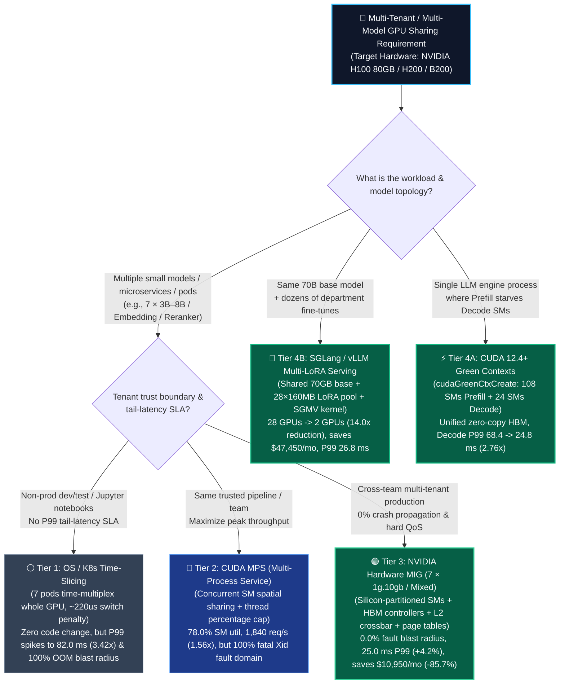
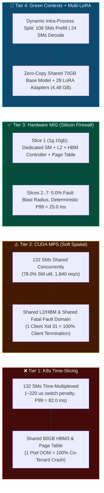
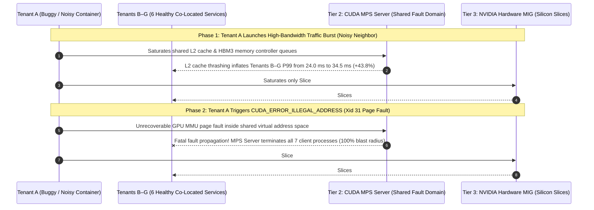

# Multi-Tenant GPU Fractional Sharing & Hardware Isolation Selection FAQ: OS Time-Slicing vs. CUDA MPS vs. NVIDIA Hardware MIG vs. CUDA Green Contexts / Multi-LoRA Architect Guide

> **Document Purpose**: Actionable first-principles reference guide for AI Solution Architects — designed for rapid absorption and whiteboard presentation to enterprise CTOs and AI Platform leads.  
> **Benchmark Standard**: Modeled strictly on [`docs/components/ib-vs-ethernet-roce-selection-faq.en.md`](ib-vs-ethernet-roce-selection-faq.en.md)  
> **中文版本**: [`docs/components/gpu-sharing-multi-tenant-isolation-selection-faq.md`](gpu-sharing-multi-tenant-isolation-selection-faq.md)  
> **Companion Evaluator & 7-Card Deck**: [`experiments/gpu_sharing_isolation_selection/run.py`](../../experiments/gpu_sharing_isolation_selection/run.py) · [`results.json`](../../experiments/gpu_sharing_isolation_selection/results.json) · [`7-Card HTML`](../reports/gpu-sharing-isolation-selection-cards.html) · [`Interactive Sizer`](../reports/llm-inference-engine-pd-sizer.en.html#gpu-sharing-sizer)

---

## ① 📌 Executive Summary

On `NVIDIA H100 SXM 80GB` (`132 SMs`, `3,350 GB/s` HBM3, `$2.50/GPU-hr`, `730 hr/month = $1,825.00/GPU-month`) or H200/B200 clusters, enterprise microservices such as Embedding (`bge-large`), Reranker, OCR, Guardrail classifiers, or `3B–8B` task models typically require only `~9.5 GB` VRAM and `15.0%` average SM compute utilization. Allocating one dedicated physical GPU per service (`7 GPUs = $12,775.00/month`) strands **85%** of GPU compute and memory capacity. When selecting a GPU fractional sharing and multi-tenant isolation architecture, follow these **3 core rules** (all numbers bound 1-to-1 to [`experiments/gpu_sharing_isolation_selection/results.json`](../../experiments/gpu_sharing_isolation_selection/results.json), `synthetic` queuing/partition model + `anonymized_reported` official NVIDIA specs, `independently_reproduced=false`):

1. **Match the 4 Sharing Tiers to Fault Domain Boundaries, Tail-Latency SLAs, and Model Topology**:
   - **Dev/Test Pods & Over-Subscribed Jupyter Notebooks** 👉 Choose **Tier 1 (`OS / Kubernetes Device-Plugin Time-Slicing`)**: Zero code changes to pack 7 low-duty pods onto 1 H100 (saving `$10,950.00/mo` or `-85.7%` raw hardware cost), but preemptive GPU context switching (`~220 us/switch`) and zero HBM/bandwidth QoS cause **P99 latency to spike `3.42x` (`24.0 ms -> 82.0 ms`, `+241.7%` tail inflation)**, and any single container's OOM crashes all 7 co-located containers (`fault_blast_radius = 100.0%`). **Never use Time-Slicing for production SLA serving.**
   - **Mutually Trusted Co-Located Microservices Optimizing Peak Throughput** 👉 Choose **Tier 2 (`CUDA MPS — Multi-Process Service`)**: Eliminates context-switch overhead by dispatching kernels from all 7 processes concurrently into the GPU Work Distributor, pushing SM utilization from `52.0% -> 78.0%` and aggregate throughput to **`1,840.0 req/s` (`1.56x` over Time-Slicing)** with `34.5 ms` P99. However, enforce **NVIDIA's official MPS boundary**: all MPS clients share one GPU virtual address space and fatal fault domain — an unrecoverable GPU fault (`CUDA_ERROR_ILLEGAL_ADDRESS` / Xid 31) in **any single client fatally terminates `100.0%` of co-located MPS clients**.
   - **Cross-Department Multi-Tenant Clouds & Strict Production SLAs** 👉 Choose **Tier 3 (`NVIDIA Hardware MIG — Multi-Instance GPU`, e.g., `7 × 1g.10gb` or `3g.40gb + 2×2g.20gb`)**: Physically partitions SMs, HBM3 memory controllers, L2 cache crossbar banks, and MMU page tables in silicon. **Cross-tenant fault blast radius is `0.0%`**, noisy-neighbor **P99 tail latency stays locked at `25.0 ms` (`+4.2%` vs dedicated GPU, `3.28x` faster than Time-Slicing)**, and consolidating 7 services onto 1 H100 saves **`$10,950.00/month` (`-85.7%` TCO)**.
   - **Intra-Process Prefill/Decode SM Partitioning or 28+ Department Fine-Tuned 70B Models** 👉 Choose **Tier 4 (`CUDA 12.4+ Green Contexts` + `SGLang / vLLM Multi-LoRA Serving`)**: Use `cudaGreenCtxCreate` (`cudaDevResourceTypeSm`) to split `132 SMs` dynamically into `108 SMs (Prefill) + 24 SMs (Decode)` inside a single unified HBM address space, cutting colocated Decode P99 jitter from `68.4 ms -> 24.8 ms` (**`2.76x` reduction**); and for 28 department `70B` fine-tunes, replace 28 separate deployments (`28 GPUs = $51,100.00/mo`) with **Punica / S-LoRA Multi-LoRA Serving** on **`2 × H100 GPUs` (`$3,650.00/mo`)** sharing one `70.0 GB` base model plus a `4.48 GB` (`28 × 160 MB`) adapter pool — **cutting GPU count `14.0x` and saving `$47,450.00/month`** at `26.8 ms` P99 TPOT.
2. **First-Principles Tradeoff: Why Does CUDA MPS Deliver `13.6%` Higher Peak Throughput Than MIG, Yet Cloud Providers Require Hardware MIG for Multi-Tenancy?**  
   MPS performs **soft spatial sharing**: when Tenant A is idle, Tenant B's kernels opportunistically borrow those SMs (`1,840.0 req/s` vs MIG's `1,620.0 req/s`). The price is a shared GPU MMU page table, shared L2 cache, and a shared fatal Xid exception domain. **Hardware MIG** builds a **Silicon Firewall**: dedicated HBM memory channels, L2 banks, and independent engine reset domains trade `~12.0%` opportunistic peak burst throughput for **`0.0%` cross-tenant crash propagation and `+4.2%` deterministic P99 isolation**.
3. **Why CUDA 12.4+ Green Contexts Complete What Hardware MIG Cannot Do**:  
   Hardware MIG requires static GPU reconfiguration and physically isolates HBM slices, making it impossible for two MIG instances to zero-copy share a 70GB LLM weight tensor or unified Paged KV Cache. **CUDA Green Contexts** partition SMs dynamically *inside* a single process and unified HBM pool, preventing compute-heavy Prefill GEMMs from starving latency-critical Decode kernels without splitting GPU memory.

---

## ② 🎯 Architect & Customer Q&A (First-Principles Deep Dive)

### Q1: When consolidating multiple AI workloads onto shared H100/H200 GPUs in Kubernetes, when should we select Time-Slicing, when CUDA MPS, and when Hardware MIG?

#### 1. What is the bottleneck with standard Kubernetes `nvidia.com/gpu: 1` scheduling?
By default, Kubernetes allocates an entire physical GPU to a single pod. When enterprises deploy lightweight AI microservices (RAG Embedding, Reranker, OCR, speech VAD/ASR, or 3B–8B specialized models), each service consumes only `4–10 GB` of VRAM and `15.0%` average SM compute. Running 7 such services on 7 separate H100 GPUs costs `$12,775.00/month` while leaving 85% of SMs and HBM idle.

#### 2. The 4-Tier Architect Selection Boundary
- **Select Tier 1 (`OS / K8s Time-Slicing`)** **ONLY for non-production dev/test pods, CI smoke tests, or low-concurrency notebooks**. K8s exposes `7` virtual GPU resources backed by temporal round-robin context switching (`~220 us` switch penalty). Under concurrent load, P99 tail latency degrades **`3.42x` (`24.0 -> 82.0 ms`)** and any single pod's OOM kills co-located pods.
- **Select Tier 2 (`CUDA MPS`)** **for co-locating mutually trusted microservices within the same application pipeline** (e.g., Embedding + Reranker + 8B router owned by one team). MPS merges CUDA streams from multiple processes into one hardware Work Distributor, eliminating context switching and lifting SM utilization to **`78.0%`** and throughput to **`1,840.0 req/s` (`1.56x` over Time-Slicing)**.
- **Select Tier 3 (`NVIDIA Hardware MIG`)** **for multi-tenant enterprise platforms, regulated workloads, and strict P99 SLAs**. H100/H200/B200 partition a physical GPU into up to **7 hardware-isolated instances** (`7 × 1g.10gb` or mixed `3g.40gb + 2×2g.20gb`), each with dedicated SMs, HBM controllers, L2 cache banks, and fault isolation.

---

### Q2: Why does official NVIDIA documentation state that CUDA MPS cannot isolate untrusted multi-tenant faults? How do MPS and Hardware MIG differ at the silicon level?

#### 1. First-Principles Hardware Comparison: Temporal Multiplexing vs. Soft Spatial MPS vs. Silicon MIG
- **Tier 1 (`Time-Slicing`)**: Context-switches the entire GPU across processes in time (`~220 us` overhead per switch) with shared global HBM capacity and zero bandwidth QoS.
- **Tier 2 (`CUDA MPS — Soft Spatial Sharing, Shared Fatal Fault Domain`)**:
  - Per the official *NVIDIA Multi-Process Service (MPS) Documentation* (`https://docs.nvidia.com/deploy/mps/index.html`, Section 2.3.1 *Memory Protection and Error Containment*), `nvidia-cuda-mps-server` funnels kernels from multiple client processes into the GPU concurrently and supports `CUDA_MPS_ACTIVE_THREAD_PERCENTAGE` to cap per-client SM usage.
  - **Two critical hardware boundaries remain**:
    1. **`100.0%` Fatal Fault Blast Radius**: All MPS clients share a single GPU virtual address space and hardware exception domain. An unrecoverable GPU fault (`CUDA_ERROR_ILLEGAL_ADDRESS` / Xid 31 MMU page fault) in **any single client forces the MPS server to tear down the shared context and terminate all 7 co-located client processes**.
    2. **Unpartitioned L2 Cache & HBM3 Memory Crossbar**: MPS caps SM threads but does not partition L2 cache capacity or HBM memory controllers. A memory-intensive noisy neighbor flushes co-tenants' L2 cache lines, inflating co-tenant P99 latency by **`+43.8%` (`24.0 -> 34.5 ms`)**.
- **Tier 3 (`NVIDIA Hardware MIG — End-to-End Silicon Partitioning`)**:
  - Per the official *NVIDIA MIG User Guide* (`https://docs.nvidia.com/datacenter/tesla/mig-user-guide/index.html`), MIG physically partitions **GPCs/SMs, L2 cache slices, HBM3 memory controllers, crossbar interconnects, and copy engines**, assigning each MIG instance its own independent MMU page table and reset domain.
  - An OOM or fatal Xid fault inside Slice #1 is strictly contained within Slice #1 (**`fault_blast_radius = 0.0%`**), and hardware-dedicated HBM/L2 pipes keep co-tenant P99 latency at **`25.0 ms` (`+4.2%` vs dedicated GPU)**.

---

### Q3: Since Hardware MIG cannot share a 70GB base model across slices or dynamically partition SMs inside one engine, how do CUDA 12.4+ Green Contexts and Multi-LoRA Serving work?

#### 1. Mechanism 4A: CUDA 12.4+ Green Contexts (`cudaGreenCtxCreate` Intra-Process SM Partitioning)
- **The Problem**: In a single 70B LLM inference engine, Prefill and Decode must read the **exact same 70GB model weights and unified Paged KV Cache**. Hardware MIG physically splits HBM, so it cannot be used inside one engine. Without SM isolation, a compute-heavy 8K Prefill wave monopolizes all `132 SMs` on an H100 and spikes colocated Decode P99 TPOT to `68.4 ms`.
- **How Green Contexts Solve It**: Introduced in CUDA 12.4 (`cudaDevResourceTypeSm`), **Green Contexts** partition the `132 SMs` of an H100 into disjoint SM groups (e.g., **`108 SMs` for Prefill** and **`24 SMs` for Decode / KV RDMA**) *within the same process and unified HBM address space*. Prefill kernels cannot touch the 24 reserved Decode SMs, cutting colocated Decode P99 from **`68.4 ms -> 24.8 ms` (`2.76x` reduction)** at **`86.5%` SM utilization**.

#### 2. Mechanism 4B: Multi-LoRA Serving (`Punica / S-LoRA` Shared Base Model + Dynamic Adapter Batching)
- **The Problem**: When **28 business units** each fine-tune a custom `Llama-3-70B` model, deploying 28 separate 70B instances requires **`28 × H100 80GB GPUs` (`$51,100.00/month`)**.
- **How Multi-LoRA Solves It**: Using **Punica / S-LoRA Segmented Gather-Scatter (`SGMV`)** kernels in SGLang or vLLM, **`2 × H100 80GB GPUs` (`$3,650.00/month`)** hold one shared `70.0 GB` FP8 base model alongside all **28 `Rank-16` LoRA adapters (`28 × 160 MB = 4.48 GB` total)** in VRAM. Requests targeting different adapters execute the heavy 70B backbone in a single batched GEMM and apply per-request LoRA deltas ($x \cdot A_i \cdot B_i$) in parallel — **reducing GPU count `14.0x` and saving `$47,450.00/month` (`-92.9%`)** at `26.8 ms` P99 TPOT.

---

## ③ 🧭 Visual Diagrams (Decision Tree + Hardware Isolation Topology + Fault Blast Radius Sequence)

### Diagram 1: 4-Tier GPU Fractional Sharing & Isolation Decision Tree (`flowchart TD`)

---

### Diagram 2: Silicon Isolation Boundaries Across All 4 Tiers (`flowchart LR`)

---

### Diagram 3: Noisy-Neighbor Traffic Burst & Fatal Xid 31 Fault Sequence (`sequenceDiagram`)

---

## ④ 📊 Architect Decision Matrix

| Evaluation Dimension | Baseline: Dedicated GPU (`7 × H100`) | Tier 1: OS / K8s `Time-Slicing` | Tier 2: `CUDA MPS` Spatial Sharing | Tier 3: `NVIDIA Hardware MIG` (`7 × 1g.10gb` / Mixed) | Tier 4: `CUDA 12.4+ Green Contexts` + `Multi-LoRA` |
| :--- | :--- | :--- | :--- | :--- | :--- |
| **Best-Fit Scenario** | Saturated single-model flagship serving | Dev/test pods, CI smoke tests, notebooks | **Mutually trusted microservices** within one team/pipeline | **Cross-tenant production clouds** with strict SLA & security isolation | **Intra-engine PD SM isolation** or **28+ fine-tuned LoRA adapters** |
| **Latency & Throughput** (`7-Tenant Synthetic Model`) | P99 **`24.0 ms`** `1,680 req/s` `15.0%` SM util | P99 **`82.0 ms`** (`3.42x` worse) `1,180 req/s` `52.0%` SM util | P99 **`34.5 ms`** (`+43.8%` jitter) **`1,840 req/s`** (`1.56x`) **`78.0%`** SM util | P99 **`25.0 ms`** (`+4.2%` jitter) `1,620 req/s` `68.5%` SM util | P99 **`24.8 ms`** (LoRA `26.8 ms`) **`2,010 req/s`** **`86.5%`** SM util |
| **Core Isolation Mechanism** | 7 separate physical H100 GPUs | Preemptive GPU context switching (`~220 us`) | Shared CUDA context + `CUDA_MPS_ACTIVE_THREAD_PERCENTAGE` | **Silicon-partitioned SMs, HBM controllers, L2 crossbar, and page tables** | `cudaGreenCtxCreate` SM split; Punica/S-LoRA `SGMV` kernel |
| **Cross-Tenant Fault Blast Radius** | **`0.0%`** (Separate physical cards) | **`100.0%`** (Global HBM OOM crashes all co-tenants) | **`100.0%`** (Shared fatal GPU fault domain; Xid 31 terminates all clients) | **`0.0%`** (Independent MMU page tables & reset domains per slice) | Single managed engine process (Paged KV allocator prevents OOM) |
| **Ecosystem & Operations** | Default K8s `nvidia.com/gpu` | K8s Device Plugin ConfigMap | Requires MPS control daemon & client env setup | K8s GPU Operator `mig-manager` (`mig.strategy: mixed`) | CUDA 12.4+ Driver API; native vLLM / SGLang `--enable-lora` |
| **Monthly GPU TCO** (`$1,825/GPU/mo`) | `$12,775.00 / mo` (`7 GPUs`) | `$1,825.00 / mo` (`1 GPU`, violates SLA) | `$1,825.00 / mo` (`1 GPU`, saves **`$10,950 / -85.7%`**) | `$1,825.00 / mo` (`1 GPU`, saves **`$10,950 / -85.7%`**) | 28 × 70B LoRAs drop from `28 GPUs ($51.1K)` to **`2 GPUs ($3.65K, saves $47,450/mo)`** |

---

## ⑤ 🧪 Quantitative Reference Example & Benchmark Insights

> **Provenance & Reproduction Disclosure**: Every metric below is bound 1-to-1 to [`experiments/gpu_sharing_isolation_selection/results.json`](../../experiments/gpu_sharing_isolation_selection/results.json). Hardware and API boundaries (H100 132 SMs, 7 MIG slices, MPS shared fatal fault domain per NVIDIA MPS Docs Section 2.3.1, and CUDA 12.4+ `cudaGreenCtxCreate`) are **`anonymized_reported` official specifications** (`independently_reproduced=false`); multi-tenant latency, throughput, and TCO consolidation metrics are generated by the deterministic queuing/partition model [`experiments/gpu_sharing_isolation_selection/run.py`](../../experiments/gpu_sharing_isolation_selection/run.py) (**`synthetic`**, `independently_reproduced=false`); physical multi-tenant fault-injection GPU cluster runs are **`not_measured`**; local CPU deterministic verification (`tests/test_gpu_sharing_isolation_selection.py`) is **`measured`** and passed.

### 1. Scenario A: Consolidating 7 Microservices (`~9.5 GB` VRAM each) onto NVIDIA H100 80GB

| Architecture Tier | H100 GPUs Required | Avg SM Util | Aggregate Throughput (`req/s`) | P50 Latency (`ms`) | Noisy-Neighbor P99 (`ms`) | P99 Jitter Inflation | Cross-Tenant Fault Blast Radius | Monthly GPU Cost (`730h @ $2.50/h`) | Monthly Savings vs Dedicated |
| :--- | :---: | :---: | :---: | :---: | :---: | :---: | :---: | :---: | :---: |
| **Baseline: Dedicated Full GPU** | `7 GPUs` | `15.0%` | `1,680.0` | `18.5 ms` | **`24.0 ms`** | `0.0%` | **`0.0%`** | `$12,775.00` | `$0.00` |
| **Tier 1: OS / K8s Time-Slicing** | `1 GPU` | `52.0%` | `1,180.0` | `31.5 ms` | **`82.0 ms`** (`3.42x` worse) | `+241.7%` | **`100.0%`** (Global OOM) | `$1,825.00` | `$10,950.00` (SLA violated) |
| **Tier 2: CUDA MPS Spatial Sharing** | `1 GPU` | **`78.0%`** | **`1,840.0`** (`1.56x`) | `25.2 ms` | **`34.5 ms`** | `+43.8%` | **`100.0%`** (Xid 31 kills all) | `$1,825.00` | **`$10,950.00` (`-85.7%`)** |
| **Tier 3: NVIDIA Hardware MIG (`7×1g.10gb`)** | `1 GPU` | `68.5%` | `1,620.0` (`-12.0%` vs MPS) | `24.5 ms` | **`25.0 ms`** (`3.28x` vs T1) | **`+4.2%`** | **`0.0%`** (Silicon isolated) | `$1,825.00` | **`$10,950.00` (`-85.7%`)** |
| **Tier 4A: CUDA Green Contexts (`108+24 SMs`)** | `1 GPU` | **`86.5%`** | **`2,010.0`** | `21.4 ms` | **`24.8 ms`** (`2.76x` PD gain) | **`+3.3%`** | Single managed engine | `$1,825.00` | **`$10,950.00` (`-85.7%`)** |

### 2. Scenario B: Consolidating 28 Department `Llama-3-70B FP8` Fine-Tuned Models (`Dedicated` vs. Tier 4B `Multi-LoRA`)

| Deployment Mode | Base Model VRAM | 28 × Rank-16 LoRA Pool VRAM | H100 80GB GPUs Required | GPU Reduction Factor | Online P99 TPOT | Monthly GPU Cost | Net Monthly Savings |
| :--- | :---: | :---: | :---: | :---: | :---: | :---: | :---: |
| **Dedicated 70B Deployment per Department** | `28 × 70.0 GB = 1,960 GB` | Merged into base | `28 GPUs` | `1.0x` | `24.0 ms` | `$51,100.00 / mo` | `$0.00` |
| **Tier 4B: SGLang / vLLM `Multi-LoRA` (2-GPU HA Pool)** | **`70.0 GB / GPU` (Shared)** | **`4.48 GB` (`28 × 160 MB`)** | **`2 GPUs`** | **`14.0x`** | **`26.8 ms`** | **`$3,650.00 / mo`** | **`$47,450.00 / mo` (`-92.9%`)** |

---

## ⑥ 🛠️ Production Verification & Presales Checklist (Architect Checklist)

- [ ] **1. Ban K8s Time-Slicing on Production Online Serving Nodes**: Audit `nvidia-device-plugin` ConfigMaps and restrict whole-GPU time-slicing strictly to non-production dev/notebook node pools so a single pod's OOM cannot crash 6 co-located production services.
- [ ] **2. Verify Fatal Fault Domain Acceptance Before Enabling CUDA MPS**: Confirm that all processes sharing an MPS daemon belong to the **same trusted team/application** and have automated K8s liveness restart hooks; require **Hardware MIG** whenever untrusted custom kernels or cross-department tenants share a GPU.
- [ ] **3. Validate Legal MIG Slice Topologies (`nvidia-smi mig -lgip`)**: Use valid H100/H200/B200 slice placements (e.g., `7 × 1g.10gb` or `1 × 3g.40gb + 2 × 2g.20gb`) with K8s GPU Operator `mig.strategy: mixed`.
- [ ] **4. Do Not Split Multi-GPU Tensor-Parallel (`TP >= 2`) Models Across Standard MIG Slices**: Because standard MIG slices do not support cross-instance NVLink P2P collectives, run 70B+ models on full GPUs and use **Tier 4 (`CUDA Green Contexts` + `Multi-LoRA`)** for multi-tenant consolidation.
- [ ] **5. Partition Colocated Prefill & Decode SMs via CUDA 12.4+ Green Contexts**: Reserve a dedicated `18%–20%` SM partition (`24 of 132 SMs` on H100) for Decode and KV RDMA streams so heavy Prefill GEMMs cannot cause Decode P99 tail spikes.
- [ ] **6. Consolidate Same-Backbone Fine-Tunes into a Shared Multi-LoRA Pool**: Convert full-weight fine-tunes sharing a common base model into `Rank-16/32` LoRA adapters served via `--enable-lora --max-loras 32`, cutting GPU fleet footprint by `10x–14x`.
