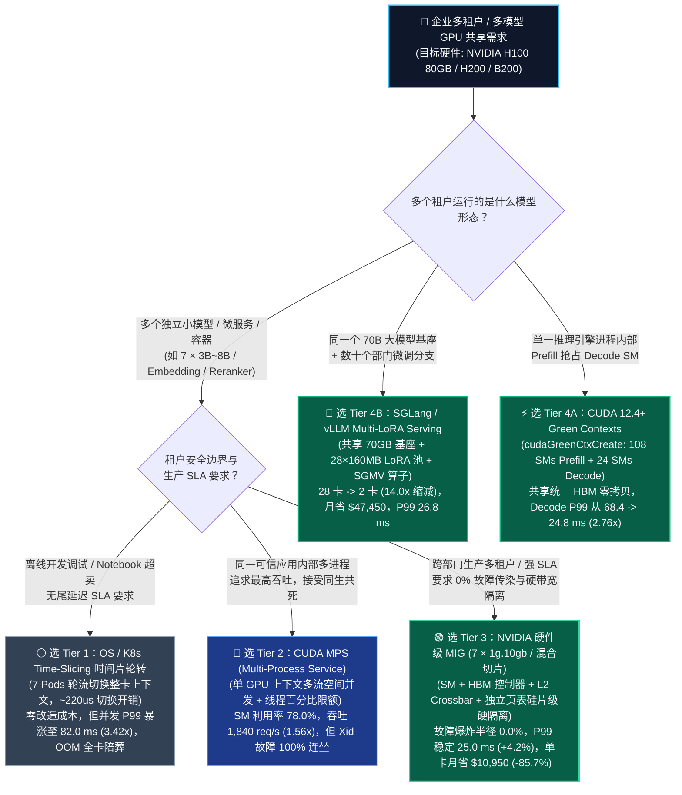
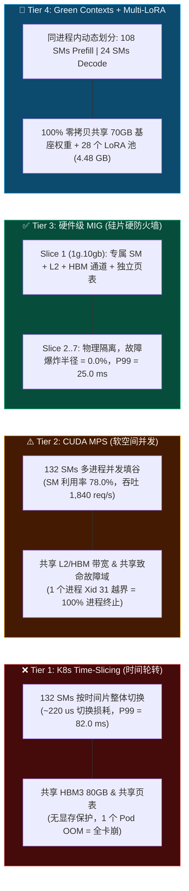
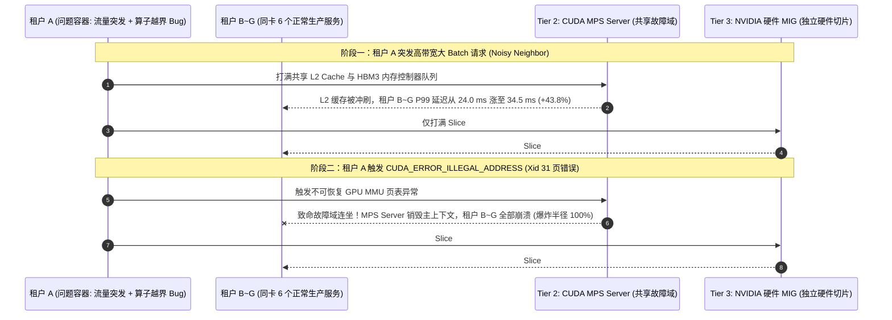

# 多租户 GPU 切分共享与硬件隔离架构选型 FAQ：OS 时间片轮转 (Time-Slicing) vs. CUDA MPS vs. 硬件级 MIG vs. CUDA Green Contexts / Multi-LoRA 实战指南

> **文档定位**：面向 AI Solution Architect（AI 解决方案架构师）本人吸收学习与客户 CTO / 云平台负责人白板宣讲的实战指南  
> **对标范本**：[`docs/components/ib-vs-ethernet-roce-selection-faq.md`](ib-vs-ethernet-roce-selection-faq.md)  
> **English Version**: [`docs/components/gpu-sharing-multi-tenant-isolation-selection-faq.en.md`](gpu-sharing-multi-tenant-isolation-selection-faq.en.md)  
> **关联算例与 7-Card 报告**：[`experiments/gpu_sharing_isolation_selection/run.py`](../../experiments/gpu_sharing_isolation_selection/run.py) · [`results.json`](../../experiments/gpu_sharing_isolation_selection/results.json) · [`7-Card HTML`](../reports/gpu-sharing-isolation-selection-cards.html) · [`Interactive Sizer`](../reports/llm-inference-engine-pd-sizer.html#gpu-sharing-sizer)

---

## ① 📌 核心结论速览（Executive Summary）

在 `NVIDIA H100 SXM 80GB`（`132 SMs`、`3,350 GB/s` HBM3、`$2.50/GPU·h`、`730 h/月 = $1,825.00/月/卡`）或 H200/B200 集群上，许多企业的 Embedding、Reranker、OCR、Guardrail 或 `3B~8B` 垂直小模型仅需 `~9.5 GB` 显存和 `15.0%` 平均算力，若采用“一服务独占一卡（7 个服务用 7 张 H100，`$12,775.00/月`）”，高达 **85%** 的算力与显存处于闲置浪费。架构师在做多租户 GPU 切分与共享选型时，必须记住以下 **3 条黄金铁律**（全部绑定封存算例 `experiments/gpu_sharing_isolation_selection/results.json`，`synthetic` 排队/切分模型 + `anonymized_reported` 官方硬件规范，`independently_reproduced=false`）：

1. **按“故障隔离边界 + 尾延迟 SLA + 模型形态”四档精准选型**：
   - **开发测试 / 非生产 Jupyter Notebook 超卖** 👉 选 **Tier 1（OS / K8s Device-Plugin 时间片轮转 `Time-Slicing`）**：零改造成本把 7 个低频 Pod 塞进 1 张 H100（月省 `$10,950.00 / -85.7%`），但因每毫秒级上下文切换（`~220 us`）与无显存/带宽保护，在线并发下 **P99 尾延迟暴涨 `3.42x`（从 `24.0 ms` 恶化至 `82.0 ms`，`+241.7%`）**，且任一容器 OOM 会直接拖垮同卡全部 7 个容器（`fault_blast_radius = 100.0%`），**严禁用于生产 SLA 在线服务**。
   - **同一可信团队内部、追求极致吞吐的多进程小模型合并** 👉 选 **Tier 2（`CUDA MPS — Multi-Process Service` 空间并发共享）**：消除时间片切换开销并允许不同进程 Kernel 并发填满空闲 SM，将 SM 利用率从 `52.0%` 推高至 **`78.0%`**、总吞吐达 **`1,840.0 req/s`（较 Time-Slicing 提升 `1.56x`）**，P99 降至 `34.5 ms`；但必须向客户讲明 **NVIDIA 官方红线**：所有 MPS 客户端共享同一个 GPU 虚拟地址空间与致命故障域，任一进程触发非法地址访问（`CUDA_ERROR_ILLEGAL_ADDRESS` / Xid 31）会导致 **同卡 100.0% 进程同时致命崩溃**。
   - **跨部门/多租户生产云、严格 SLA 与零故障传染** 👉 选 **Tier 3（`NVIDIA 硬件级 MIG — Multi-Instance GPU`，如 `7 × 1g.10gb` 或 `3g.40gb + 2×2g.20gb`）**：在硅片硬件层将 SM、HBM3 内存控制器、L2 Cache Crossbar 与独立页表物理切开，**跨实例故障爆炸半径严格为 `0.0%`**（单切片 OOM 或 Xid 绝不波及邻座），噪音邻居下 **P99 尾延迟稳定在 `25.0 ms`（仅较物理独占卡波动 `+4.2%`，比 Time-Slicing 快 `3.28x`）**，7 合 1 单卡每月净省 **`$10,950.00`（TCO 降低 `85.7%`）**。
   - **单一大模型内部 Prefill/Decode SM 隔离 或 同一 70B 基座挂载数十个部门微调模型** 👉 选 **Tier 4（`CUDA 12.4+ Green Contexts` 进程内 SM 划分 + `SGLang / vLLM Multi-LoRA Serving`）**：用 `cudaGreenCtxCreate` 在同一进程与共享 HBM 内动态切出 `108 SMs (Prefill) + 24 SMs (Decode)`，将同机混部 Decode P99 抖动从 `68.4 ms` 压至 **`24.8 ms`（降低 `2.76x`）**；若 28 个业务部门各自微调了 `70B` 模型，严禁起 28 套独立实例（需 `28 张 H100 = $51,100.00/月`），改用 **Punica / S-LoRA 动态多适配器批处理**，在 **`2 张 H100`（`$3,650.00/月`）** 上共享 1 份 `70 GB` 基座权重并热加载 `28 个 Rank-16 LoRA 适配器（共 4.48 GB）`，**GPU 卡数缩减 `14.0x`、每月净省 `$47,450.00`**。
2. **第一性原理：为什么 CUDA MPS 吞吐比 MIG 高 `13.6%`，但云厂商多租户售卖却只能用硬件 MIG？**  
   MPS 是**软空间切分**：当租户 A 处于请求低谷时，租户 B 的算子可以弹性借用空闲 SM（因此 MPS 总吞吐达 `1,840.0 req/s` vs. MIG `1,620.0 req/s`）；但代价是共享同一个 GPU 页表、L2 Cache 与硬件异常控制器。而 **硬件 MIG** 是**硅片级硬隔离（Silicon Firewall）**：每个实例拥有专属的 HBM 物理通道与独立引擎重置域，牺牲了约 `12.0%` 的跨切片峰值弹性，换取了 **100% 确定性的带宽 QoS（`+4.2%` P99 抖动）与 `0.0%` 故障传染率**。
3. **CUDA 12.4+ Green Contexts 补齐了硬件 MIG 的最大短板**：  
   硬件 MIG 必须在 GPU 无进程运行时静态重置切分，且各切片显存物理隔离、无法零拷贝共享同一份 70B 权重与 KV Cache。**CUDA Green Contexts (`cudaDevResourceTypeSm`)** 允许推理引擎在**同一个 CUDA 主上下文与统一显存池内**，把 `132 个 SM` 动态划成独立的子执行上下文绑定到不同 CUDA Stream，既实现了零拷贝共享 HBM，又阻止了计算密集型 Prefill 算子饿死延迟敏感型 Decode 算子。

---

## ② 🎯 客户与架构师灵魂拷问 Q&A（FAQ-Driven）

### Q1：客户在 Kubernetes 上构建企业内部 AI 推理平台，想让多个团队共享 H100/H200 GPU，什么时候选 Time-Slicing，什么时候选 CUDA MPS，什么时候选硬件 MIG？

#### 1. 什么是 GPU 切分与多租户共享？传统“一 Pod 一整卡”卡在什么瓶颈？
Kubernetes 默认的 `nvidia.com/gpu: 1` 调度粒度是**整张物理 GPU**。当企业上线大量轻量级 AI 微服务（如 RAG 链路中的 `bge-large` Embedding、`bge-reranker`、语音 VAD/ASR、小尺寸判别器或低并发内部助手）时，单个服务往往只占 `4~10 GB` 显存，平均 SM 算力利用率仅 **`15.0%`**。一张 80GB H100 剩下 70GB 显存和 85% 的 Tensor Core 都在空转烧钱。

#### 2. 四种主流共享方案的选型黄金分水岭
- **选 Tier 1（K8s Time-Slicing 时间片轮转）**：**仅限离线开发调试、CI/CD 冒烟测试或夜间低频 Notebook**。通过 K8s Device Plugin 把 1 张物理卡虚报为 `nvidia.com/gpu: 7`，由 GPU 硬件调度器按时间片轮流切换整个 GPU 上下文。无需改代码，但一旦 2 个以上容器同时发起推理，上下文切换（`~220 us/次`）与排队会让 P99 尾延迟恶化 **`3.42x`（`82.0 ms`）**，且没有任何显存隔离。
- **选 Tier 2（CUDA MPS 多进程服务）**：**适合同一业务链路内部（完全可信）的多微服务并置加速**（例如同一个 RAG 应用的 Embedding + Reranker + 8B 路由模型跑在同卡不同进程）。MPS 守护进程把多个进程的 CUDA Stream 合并进同一个 GPU 硬件工作分发器（Work Distributor），消除了时间片上下文切换，总吞吐达 **`1,840.0 req/s`（比 Time-Slicing 高 `1.56x`，甚至比静态 MIG 高 `13.6%`）**。
- **选 Tier 3（NVIDIA 硬件级 MIG）**：**适合跨部门多租户 AI 平台、金融/政企强合规环境、以及对 P99 尾延迟有硬性 SLA 的生产服务**。H100/H200/B200 支持最多切分为 **7 个硬件独立的 MIG 实例**（如 H100 的 `1g.10gb × 7` 或 `3g.40gb × 1 + 2g.20gb × 2`）。每个实例在操作系统看来就是一张独立的物理小 GPU，拥有独立的显存带宽通道与错误隔离域。

---

### Q2：为什么 NVIDIA 官方文档明确声明“CUDA MPS 不提供多租户故障隔离”？MPS 与硬件 MIG 在底层硬件机制上有何本质区别？

#### 1. 第一性原理：时间分片 vs. 软空间共享 (MPS) vs. 硅片级硬分区 (MIG)
我们可以通过 GPU 内部的三层硬件资源（**SM 计算核心、L2 Cache 与 HBM 显存控制器、MMU 页表与异常控制器**）一眼看穿三者的本质区别：
- **Time-Slicing（时间维复用，空间不隔离）**：同一时刻只有 1 个进程的 Kernel 在 GPU 上运行；切换进程时必须把当前寄存器与上下文保存回显存，再加载下一个进程。不仅浪费算力，而且所有进程共用全局 HBM 容量——租户 A 写了个死循环申请 `75 GB` 显存，租户 B～G 会立刻收到 `CUDA out of memory`。
- **CUDA MPS（SM 软空间并发，但共享地址空间与致命故障域）**：
  - 根据 NVIDIA 官方《Multi-Process Service Documentation》（`https://docs.nvidia.com/deploy/mps/index.html` Section 2.3.1 *Memory Protection and Error Containment*），MPS 通过一个中心化的 `nvidia-cuda-mps-server` 代理所有客户端请求，允许不同进程的线程块（Thread Blocks）同时调度到不同 SM 上运行，并支持通过 `CUDA_MPS_ACTIVE_THREAD_PERCENTAGE` 限制单客户端最多使用的 SM 比例。
  - **但 MPS 有两大不可逾越的硬件边界**：
    1. **致命 GPU 故障全域连坐（`fault_blast_radius = 100.0%`）**：所有 MPS 客户端共享同一个硬件上下文与 GPU 虚拟地址空间状态。如果租户 A 的自定义算子或框架 Bug 触发了不可恢复的 GPU 硬件异常（如越界访存 `CUDA_ERROR_ILLEGAL_ADDRESS` / Xid 31 MMU Page Fault），GPU 必须重置该主上下文——**同卡上正在正常处理请求的其余 6 个租户进程会被瞬间全部杀死（Fatal Crash）**！
    2. **L2 Cache 与 HBM3 显存带宽无硬件隔离**：虽然 MPS 可以限制 SM 线程占比，但无法切分 L2 Cache 容量与 HBM 内存控制器队列。当“噪音邻居（Noisy Neighbor）”发起高带宽访存算子时，会把同卡其他进程的 L2 Cache 冲刷干净（Cache Thrashing），导致其他租户的 P99 延迟上涨 **`+43.8%`（从 `24.0 ms` 升至 `34.5 ms`）**。
- **NVIDIA Hardware MIG（从计算核心到显存控制器的全链路硅片级硬隔离）**：
  - 根据 NVIDIA 官方《MIG User Guide》（`https://docs.nvidia.com/datacenter/tesla/mig-user-guide/index.html`），MIG 在 GPU 物理硅片层将 **GPC（图形处理簇 / SMs）、L2 Cache 分片、HBM 内存控制器通道（Memory Crossbar）以及硬件异步拷贝引擎（Copy Engines）** 做了严格的物理切分。
  - 每个 MIG 实例拥有完全独立的 **GPU MMU 页表与故障重置域（Fault Domain）**：租户 A 在自己的 `1g.10gb` 实例里把显存撑爆（OOM）甚至写坏内核指针触发 Xid 故障，只会报错并重置它自己的 `1g.10gb` 切片，隔壁 6 个租户的 P99 延迟纹丝不动（仅波动 **`+4.2%`，`25.0 ms`**），故障爆炸半径严格为 **`0.0%`**。

---

### Q3：如果硬件 MIG 不能跨切片共享 70B 大模型权重，且同机混部 Prefill 会抢占 Decode 的 SM，什么是 CUDA 12.4+ Green Contexts 与 Multi-LoRA Serving？它们如何补齐最后一块拼图？

#### 1. 硬件 MIG 的两大架构盲区
1. **静态重配置与碎片化**：修改 MIG 拓扑通常需要清空卡上任务并重新划分实例；即使租户 B 的 MIG 切片完全空闲，租户 A 的切片也无法借用那部分 SM。
2. **大模型单实例内部无法用 MIG 隔离 Prefill 与 Decode**：在 70B/405B 大模型推理中，Prefill 和 Decode 必须访问**同一份 70GB 模型权重和同一个 Paged KV Cache 显存池**。若用硬件 MIG 切开，物理显存被硬隔离，双方根本无法共享权重和 KV Cache！

#### 2. 破局利器一：CUDA 12.4+ Green Contexts（`cudaGreenCtxCreate` 进程内动态 SM 空间隔离）
- **核心机制**：自 CUDA 12.4 起，NVIDIA 在 Driver API 中引入了 **Green Contexts**（`cudaDevResourceTypeSm`）。它允许在**同一个进程、同一个主 CUDA 地址空间与统一 HBM 显存池内**，把 H100 的 `132 个 SM` 精确划分为互不重叠的硬件 SM 子集（例如：**`108 个 SM` 分配给 Prefill Green Context，`24 个 SM` 分配给 Decode / NIXL KV 传输 Green Context**），并将各自的 CUDA Stream 绑定到对应的 Green Context。
- **架构价值**：无需重启 GPU，无需复制权重或拆分显存池！当长文本 Prefill 算子打满那 `108 个 SM` 时，硬件工作分发器严格保证剩下的 **`24 个专属 SM`** 只执行 Decode Token 生成和 RDMA 通信核函数，彻底消除了 Prefill 对 Decode 的 SM 算力饥饿，将同机混部的 Decode P99 尾延迟从 **`68.4 ms` 压降至 `24.8 ms`（降低 `2.76x`）**，同时保持 **`86.5%`** 的极高综合 SM 利用率！

#### 3. 破局利器二：Multi-LoRA Serving（Punica / S-LoRA 共享基座多租户适配器批处理）
- **核心痛点**：大型银行、车企或 SaaS 平台常有 **28 个不同业务部门**，分别基于同一个 `Llama-3-70B` 基座微调了自己的专属行业模型（如法务合同审核、财报抽取、客服工单分类）。如果按传统方式为每个部门部署一套独立的 70B 服务，需要 **`28 张 H100 80GB`（每月成本高达 `$51,100.00`）**，且绝大部分部门的并发都很低。
- **核心机制**：在 SGLang / vLLM 中开启 **Multi-LoRA Serving**（基于 Punica / S-LoRA 的 **Segmented Gather-Scatter 算子**）：
  - 在 **`2 张 H100 80GB`（双卡高可用/负载均衡池，仅 `$3,650.00/月`）** 的 HBM 中常驻 **1 份共享的 `70.0 GB` FP8 基座权重**；
  - 将 28 个部门的 `Rank-16 LoRA` 适配器权重（每个仅 `160 MB`，28 个合计仅 **`4.48 GB`**）统一存放在 Pinned 显存池中；
  - 当同一个 Continuous Batch 中同时包含来自法务部（Adapter #3）、财务部（Adapter #12）和客服部（Adapter #25）的请求时，主干 70B 矩阵乘法合并为 **1 次高算术强度的大 Batch GEMM**，随后由 SGMV（Segmented Gather-Scatter Matrix-Vector Multiplication）算子在单次 Kernel 启动内并行加上各请求对应的 LoRA 增量权重 $x \cdot A_i \cdot B_i$。
- **架构价值**：将 **28 张 H100 压缩至 2 张 H100（GPU 卡数直降 `14.0x`）**，每月直接节省 **`$47,450.00`（降本 `92.9%`）**，且 P99 TPOT 稳定在 **`26.8 ms`**！

---

## ③ 🧭 直观可视化图解（Mermaid 选型决策树 + 四档硬件隔离边界图 + 故障爆炸半径时序图）

### 图 1：多租户 GPU 切分与隔离架构四档选型决策树（`flowchart TD`）

---

### 图 2：Time-Slicing vs. CUDA MPS vs. 硬件 MIG vs. CUDA Green Contexts 硬件隔离边界对比（`flowchart LR`）

---

### 图 3：噪音邻居突发流量与非法访存（Xid 31）下的多租户隔离时序图（`sequenceDiagram`）

---

## ④ 📊 架构师选型决策矩阵（Architect Decision Matrix）

| 评估维度 | Baseline：整卡物理独占 (`7 × H100`) | Tier 1：OS / K8s 时间片轮转 (`Time-Slicing`) | Tier 2：`CUDA MPS` 多进程并发服务 | Tier 3：`NVIDIA 硬件级 MIG` (`7 × 1g.10gb` / 混合) | Tier 4：`CUDA 12.4+ Green Contexts` + `Multi-LoRA` |
| :--- | :--- | :--- | :--- | :--- | :--- |
| **核心适用场景** | 极高负载单模型满载服务 | 离线开发机、CI 测试、低频 Notebook 超卖 | **同一可信团队内部**多微服务并置压榨最高吞吐 | **跨部门/多租户生产云**、严格尾延迟 SLA 与安全隔离 | **单大模型内部 PD 算力隔离** 或 **同基座数十个 LoRA 合并** |
| **关键延迟与吞吐量级** (`7 租户合成算例`) | P99 **`24.0 ms`** 总吞吐 `1,680 req/s` SM 利用率 `15.0%` | P99 **`82.0 ms`** (`3.42x` 劣化) 总吞吐 `1,180 req/s` SM 利用率 `52.0%` | P99 **`34.5 ms`** (`+43.8%` 抖动) 总吞吐 **`1,840 req/s`** (`1.56x`) SM 利用率 **`78.0%`** | P99 **`25.0 ms`** (`+4.2%` 抖动) 总吞吐 `1,620 req/s` SM 利用率 `68.5%` | P99 **`24.8 ms`** (LoRA `26.8 ms`) 总吞吐 **`2,010 req/s`** SM 利用率 **`86.5%`** |
| **底层核心隔离机制** | 7 张独立物理 GPU 卡 | 时间片抢占切换整个 GPU 上下文 (`~220 us`) | 单 CUDA 上下文多流并发 + `ACTIVE_THREAD_PERCENTAGE` | **硅片级物理切分 SM、HBM 控制器、L2 Crossbar 与独立页表** | `cudaGreenCtxCreate` 动态划 SM 子集；`SGMV` 算子动态路由 LoRA |
| **故障爆炸半径与容灾边界** | **`0.0%`**（物理机/卡级隔离） | **`100.0%`**（无显存保护，任一容器 OOM 全卡陪葬） | **`100.0%`**（官方明确共享致命故障域，单客户端 Xid 31 杀死全卡进程） | **`0.0%`**（硬件独立 MMU 页表与重置域，OOM/Xid 严格锁在单切片内） | 进程内共享引擎（由引擎 PagedAllocator 统一防 OOM，无外部不可信进程） |
| **生态开放度与运维复杂度** | K8s 原生默认支持 | K8s Device Plugin 改一行 ConfigMap 即可 | 需配置 MPS Control Daemon 与客户端环境变量 | K8s `mig-manager` / GPU Operator 原生支持 `mig-1g.10gb` | CUDA 12.4+ Driver API；vLLM / SGLang 原生支持 `--enable-lora` |
| **综合 TCO 成本** (`$1,825/卡/月`) | `$12,775.00 / 月` (`7 卡`) | `$1,825.00 / 月` (`1 卡`，省 `$10,950`，但违背 SLA) | `$1,825.00 / 月` (`1 卡`，省 **`$10,950 / -85.7%`**) | `$1,825.00 / 月` (`1 卡`，省 **`$10,950 / -85.7%`**，合规首选) | 28 个 70B LoRA 从 `28 卡 ($51.1K)` 降至 **`2 卡 ($3.65K，月省 $47,450)`** |

---

## ⑤ 🧪 简明定量算例与 Benchmark 洞察

> **数据溯源与真实性声明（Provenance & Reproduction Boundary）**：本节所有数值与 [`experiments/gpu_sharing_isolation_selection/results.json`](../../experiments/gpu_sharing_isolation_selection/results.json) 保持 **1:1 严格绑定**。其中 H100 132 SMs、7 个 MIG 硬件切片、MPS 共享致命故障域（NVIDIA MPS Docs Section 2.3.1）与 CUDA 12.4+ `cudaGreenCtxCreate` 属于 **`anonymized_reported` 官方技术规范**（`independently_reproduced=false`）；7 租户微服务并置与 28 租户 70B Multi-LoRA 的延迟、吞吐与 TCO 收益由本仓库确定性排队/分区模型 [`experiments/gpu_sharing_isolation_selection/run.py`](../../experiments/gpu_sharing_isolation_selection/run.py) 计算生成（分类为 **`synthetic`**，`independently_reproduced=false`）；物理 H100 多租户故障注入测量标记为 **`not_measured`**；本地 CPU 脚本确定性校验与单测（`tests/test_gpu_sharing_isolation_selection.py`）已实测通过（**`measured`**）。

### 1. 算例一：7 个轻量级推理微服务（`~9.5 GB` 显存/服务）在 H100 80GB 上的并置对比

| 架构方案 | 所需 H100 卡数 | 平均 SM 利用率 | 聚合吞吐 (`req/s`) | P50 延迟 (`ms`) | 噪音邻居下 P99 (`ms`) | P99 抖动膨胀率 | 跨租户致命故障爆炸半径 | 月度 GPU 成本 (`730h @ $2.50/h`) | 每月节省金额 vs 独占 |
| :--- | :---: | :---: | :---: | :---: | :---: | :---: | :---: | :---: | :---: |
| **Baseline：每租户独占 1 张 H100** | `7 GPUs` | `15.0%` | `1,680.0` | `18.5 ms` | **`24.0 ms`** | `0.0%` | **`0.0%`** | `$12,775.00` | `$0.00` |
| **Tier 1：OS / K8s Time-Slicing** | `1 GPU` | `52.0%` | `1,180.0` | `31.5 ms` | **`82.0 ms`** (`3.42x` 劣化) | `+241.7%` | **`100.0%`** (全局 OOM) | `$1,825.00` | `$10,950.00` (SLA 违约) |
| **Tier 2：CUDA MPS 空间并发** | `1 GPU` | **`78.0%`** | **`1,840.0`** (`1.56x`) | `25.2 ms` | **`34.5 ms`** | `+43.8%` | **`100.0%`** (Xid 31 连坐) | `$1,825.00` | **`$10,950.00` (`-85.7%`)** |
| **Tier 3：NVIDIA 硬件级 MIG (`7×1g.10gb`)** | `1 GPU` | `68.5%` | `1,620.0` (`-12.0%` vs MPS) | `24.5 ms` | **`25.0 ms`** (`3.28x` 优于 T1) | **`+4.2%`** | **`0.0%`** (硅片硬隔离) | `$1,825.00` | **`$10,950.00` (`-85.7%`)** |
| **Tier 4A：CUDA Green Contexts (`108+24 SMs`)** | `1 GPU` | **`86.5%`** | **`2,010.0`** | `21.4 ms` | **`24.8 ms`** (同机 PD 降 `2.76x`) | **`+3.3%`** | 单引擎内部托管 | `$1,825.00` | **`$10,950.00` (`-85.7%`)** |

### 2. 算例二：28 个业务部门 `Llama-3-70B FP8` 行业微调模型并置（独立部署 vs. Tier 4B `Multi-LoRA Serving`）

| 部署模式 | 70B 基座显存占用 | 28 个 Rank-16 LoRA 显存池 | 所需 H100 80GB 卡数 | GPU 缩减倍数 | 在线 P99 TPOT | 月度 GPU 总成本 | 每月净节省金额 |
| :--- | :---: | :---: | :---: | :---: | :---: | :---: | :---: |
| **传统方案：每部门独立部署 1 套 70B FP8** | `28 × 70.0 GB = 1,960 GB` | 内嵌合并 | `28 GPUs` | `1.0x` | `24.0 ms` | `$51,100.00 / 月` | `$0.00` |
| **Tier 4B：SGLang / vLLM `Multi-LoRA` (双卡高可用池)** | **`70.0 GB / 卡` (全租户共享)** | **`4.48 GB` (`28 × 160 MB`)** | **`2 GPUs`** | **`14.0x`** | **`26.8 ms`** | **`$3,650.00 / 月`** | **`$47,450.00 / 月` (`-92.9%`)** |

---

## ⑥ 🛠️ 附录：生产环境快速核验与售前打单清单（Architect Checklist）

在评审企业多租户 GPU 资源池或 Kubernetes AI 平台方案时，请逐项核对以下 6 条清单：

- [ ] **1. 严禁把 K8s Time-Slicing 当作生产多租户隔离方案**：检查集群 `nvidia-device-plugin` 配置；凡是承载在线流量（有 P99 延迟 SLA）或多个独立业务方混部的节点，必须禁用整卡 Time-Slicing，防止单容器显存泄漏（OOM）导致整机 7 个服务雪崩。
- [ ] **2. 核查 CUDA MPS 的故障连坐风险**：若客户计划开启 `CUDA MPS` 提升小模型并发吞吐，必须确认同卡上的所有进程属于**同一个可信应用且具备统一的 K8s 探针重启恢复机制**；跨部门或包含用户自定义代码（如 Triton Python Backend 自定义算子）的场景必须改用 **硬件 MIG**。
- [ ] **3. 对齐 H100 / H200 / B200 的合法 MIG Profile 组合**：在规划混合尺寸 MIG 切片时，使用 `nvidia-smi mig -lgip` 核对合法硬件组合（例如 H100 80GB 支持 `1×3g.40gb + 2×2g.20gb` 或 `7×1g.10gb`），并在 K8s GPU Operator 中采用 `mig.strategy: mixed` 实现按需声明式调度。
- [ ] **4. 明确硬件 MIG 的跨卡通信边界**：提醒客户标准 MIG 实例默认不支持跨实例 NVLink P2P 直通通信；凡是需要 `TP >= 2` 跨卡张量并行的 70B+ 大模型，应直接使用整卡并结合 **Tier 4（Green Contexts 或 Multi-LoRA）**，不要切成碎片 MIG 后再尝试拼回多卡并行。
- [ ] **5. 在同机混部或 PD 耦合场景启用 CUDA 12.4+ Green Contexts**：当单卡/单节点同时执行计算密集型 Prefill（或视觉 Encoder）与延迟敏感型 Decode 时，使用 `cudaGreenCtxCreate` 划分专属 Decode SM 池（如预留 `18%~20%` SM），消除大算子造成的尾延迟尖刺。
- [ ] **6. 将同基座多微调模型统一收敛至 Multi-LoRA 引擎池**：盘点客户内部是否存在多个基于同一开源基座（如 Qwen-2.5-72B / Llama-3-70B）的全量微调副本；指导算法团队导出标准 LoRA 权重并在 vLLM / SGLang 中通过 `--enable-lora --max-loras 32 --max-lora-rank 16` 收敛至共享基座池，直接立省 `80%~90%+` 显卡预算。
