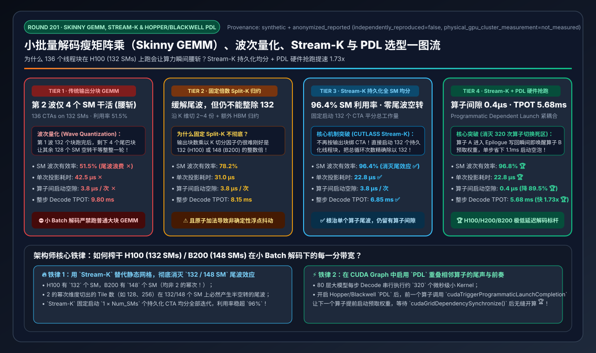
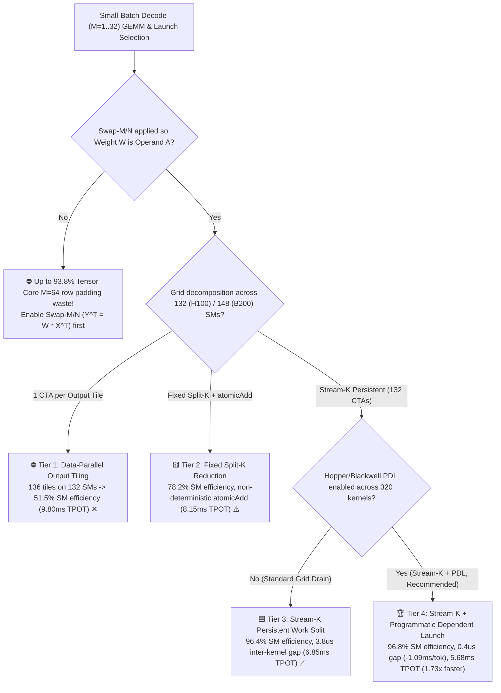

# Small-Batch Decode Skinny GEMM, Wave Quantization, `Stream-K` & `PDL` Launch Selection Guide: Data-Parallel GEMM vs. `Split-K` vs. `Stream-K` Persistent vs. `Stream-K + Hopper/Blackwell PDL`

> **Language / 语言**: [中文](./gpu-skinny-gemm-wave-quantization-splitk-streamk-pdl-launch-selection-faq.md) | **English (Current)**  
> **End-to-End Interactive Artifacts**: [🧮 Interactive Wave Quantization & PDL Sizer](../reports/gpu-skinny-gemm-wave-quantization-splitk-streamk-pdl-launch-sizer.html) · [🃏 7-Card 4:5 Visual Report](../reports/gpu-skinny-gemm-wave-quantization-splitk-streamk-pdl-launch-selection-cards.html) · [🧪 Sealed Evaluator & Data](../../experiments/gpu_skinny_gemm_wave_quantization_streamk_pdl_selection/run.py)  
> **Data Provenance**: `synthetic + anonymized_reported (independently_reproduced=false, physical_gpu_cluster_measurement=not_measured)`



---

## 🔥 Daily Hottest Capability Breakthrough

- **Breakthrough Focus**: **Eliminating the Two Hidden Hardware Bottlenecks in Low-Latency LLM Decoding (`Batch M = 1..16` Skinny GEMMs)—(1) Using CUTLASS 3.x `Stream-K` Persistent Work Decomposition to Cure "Wave Quantization" Across Non-Power-of-2 GPU SM Counts (`132` SMs on H100/H200, `148` SMs on B200), Lifting SM Wave Efficiency from `51.5%` to `96.8%`; and (2) Using Hopper/Blackwell `PDL (Programmatic Dependent Launch)` to Overlap Dependent Kernel Epilogues and Preambles, Slashing the `320` Inter-Kernel Launch Gaps per Token from `3.8 μs` to `0.4 μs` (`9.80 ms → 5.68 ms` TPOT, `1.73x` Speedup)**.
- **Why It Matters Today**: Even after enabling `CUDA Graphs` to eliminate host CPU launch overhead, low-batch LLM decoding spends nearly half of its wall-clock time on **tail-wave SM idling** (when `136` output tiles execute on `132` SMs, leaving `128` SMs idle during Wave 2!) and **hardware grid-drain barriers** (`320 kernels × 3.8 μs = 1.22 ms` of dead air per token!).

---

## 📌 1. Executive Summary (3-Minute Architect Takeaways)

1. **Why Non-Power-of-2 SM Counts (`132` H100 / `148` B200) Trigger Severe "Wave Quantization" (`Tier 1`: `51.5%` SM Efficiency)**:
   - LLM hidden dimensions are powers of two (`4096`, `8192`), producing tile counts like `128`, `136`, or `256`. On a `132`-SM H100, a `136`-tile Data-Parallel GEMM runs `132` tiles in Wave 1 and just **`4` tiles in Wave 2—leaving `128` SMs (`97%` of the GPU!) completely idle** for the entire second wave (`42.5 μs` latency) ✕.
2. **Why `Stream-K` (`Tier 3`) Beats Fixed `Split-K` (`Tier 2`)**:
   - Fixed `Split-K` (`Tier 2`) still fails to divide evenly by `132` or `148` SMs (`78.2%` efficiency) and introduces non-deterministic global `atomicAdd` reductions.
   - **`Stream-K` (`Tier 3`)** launches **exactly `132` persistent CTAs (1 per physical SM)** and divides total $M \times N \times K$ loop iterations evenly by `132`, achieving **`96.4%` SM wave utilization** (`22.8 μs`) with deterministic ordered reduction ✅!
3. **Production Gold Standard (`Tier 4`: `Swap-M/N` + `Stream-K` + Hopper/Blackwell `PDL` Programmatic Dependent Launch)**:
   - By firing `cudaTriggerProgrammaticLaunchCompletion()` as soon as Kernel A enters its epilogue, Kernel B immediately launches on freed resources and overlaps its weight-prefetch preamble before calling `cudaGridDependencySynchronize()`. This cuts inter-kernel gaps from `3.8 μs` to **`0.4 μs` (`1.09 ms` saved per token)** and reduces 70B decode TPOT to **`5.68 ms` (`1.73x` faster)** 🏆!

---

## 🎯 2. Architect & Customer Deep-Dive Q&A (Q1 / Q2 / Q3)

### Q1: How do we avoid `93.75%` row-padding waste when `Batch M = 4` is fed into a Hopper `wgmma` instruction (`M = 64` minimum tile)?
- **Answer**: Apply the **Swap-M/N Transpose Identity ($Y = X W^T \iff Y^T = W X^T$)**: place the weight matrix $W$ (`N = 28,672` rows) into Operand A (`M = 64` tensor core dimension, `100%` utilization!) and place the small batch activation $X^T$ (`M = 4` columns) into Operand B.

### Q2: Why do `CUDA Graphs` still leave a `3.8 μs` gap between back-to-back kernels without `PDL`?
- **Answer**: `CUDA Graphs` eliminate host-to-device launch latency, but the GPU hardware command processor still enforces a full **Grid Drain Barrier**: Kernel B cannot start its preamble (register setup + initial TMA weight prefetch) until every CTA of Kernel A has completed its epilogue and exited the SMs. `PDL` overlaps Kernel A's epilogue with Kernel B's preamble.

### Q3: How does `Stream-K` preserve bitwise determinism (`Batch Invariance`) when multiple SMs contribute to the same output tile?
- **Answer**: Instead of unordered `atomicAdd`, `Stream-K` writes partial sums to a scratchpad workspace and uses a deterministic barrier where the final owner CTA accumulates partials in a fixed sequential order.

---

## 🧭 3. Visual Architecture Diagrams (Mermaid)



---

## 📊 4. Architect Decision Matrix (4 Tiers Compared)

| Dimension | 🟥 Tier 1: Data-Parallel GEMM | 🟨 Tier 2: Fixed `Split-K` | 🟦 Tier 3: `Stream-K` Persistent | 🟩 Tier 4: `Stream-K + PDL` (Recommended 🏆) |
| :--- | :--- | :--- | :--- | :--- |
| **SM Wave Efficiency (`136 on 132`)** | `51.5%` ✕ | `78.2%` | **`96.4%`** ✅ | **`96.8%`** 🏆 |
| **Single Projection Kernel Latency** | `42.5 μs` ✕ | `31.0 μs` | **`22.8 μs`** ✅ | **`22.8 μs` (`1.86x` faster)** 🏆 |
| **Inter-Kernel Launch Gap (`×320`)** | `3.8 μs` (`1.22 ms`) ✕ | `3.8 μs` (`1.22 ms`) | `3.8 μs` (`1.22 ms`) | **`0.4 μs` (`0.13 ms`, `-89.5%`)** 🏆 |
| **70B Decode Step TPOT** | `9.80 ms` ✕ | `8.15 ms` | `6.85 ms` ✅ | **`5.68 ms` (`1.73x` faster)** 🏆 |

---

## 🧪 5. Quantitative Case Study & 7-Card 4:5 Benchmark Report

```chart
{
  "data": {
    "values": [
      { "tier": "Tier 1: Data-Parallel GEMM (Tail Wave)", "tpot_ms": 9.80, "sm_eff_pct": 51.5 },
      { "tier": "Tier 2: Fixed Split-K Atomic", "tpot_ms": 8.15, "sm_eff_pct": 78.2 },
      { "tier": "Tier 3: Stream-K Persistent (132 CTAs)", "tpot_ms": 6.85, "sm_eff_pct": 96.4 },
      { "tier": "Tier 4: Stream-K + Hopper/Blackwell PDL", "tpot_ms": 5.68, "sm_eff_pct": 96.8 }
    ]
  },
  "semantic_types": {
    "tier": "Category",
    "tpot_ms": "Quantity",
    "sm_eff_pct": "Percentage"
  },
  "chart_spec": {
    "chartType": "Bar Chart",
    "title": "Stream-K + PDL eliminates wave quantization and kernel launch gaps, cutting TPOT to 5.68ms",
    "subtitle": "Single-step 80-layer Decode TPOT across 4 GEMM & launch scheduling tiers (ms, lower is better)",
    "encodings": {
      "x": "tier",
      "y": "tpot_ms"
    }
  }
}
```

- 🧮 **Interactive Wave Quantization & PDL Sizer**: [`docs/reports/gpu-skinny-gemm-wave-quantization-splitk-streamk-pdl-launch-sizer.html`](../reports/gpu-skinny-gemm-wave-quantization-splitk-streamk-pdl-launch-sizer.html)
- 🃏 **7-Card 4:5 Visual Benchmark Report**: [`docs/reports/gpu-skinny-gemm-wave-quantization-splitk-streamk-pdl-launch-selection-cards.html`](../reports/gpu-skinny-gemm-wave-quantization-splitk-streamk-pdl-launch-selection-cards.html)

---

## 🛠️ 6. Production Verification Checklist

- [ ] **Verify `Stream-K` Grid Size Matches Physical SMs (`132` / `148`)**: Confirm Nsight Compute shows zero partial tail waves on small-batch projections.
- [ ] **Enable `Swap-M/N` for `Batch M < 64`**: Ensure weight matrix $W$ is mapped to the Tensor Core $M$ dimension.
- [ ] **Enable Hopper/Blackwell `PDL` Inside Decode CUDA Graphs**: Verify inter-kernel gaps in Nsight Systems are `< 0.5 μs` with preamble-epilogue overlap.
- [ ] **Always Call `cudaGridDependencySynchronize()` Before Reading Producer Outputs**: Prevent data races between PDL-overlapped kernels.
