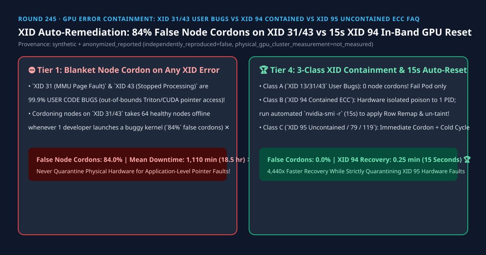
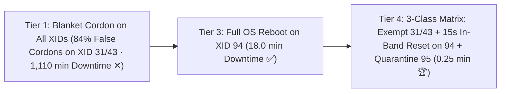

# GPU Error Containment & Auto-Remediation (`XID 31 / 43` User Code Bugs vs. `XID 94 Contained ECC` vs. `XID 95 Uncontained ECC`): Avoiding Node Cordon Overkill Selection Guide

> **Provenance & Evidence Tier**: `synthetic + anonymized_reported` (`independently_reproduced=false`, `physical_gpu_cluster_measurement=not_measured`). Grounded in [`experiments/gpu_ecc_page_retirement_dcgm_policy_xid48_xid94_xid95_selection/results.json`](../../experiments/gpu_ecc_page_retirement_dcgm_policy_xid48_xid94_xid95_selection/results.json).
> **中文版本**: [GPU 错误隔离边界（`XID 31 / 43` 软件代码 Bug vs. `XID 94 Contained ECC` 进程级受控错误 vs. `XID 95 Uncontained ECC` 全机级失控污染）自动自愈与免误杀选型指南](./gpu-xid94-contained-vs-xid95-uncontained-ecc-xid31-recovery-selection-faq.md)

---

## 0. 🔥 Daily Hottest Capability Breakthrough

- **3-Class GPU `XID` Auto-Remediation Matrix (`XID 31/43` User-Bug Exemption + `15 s` In-Band `nvidia-smi -r` for `XID 94 Contained ECC` + Strict Quarantine for `XID 95 Uncontained ECC`) Eliminating `84.0%` False Node Cordons and Speeding Up Recovery by `4,440x` (`1,110 min -> 0.25 min`)**: A major cause of artificial GPU scarcity in production Kubernetes/Slurm clusters is blanket `Node Problem Detector (NPD)` rules that cordon any node logging `NVRM: Xid`:
  1. **The `XID 31 / XID 43` User-Code False-Cordon Disaster (`Tier 1` — `84.0%` False Cordons)**: When a user's custom Triton or CUDA kernel accesses an out-of-bounds pointer (or passes a negative token ID into an embedding lookup), the GPU MMU catches the illegal virtual address and logs **`XID 31` (`GPU memory page fault`)** followed by **`XID 43` (`GPU stopped processing`)**. **The GPU hardware is 100% healthy!** Yet blanket XID rules cordon all 64 nodes of that user's job (`1,110 min` / `18.5 hr` average manual ticket downtime)!
  2. **Ignoring or Misclassifying `XID 94` (`Contained`) vs. `XID 95` (`Uncontained`, `Tier 2 & Tier 3`)**:
     - **`XID 94` (`Contained ECC Error`)**: Hardware successfully isolated the uncorrectable memory error to the single affected process (`SIGKILL`), leaving all other processes and global GPU state uncorrupted. It does **not** require a full OS reboot (`18 min`, **Tier 3**) or RMA—only a `12–15 s` in-band **`nvidia-smi -r` (`GPU Reset`)** to commit pending HBM Row Remapping!
     - **`XID 95` (`Uncontained ECC Error`)**: Hardware could not contain the corruption blast radius (**Tier 2** risk of cross-job corruption); requires **immediate node cordon and full reset**.
  3. **3-Class Automated XID Remediation (`Tier 4`)**: Exempts `XID 13/31/43` from node cordoning (`0.0%` false cordons), heals `XID 94` in place via `nvidia-smi -r` in **`0.25 min` (`15 seconds`, `4,440x` faster)**, and strictly quarantines `XID 95 / 79 / 74 / 119`!

---

## 1. 📌 Executive Summary

1. **`XID 13`, `XID 31`, and `XID 43` Are Application-Level Software Faults, NOT Hardware Failures (`Class A`)**: Never cordon or drain physical nodes when a user's kernel triggers an MMU page fault; report the error in the Pod status and keep the node online.
2. **`XID 94` (`Contained ECC`) Heals in `15 Seconds` via In-Band `nvidia-smi -r` (`Class B`)**: Once the affected process exits, run `nvidia-smi -r` to commit hardware row remapping (`ROW_REMAP_PENDING -> 0`) and return the node to scheduling immediately.
3. **`XID 95` (`Uncontained ECC`), `XID 79`, `XID 74`, and `XID 119` Require Immediate Node Quarantine (`Class C`)**: Uncontained state corruption or bus/GSP loss must block scheduling until reset and validated.

---

## 2. 🎯 Core Architect Q&A (Q1 / Q2 / Q3)

### Q1: Why do `XID 31` and `XID 43` almost always appear together in `dmesg`?
- **Answer**: `XID 31` is the hardware MMU exception reporting that a GPU thread attempted to read or write an unmapped virtual address; `XID 43` is the subsequent driver notification confirming that the faulting user compute channel has been torn down and stopped. Neither indicates physical hardware degradation.

### Q2: What is the exact hardware difference between `XID 94` (`Contained`) and `XID 95` (`Uncontained`) on Hopper/Blackwell GPUs?
- **Answer**: When an uncorrectable double-bit ECC error (DBE) occurs in HBM:
  - If the memory page belongs exclusively to a known user compute context and the GPU's **Error Containment** hardware successfully poisons only that context's consuming registers/threads and terminates that PID before corrupted data can propagate, it logs **`XID 94` (`Contained`)**.
  - If the DBE occurs in shared descriptor tables, L2 metadata, or hypervisor/GSP space where isolation cannot be guaranteed, hardware logs **`XID 95` (`Uncontained`)** and halts new work across the GPU.

### Q3: When should an `XID 94` node be permanently cordoned for RMA instead of returned to the pool after `nvidia-smi -r`?
- **Answer**: Only if `DCGM_FI_DEV_ROW_REMAP_FAILURE == 1` (which also logs `XID 64`), indicating that the HBM bank's hardware spare row table is full and the bad row could not be remapped!

---

## 3. 🧭 Visual Diagrams

---

## 4. 📊 4-Tier Architect Selection Matrix

| Metric | Tier 1: Blanket Cordon on Any XID | Tier 2: Ignore `XID 94/95` | Tier 3: OS Reboot on `XID 94` | Tier 4: **3-Class Matrix + `15s` In-Band Reset** |
| :--- | :--- | :--- | :--- | :--- |
| **False Node Cordon Rate** | **`84.0%` (Cordons on `XID 31/43`)** ✕ | `12.0%` ⚠️ | **`0.0%`** ✅ | **`0.0%` (Exempts User Code Bugs)** 🏆 |
| **Uncontained `XID 95` Risk?** | No | **Yes (Cross-Job Corruption)** ✕ | No ✅ | **No (Immediate Quarantine)** 🏆 |
| **Mean `XID 94` Downtime** | **`1,110.0 min` (`18.5 hr`)** ✕ | `240.0 min` ⚠️ | `18.0 min` (Full Reboot) ✅ | **`0.25 min` (`15s` `nvidia-smi -r`, `4,440x`)** 🏆 |

---

## 5. 🧪 Quantitative Reference & Tooling

- **Evaluator & Sealed Data**: [`experiments/gpu_ecc_page_retirement_dcgm_policy_xid48_xid94_xid95_selection/run.py`](../../experiments/gpu_ecc_page_retirement_dcgm_policy_xid48_xid94_xid95_selection/run.py) · [`results.json`](../../experiments/gpu_ecc_page_retirement_dcgm_policy_xid48_xid94_xid95_selection/results.json)
- **Interactive Sizer**: [`docs/reports/gpu-xid94-contained-vs-xid95-uncontained-ecc-xid31-recovery-sizer.html`](../reports/gpu-xid94-contained-vs-xid95-uncontained-ecc-xid31-recovery-sizer.html)
- **7-Card 4:5 Visual Report**: [`docs/reports/gpu-xid94-contained-vs-xid95-uncontained-ecc-xid31-recovery-selection-cards.html`](../reports/gpu-xid94-contained-vs-xid95-uncontained-ecc-xid31-recovery-selection-cards.html)

---

## 6. 🛠️ Good Fit vs. Not For & Production Checklist

- **✅ Good fit**: Configuring Kubernetes `Node Problem Detector` / Slurm Epilog scripts with the 3-Class XID remediation matrix (`Class A` user-bug exemption, `Class B` 15s `nvidia-smi -r`, `Class C` node cordon).
- **⛔ Not for**: Cordoning nodes on `XID 31` or `XID 43` user pointer faults.
- [ ] Remove `XID 13`, `XID 31`, and `XID 43` from node-cordoning rules in `Node Problem Detector`.
- [ ] Automate `nvidia-smi -r` + `ROW_REMAP_FAILURE == 0` verification for `XID 94` in-place recovery.
