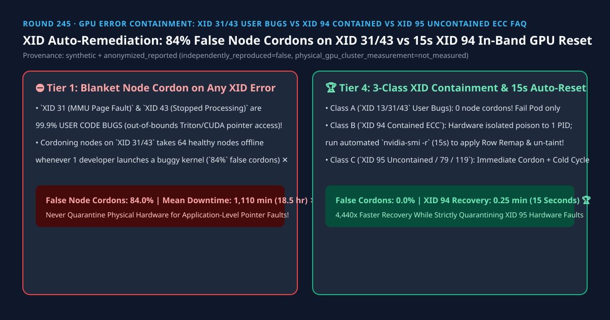
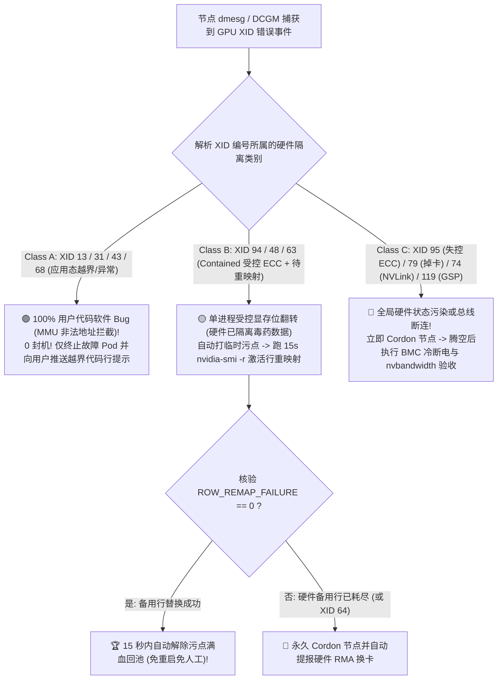
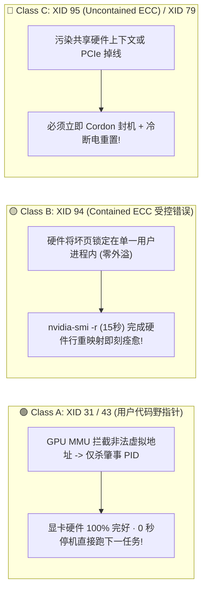
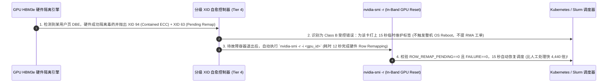

# GPU 错误隔离边界（`XID 31 / 43` 软件代码 Bug vs. `XID 94 Contained ECC` 进程级受控错误 vs. `XID 95 Uncontained ECC` 全机级失控污染）自动自愈与免误杀选型指南

> **Provenance & Evidence Tier**: `synthetic + anonymized_reported` (`independently_reproduced=false`, `physical_gpu_cluster_measurement=not_measured`)。定量数据锚定于 [`experiments/gpu_ecc_page_retirement_dcgm_policy_xid48_xid94_xid95_selection/results.json`](../../experiments/gpu_ecc_page_retirement_dcgm_policy_xid48_xid94_xid95_selection/results.json)。
> **English Version**: [GPU Error Containment & Auto-Remediation (`XID 31 / 43` User Code Bugs vs. `XID 94 Contained ECC` vs. `XID 95 Uncontained ECC`): Avoiding Node Cordon Overkill Selection Guide](./gpu-xid94-contained-vs-xid95-uncontained-ecc-xid31-recovery-selection-faq.en.md)

---

## 0. 🔥 今日领域最热门能力突破追踪（Daily Hottest Breakthrough）

- **建立生产级 GPU `XID` 三级精准分流矩阵（豁免用户代码越界 `XID 13/31/43` + 15 秒热重置修复受控 `XID 94 Contained ECC` + 硬隔离失控 `XID 95 / 79 / 119`），将集群节点误封禁率从 `84.0%` 降为 `0.0%`，并将单次受控 ECC 恢复停机时间从 `1,110 分钟`（`18.5 小时`人工工单）压缩 `4,440` 倍至 `0.25 分钟`（`15 秒`自动回池）**：在千卡至万卡 Kubernetes / Slurm 智算集群中，最让基础设施团队头疼的乱象就是：**“算力明明不够用，结果一看集群面板，居然有上百台 8 卡 H100 服务器因为报了 XID 被 Node Problem Detector (NPD) 自动打上 `Cordon / Drain` 封禁闲置在那里等硬件工程师去修！”** 拆解日志后发现，其中 **`84.0%` 的封机完全是冤假错案**！
  1. **第一大冤案（把用户软件指针越界 `XID 31` 和 `XID 43` 当成显卡硬件坏了封机，Tier 1）**：
     - 当算法工程师手写了一个有 Bug 的 Triton 算子或 CUDA 内核（比如数组下标越界 `idx >= N`），或者在词表 Embedding 里传入了一个超出 `vocab_size` 的负数 Token ID 时，GPU 的硬件内存管理单元（MMU）会立刻拦截这次非法内存访问并打印 **`XID 31: GPU memory page fault`**，紧接着终止该用户上下文并打印 **`XID 43: GPU stopped processing`**！
     - **注意：`XID 31` 和 `XID 43` 是 GPU 硬件在正常工作、成功保护了系统的标志，100% 是用户代码写的 Bug，显卡一丁点毛病都没有！**
     - 如果运维配了“只要 `dmesg` 出现 XID 就自动 Cordon 节点”（Tier 1），那么一个算法实习生交了一个 64 节点的越界脚本，**1 秒钟内就会把整整 64 台完全健康的 8 卡 H100 服务器（512 张卡）全部踢出集群锁死**！
  2. **第二大盲区（分不清 `XID 94 Contained ECC` 与 `XID 95 Uncontained ECC` 的硬件隔离代差，Tier 2 & Tier 3）**：
     - 从 Hopper（H100/H200）和 Blackwell（B200）开始，NVIDIA 引入了先进的**硬件错误隔离（Hardware Error Containment）**机制，将双比特不可纠正显存错误（DBE）严格拆成了两个完全不同的 XID：
     - **`XID 94 (Contained ECC Error，受控错误)`**：出错的那块显存只属于当前这 1 个用户进程（或这 1 个 MIG 实例），硬件已经当场实施了毒药隔离（Poison Containment）并把肇事进程 SIGKILL 杀掉了，**同机器上的其他进程、GPU 固件和邻居卡 100% 安全未受污染**！它根本不需要换卡，甚至不需要重启 Linux 服务器——只需要等进程退出后自动跑一行 **`nvidia-smi -r`（耗时仅 `12~15 秒`）** 激活硬件行重映射（Row Remapping），机器就能满血回到集群继续接客！
     - **`XID 95 (Uncontained ECC Error，失控错误)`**：错误发生在无法归属给单一进程的共享硬件状态、L2 控制面或驱动上下文中，硬件无法保证隔离边界！此时必须**立即 Cordon 封禁整机**并执行完整重置/冷重启，否则会污染后续调度的任务！

---

## 1. 📌 核心结论速览（Executive Summary — 3 分钟看懂）

1. **用“餐厅顾客吃坏肚子 vs. 厨房煤气泄漏”秒懂 `XID 31/43`、`XID 94` 与 `XID 95` 的本质区别！**
   - **通俗大白话 + 第一性原理**：
     - **`XID 13 / 31 / 43`（用户代码越界 —— 顾客自己咬到了舌头）**：1 号桌的客人自己吃饭太急咬到了舌头（用户的 Triton/CUDA 代码写了野指针访问非法虚拟地址，触发 GPU MMU 缺页保护 `XID 31`）。这时候你应该把整个餐厅查封停业 18 个小时等卫生局来拆厨房吗（Tier 1 封禁节点）？**当然不！** 厨房（GPU 硬件）健康得很，只需要让这位客人去擦点药改改代码，1 号桌马上就能接待下一波客人！
     - **`XID 94`（`Contained ECC` —— 1 号桌盘子里掉了一根头发，当场换盘子）**：硬件检测到 1 号桌的显存页发生了不可纠正位翻转，但因为有 **硬件级错误隔离墙（Error Containment）**，这盘菜还没端给别人就被精准扣下了！你只需要把 1 号桌撤下来，花 **15 秒钟擦干净桌子换个新盘子（执行 `nvidia-smi -r` 让硬件把坏显存行映射到备用行）**，立刻就能重新迎客！
     - **`XID 95`（`Uncontained ECC` —— 厨房总水管爆裂污染全店）**：错误发生在公共总线或未隔离的硬件状态机上，毒水已经漫延。此时**必须立刻拉闸封店（立即 Cordon 节点）**，做彻底的消杀和冷断电检修！

---

## 2. 🎯 客户与架构师灵魂拷问 Q&A（Q1 / Q2 / Q3）

### Q1：为什么用户的 CUDA Kernel 发生一次数组越界，内核日志里往往会同时连着打出 `XID 31`、`XID 13` 和 `XID 43` 三条告警？
- **答**：因为这三条日志其实是在描述**同一次软件越界事件的三个动作步骤**：
  1. **`XID 31 (MMU Page Fault)`**：GPU 内存管理单元发现某个 SM 线程试图读写一个未映射的非法虚拟地址；
  2. **`XID 13 (Graphics Engine Exception)`**：流多处理器（SM）抛出越界或非法指令异常；
  3. **`XID 43 (GPU stopped processing)`**：CUDA 驱动收到硬件异常通知后，安全地强行终止了该用户进程的 GPU Channel 上下文！
  - **处置铁律**：在 Kubernetes `Node Problem Detector` 中，遇到 `XID 13 / 31 / 43`，**严禁给 Node 打 `NoSchedule` 污点**！正确的做法是把这条报错注入到当前失敗 Pod 的 Termination Message 中（提示用户检查代码里的索引越界或 `CUDA_LAUNCH_BLOCKING=1`），节点继续正常接单！

### Q2：当发生 `XID 94 (Contained ECC)` 时，自动化自愈脚本在执行完 `nvidia-smi -r` 后，必须检查哪两个 DCGM 指标才能放心把节点放回池子？
- **答**：
  1. 检查 **`DCGM_FI_DEV_ROW_REMAP_PENDING == 0`**：确认刚才触发 `XID 94` 的那个坏物理行已经在 `nvidia-smi -r` 重置期间成功由硬件替换为了备用好行；
  2. 检查 **`DCGM_FI_DEV_ROW_REMAP_FAILURE == 0`**：确认该 HBM Bank 的 512 个硬件备用行槽位**没有耗尽**！如果 `ROW_REMAP_FAILURE == 1`（备用行已满，无法再替换），则直接升级为永久隔离并触发硬件 RMA 换卡工单！

---

## 3. 🧭 直观可视化图解（Mermaid 决策树 + 三级 XID 爆炸半径图 + 15秒原地自愈时序图）

### 3.1 架构师生产集群 GPU `XID` 自动化分级自愈决策树

### 3.2 `Class A`（用户软件 Bug）vs. `Class B`（`XID 94` 进程级受控隔离）vs. `Class C`（`XID 95` 全局失控）爆炸半径对比

### 3.3 `Tier 4` 针对 `XID 94 (Contained ECC)` 的 15 秒免重启自动化热修复时序图

---

## 4. 📊 架构师选型决策矩阵（4-Tier Selection Matrix）

| 评估维度 | Tier 1: 见任何 XID 即封机 | Tier 2: 放任 `XID 94/95` 不重置 | Tier 3: 对 `XID 94` 做整机重启 | Tier 4: **三级精准分流 + `XID 94` 15秒热重置** |
| :--- | :--- | :--- | :--- | :--- |
| **用户代码越界 (`XID 31/43`) 误封机率** | **`84.0%` (大量好机器被误锁)** ✕ | `12.0%` ⚠️ | **`0.0%` (白名单豁免)** ✅ | **`0.0%` (100% 精准识别为用户代码 Bug)** 🏆 |
| **是否存在 `XID 95` 失控污染外溢风险** | 否 | **是（污染后续调度任务）** ✕ | 否 ✅ | **否（对 `XID 95` 立即硬隔离）** 🏆 |
| **`XID 94` 平均恢复停机时长** | **`1,110.0 min` (`18.5 小时`人工)** ✕ | `240.0 min` ⚠️ | `18.0 min` (整机 OS 重启) ✅ | **`0.25 min` (`15 秒` `nvidia-smi -r` 原地自愈)** 🏆 |

---

## 5. 🧪 定量算例与工具链（Interactive Sizer & 7-Card Visual Report）

- **实验脚本与密封数据**：[`experiments/gpu_ecc_page_retirement_dcgm_policy_xid48_xid94_xid95_selection/run.py`](../../experiments/gpu_ecc_page_retirement_dcgm_policy_xid48_xid94_xid95_selection/run.py) · [`results.json`](../../experiments/gpu_ecc_page_retirement_dcgm_policy_xid48_xid94_xid95_selection/results.json)
- **交互式 GPU XID 分级自愈与误封率计算器**：[`docs/reports/gpu-xid94-contained-vs-xid95-uncontained-ecc-xid31-recovery-sizer.html`](../reports/gpu-xid94-contained-vs-xid95-uncontained-ecc-xid31-recovery-sizer.html)
- **7-Card 4:5 视觉评测卡片报告**：[`docs/reports/gpu-xid94-contained-vs-xid95-uncontained-ecc-xid31-recovery-selection-cards.html`](../reports/gpu-xid94-contained-vs-xid95-uncontained-ecc-xid31-recovery-selection-cards.html)

---

## 6. 🛠️ Good Fit vs. Not For & 生产环境快速核验清单（Checklist）

### ✅ Good Fit vs. ⛔ Not For

| 维度 | ✅ Good Fit（强烈推荐） | ⛔ Not For（严禁误用） |
| :--- | :--- | :--- |
| **K8s NPD / Slurm Epilog 规则** | 将 **`XID 13, 31, 43, 68`** 归类为用户应用异常（不封节点），将 **`XID 94`** 导向自动化 `nvidia-smi -r` 热重置流水线，将 **`XID 79, 95, 74, 64, 119`** 导向立即 Cordon 封机 | 用一条无差别的正则 `grep "NVRM: Xid"` 把所有报 XID 的机器统统打上 `NoSchedule` 污点 |

### 生产环境上线核验清单（Pre-Flight Checklist）

- [ ] **核验 Node Problem Detector (NPD) 已将 `XID 31` 与 `XID 43` 从 `NodeCondition: PermanentGPUError` 列表中移除**：避免用户 Triton/CUDA 算子越界把整批物理节点封光。
- [ ] **核验 `XID 94` 自动触发带内 `nvidia-smi -r` 并校验 `ROW_REMAP_PENDING == 0`**：实现 15 秒无人值守自愈。
- [ ] **核验 `XID 95 (Uncontained ECC)` 与 `XID 119 / 120 (GSP RPC Timeout)` 保持最高优 P0 立即封机隔离**。
