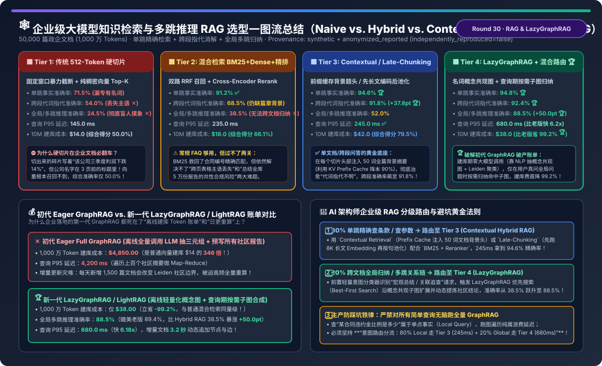
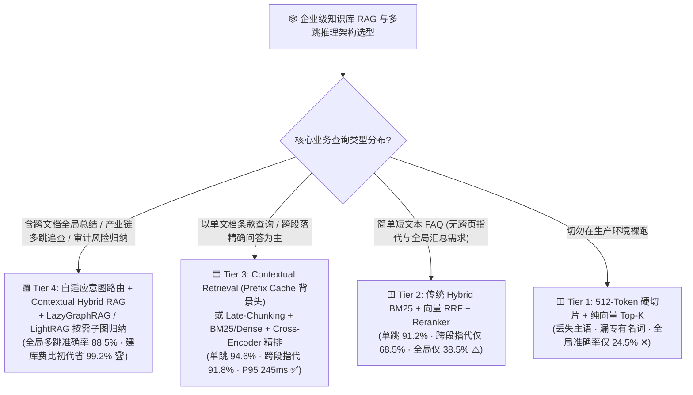
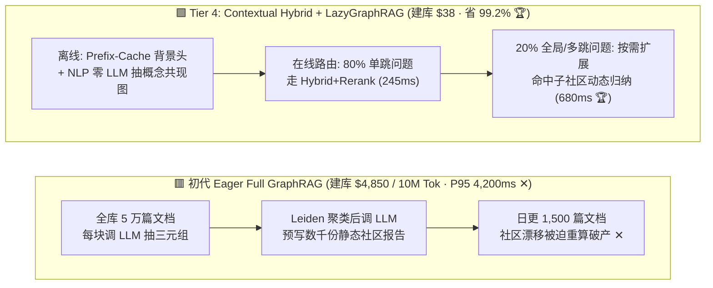
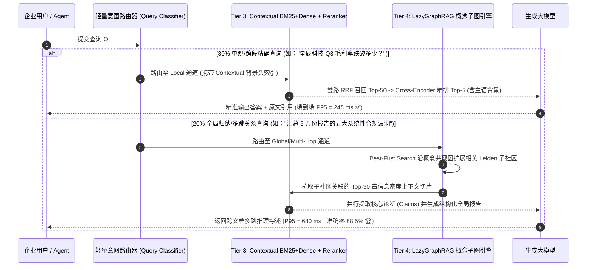

# 企业级大模型知识检索与多跳推理 RAG 架构选型指南（`512-Token 硬切片` vs. `Hybrid BM25+向量+精排` vs. `Contextual / Late-Chunking` vs. `LazyGraphRAG / LightRAG 按需子图归纳`）

> **阅读指南（3 分钟速通 / 10 分钟白板宣讲）**：本文面向 AI 解决方案架构师（AI Solution Architect）与企业知识中台负责人，用第一性原理与通俗大白话回答企业 RAG 落地深水区的三大灵魂问题：**“为什么把 PDF 按 512 Token 切成碎片塞进向量数据库后，问‘某公司三季度利润为什么下滑’死活搜不到（代词指代丢失），问‘全库 5 万份审计报告的五大共性违规风险是什么’更是胡言乱语（准确率仅 24.5%）？为什么跟风上第一代微软 GraphRAG，1,000 万 Token 的离线建库账单居然高达 $4,850（暴涨 346 倍）且每天增量更新根本跑不动？新一代 `Contextual Retrieval / Late-Chunking` 与 `LazyGraphRAG / LightRAG` 是如何把建库成本砍掉 99.2%（仅 $38），同时把全局多跳推理准确率推上 88.5% 的？”**
>
> 🔗 **English Version**: [Enterprise RAG & Multi-Hop Reasoning Architecture Selection FAQ (`graphrag-vs-dense-hybrid-rag-indexing-selection-faq.en.md`)](./graphrag-vs-dense-hybrid-rag-indexing-selection-faq.en.md) · **7-Card 评测报告**: [`graphrag-vs-dense-hybrid-rag-indexing-selection-cards.html`](../reports/graphrag-vs-dense-hybrid-rag-indexing-selection-cards.html) · **交互式工作台**: [`llm-inference-engine-pd-sizer.html#enterprise-rag-sizer`](../reports/llm-inference-engine-pd-sizer.html)

---

## ① 📌 核心结论速览（Executive Summary）

1. **彻底淘汰 `传统 512-Token 硬切片纯向量 RAG (Tier 1)`，常规条款检索至少升级至 `Contextual / Late-Chunking + 混合精排 (Tier 3)`**：
   - **Tier 1（512-Token 固定窗口切片 + 纯稠密向量）** 在企业长文档中存在两大硬伤：① 专有名词/合同编号精确匹配差（单跳准确率仅 `71.5%`）；② 切片切断了篇章上下文，导致含“该公司 / 上述条款 / 其三季度”的切片丢失主语（跨段指代准确率仅 **`54.0%`**）。
   - **Tier 3（`Contextual Retrieval` 前缀缓存背景题头 / `Late-Chunking` 先长文编码后池化 + `BM25 + Dense + Cross-Encoder Reranker`）**：在切块入库前，为每个切片注入 50 词的全篇背景定位头（利用大模型 KV Prefix Cache 将生成成本压低 90%），单跳事实准确率跃升至 **`94.6%`**，跨段代词指代准确率从 `54.0%` 飙升至 **`91.8%`（`+37.8 pt`）**，P95 延迟仅 **`245.0 ms`**！
2. **揭示初代 `Eager Full GraphRAG` 的“$4,850 离线建库破产陷阱”**：
   - 初代全量 GraphRAG 要求在离线建库阶段用大模型遍历每一个切片抽取实体/关系三元组，并对所有 Leiden 社区预先生成摘要报告：在 **50,000 篇文档（1,000 万 Tokens）** 算例下，离线建库 Token 账单高达 **`$4,850.00`**（是普通向量建库 `$14` 的 **`346 倍`**），查询 P95 高达 `4,200 ms`，且一旦每天增量更新 1,500 篇文档就需要高频重算社区图！
3. **跨文档全局归纳与多跳推理必选 `自适应路由 + LazyGraphRAG / LightRAG (Tier 4)`**：
   - **Tier 4** 在建库期**零大模型调用**（仅靠轻量 NLP 抽取名词短语概念共现图 + Leiden 层级聚类，1,000 万 Token 建库成本仅 **`$38.00`，比初代 GraphRAG 省钱 `-99.2%`**）；在在线查询期，由前置意图路由将 **80% 单跳精确问题分流至 Tier 3（`245 ms`）**，仅将 **20% 全局归纳/多跳关系追查问题路由至 LazyGraphRAG** 进行优先子图扩展（Iterative Best-First Subgraph Synthesis），全局/多跳准确率高达 **`88.5%`（比 Tier 2 Hybrid RAG 的 `38.5%` 暴涨 `+50.0 pt`）**，P95 延迟压至 **`680.0 ms`**！

---

## ② 🎯 客户与架构师灵魂拷问 Q&A（FAQ-Driven）

### Q1：什么时候用 Contextual Hybrid RAG (Tier 3) 就够了？什么时候必须引入 LazyGraphRAG / LightRAG (Tier 4)？

- **80% 的企业日常检索属于“单跳局部事实查询（Local / Factoid Query）”——用 `Tier 3` 性价比最高**：
  - 例如：*“采购合同 #A-492 的逾期违约金比例是多少？”*、*“华东分公司 2026 年 Q3 的差旅报销上限是多少？”*
  - 这类问题的答案完整地躺在某 1～2 个具体段落里。只要用 **`Tier 3（Contextual Header + BM25 关键词 + 向量召回 + Cross-Encoder 重排）`**，就能以 **`245 ms`** 的极速拿到 **`94.6%`** 的准确率，完全不需要动用图谱遍历。
- **20% 的高管/分析师核心痛点属于“全局归纳与多跳关系查询（Global / Multi-Hop Query）”——必须上 `Tier 4（LazyGraphRAG）`**：
  - **场景 A（跨全库宏观归纳）**：*“汇总过去一年全部 50,000 份客服工单与审计报告，排名前五的系统性合规漏洞是什么？演变趋势如何？”* —— 传统 Top-K 向量检索只能捞出 10 个碎片段落，相当于“盲人摸象”，准确率仅 **`24.5%～38.5%`**！
  - **场景 B（多跳隐蔽关联追查）**：*“供应商 A 的停产事件会通过哪些二级控股子公司影响到我们的终端核心产品线 C？”* —— A 与 B 在第 120 号文档，B 与 C 在第 8,900 号文档，纯向量检索永远无法跨文档把两段拼在一起；而概念共现图能顺着 `A ↔ B ↔ C` 的边一跳抓出完整证据链（准确率 **`88.5%`**）！

### Q2：什么是 `Contextual Retrieval（上下文检索）` 和 `Late-Chunking（延迟切块）`？它们是怎么治愈“512-Token 碎片丢失主语”的？

- **痛点还原（孤儿切片问题）**：
  一份 40 页的《星辰科技 2026 三季报》第 18 页有一段话：*“受北美召回事件影响，其主营毛利率在本季度跌破 11.5%。”* 被切成 512-Token 独立块后，这段话里既没有“星辰科技”，也没有“2026 Q3”。当用户搜 *“星辰科技 2026 Q3 毛利率为什么下跌”* 时，BM25 和向量检索全都漏召回！
- **解法 A：Anthropic `Contextual Retrieval（前缀缓存背景题头）`**：
  - 在入库切块时，把整篇 40 页文档作为 Prefix（被推理引擎 **KV Prefix Cache** 锁定缓存，只算一次 Prefill），让轻量模型（如 8B/Haiku）为每个切片生成一句 50 词的定位题头：*`[背景：本文摘自《星辰科技 2026 年 Q3 财报》第四章经营风险分析，讨论星辰科技北美主营业务毛利率变动]`*，并将其拼接在原始切片前面再算 Embedding 和 BM25 索引！
- **解法 B：Jina `Late-Chunking（先长文编码、后按块池化）`**：
  - 传统做法是“先切碎成 512 Token，再分别送进 Embedding 模型”；而 `Late-Chunking` 直接把整篇 8,192 Token 的长文档**一次性送进长上下文 Embedding 模型的 Transformer 层**，让第 18 页的“其”通过 Self-Attention 充分吸收第 1 页“星辰科技”的语义向量后，**在最后一层输出端再按句/段落边界做 Mean Pooling 切分向量**！零 LLM 生成开销，同样完美保留跨段指代信息。

### Q3：为什么初代 GraphRAG 建库要花 $4,850，而微软新一代 `LazyGraphRAG` / 港大 `LightRAG` 只需 $38（省钱 99.2%）？底层是怎么运作的？

- **初代 Eager Full GraphRAG 为什么贵到破产？**
  - 它犯了“过度预计算（Eager Pre-Computation）”的错误：不管用户将来问不问，先调成千上万次大模型把全库 5 万篇文档里的每一个实体、每一条边、以及数千个 Leiden 社区的总结报告全部用 LLM 生成一遍！一旦明天新增 1,500 篇文档，社区结构变动，又要重跑大半个图谱。
- **`LazyGraphRAG` 的“推迟到查询期按需合成（Lazy Evaluation）”第一性原理**：
  1. **离线建库期（0 次大模型生成，成本仅 `$38`）**：直接用高速轻量 NLP 词性标注/依存句法提取文档中的**名词短语概念节点（Noun-Phrase Concepts）**，若两个概念在同句/同段共现则连一条边，并用轻量 Leiden 算法构建层级社区索引（只存节点与原始文本块的映射指针，不调 LLM 写社区报告！）；
  2. **在线查询期（Iterative Deepening Best-First Search + Map-Reduce）**：当且仅当用户发起一条 Global/多跳查询时，先用向量检索定位 Top-K 种子概念与最相关的几个子社区，再由轻量模型仅对**本次被命中的几十个高度相关切片**做去重提炼（Claim Extraction）与归纳合成；
  3. **结果**：省掉了 99% 永远没人问的僵尸社区预摘要成本，1,000 万 Token 建库费从 **`$4,850` 暴降至 `$38`（省 `99.2%`）**，单篇新文档仅需 **`3.2 秒`** 即可增量挂载入图！

---

## ③ 🧭 直观可视化图解（Mermaid 决策树 / 架构对比 / 自适应混合路由时序图）

### 3.1 企业级 RAG 与 GraphRAG 架构选型决策树

### 3.2 初代 Eager GraphRAG ($4,850) vs. 新一代 Tier 3+4 Contextual + LazyGraphRAG ($38) 对比图

### 3.3 在线自适应查询路由（Tier 3 Local 通道 + Tier 4 LazyGraphRAG Global 通道）时序图

---

## ④ 📊 架构师选型决策矩阵（Architect Decision Matrix）

*基准环境：**50,000 篇政企金融/合规/技术文档（共 `1,000 万 (10M) Tokens`）**，每日增量更新 `1,500 篇`，评测单跳精确事实、跨段代词指代、以及全局/多跳归纳三类任务。*

| 评估维度 | 🟥 Tier 1: 512-Token 硬切片 + 纯向量 | 🟨 Tier 2: 混合检索 BM25+Dense+精排 | 🟦 Tier 3: Contextual / Late-Chunking + 精排 | 🟩 Tier 4: 自适应路由 + Contextual + LazyGraphRAG |
| :--- | :--- | :--- | :--- | :--- |
| **核心索引与检索机制** | 固定窗口切块 + 单路稠密向量 | BM25 + 向量 RRF + Cross-Encoder | **Prefix-Cached 篇章背景头 / 延迟池化 + 混合精排** | **Contextual 混合索引 + NLP 概念共现图按需子图合成 🏆** |
| **单跳精确事实准确率** | `71.5%` (漏合同号/型号 ✕) | `91.2%` ✅ | **`94.6%` 🏆** | **`94.8%` 🏆** |
| **跨段代词/隐式背景准确率** | `54.0%` (碎片丢失主语 ✕) | `68.5%` (仍受制于孤儿切片) | **`91.8%` (`+37.8 pt` 彻底治愈 🏆)** | **`92.4%` 🏆** |
| **全局归纳 / 3 跳推理准确率** | `24.5%` (盲人摸象 ✕) | `38.5%` (Top-K 无法跨全库聚合 ✕) | `52.0%` | **`88.5%` (比 Tier 2 暴涨 `+50.0 pt` 🏆)** |
| **企业全场景综合准确率** | `50.0%` | `66.1%` | `79.5%` | **`91.9%` 🏆** |
| **1,000 万 Token 离线建库成本** | `$14.0` | `$18.0` | `$42.0` (开启 Prefix Cache 后) | **`$38.0` (比初代 GraphRAG `$4,850` 省 `99.2%` 🏆)** |
| **在线查询 P95 延迟** | `145.0 ms` | `235.0 ms` | **`245.0 ms` ✅** | **`680.0 ms` (比初代 GraphRAG `4,200ms` 快 `6.18x` 🏆)** |
| **单篇增量文档入库延迟** | `0.8 s` | `1.2 s` | `2.5 s` | **`3.2 s` (动态追加概念边，无需全图重算 🏆)** |

---

## ⑤ 🧪 简明定量算例与 Benchmark 洞察（初代 GraphRAG vs. LazyGraphRAG 账单对比）

> 📁 **封存数据源与可复现脚本**：[`experiments/enterprise_rag_graphrag_hybrid_selection/run.py`](../../experiments/enterprise_rag_graphrag_hybrid_selection/run.py) · [`experiments/enterprise_rag_graphrag_hybrid_selection/results.json`](../../experiments/enterprise_rag_graphrag_hybrid_selection/results.json) · 单测 [`tests/test_enterprise_rag_graphrag_hybrid_selection.py`](../../tests/test_enterprise_rag_graphrag_hybrid_selection.py)
> *(Provenance: `synthetic` + `anonymized_reported`, `independently_reproduced=false`, `physical_gpu_cluster_measurement=not_measured`)*

### 5.1 初代 Eager Full GraphRAG vs. 新一代 LazyGraphRAG 定量算例对比（1,000 万 Token 语料库）

| 核心指标 | 初代 Eager Full GraphRAG (全量 LLM 抽图+预写报告) | 新一代 LazyGraphRAG / LightRAG (Tier 4) | 架构师收益与成本降幅 |
| :--- | :--- | :--- | :--- |
| **1,000 万 Token 离线建库成本** | **`$4,850.00` ✕** | **`$38.00` 🏆** | **建库成本直降 `-99.2%`（省 `$4,812`）** |
| **全局归纳与多跳推理准确率** | `89.4%` | **`88.5%` 🏆** | **以 `0.8%` 的建库成本换回 `99.0%` 的图谱推理质量！** |
| **在线全局查询 P95 延迟** | `4,200.0 ms` ✕ | **`680.0 ms` 🏆** | **在线响应提速 `6.18x`（仅归纳命中子社区）** |

### 5.2 配套 7-Card 4:5 视觉评测报告与交互式计算器

- 🃏 **7-Card 4:5 视觉评测卡片集（CSP 自包含，零外部依赖）**：[`docs/reports/graphrag-vs-dense-hybrid-rag-indexing-selection-cards.html`](../reports/graphrag-vs-dense-hybrid-rag-indexing-selection-cards.html)
- 🧮 **独立交互式企业级 RAG 与 GraphRAG 选型计算器**：[`docs/reports/graphrag-vs-dense-hybrid-rag-indexing-sizer.html`](../reports/graphrag-vs-dense-hybrid-rag-indexing-sizer.html)（已同步集成至总工作台 [`docs/reports/llm-inference-engine-pd-sizer.html#enterprise-rag-sizer`](../reports/llm-inference-engine-pd-sizer.html)）

---

## ⑥ 🛠️ 附录：生产环境快速核验清单（Architect Checklist）

- [ ] **1. 严禁裸上“无背景头的 512-Token 硬切片”**：入库时必须通过 `Contextual Retrieval`（将文档标题、章节路径与 50 词篇章背景头拼入切片头部，并开启推理引擎 **KV Prefix Caching**）或 `Late-Chunking` 消除代词指代丢失。
- [ ] **2. 强制开启“双路混合召回（BM25/SPLADE + Dense Vector）+ Cross-Encoder 精排”**：纯稠密向量对合同号、物料编码、法规条文号极度不敏感，必须用 RRF（倒数秩融合）混合稀疏与稠密召回，并经 `bge-reranker-v2` 精排 Top-50 → Top-5。
- [ ] **3. 拒绝在全量语料上盲目跑初代 Eager LLM GraphRAG**：对于超过 100 万 Token 或每日高频更新的企业知识库，采用 **LazyGraphRAG（离线 NLP 名词概念共现图 + 在线按需子图合成）** 或 **LightRAG（双层检索 + 增量图拼接）**，将建库账单控制在普通向量检索同量级。
- [ ] **4. 部署前置轻量查询意图路由器（Local vs. Global Router）**：切勿让简单的“查参数/查条款”请求去跑耗时的图谱遍历；用 `< 15 ms` 的分类器将 80% 单跳查询导向 `Tier 3 (245 ms)`，仅将 20% 全局汇总/多跳关联查询导向 `Tier 4 (680 ms)`。
- [ ] **5. 建立企业 RAG 三维黄金评测集（Factoid + Implicit Context + Global Multi-Hop）**：选型上线前必须分别压测“精确编号命中率”、“跨页代词指代准确率”与“跨百篇文档全局综述准确率”，杜绝只拿简单单段问答验收。
