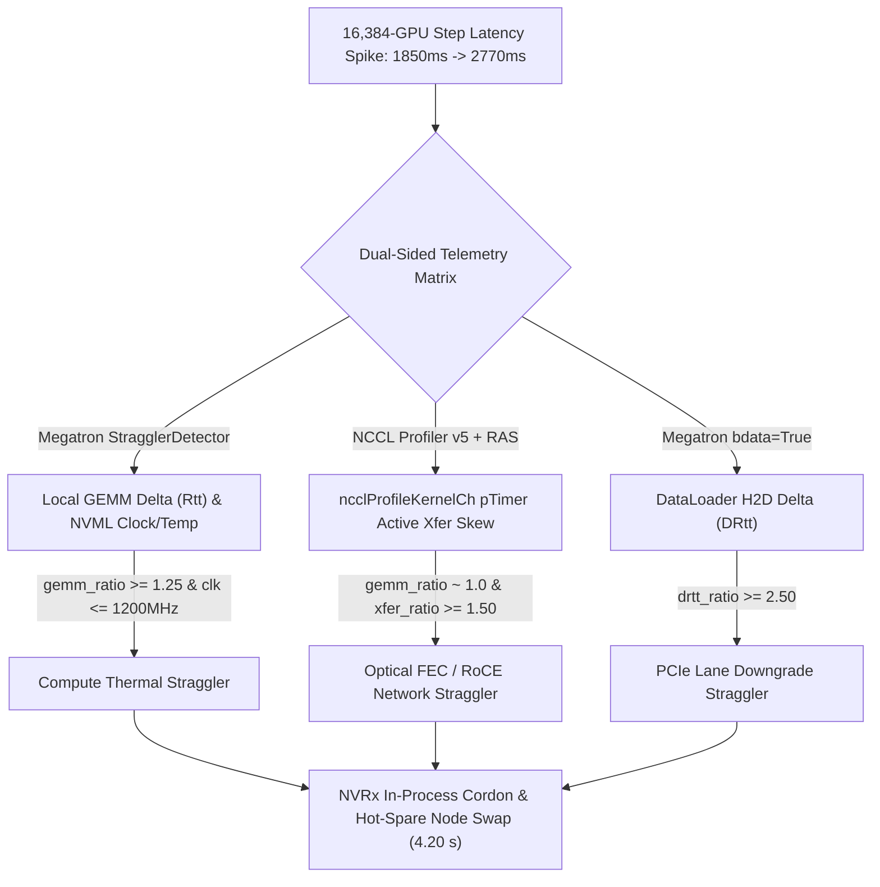

# 万卡同步训练灰故障（Grey Failure / Slow Straggler）双端遥测定位与热备秒级替换

## 1. 为什么“灰故障（Grey Failure）”比硬崩溃（`Xid`）对万卡集群更具破坏力？

在 [万卡同步训练容错与 SDC 防御](fault-tolerant-training-resilience.md) 与 [GPU HBM3e ECC 行重映射与预测性排空](gpu-ecc-row-remapping-predictive-failure.md) 中，我们解决了显式硬件异常（如 `Xid 64/94/95`、进程崩溃或心跳超时）。然而在 `16,384` 卡同步训练生产集群中，最具破坏力的往往是不触发报错、不中断进程的 **灰故障（Grey Failure / Slow Straggler）**：
1. **局部热节流计算慢节点（Compute Thermal Straggler）**：冷板微流道局部结晶或导热垫老化导致单颗 GPU 温度升至 `88°C+`，触发固件 `SW Thermal Slowdown`，SM 频率从 `1,980 MHz` 跌至 `900 MHz`（单卡 GEMM 变慢 `1.50x`），但 CUDA 内核依然返回 `cudaSuccess`。
2. **光模块 FEC 重传网络慢节点（Network FEC Straggler）**：400G/800G 光模块端面污染或激光器偏置老化导致误码率（BER）逼近 `RS(544, 514)` 纠错极限，底层链路频繁重传与 PFC 反压使单端口有效 RoCEv2/IB 带宽下降 `67%`（集合通信耗时膨胀 `3.00x`），却未达到 `IBV_WC_RETRY_EXC_ERR` 断连阈值。
3. **PCIe 链路降级慢节点（PCIe Lane Degradation）**：主机 PCIe Gen5 x16 因信号完整性抖动协商降级为 `Gen4 x4`（带宽缩水 `8.0x`），拖慢 DataLoader `H2D` 与激活卸载。

**同步屏障放大效应**：在 `TP=8 × PP=16 × DP=128`（`16,384` 卡）中，单颗 GPU 的计算变慢会通过 `PP=16` 微批次流水线传染给同 DP 组全部 `16` 个 Stage，再通过每步末尾的 `DP=128` AllReduce 同步屏障迫使全集群其余 **`16,383` 颗健康 GPU 空转等待**！但因为所有等待方在火焰图上都表现为“卡在 `ncclKernel_AllReduce`”，传统的日志监控无法区分谁是真正的肇事慢节点（Root-Cause Straggler），谁是无辜的受害等待者（Victim Rank）。

---

## 2. 一手源码核验：`Megatron-LM StragglerDetector` 与 `NCCL Profiler v5` (`implementation`)

我们核验了 `NVIDIA/Megatron-LM` 与 `NVIDIA/nccl` 的一手源码遥测契约：

1. **`NVIDIA/Megatron-LM` 本地算子与数据加载精细计时器（`megatron/core/utils.py`, blob `efbfdfa3d9580c8750109b09ad4026bc68cf3e7c`；`megatron/core/README_STRAGGLER.md`, blob `fe9062c851ad9339439756e03d70c7858f1a0ab9`）**：
   - `StragglerDetector`（`utils.py` 行 `1617-1965`）通过预分配的 CUDA Event 队列（`start_gemm_ev` / `stop_gemm_ev` 与 `start_data_ev` / `stop_data_ev`）精确隔离 **纯本地算子耗时 `delta`（`Rtt`）** 与 **数据加载耗时 `batch_delta`（`DRtt`）**，完全排除跨节点 DP AllReduce 同步等待时间的污染。
   - 在 `elapsed()` 与 `report()` 中，它同步采集 NVML 硬件遥测（`temp`、`power`、`util`、`clock`）并计算各 Rank 估计吞吐 `Etpt`，在 Rank 0 上汇总输出全局极值（`MnRtt/Rnk`、`MxRtt/Rnk`、`MnClk/Rnk`、`MxDRtt/Rnk` 与 `Bottom N Ranks with lowest Etpt(TF)`），并支持通过 `curl Rank0Host:65535` 零重启在线开启/关闭。
2. **`NVIDIA/nccl` GPU 驻留进度计数器与 `ncclProfileKernelCh` 通道级时间戳（`src/include/comm.h`, blob `baaa38427da33a916df6f43c1fc9ea9607f95ab1`；`src/include/plugin/profiler/profiler_v5.h`, blob `be5705d2e4d76b9a023f0b0934c30318acaaadbf`）**：
   - `struct ncclComm`（`comm.h` 行 `820-839`）维护了獨立于 GPU 完成计数的 Host 集合序列号 `seqNumber[NCCL_NUM_FUNCTIONS]`，以及供 RAS（Reliability, Availability, Serviceability）子系统直接轮询的 GPU 驻留进度计数器镜像 `hostCountersBlock` / `deviceCountersBlock` 与 `gpuTimerOffsetNs`。
   - `profiler_v5.h` 中的 `ncclProfileKernelCh` 事件在每个集合通信 Channel 启动与完成时记录 GPU `globaltimer` 时间戳 `pTimer`。通过对比某个 Rank **进入集合通信的时间戳 $t_{\text{enter}}(r)$** 与 **实际通道数据传输完成时长 $\Delta t_{\text{ch}}(r) = t_{\text{exit}}(r) - \max_{\text{peer}} t_{\text{enter}}(\text{peer})$**，即可在数学上完全解耦“因自己算得慢而晚到集合点（Compute Straggler）”与“准时到达集合点但网卡传输慢（Network Straggler）”。

---

## 3. 定量实验：16,384 卡灰故障 MFU 坍塌与双端遥测自动换备收益 (`own-offline`)

在 `experiments/grey_failure_straggler_detector/run.py` 中，我们对 `16,384x H100`（`TP=8, PP=16, DP=128`，健康单步 `1,850.0 ms`，基准 `54.0% MFU`）下的 5 类场景及 30 天（`720` 小时，`72` 次灰故障事件）集群有效吞吐（Goodput）进行了确定性仿真：

| 故障场景 ID | 真实根因类别 | 本地 GEMM 倍率 (`Rtt`) | NCCL 通道传输倍率 (`KernelCh`) | DataLoader 倍率 (`DRtt`) | 分类器判定结果 | 全集群单步耗时 (`ms`) | 全集群有效 MFU (`%`) | 全集群 MFU 跌幅 / 等效浪费卡数 |
|---|---|---|---|---|---|---|---|---|
| `healthy_baseline` | `none` | `1.000x` (`1980 MHz`) | `1.000x` | `1.000x` | `none` (✓) | `1,850.00 ms` | **`54.00%`** | `0.00%` / `0` GPUs |
| `thermal_sm_throttle_945mhz` | `compute_straggler` | **`1.500x` (`900 MHz, 88°C`)** | `1.000x` | `1.000x` | `compute_straggler` (✓) | `2,758.80 ms` | **`36.21%`** | **`-32.94%` (`5,396.9` GPUs)** |
| `optical_fec_retry_roce_degrade` | `network_straggler` | `1.000x` (`1980 MHz`) | **`3.000x`** | `1.000x` | `network_straggler` (✓) | `2,770.00 ms` | **`36.06%`** | **`-33.22%` (`5,442.8` GPUs)** |
| `pcie_gen4_x4_link_downgrade` | `pcie_dataloader_straggler` | `1.040x` (`1965 MHz`) | `1.350x` | **`8.000x`** | `pcie_dataloader_straggler` (✓) | `2,293.70 ms` | **`43.55%`** | **`-19.35%` (`3,170.3` GPUs)** |
| `compound_thermal_plus_fec_grey_fault` | `compound_straggler` | **`2.100x` (`900 MHz, 89°C`)** | **`3.500x`** | `1.000x` | `compound_straggler` (✓) | `4,999.36 ms` | **`19.98%`** | **`-63.00%` (`10,321.9` GPUs)** |

### 30 天万卡集群恢复对比与架构师守则
1. **单颗慢卡即可瘫痪三分之一至三分之二座万卡集群**：仅 `1` 颗 GPU 发生 `1.50x` 热节流或 `1` 条光链路发生 `3.00x` FEC 降速，就会将 `16,384` 卡集群的整体有效 MFU 拖垮 **`32.94%–33.22%`**（相当于 **`5,400+` 颗 H100 白白空转**）；复合灰故障更会使集群 MFU 暴跌 **`63.00%`**（跌至 `19.98%`，等效浪费 `10,321.9` 颗 GPU）。
2. **从 `71.35%` 到 `98.83%` 的 30 天有效 Goodput 跃升**：在人工排查模式下（平均每次灰故障潜伏 `5.6` 小时才被二分法定位并执行 `15 min` Slurm 重启），30 天有效训练 Goodput 跌至 **`71.35%`**；而结合 `Megatron StragglerDetector` + `NCCL Profiler v5` 双端差分矩阵（`2` 步滑动窗口 = **`3.70 s` 检出**，分类准确率 **`100.0%`**）与 `NVRx` 进程内热备替换（**`4.20 s` 换备**），30 天有效 Goodput 恢复至 **`98.83%`（提升 `+27.48 pts`）**。
