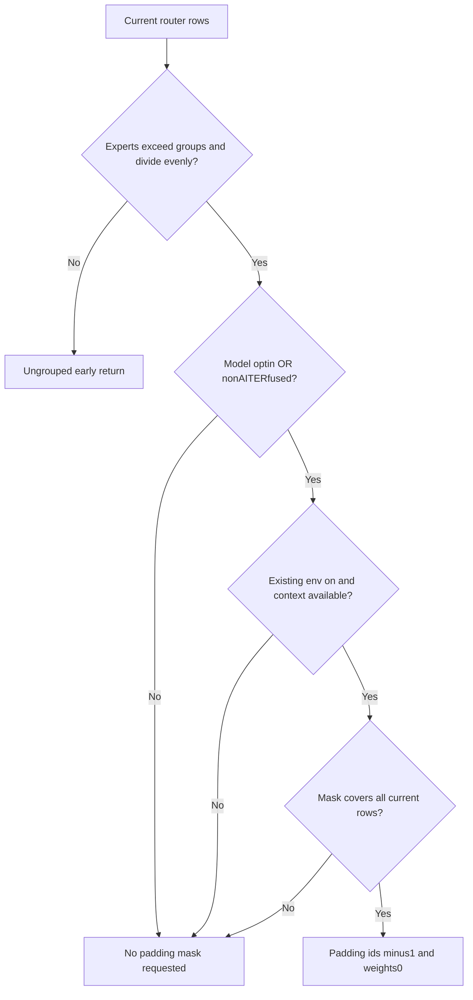
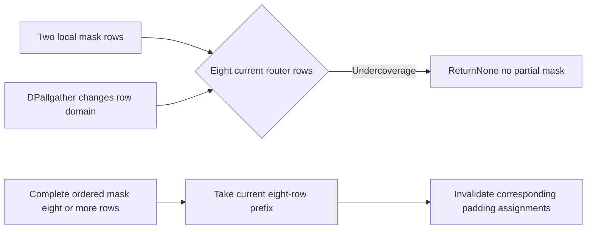
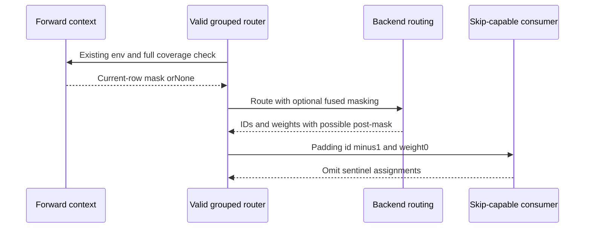

# Grouped MoE selection FAQ: padding eligibility,complete row witnesses and the−1skip sentinel

> **Language**: English | [中文](grouped-moe-padding-mask-coverage-sentinel-selection-faq.md)  
> **Round159**: actualNov14grouped-router policy correction.The existing environment default1is not newly introduced.Original eight-row ledger:expert scalar calls **16→8**,live-output misses **0/4**,declared route payload unchanged at **128 B**.`synthetic`, `independently_reproduced=false`;CPU timing separately `measured`.
>
> [H5](../reports/grouped-moe-padding-mask-coverage-sentinel-sizer.html) · [Seven cards](../reports/grouped-moe-padding-mask-coverage-sentinel-selection-cards.html) · [1600px SVG](../../assets/svg/grouped-moe-padding-mask-coverage-sentinel-selection-faq-summary.svg) · [Experiment/evidence](../../experiments/grouped_moe_padding_mask_selection/README.md)

## Q1: When should grouped routing mask DP/CUDA Graph padding by default?

Not every MoEorROCmpath.The change replaces `skip_padding` with `model_optin OR NOT AITER_fused` in the **valid grouped branch**.The existing environment switch,forward context and mask coverage checks still apply.

| Path | Scope |
| :--- | :--- |
| Valid non-AITERgrouped routing | Consult existing context mask without model opt-in |
| AITERfused MoE | Retain caller opt-in;source comments constrain the DeepEPv2scenario,not verified locally |
| Invalid grouping | Earlier ungrouped fused-topk/bias fallback returns |
| Env off/missing context/incomplete mask | Property true does not mean a mask is applied |

`masks_padding=True` is a router property—not an available mask or hardware skip-capability certificate.

## Q2: Why cannot zero weights replace the−1expert id?

A zero weight removes output contribution,not necessarily expert execution.The supported consumer interprets−1as a **skip sentinel**,not Python's last-element index.

The original ledger predefines eight rows,topk2andfour padding rows;it does **not compute grouped logits/top-k**.Masking writes `[-1,-1]` IDs and `[0,0]` weight numerators.The explicitly skip-aware scalar consumer executes16→8expert calls and preserves four live-row integer output numerators.

| Original consumer input | Contribution | Scalar expert calls |
| :--- | :--- | :--- |
| Valid id,weight0 | Zero | Still executed |
| Id−1,weight0,supported skip | Zero | Skipped |
| Id−1,unsupported consumer | No success output | Original explicit error |

Weights are **integer numerators/unit10**,not native FP32gating values.Rejecting an unsupported consumer is an original scope guard,not a claim that native factory adds the same field/check or that DeepEPconfiguration is authorized.

## Q3: Why cannot a local mask simply be sliced onto all-gathered rows?

Naive DPdispatch may all-gather several ranks' rows before routing.The forward mask can describe only local rows.New `get_moe_padding_mask` requires `mask.shape[0] >= num_tokens`;otherwise it returnsNone,not a partial application,replicated mask or invented suffix.

The two-row/eight-route original case explicitly reports `mask_undercoverage_return_none`.Legacy undercoverage is not executed;we invent neither successful native output nor a specific GPUfailure.

Length coverage is **necessary,not sufficient**.Mask ordering must match current router ordering.Rank concatenation,reordering and EPLBlogical-to-physical mapping are not certified by a shape check.The original ledger assumes already ordered witnesses and executes none of those operations.

## Q4: Which paths mask inside routing versus afterward,and does memory shrink?

Supported CUDAfused grouped operators can receive kernel padding.XPUexternal operators retain their ABIandpost-mask.Torch grouped fallback uses masked fill.AITERretains its interface and masks afterward.These are **not one universal fused kernel**.

IDs/weights retain `N×topk`shape.Our declared int32ID/FP32weight payload is8rows×2×8B=**128B**before and after—not Python/Torch object overhead,allocator peak or entire native MoEmemory.

Assignment/scalar-call counts do not translate directly into native GEMMFLOPs,DeepEPtraffic,SMoccupancy or model throughput.EPLB,shared experts,expert dispatch and graph execution were not run.

## Q5: How were live outputs and the zero-weight baseline checked?

Eight tests cover the default branch,AITERopt-in,ungrouped early return,independent env/context/mask gates,undercoverage,long-prefix masks,consumer capability,sentinel versus zero weight,empty rows and invalid schemas.64random policy/mask cases compare every live row;Node/Python compare65configurations/130outcomes.

| Original rows | Sentinel skip / ms | Valid-id zero-weight compute / ms |
| :--- | ---: | ---: |
| 64 | 0.022267 | 0.027667 |
| 256 | 0.090600 | 0.110533 |
| 1024 | 0.369800 | 0.454500 |
| 4096 | 1.544467 | 1.791267 |

Both timed paths use the same masked weights and return **identical integer outputs for all rows**.Sentinels avoid original scalar calls;zero-weight-only input still executes them.Observed counts areNversus2N.The sealed samples record2warmups,7alternating repeats,3operations/sample and median repeat means.

Setup,logits/topk,GEMMs,EPLB,CUDA/AITER/DeepEP,DPallgather,graph replay and model throughput are excluded.Main provenance is synthetic;CPU samples are measured.Native unknowns are not zeros,and browser visual acceptance is not claimed.

## Q6: What independent contracts need production acceptance?

Confirm pinned version and actual valid-grouping branch.Verify the environment switch,forward context,current mask length and row ordering.For AITER,check real DeepEPv2/model opt-in and consumer skip support—not just the property.Validate sentinel/zero-weight pairs,unchanged live outputs,local/global row domains and sentinel preservation through EPLB.Then measure real experts,communication and model workloads;ledger counts are not native metrics.

Unlike the earlier sampler flag-refresh study,this concerns **MoErouting assignment padding identity and consumer skip protocol**,not sampling fast-path flags after retained rows change.Primary evidence is linked,not mirrored;Apache-2.0rights remain.

**Pinned primary evidence**:

- [ActualNov14commit](https://github.com/vllm-project/vllm/commit/fee9686811b7c060c404dba0c6a5a6007de4659b)
- [Grouped router,early return and backend masks](https://github.com/vllm-project/vllm/blob/fee9686811b7c060c404dba0c6a5a6007de4659b/vllm/model_executor/layers/fused_moe/router/grouped_topk_router.py)
- [Context mask coverage](https://github.com/vllm-project/vllm/blob/fee9686811b7c060c404dba0c6a5a6007de4659b/vllm/model_executor/layers/fused_moe/router/base_router.py)
- [Existing environment switch/AITERscenario](https://github.com/vllm-project/vllm/blob/fee9686811b7c060c404dba0c6a5a6007de4659b/vllm/envs.py)
- [Native grouped top-k tests](https://github.com/vllm-project/vllm/blob/fee9686811b7c060c404dba0c6a5a6007de4659b/tests/kernels/moe/test_grouped_topk.py)
- [Apache-2.0LICENSE](https://github.com/vllm-project/vllm/blob/fee9686811b7c060c404dba0c6a5a6007de4659b/LICENSE)
