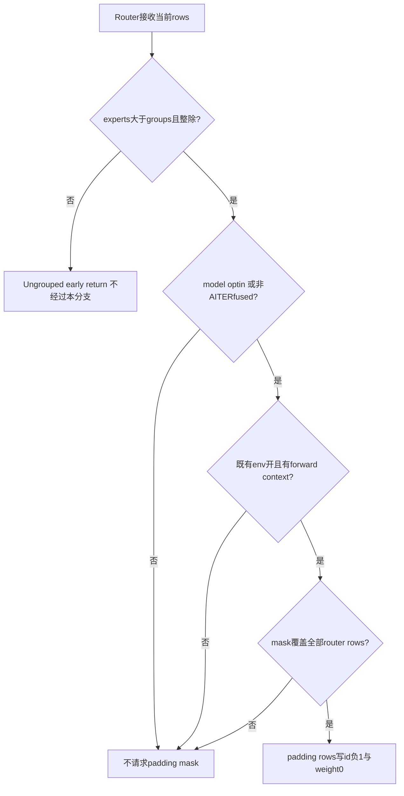
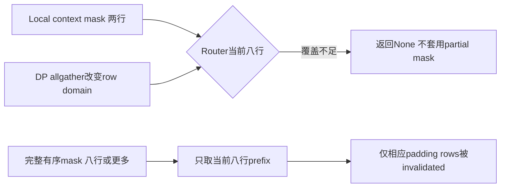
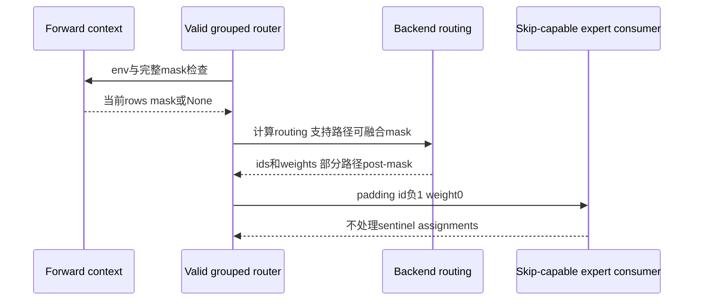

# Grouped MoE 架构选型 FAQ：padding eligibility、完整 row witness 与 -1 skip sentinel

> **语言**：中文 | [English](grouped-moe-padding-mask-coverage-sentinel-selection-faq.en.md)  
> **Round159**：实际 Nov14 grouped-router policy 修正；既有环境变量默认 `1` 不是本次新增。原创八行 route ledger：expert scalar calls **16→8**，四个 live row 输出错 **0/4**，声明的 route payload 仍 **128 B**。`synthetic`，`independently_reproduced=false`；CPU 时延另标 `measured`。
>
> [H5](../reports/grouped-moe-padding-mask-coverage-sentinel-sizer.html) · [七卡](../reports/grouped-moe-padding-mask-coverage-sentinel-selection-cards.html) · [高清 SVG](../../assets/svg/grouped-moe-padding-mask-coverage-sentinel-selection-faq-summary.svg) · [实验/证据](../../experiments/grouped_moe_padding_mask_selection/README.md)

## Q1：何时让 grouped routing 默认屏蔽 DP/CUDA Graph padding？

该修正不是“所有 MoE、所有 ROCm 都默认跳过 padding”。它把 **有效 grouped 分支** 的 `masks_padding` 从单独 `skip_padding` 改成 `model_optin OR NOT AITER_fused`；之后还要经过既有 `VLLM_MOE_SKIP_PADDING`、forward context 和 mask 覆盖检查。

| 路径 | 这段 policy 的适用范围 |
| :--- | :--- |
| 非 AITER 的有效 grouped 路径 | 无需 model opt-in 就请求既有 context mask |
| AITER fused MoE | 仍需调用方 opt-in；source 注释限定 DeepEP v2 场景，不由本机认证 |
| invalid grouping | 先走 ungrouped fused-topk/bias fallback 并返回 |
| env off / context 缺失 / mask 不足 | 即使 property 为 true，也不实际应用 mask |

`masks_padding=True` 是 **路由器属性**，不是已得到一个可应用的 mask，更不是整个 MoE pipeline 的硬件 skip 支持证明。

## Q2：为什么 weight=0 不能替代 id=-1？

零权重只说明输出加权时不贡献结果，不保证 dispatch 或专家 kernel 不执行。id `-1` 是该支持路径的 **skip sentinel**，不能用 Python 的负下标语义把它映射成最后一个专家。

原创输入为八行、topk=2、四个 declared padding rows，ids/weights 已预先给定，**没有模拟 grouped logits/top-k 选择**。正确 mask 同时将 padding rows 的 ids 变成 `[-1,-1]`、weight numerators 变成 `[0,0]`。原型 consumer 明确理解 sentinel，于是 expert scalar calls 从16变8，四个 live row 的整数输出 numerators 不变。

| 原创 consumer 输入 | 输出贡献 | Expert scalar calls |
| :--- | :--- | :--- |
| 合法 expert id、weight=0 | 零 | 仍执行 |
| id=-1、weight=0、consumer 支持 skip | 零 | 不执行 |
| id=-1 但不支持 sentinel | 不提供成功结果 | 原型显式错误 |

工作台的权重是 **整数 numerator/unit10**；这不是 native FP32 gating 数值。原型对 unsupported consumer 显式报错，是安全的范围检查，不代表原生 factory 增加了同名检查，也不授予 DeepEP 配置权限。

## Q3：为什么 local mask 不能直接 slice 给 all-gather 后的 rows？

naive DP dispatch 可能先 all-gather 多个 rank 的 rows，再调用 router。此时 context mask 只描述本 rank，长度可能小于全局 router rows。新 `get_moe_padding_mask` 要求 `mask.shape[0] >= num_tokens`，不足就返回 `None`，**不是复制、补 False、部分套用或补 True**。

原型两行 mask 面对八行 routes，after 状态明确标记 `mask_undercoverage_return_none`。旧 branch 的 undercovered mask 不执行；native 旧行为可能涉及形状或 kernel 范围问题，本机不编造成功输出或具体 GPU 故障。

足够长也只满足 **必要条件**：mask ordering 必须与 router row ordering 对齐。全局 rank 拼接、重排、EPLB logical→physical map 都不能被一个长度检查证明；原型假设输入 witness 已按当前 rows 排列，不执行这些过程。

## Q4：哪些 backend 在 kernel 内 mask，哪些在 routing 后 mask？内存会减少吗？

CUDA 的支持 fused grouped operator 可接收 kernel padding；XPU 外部 operator 保留 ABI 并 post-mask；Torch grouped fallback 使用 masked fill；AITER 仍使用已有接口并在 routing 后 mask。**不能把所有路径描述为同一个 fused kernel**。

mask 后仍保留 `N × topk` 的 ids/weights shape。原创声明 int32 ids、FP32 weights，因此八行×topk2×8B = **128 B**，before/after 相同；这只是逻辑 route payload，不是 Python/Torch object、allocator peak 或 native 全 pipeline 显存。

同样，减少原型的 assignment/scalar-call 数，不能直接换算为真实 GEMM FLOPs、DeepEP 字节、SM 占用率或 model throughput。EPLB mapping、shared experts、expert dispatch backend 与 graph execution 都未运行。

## Q5：如何验证真实 rows 不变，并区分 skip 与 zero-weight baseline？

八项测试覆盖默认分支、AITER opt-in、ungrouped early return、env/context/mask 独立性、undercoverage、长 mask prefix、consumer capability、sentinel/zero-weight、空 rows 和 schema 错误。64 个随机 policy/mask 样例逐 live row 比较 before/after；Node/Python 比较65配置的130组 outcomes。

| 原创 rows | Sentinel skip / ms | 合法id但zero-weight compute / ms |
| :--- | ---: | ---: |
| 64 | 0.022267 | 0.027667 |
| 256 | 0.090600 | 0.110533 |
| 1024 | 0.369800 | 0.454500 |
| 4096 | 1.544467 | 1.791267 |

这里两路使用相同 masked weights，返回 **所有行都相同的整数输出**；区别是 sentinel consumer 省掉原型 scalar calls，zero-weight baseline 仍调用专家标量函数。实际计数分别 N 与2N。两次 warmup、七次交替 repeat、每 sample 三次操作，median 来自封存数据。

route/mask setup、logits/topk、GEMM、EPLB、CUDA/AITER/DeepEP、DP all-gather、graph replay 和 model throughput 均不在计时范围。报告 provenance 主体是 synthetic，CPU samples 为 measured；native unknown 不填零，没有 browser 视觉验收。

## Q6：上线验收应检查哪几条独立契约？

确认运行版本和实际 valid-grouping 分支；分别检查环境开关、context 可用性、当前 mask 长度及 row ordering。对 AITER 核对真实 DeepEP v2/model opt-in 和 expert consumer 支持，不能仅看 `masks_padding`。验证 padding sentinel、权重零化、live-row 输出不变、local/global row domain 与 EPLB 后 sentinel 保持情况；用真实专家 kernel、通信与模型负载测收益，不把 ledger count 当原生指标。

本次研究与此前 sampler top-k flag refresh 不同：前者更新 batch 保留 rows 后的 sampling 快路径参数；本专题是 **MoE routing assignment 的 padding identity 与 consumer skip 协议**。只链接一手证据，不镜像第三方实现，Apache-2.0 权利保留。

**固定一手证据**：

- [实际 Nov14 commit](https://github.com/vllm-project/vllm/commit/fee9686811b7c060c404dba0c6a5a6007de4659b)
- [grouped router、early return 与 backend mask](https://github.com/vllm-project/vllm/blob/fee9686811b7c060c404dba0c6a5a6007de4659b/vllm/model_executor/layers/fused_moe/router/grouped_topk_router.py)
- [context mask coverage](https://github.com/vllm-project/vllm/blob/fee9686811b7c060c404dba0c6a5a6007de4659b/vllm/model_executor/layers/fused_moe/router/base_router.py)
- [既有环境开关与 AITER 场景说明](https://github.com/vllm-project/vllm/blob/fee9686811b7c060c404dba0c6a5a6007de4659b/vllm/envs.py)
- [native grouped top-k tests](https://github.com/vllm-project/vllm/blob/fee9686811b7c060c404dba0c6a5a6007de4659b/tests/kernels/moe/test_grouped_topk.py)
- [Apache-2.0 LICENSE](https://github.com/vllm-project/vllm/blob/fee9686811b7c060c404dba0c6a5a6007de4659b/LICENSE)
