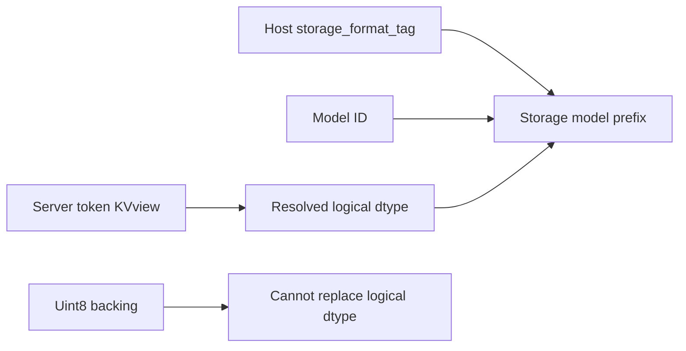
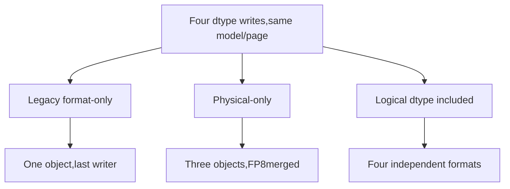
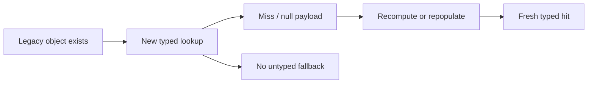

# AI Infra persistent-KV FAQ: HiCache logical dtype,uint8 backing and storage namespaces

> **Language**: English | [中文](hicache-logical-kv-dtype-storage-namespace-selection-faq.md)  
> **Round153 · 2026-11-14daytime**: same-day controller-prefix correction;original JSONcache,not SGLang/Mooncake execution.

**Finding:** E4M3FN/E5M2may share uint8backing;physical dtype cannot identify logical interpretation.Four original formats share model/page:legacy retains1object,physical-only3,logical4.Foreign writer-witness reads are3/1/0.New typed lookup should cold-miss old objects,not silently fall back.

**Artifacts**: [H5ledger](../reports/hicache-logical-kv-dtype-storage-namespace-sizer.html) · [seven cards](../reports/hicache-logical-kv-dtype-storage-namespace-selection-cards.html) · [1600px SVG](../../assets/svg/hicache-logical-kv-dtype-storage-namespace-selection-faq-summary.svg) · [sealed report](../../experiments/logical_kv_dtype_namespace_selection/report.json)

## Q1: Where is the same-day correction,and did every old key lack dtype?

The pinned **Nov14,05:22UTC=13:22BJT**commit preserves model/storage_format_tagand adds`dtype_{normalized resolved logical dtype}`to storage_model_name.Controller uses token KVview/anchor dtype,not FP8uint8store_dtype.Missing/unresolved logical dtype visibly fails.



Scope is controller/storage prefix forDCP/non-DCP.**Not every previous HiCache key lacked dtype.**Existing unified msgspec namespace already contains dtype/page/layout/head/layer fields.Our JSONkeys are not native digest/rank-shard compatible;this is an independent identity experiment.

## Q2: Why cannot byte type,count or checksum define format?

FP8byte`0x3c`means1.5inE4M3FNbut1inE5M2.Equal bytes/equal deterministic checksums do not define interpretation.Little-endian word`803f`meansBF16 1versusFP16 1.875.These are original scalar mathematics,not native KVcasts/model accuracy.

Primary2Bpayloads areE4M3FN`3c00`,E5M2`4000`,FP16`003e`,BF16`803f`.BothFP8backing labels areuint8.Physical-only keys letE5M2overwriteE4M3;the latter's original1.5probe then reads2,absolute error1/2.

Different dtypes with coincidentally equal bytes need not immediately change one probe.We separately check **dtype identity,payload identity and scalar error**,not equate every witness mismatch with model-output corruption.

## Q3: What do the three original strategies retain?



| Strategy | Objects | Selected raw payload | Foreign writer-witness reads |
| --- | ---: | ---: | ---: |
| Legacy format-only subidentity | 1 | 2B | 3/4 |
| Physical-only | 3 | 6B | 1/4 |
| Logical dtype | 4 | 8B | 0/4 |

Excludes JSONkeys,Pythonobjects,metadata,alignment/native allocators.Witnesses are **external experiment metadata,not self-describing legacy headers**.A real legacy reader may not detect foreign dtype.No native hit-rate,KVquality or complete integrity certification.

## Q4: Why should migration be cold rather than untyped fallback?



Source says existing keys become cold/repopulate with no fallback;default Mooncake master/configured tenants remain unchanged.Our initial typed miss returns null until explicit fresh typed write.

Retain storage_format_tag;other formats/layouts still needextra_backend_tag.Null model must not remove dtype identity.Model/tokenizer,page geometry,TP/DCP/PP/CPandtenant compatibility are not fully replaced by four dtype labels.

## Q5: How does JSONassembly differ from native storage latency?

| Original page keys | Hoisted prefix(ms) | Full descriptor(ms) |
| ---: | ---: | ---: |
| 64 | 0.022267 | 0.123267 |
| 256 | 0.089300 | 0.493600 |
| 1024 | 0.373867 | 2.064467 |
| 4096 | 1.519333 | 9.068667 |

Both paths yield identical JSONarray keys.Two warmups,seven alternating repeats,three operations/sample,median repeat means.Excludes page/input setup,probes,hashes,msgspec/SGLang/Mooncake/storage/GPU.Not native digest,disk/networklatency or KVthroughput.

UIcanonical labels are not native resolved`torch.dtype`objects.Layout tags are metadata,not envelope codecs.Probes omit scales/calibration/full-page attention error.Nonfinite/incomplete values do not fabricate finite-error coordinates.

## Q6: How can real persistent-KV compatibility be checked?

```powershell
python -m unittest discover -s tests -p test_logical_kv_dtype_namespace_selection.py -q
python -m experiments.logical_kv_dtype_namespace_selection.run --check
# --measure updates original CPU JSONassembly,no SGLang/Mooncake.
```

Eight tests cover independent scalar literals,object/witness counts,cold no-fallback,format/extra tags/nullmodel,unresolved dtype/invalid payload,signed-zero/nonfinite/64native CPythonhalf probes,sixNodefixtures/hoisted equality,and the full sealed matrix.

Sources:[Nov14correction](https://github.com/sgl-project/sglang/commit/a05c729c4eb233c73b22f7a9289bcd11868d8cee),[controller](https://github.com/sgl-project/sglang/blob/a05c729c4eb233c73b22f7a9289bcd11868d8cee/python/sglang/srt/managers/cache_controller.py),[unified namespace](https://github.com/sgl-project/sglang/blob/a05c729c4eb233c73b22f7a9289bcd11868d8cee/python/sglang/srt/mem_cache/hicache_key_scheme.py),[migration note](https://github.com/sgl-project/sglang/blob/a05c729c4eb233c73b22f7a9289bcd11868d8cee/python/sglang/srt/mem_cache/storage/mooncake_store/README.md),[FP8definitions](https://github.com/onnx/onnx/blob/290eaba8185c0ed1ba6abda16f6f16d562a42da5/docs/docsgen/source/technical/float8.md),[LICENSE](https://github.com/sgl-project/sglang/blob/a05c729c4eb233c73b22f7a9289bcd11868d8cee/LICENSE).Rights retained,no implementation mirror.

Deployment needs resolved dtype,format/layout/parallel namespace,real roundtrip,migration capacity and actual hit-rate/latency/quality.Main`synthetic`, `independently_reproduced=false`;CPUseparately`measured`.Native compatibility,SGLang/Mooncake/KVquality remain unknown/null.Original60-solid cabinet is not hardware.Prior browser refusal remains respected;no visual browser acceptance.
