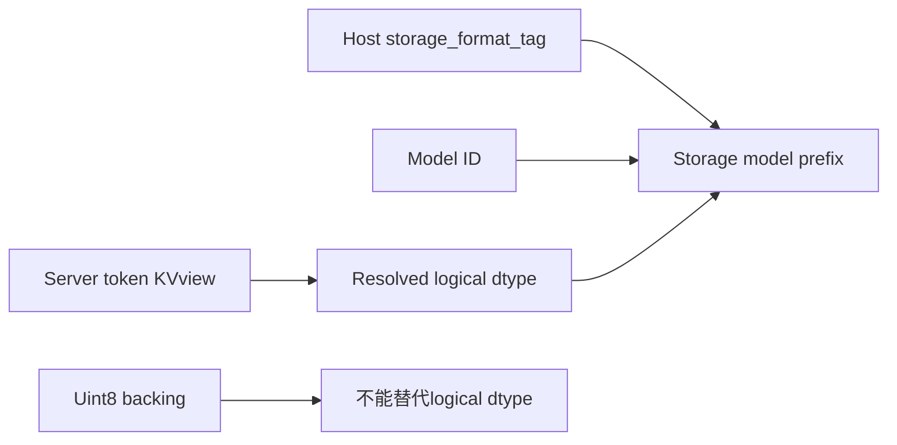
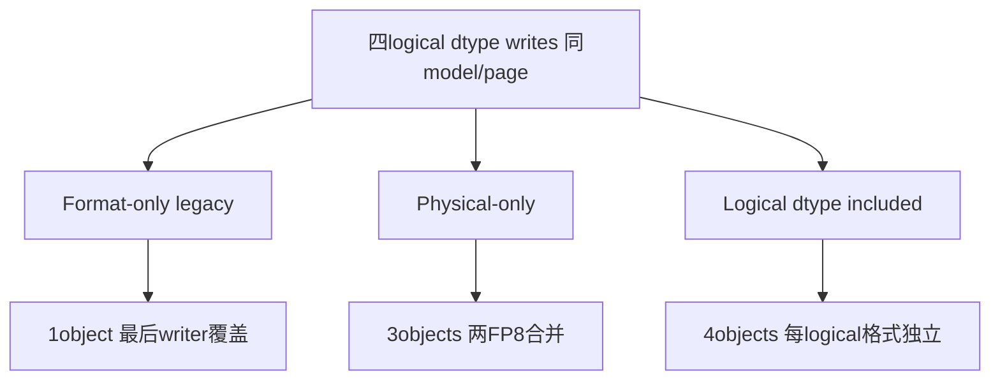
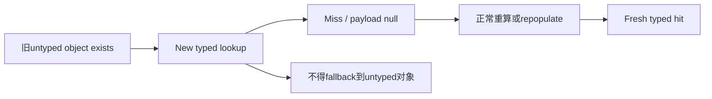

# AI Infra KV 持久化 FAQ：HiCache Logical Dtype、Uint8 Backing 与 Storage Namespace

> **语言**：中文 | [English](hicache-logical-kv-dtype-storage-namespace-selection-faq.en.md)  
> **Round153 · 2026-11-14白班**：当天HiCache controller prefix修正；原创JSON object cache，不是SGLang/Mooncake执行评测。

**结论速览**：FP8E4M3FN/E5M2可能共用uint8 backing，不能由physical dtype推断logical interpretation。原创四formats的model/page相同：legacy format-only身份留1object、physical-only留3、logical身份留4；foreign writer-witness reads分别3/1/0。新typed namespace首次读旧objects应cold miss，不应默默fallback。

**交付**：[H5 identity ledger](../reports/hicache-logical-kv-dtype-storage-namespace-sizer.html) · [7-Card](../reports/hicache-logical-kv-dtype-storage-namespace-selection-cards.html) · [1600px SVG](../../assets/svg/hicache-logical-kv-dtype-storage-namespace-selection-faq-summary.svg) · [sealed report](../../experiments/logical_kv_dtype_namespace_selection/report.json)

## Q1：当天修正加在controller prefix哪里，是否所有旧key都没有dtype？

固定SGLang commit为**Nov14 05:22UTC＝13:22BJT**。`storage_model_name`保留model与host pool storage_format_tag，并加入`dtype_{normalized resolved logical dtype}`；controller取token KVview/anchor的dtype，不能取FP8uint8 store_dtype。missing/unresolved dtype显式报错。



scope是controller/storage prefix覆盖DCP/non-DCP；**不能泛称所有旧HiCache key都缺dtype**。已有unified msgspec namespace也包含dtype、page/layout/head/layer等字段。原型JSON keys不兼容native msgspec digest或所有rank/shard suffix；只是独立identity实验。

## Q2：相同byte type、byte count或checksum为什么不定义logical格式？

FP8raw `0x3c`在E4M3FN为1.5，在E5M2为1；equal raw bytes产生equal deterministic checksum仍不说明interpretation。FP16/BF16相同2Bword也可能不同：little-endian`803f`为BF16 1、FP16 1.875。这里是原创scalar bitfield数学，不是nativeKVcast或model accuracy。

主例四个2Bpayload：E4M3FN`3c00`、E5M2`4000`、FP16`003e`、BF16`803f`。两个FP8physical label均uint8；仅按backing隔离时E5M2覆盖E4M3对象，后者原本1.5的scalar probe得到2，absolute error1/2。

不同logicaldtype且bytes碰巧相同，不一定在单个probe立即产生numeric error；本轮分别验证**dtype identity、payload identity和scalar error**，不把witness mismatch一律宣称模型输出损坏。

## Q3：三个原创key策略的object数量与witness结果是什么？



| 原创strategy | objects | selected raw payload | foreign writer-witness reads |
| --- | ---: | ---: | ---: |
| Legacy format-only subidentity | 1 | 2B | 3/4 |
| Physical-only | 3 | 6B | 1/4 |
| Logical dtype | 4 | 8B | 0/4 |

计量不含JSON key长度、Python objects、metadata、alignment或native allocator。writer dtype/payload witnesses是**实验外部oracle metadata，不是旧raw files自动携带的header**；实际legacy reader未必能识别foreign type。本轮不能认证真实cache hit-rate、KVquality或安全完整性。

## Q4：旧objects迁移为什么应该cold，而不是fallback读取？



source README明确现有keys变cold并repopulate，无fallback；默认Mooncake master和已配置tenants不因这个prefix修正而改变。原型先只提供legacy object，新typed read返回miss/null，再显式写新typed对象后才hit。

storage_format_tag已有语义仍须保留；其他format/layout差异仍需要extra_backend_tag。null model也必须保留logicaldtype身份。model weights/tokenizer、page geometry、TP/DCP/PP/CP与tenant配置等完整兼容规则没有被四个dtype标签全部替代。

## Q5：original JSON key assembly时延和native storage latency如何区分？

| original page keys | hoisted namespace prefix（ms） | full descriptor（ms） |
| ---: | ---: | ---: |
| 64 | 0.022267 | 0.123267 |
| 256 | 0.089300 | 0.493600 |
| 1024 | 0.373867 | 2.064467 |
| 4096 | 1.519333 | 9.068667 |

两个paths生成exact相同JSONarray keys；2warmups、7轮交替repeat、每sample3operations，取median repeat means。排除page/input准备、payload probes、hashes、msgspec/SGLang/Mooncake/storage/GPU。数字不是native key digest、disk/networklatency或KVcache吞吐。

UI仅选四个canonical logicaldtype labels；native API需要**resolved torch.dtype对象**，不是把UI字符串传过去即可。布局标签只是原型namespace metadata，未实现envelope编码/解码。scalar probes不模拟scales、quantization calibration或整页attention误差；nonfinite/incomplete probe不伪造finite-error坐标。

## Q6：如何复现并核验真实持久KV兼容性？

```powershell
python -m unittest discover -s tests -p test_logical_kv_dtype_namespace_selection.py -q
python -m experiments.logical_kv_dtype_namespace_selection.run --check
# --measure只更新原创CPU JSONassembly，不执行SGLang/Mooncake。
```

八项测试覆盖独立FP8/half/BF16 scalar literals、object/witness计数、cold无fallback、format/extra tags/nullmodel、unresolveddtype/非法payload、signedzero/nonfinite与64native CPython half probes、六Node/Python fixtures/hoisted key equality、完整sealed matrix。

来源：[Nov14correction](https://github.com/sgl-project/sglang/commit/a05c729c4eb233c73b22f7a9289bcd11868d8cee)、[controller prefix](https://github.com/sgl-project/sglang/blob/a05c729c4eb233c73b22f7a9289bcd11868d8cee/python/sglang/srt/managers/cache_controller.py)、[unified namespace/dtype normalization](https://github.com/sgl-project/sglang/blob/a05c729c4eb233c73b22f7a9289bcd11868d8cee/python/sglang/srt/mem_cache/hicache_key_scheme.py)、[Mooncake migration note](https://github.com/sgl-project/sglang/blob/a05c729c4eb233c73b22f7a9289bcd11868d8cee/python/sglang/srt/mem_cache/storage/mooncake_store/README.md)、[FP8definitions](https://github.com/onnx/onnx/blob/290eaba8185c0ed1ba6abda16f6f16d562a42da5/docs/docsgen/source/technical/float8.md)、[SGLang LICENSE](https://github.com/sgl-project/sglang/blob/a05c729c4eb233c73b22f7a9289bcd11868d8cee/LICENSE)。rights保留，无实现镜像。

上线检查实际resolveddtype、format/layout/parallel namespace、read/write roundtrip、migration容量与真实hit-rate/latency/quality。主报告`synthetic`、`independently_reproduced=false`，CPU单独`measured`；native key compatibility、SGLang/Mooncake与KVquality未知/null。原创60-solid柜非storage hardware；此前browser refusal仍尊重，未做视觉浏览器验收。
