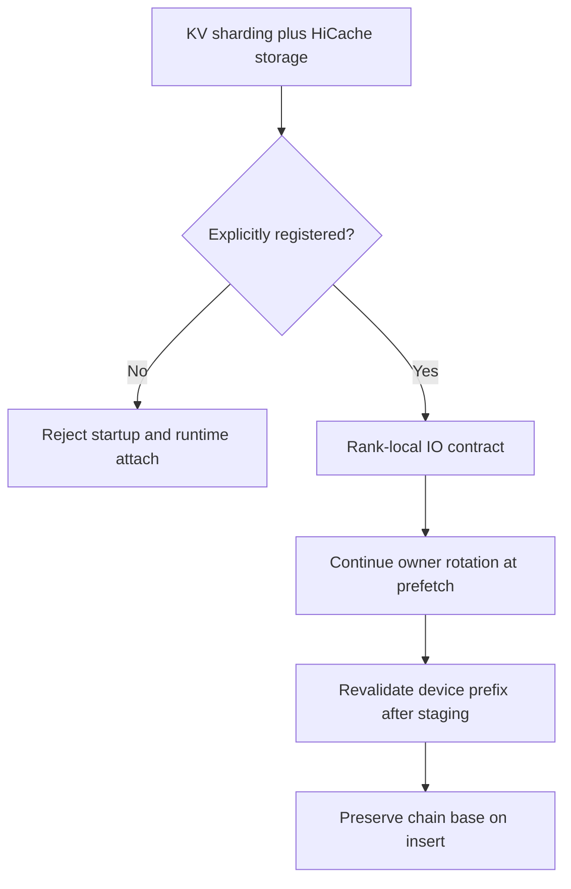
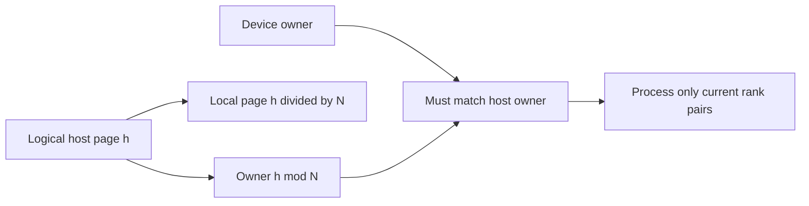

# HiCache selection FAQ:out-of-tree storage,logical page ownership and staged rotation

> **Language**:English | [中文](hicache-logical-page-backend-staged-rotation-selection-faq.md)  
> **Round162 · actualNov14**:explicit rank-local backend registration plus owner-preserving prefetch/backup/load-back. **The upstream registry remains empty**;this is not universal HiCache backend support. This study concerns page-owner lifecycle,not Round153 logical-dtype namespaces.
>
> [H5](../reports/hicache-logical-page-backend-staged-rotation-sizer.html) · [7-Card](../reports/hicache-logical-page-backend-staged-rotation-selection-cards.html) · [1600pxSVG](../../assets/svg/hicache-logical-page-backend-staged-rotation-selection-faq-summary.svg) · [Experiment/evidence](../../experiments/hicache_page_rotation_selection/README.md)

## Q1: What is admitted,and does registration certify correct IO?

The out-of-tree registration hook admits storage backends that read/write only each shard rank's own pages. No upstream backend is registered. Both startup validation and runtime attachment check the registry;runtime must not bypass the gate.



Registration is an admission contract,not automatic proof of every plugin IO,buffer copy or permission. Our JSON `rank-local-demo` is an original witness name,not a loaded plugin;`native_plugin_verified=null`.

## Q2: What are logical/local host pages,and does logical capacity equal per-rank memory?

Logical host page `h` belongs to `h%N`;its local page is `h//N`. Device/host pairs must share ownership and each rank selects its own stripe. Host `size` remains per-rank rows;N-fold logical capacity does not mean N-fold memory on each rank. The physical page quantum does not grow with widened indices.



Original N4/fetch7/page16/rank1 yields2owned pages,or32logical token rows. Total fetch112rows is not112bytes or native HBM peak. Host IDs are original synthetic owner-class slots,with local page0unused,not observed native allocator IDs.

## Q3: Why cannot prefetch restart independently at owner0 or least-full class?

An existing chain base1 plus snapshotted prefix32/page16 advances2pages;raw start owner is3,normalized modulo4. Original7-page owners are `[3,0,1,2,3,0,1]`.

An intentionally wrong **counterfactual detached proposal** starts at least-full class0 and produces `[0,1,2,3,0,1,2]`:7/7owner mismatches versus0/7chain-aware. **This is not evidence of old native wrong-copy execution**:old startup rejected sharded storage before that hypothetical path.

Only a new chain with no available base is seeded from the most-free class,lowest class ID on ties;then add the snapshotted prefix-page offset. Backup passes the node's rotation phase as well. 64random cases compare closed-form class draws with explicit owner lists.

## Q4: What if the device prefix changes chains or is evicted during prefetch?

Recover staged base as `(first_host_owner−snapshotted_prefix_pages)%N`. Use the staging snapshot length,not an arbitrarily substituted current match length.

```mermaid
sequenceDiagram
    participant P as Device prefix
    participant S as Staged host slots
    participant A as Admission
    P->>S: Allocate with chain base plus prefix pages
    S-->>A: First host owner and snapshot
    A->>P: Re-match full prefix
    P-->>A: Existing chain base changed
    A->>S: Warning and refetch;do not publish
    P-->>A: Or prefix evicted;no existing chain
    A->>P: Loaded insert preserves recovered base
```

Full joint device coverage resolves before rotation revalidation:there is no remaining load to reject. Otherwise a matching device prefix with a different base triggers native `reason=rotation` warning/refetch. An evicted prefix can adopt the staged base,but other admission/key/aux-pool conditions still apply.

## Q5: What did local validation and timing measure?

Eight tests cover both registry gates,unsharded mode,least-full ties,raw-start normalization,prefix rotation changes,device-covered precedence,empty full spans,capacity attempts and invalid schemas/ranges. 64random cases validate class draws/local partitions;Node/Python compare65configs/130outcomes.

Capacity checks observed free pages per class;failure is an attempt miss,not a silent rotation change. Native eviction/retry,partial hits,aux pools and allocator transactions are not executed. The profile is aligned whole-page metadata,not every native tensor/partial-token ABI.

Sealed CPU timing compares one-pass buckets with four independent scans for64/256/1024/4096page labels. Two warmups,seven alternating repeats,three partitions/sample and median repeat means are used. This is an original metadata planner,**not native Torch `local_mask`,storage bandwidth,network or HBM copy**. Card bars use sealed samples only.

## Q6: How should a real out-of-tree backend be accepted?

Register before effective validation/attachment,then verify rank-local read/write,logical/local index interpretation,owner pairing,staged snapshots and preserved insert bases. Exercise prefix eviction,rotation changes,class capacity and failed runtime attachment with explicit logs/refetch.

Do not read a whole chain independently on every rank,confuse logical capacity with per-rank memory,or treat0/7original misses as native plugin/performance certification. Provenance is `synthetic`,`independently_reproduced=false`;CPU samples separately `measured`. Native plugin/copy and browser visual acceptance remain unknown.

**Pinned primary evidence**:[Actualcommit](https://github.com/sgl-project/sglang/commit/56fa7ca6e7e4004aeb935b6bb38d0acf81340510) · [Registration/startup](https://github.com/sgl-project/sglang/blob/56fa7ca6e7e4004aeb935b6bb38d0acf81340510/python/sglang/srt/arg_groups/kv_shard_hook.py) · [Pipeline lifecycle](https://github.com/sgl-project/sglang/blob/56fa7ca6e7e4004aeb935b6bb38d0acf81340510/python/sglang/srt/mem_cache/buffer_mode/pipeline.py) · [Host ownership](https://github.com/sgl-project/sglang/blob/56fa7ca6e7e4004aeb935b6bb38d0acf81340510/python/sglang/srt/mem_cache/pool_host/page_interleave.py) · [Class allocator](https://github.com/sgl-project/sglang/blob/56fa7ca6e7e4004aeb935b6bb38d0acf81340510/python/sglang/srt/mem_cache/allocator/page_interleave.py) · [Runtime attach](https://github.com/sgl-project/sglang/blob/56fa7ca6e7e4004aeb935b6bb38d0acf81340510/python/sglang/srt/mem_cache/unified_cache/storage_attachment.py) · [Apache-2.0LICENSE](https://github.com/sgl-project/sglang/blob/56fa7ca6e7e4004aeb935b6bb38d0acf81340510/LICENSE). Rights retained;original ledger,not an implementation mirror.
