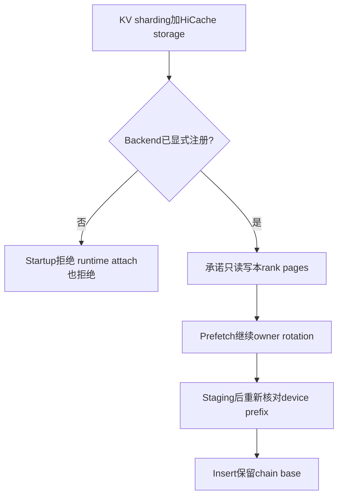
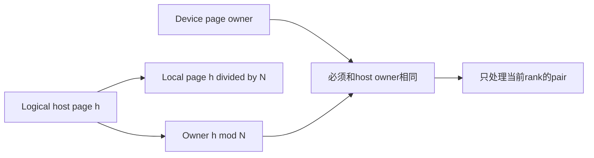
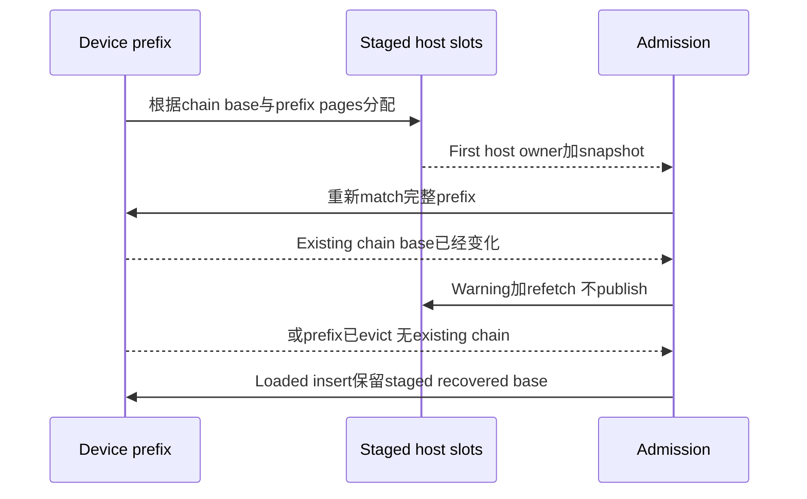

# AI Infra HiCache 架构选型 FAQ：Out-of-tree Backend、Logical Page Ownership 与 Staged Rotation

> **语言**：中文 | [English](hicache-logical-page-backend-staged-rotation-selection-faq.en.md)  
> **Round162 · actualNov14**：显式注册rank-local storage backend，且prefetch/backup/load-back保留device chain的owner rotation。**上游注册集合仍为空**；不是“所有HiCache backend现在都支持KVsharding”。本轮研究page owner生命周期，不重复Round153logical dtype namespace。
>
> [H5 owner ledger](../reports/hicache-logical-page-backend-staged-rotation-sizer.html) · [7-Card](../reports/hicache-logical-page-backend-staged-rotation-selection-cards.html) · [1600pxSVG](../../assets/svg/hicache-logical-page-backend-staged-rotation-selection-faq-summary.svg) · [实验/封存证据](../../experiments/hicache_page_rotation_selection/README.md)

## Q1：这次允许的是什么，registration是不是I/O正确性认证？

新增out-of-tree registration接口，仅允许读写**各shard rank自身pages**的storage backend。上游集合没有注册任何backend。startup参数检查与runtime attach都查registration；不能只放开启动入口而让runtime绕过保护。

registration是admission contract，不是自动检查plugin每次I/O、Torch buffer/copy或权限的证明。原型JSON中`rank-local-demo`是原创见证名，没有加载真实plugin；`native_plugin_verified=null`。

## Q2：Logical host page与local page是什么？capacity是否等于本rank内存？

logical host page `h`的owner为`h%N`，其local page为`h//N`。device/host pairing必须owner一致，rank只拿自己的stripe。host pool的`size`仍是每rankrows；logical capacity扩大N倍，不代表每rank多分配N倍内存。physical page quantum不随logical index widening扩大。

原创N4、fetch7pages、page16tokens、rank1获得2pages＝32logical token rows；总fetch为112rows，不是112B或native HBM peak。本原型host page IDs是按owner构造的synthetic slots，local page0留空；不是从真实allocator读取的slot IDs。

## Q3：为什么prefetch不能独立从owner0或least-full class重新开始？

已有chain的base为1，snapshotted prefix32tokens、page16，意味着已过2pages；fetch应从raw`1+2=3`开始，按N4归一。原创7page owners为`[3,0,1,2,3,0,1]`。

错误的**counterfactual detached proposal**只选least-full class0，得到`[0,1,2,3,0,1,2]`，7/7owner mismatches。chain-aware为0/7。**这不是native旧版本已经执行错copy的证据**：旧startup直接拒绝sharded HiCache storage，没有走这个假想错误方案。

new chain没有可用base时才选most-free class，tie取最低class ID；随后仍加snapshotted prefix page offset。backup也传node的rotation phase，不让staging slots脱离device owners。closed-form每class draw数量与原始owner list在64随机case一致。

## Q4：prefetch期间device prefix换了chain或被evict，怎么处理？

staged base由`(first_host_owner−snapshotted_prefix_pages)%N`恢复。这里用staged snapshot长度，不是把当前match长度随意替换进公式。

joint device coverage已覆盖整个staged span时先resolve device-covered；不需要再因已无须load的rotation差异refetch。若仍有matched device prefix且base不同，native记录`reason=rotation`warning并refetch。prefix消失可发布staged base，但不等于忽略其他admission、key namespace或aux-pool条件。

## Q5：本机验证哪些边界？timing是否能推出nativeIO性能？

八tests覆盖registry双入口、already-unsharded、least-full tie、rawstart归一、prefix rotation变化、device-covered优先、empty full span、capacity attempt miss、schema与range错误。64random验证closed-form draw/local partition；Node/Python比较65configs/130outcomes。

容量根据observed class free-page counts逐class检查；缺容量返回本attempt miss，不偷偷换rotation。native eviction/retry、partial-hit、aux pools与allocator transaction未执行。本原型仅aligned whole-page observations；不泛化全部native tensor/partial-token ABI。

封存CPU timing对64/256/1024/4096page labels比较one-pass owner buckets与four independent scans。两次warmup、七次交替repeat、三次partition/sample，median repeat means。它是原创metadata planner，**不是native Torch `local_mask`benchmark，更不是storage bandwidth、network或HBM copy**。card条宽只用封存samples。

## Q6：怎样把out-of-tree支持用于真实部署，而不把登记当通行证？

实际plugin须在有效validation/attach前注册，并保证rank-local read/write、logical/local index解释、device-host owner pairing、staged snapshot与loaded insert base一致。测试prefix eviction、rotation变化、class容量不足与runtime attach失败，保留明确日志/refetch路径。

不能把全链KV读取到每个rank，不能把host logical capacity当每rankphysical memory，更不能因为原型0/7mismatches就宣布nativeplugin正确或吞吐提升。本机`synthetic`,`independently_reproduced=false`；CPUsamples另为`measured`，nativeplugin/copy及browser视觉验收均未知。

**固定一手证据**：[actualcommit](https://github.com/sgl-project/sglang/commit/56fa7ca6e7e4004aeb935b6bb38d0acf81340510) · [registration/startup](https://github.com/sgl-project/sglang/blob/56fa7ca6e7e4004aeb935b6bb38d0acf81340510/python/sglang/srt/arg_groups/kv_shard_hook.py) · [pipeline lifecycle](https://github.com/sgl-project/sglang/blob/56fa7ca6e7e4004aeb935b6bb38d0acf81340510/python/sglang/srt/mem_cache/buffer_mode/pipeline.py) · [host ownership](https://github.com/sgl-project/sglang/blob/56fa7ca6e7e4004aeb935b6bb38d0acf81340510/python/sglang/srt/mem_cache/pool_host/page_interleave.py) · [class allocator](https://github.com/sgl-project/sglang/blob/56fa7ca6e7e4004aeb935b6bb38d0acf81340510/python/sglang/srt/mem_cache/allocator/page_interleave.py) · [runtime attach](https://github.com/sgl-project/sglang/blob/56fa7ca6e7e4004aeb935b6bb38d0acf81340510/python/sglang/srt/mem_cache/unified_cache/storage_attachment.py) · [Apache-2.0LICENSE](https://github.com/sgl-project/sglang/blob/56fa7ca6e7e4004aeb935b6bb38d0acf81340510/LICENSE)。权利保留，原创ledger而非实现镜像。
