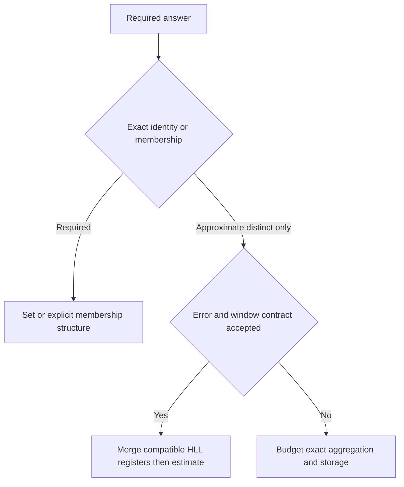
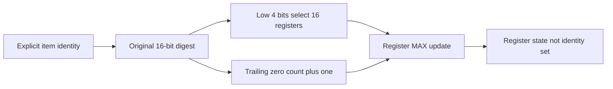
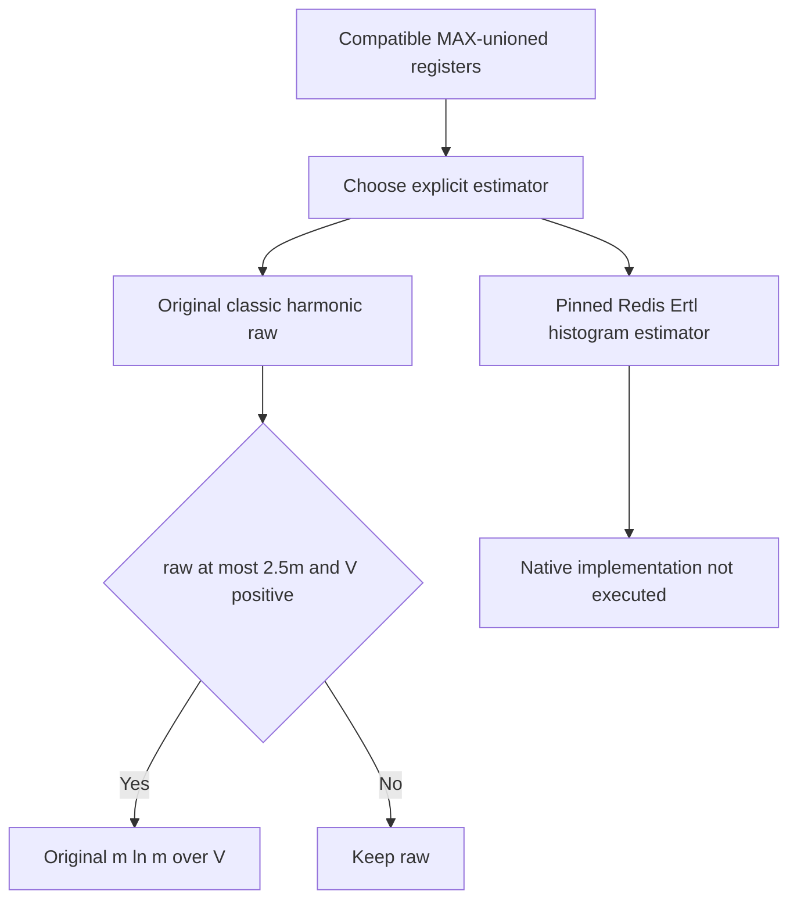

# AI Infra distinct-count FAQ: HLL register-max union, rank contracts and estimator boundaries

> **Language**: English | [中文](hll-register-max-union-cardinality-estimator-selection-faq.md)  
> **Round 136 · 2026-11-14 daytime**: traffic cardinality, training-data telemetry and sharded distinct counts—not exact deduplication or membership.  
> **Related**: [Bloom negative gates and deletion](bloom-negative-gate-layer-budget-safe-deletion-selection-faq.en.md) · [Flink watermarks and late windows](event-time-watermark-idleness-lateness-cleanup-selection-faq.en.md)

**Executive finding:** do not add local distinct counts across overlapping shards. Compatible HLL union takes **per-register maxima, then estimates cardinality**. Our two 20-item shards overlap by 10: exact union is 30, not their summed count 40. The original affine 16-bit digest's classic estimate is **57.995698**, showing that **correct merge algebra does not establish hash quality or estimator accuracy**. Ideal asymptotic `1.04/√m` standard error is not an individual-sample bound.

**Artifacts**: [workbench](../reports/hll-register-max-union-cardinality-estimator-sizer.html) · [seven cards](../reports/hll-register-max-union-cardinality-estimator-selection-cards.html) · [high-resolution SVG](../../assets/svg/hll-register-max-union-cardinality-estimator-selection-faq-summary.svg) · [sealed report](../../experiments/hll_register_union_selection/report.json)

## Q1: When should AI Infra use HLL instead of a set, Bloom filter or summed local counts?

Choose HLL for **approximate distinct cardinality** across many tenants, signatures or data shards when the application accepts an explicit error model and window protocol. Shards may contain the same identity; their separate unique counts therefore cannot simply be summed. Use an appropriate exact set/index for precise deduplication, listing duplicates, membership or per-item deletion. A Bloom filter's query semantics are different again.



Whether Redis `PFADD` changes a register is not an exact previously-seen test: a new identity may fail to increase any maximum. Duplicate-delivery idempotence also does not imply per-item retraction. Precise training-sample deduplication and approximate telemetry distinct counts are different requirements.

## Q2: How do hash bits, register indexing and rank work?

The pinned Redis `hllPatLen` uses the low `p` bits of a 64-bit hash for the register index. After removing index bits it counts trailing zero bits plus one, with a sentinel ensuring termination for an all-zero tail. The default has `p=14`, 16384 six-bit registers. A register stores the largest observed rank, not the original identities.

The original model deliberately uses another transparent digest: `d=(identity*40503+17) mod 65536`, with `p=4`. This is a permutation of the bounded identity domain, **not MurmurHash and not a verified uniform hash distribution**. Index is `d&15`; an all-zero 12-bit remainder has rank 13. An independently written binary-string reversal/zero-count oracle checks the bit-operation model.



The model validates precision, hash width, array length and rank bounds. Production also requires matching identity canonicalization, hash family/seed, bit convention, precision and encoding version. The model's limited metadata does not replace those production checks. Precision conversion/downsampling is unimplemented; truncating a register array is not a valid general conversion.

## Q3: Why is MAX a valid union while scalar estimates are not?

Each local register already holds the largest rank for its input. The maximum over both inputs is the maximum of those two maxima. Elementwise MAX is associative, commutative and idempotent: regrouping, reversing delivery or retransmitting compatible state leaves the union unchanged.

| Sealed fixture | Original result | Architecture meaning |
| :--- | :--- | :--- |
| A=`0..19`, B=`10..29` | 20 each, overlap 10, true union 30 | Even summed exact local counts give the wrong 40 |
| `MAX(sketch(A),sketch(B))` | All 16 registers match direct ingestion of `A+B` | Correct state union does not establish error |
| `MAX(B,A)` and `MAX(A,A,B)` | Exactly equal to the original union | Reordering and duplicate transfer are idempotent |
| Sum of local teaching estimates | 75.319748; merged teaching estimate 57.995698 | Neither is the exact true union 30 |
| Delete one key | Information unavailable | Decrementing rank cannot restore prior state |

Distinct counts over time cannot generally be subtracted either. A rolling-window design may keep time buckets, union those covering the requested interval and state boundary error explicitly. It cannot subtract an old sketch from an aggregate to recover arbitrary exact windows. That protocol is not implemented here.

## Q4: Is the classic harmonic estimator the same as current Redis PFCOUNT?

**No.** Historical introductory comments do not replace auditing the actual function: pinned `hllCount` uses register histograms and Ertl's `sigma/tau` estimator. This original model teaches classic `alpha*m² / Σ2^-register`, using `m*ln(m/V)` linear counting when raw≤`2.5m` and at least one register is empty. Ertl, native rounding, sparse encoding and finite-range correction are not implemented.

An empty sketch has classic raw 10.768 but linear count 0. That zero follows the formula and exact empty state; it is not an unmeasured native result coerced to zero. With no empty registers, `ln(m/0)` is invalid and our toy keeps classic raw. A visibly inaccurate original digest fixture must remain visible rather than being replaced by a flattering native accuracy claim.



Precision 4 and 16-bit digests validate algebra and interface boundaries, not Redis default accuracy. Ideal uniform-hash asymptotic RSE is a distributional statistic, not a confidence guarantee or SLA.

## Q5: How should memory, throughput and error budgets be calculated?

The budget workbench is separate from the 16-register simulation. Selecting `p=14`, six-bit registers and 64 shards gives 16384 registers, 12288B of dense register payload per sketch and 786432B across 64 copies. Redis headers, allocators, objects, caches, sparse encodings and transfer envelopes are excluded. The 64-bit hash maximum rank is `64-p+1`; insufficient selected register width is explicitly rejected.

The ideal uniform-hash asymptotic `1.04/√16384=0.008125` means 0.8125% standard error, not an all-case bound. Do not equate that budget with the original affine digest's observed estimation error.

| Precomputed digests | Original bitwise rank (ms) | Original binary-string rank (ms) |
| ---: | ---: | ---: |
| 64 | 0.011000 | 0.025633 |
| 256 | 0.042933 | 0.099200 |
| 1024 | 0.181333 | 0.439700 |
| 4096 | 0.725167 | 1.659267 |

Two warmups, seven alternating repeats, three operations per sample, median repeat means; raw samples are in `latency.json`. These are local Python register updates on precomputed digests, excluding hashing, estimation, merging, Redis/SIMD, network and sparse conversion. They are not Redis throughput evidence.

## Q6: How can the study be reproduced and production boundaries checked?

```powershell
python -m unittest discover -s tests -p test_hll_register_union_selection.py -q
python -m experiments.hll_register_union_selection.run --check
# Use --measure only to deliberately replace original local CPU records.
```

Eight tests cover the independent string oracle, zero-tail sentinel, overlapping union versus direct ingestion, MAX algebra, duplicate/empty counting, precision/hash-width rejection, payload/rank width, Node/Python parity and sealed timing. Workbench integers and JSON inputs are bounded; errors are visible rather than success-shaped defaults. The prior browser refusal is respected; visual browser inspection was not performed.

Source: [pinned Redis `hyperloglog.c`](https://github.com/redis/redis/blob/ee8e7f70152404649ac947157fd662d11b4a00d5/src/hyperloglog.c), reading `hllPatLen`, `hllDenseSet`, `hllMerge` and `hllCount`. The tracked Nov 13 tree's SORT allocation change did not invent HLL; this is a source-audit-driven architecture study, not a trending-rank claim. The header offers RSALv2 / SSPLv1 / AGPLv3, with separate BSD3 provenance for portions. Original models, oracle, prose and artwork do not copy the native implementation.

Production evaluation should cover identity normalization, hash contracts, version migration, window cleanup, independent actual error and dense/sparse memory. Native PFCOUNT, production error, memory and latency remain unknown/null. Report provenance is `synthetic`, `independently_reproduced=false`; original CPU timing is separately `measured`. Correct toy algebra does not authorize production billing or exact sample deduplication.
