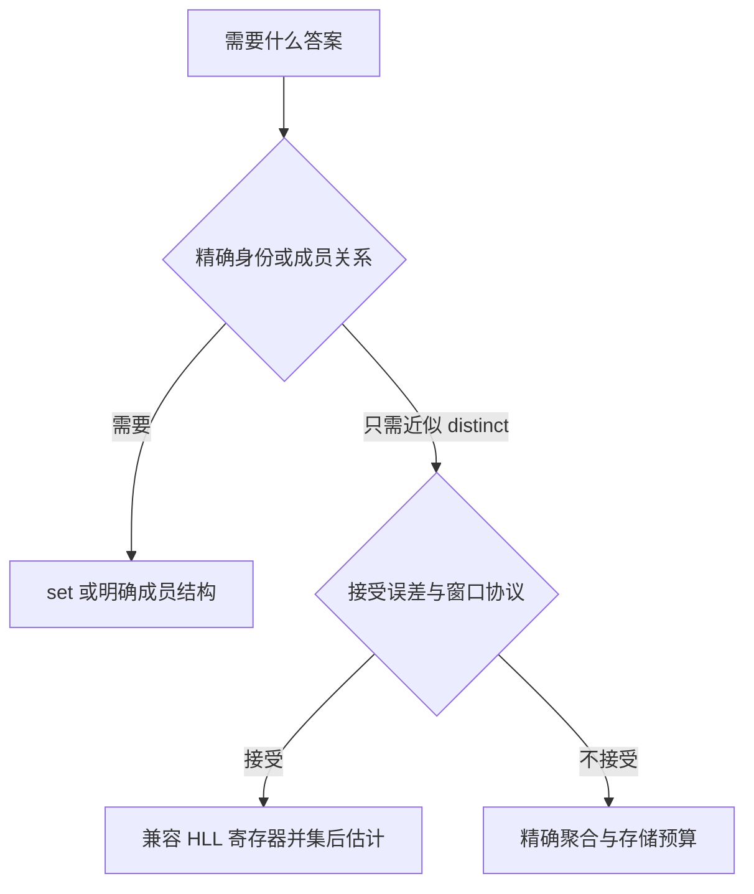
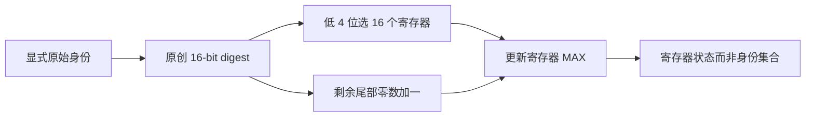
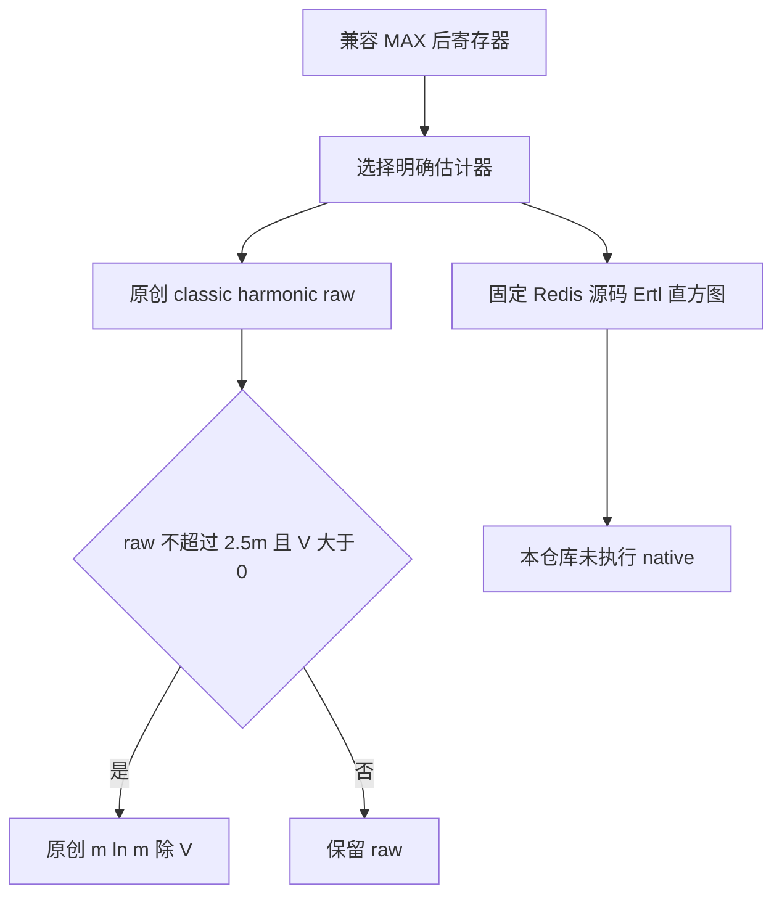

# AI Infra 去重基数选型 FAQ：HLL 寄存器 MAX 并集、rank 契约与估计器边界

> **语言**：中文 | [English](hll-register-max-union-cardinality-estimator-selection-faq.en.md)  
> **Round 136 · 2026-11-14 白班**：流量基数、训练数据遥测与分片 distinct 计数；不是精确去重或成员判断。  
> **关联**：[Bloom 否定门与安全删除](bloom-negative-gate-layer-budget-safe-deletion-selection-faq.md) · [Flink watermark 与迟到窗口](event-time-watermark-idleness-lateness-cleanup-selection-faq.md)

**结论速览**：分片独立 distinct 数不能直接相加；兼容 HLL 的并集是**逐寄存器 MAX，之后再估计**。本例两组各 20 个身份、交集 10、真实并集 30，相加得到错误的 40。原创 16-bit 仿射 digest 的 classic 估计却达到 **57.995698**：这恰好说明 **MAX 契约正确，不代表 hash 分布或基数估计准确**。不得把理想渐近 `1.04/√m` 标准误差当逐样本上界。

**交付**：[交互工作台](../reports/hll-register-max-union-cardinality-estimator-sizer.html) · [7-Card 报告](../reports/hll-register-max-union-cardinality-estimator-selection-cards.html) · [高清 SVG](../../assets/svg/hll-register-max-union-cardinality-estimator-selection-faq-summary.svg) · [封存数据](../../experiments/hll_register_union_selection/report.json)

## Q1：AI Infra 中什么时候选择 HLL，而不是 set、Bloom 或直接加总？

当任务是大量租户、请求签名或数据分片的**近似 distinct 基数**，且允许明确误差统计与时间窗口协议时，可选择 HLL。不同分片可能重复出现同一个身份；这使“本地 unique 数相加”不再等于全局 distinct。任务若需要逐条精确去重、列出重复身份、成员查询或按身份删除，应保留精确集合/索引等适配结构；Bloom 的查询语义也不是基数估计。



不要把 Redis `PFADD` 是否改变寄存器当成“身份以前是否出现”的精确判断：新身份也可能不增加任何寄存器。也不要从重复投递幂等直接推出可撤回单个身份。AI 数据质量的“精确样本去重”和监控面板的“近似训练样本 distinct”是两个不同问题。

## Q2：hash 位、寄存器索引和 rank 的原理是什么？

读取固定 Redis 源码的 `hllPatLen` 可确认：64-bit hash 的低 `p` 位选寄存器；移除索引位后，计算剩余位从低位开始的连续零数加一，并设置 sentinel，保证全零尾部也终止。默认 `p=14`、16384 个 6-bit 寄存器。寄存器只记录目前见过的最大 rank，不记录原始身份。

原创模型刻意采用不同且透明的 16-bit digest：`d=(identity*40503+17) mod 65536`，`p=4`。它是 bounded identity 域上的排列，**不是 MurmurHash，也不满足我们已证明的随机 hash 分布**。索引 `d&15`；剩余 12 位尾部全零时 rank 为 13。字符串逆序/数零 oracle 与生产模型的位操作分别实现。



本模型检查精度、hash 位宽、数组长度和 rank 范围；真实系统还必须检查相同的身份规范化、hash 家族/种子、位方向、精度与编码版本。模型的有限元数据并不替代这些生产契约检查。不同 precision 的转换或 downsample 没有实现，不能把数组截断当兼容转换。

## Q3：为什么 MAX 可以安全做并集，而 scalar 估计不能？

对于同一个寄存器，每组输入的状态都是其 rank 最大值；两组输入合并后，最大值就是两个局部最大值的 MAX。逐元素 MAX 具有结合律、交换律与幂等性；因此分组归约、反序投递和重复传输兼容状态都不改变最终寄存器。

| 封存实验 | 原创结果 | 架构含义 |
| :--- | :--- | :--- |
| A=`0..19`，B=`10..29` | 各 20，交集 10，并集 30 | 局部 exact distinct 相加 40 已经错误 |
| `MAX(sketch(A),sketch(B))` | 等于直接 ingest `A+B` 的全部 16 个寄存器 | 状态合并正确，不保证估计误差 |
| `MAX(B,A)` 与 `MAX(A,A,B)` | 与原始并集完全相同 | 重排序、重复传输幂等 |
| 两个局部 teaching 估计相加 | 75.319748；并集 teaching 估计 57.995698 | 任一都不能冒充真实并集 30 |
| 删除一个 key | 没有足够信息 | 不能对 rank 做减一恢复 |

跨时间窗的 distinct 也不是任意相减。若要 rolling window，可明确保留时间桶、合并当前覆盖桶并处理边界误差；不能从全量 sketch 中减去旧桶恢复任意精确窗口。此处未实现该协议。

## Q4：classic harmonic estimator 和 Redis 当前 PFCOUNT 是同一个算法吗？

**不是。** 源码开头的历史说明不足以替代实际函数审计：当前固定源码的 `hllCount` 用寄存器直方图及 Ertl 的 `sigma/tau` 估计器。原创模型仅讲解 classic `alpha*m² / Σ2^-register`，并在 raw≤`2.5m` 且存在空寄存器时用 `m*ln(m/V)` 线性计数。没有实现 Ertl、native rounding、稀疏编码或大范围修正。

空 sketch 的 classic raw 为 10.768，但线性计数得到 0。该 0 来自公式与确切空状态，不是把未测 native 结果置零。没有空寄存器时不能计算 `ln(m/0)`，本模型直接保留 classic raw。误差很大的原创仿射 digest 样本仍应原样报告，不能换成“更好看”的 native 精度承诺。



本例 precision=4、digest=16-bit，仅验证代数和接口原理；不能借此测出 Redis 默认配置的误差。理想均匀 hash 的渐近 RSE 是分布性指标，不是置信保证或 SLA。

## Q5：内存、吞吐和误差预算应该怎么计算？

预算工作台独立于 16-register 仿真。选择 `p=14`、6-bit register、64 个分片：寄存器数 16384，dense register payload=12288B，64 份为 786432B；这不包含 Redis 头部、allocator、对象、cache、sparse encoding 或传输封装。64-bit hash 的最大 rank=`64-p+1`，register 位宽必须能容纳，否则显式拒绝。

该预算的理想均匀 hash 渐近 `1.04/√16384=0.008125`，即 0.8125% 标准误差；不是每次都落在此范围。预算与原创仿射 digest 的实际误差不可混淆。

| 预计算 digest 数 | 原创 bitwise rank（ms） | 原创 binary-string rank（ms） |
| ---: | ---: | ---: |
| 64 | 0.011000 | 0.025633 |
| 256 | 0.042933 | 0.099200 |
| 1024 | 0.181333 | 0.439700 |
| 4096 | 0.725167 | 1.659267 |

两次 warmup，七轮交替路径，每个样本三次操作，报告 repeat 均值的中位数；原始样本见 `latency.json`。只测本地 Python 预计算 digest 的寄存器更新；不含 hash、估计器、merge、Redis/SIMD、网络或 sparse 转换。不是 Redis 吞吐优势证据。

## Q6：如何复现、选择生产边界并核对来源？

```powershell
python -m unittest discover -s tests -p test_hll_register_union_selection.py -q
python -m experiments.hll_register_union_selection.run --check
# 仅在有意更新本机 CPU 记录时使用 --measure
```

八项测试覆盖独立字符串 oracle、全零尾 sentinel、交集直接摄取、MAX 代数、重复身份/空计数、precision/hash 位宽拒绝、payload rank 位宽、Node/Python parity 与封存 timing。工作台只接受有界整数、可读 JSON 和有限输入；错误可见，不假报成功。此前浏览器拒绝仍受尊重，未执行视觉浏览器检查。

来源为 [Redis 固定源码 `hyperloglog.c`](https://github.com/redis/redis/blob/ee8e7f70152404649ac947157fd662d11b4a00d5/src/hyperloglog.c)，实际读取 `hllPatLen`、`hllDenseSet`、`hllMerge`、`hllCount`。所追踪 11 月 13 日 tree 的 SORT allocation 变化不是 HLL 新发明；本专题是当日源码审计驱动的选型原理研究，不宣称热榜排名。文件头许可为 RSALv2 / SSPLv1 / AGPLv3 选择，部分内容另有 BSD3 来源说明；原创模型、oracle、文字和美术没有复制 native 实现。

生产检查应包含身份规范化、hash 契约、版本迁移、窗口清理协议、独立实际误差评估与 dense/sparse 内存观测。native PFCOUNT、生产误差、内存及延迟都保持未知/null；本报告 `synthetic`、`independently_reproduced=false`，原创 CPU timing 单独 `measured`。不能据 toy 代数正确性自动放行生产计费或精确样本去重。
