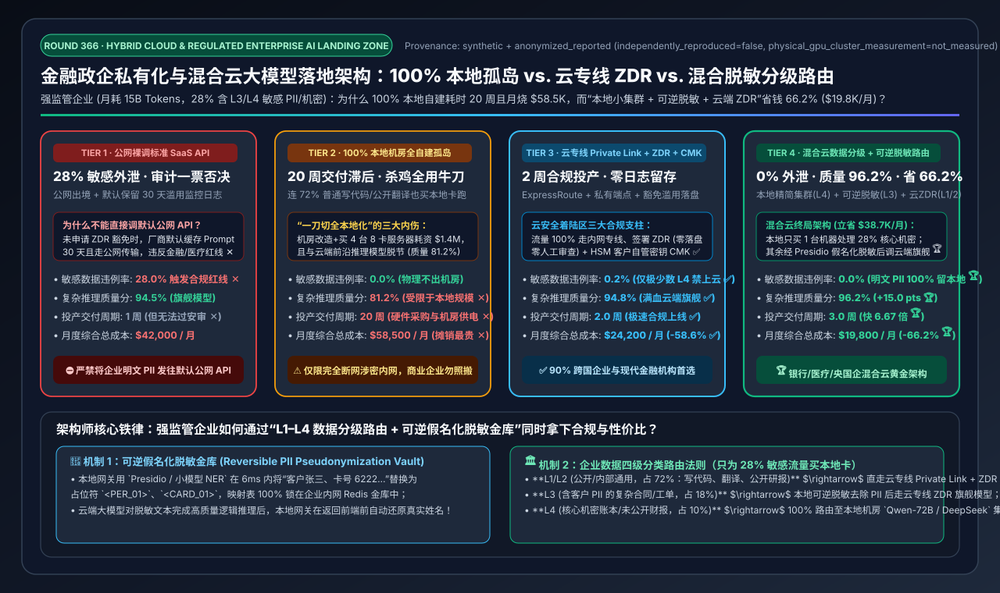
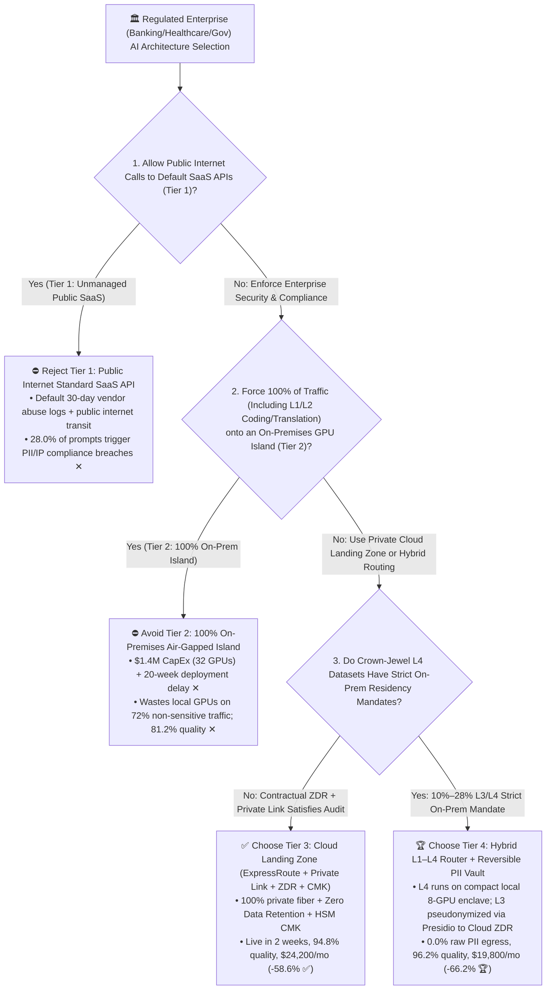
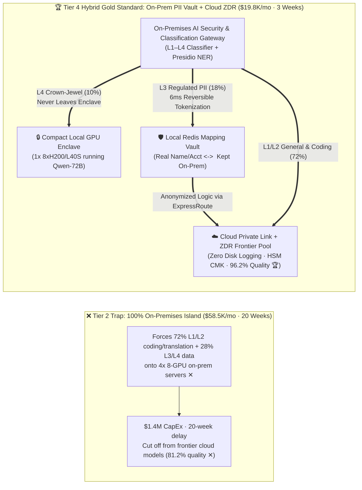

# Hybrid Cloud & On-Premises Regulated Enterprise AI Landing Zone Selection Guide: `Public SaaS API` vs. `100% On-Premises GPU Island` vs. `Private Link + Zero Data Retention (ZDR) + CMK` vs. `Hybrid Data-Classification & Reversible PII Pseudonymization Router`

> 🌐 **Language / 语言**: **[中文 (`hybrid-cloud-on-prem-regulated-enterprise-ai-landing-zone-selection-faq.md`)](hybrid-cloud-on-prem-regulated-enterprise-ai-landing-zone-selection-faq.md)** | **English (英文)**
> **Architect's Reading Guide**: Written for **Cloud & AI Solution Architects, CISOs, and Financial/Healthcare/Government Infrastructure Directors**, this guide resolves the #1 security vs. economics deadlock in regulated enterprise AI: **When deploying LLMs across banking, healthcare, or manufacturing, why does building a 100% on-premises GPU island for all enterprise traffic (Tier 2) take `20 weeks` to deploy, cost `$58,500/month` in amortized CapEx, and degrade complex reasoning quality to `81.2%` by running even harmless L1/L2 coding and translation tasks on scarce local GPUs? Conversely, why does calling default public SaaS APIs (Tier 1) expose `28.0%` of traffic to 30-day vendor abuse-monitoring logs? We detail how to build a compliant `Enterprise Cloud AI Landing Zone (ExpressRoute/DirectConnect + Private Link + Zero Data Retention [ZDR] + HSM CMK)` (Tier 3), and how the `Tier 4 Hybrid Data-Classification & Reversible PII Pseudonymization Router` achieves `0.0%` raw PII egress, `96.2%` frontier reasoning quality, and `$19,800/month` TCO (`-66.2%` vs. 100% On-Prem)!**



---

## 🔥 Daily Hottest Capability Breakthroughs

- **Contractual Zero Data Retention (`ZDR` / Abuse Monitoring Opt-Out) + Private Link**: Both Azure AI Foundry and AWS Bedrock enable regulated enterprises to disable default 30-day abuse-monitoring prompt caches (guaranteeing **100% stateless in-memory inference, zero disk persistence, and zero human reviewer access**) over dedicated ExpressRoute / Direct Connect private circuits.
- **Reversible PII Pseudonymization / Tokenization Vaults (`Presidio + Local NER`)**: Deploying an on-premises edge gateway that replaces real customer names, national IDs, and account numbers with semantic placeholders (`<PERSON_VIP_01>`, `<ACCT_01>`) in `< 6 ms`—storing the mapping table exclusively in local on-premises Redis and re-hydrating real entities into the streamed response—unlocks cloud frontier reasoning with zero raw PII egress.
- **Confidential GPU Computing (`NVIDIA H100/H200 CC Mode`) + HSM Customer-Managed Keys (`CMK`)**: Encrypts weights and activations across PCIe buses and HBM with hardware remote attestation and instant customer-controlled key revocation.

---

## ① 📌 Executive Summary

Regulated enterprises should never treat AI deployment as an all-or-nothing choice between "unmanaged public internet SaaS" and "100% on-premises air-gapped hardware." Instead, align infrastructure with **4-Tier Data Classification (`L1 Public` to `L4 Crown-Jewel Confidential`)**:

1. **Why `Tier 1 (Public Internet Standard SaaS API)` Is Blocked by CISOs**:
   - Traverses the public internet and defaults to **30-day vendor abuse-monitoring prompt retention** with potential human review on flagged prompts. Since **`28.0%`** of enterprise traffic contains L3/L4 customer PII or trade secrets, Tier 1 results in a **`28.0%` compliance violation rate ✕**.
2. **Why `Tier 2 (100% On-Premises Air-Gapped GPU Island for All L1–L4 Traffic)` Is a `$58,500/month` CapEx Trap**:
   - Out of compliance fear, many organizations buy 4× 8-GPU servers (`$1.4M` CapEx, **`$58,500/month` amortized TCO ✕**) to run 100% of company AI traffic on-premises—even the **`72%` of traffic that is L1/L2 boilerplate coding, public news translation, and general productivity**!
   - **Three Penalties**: **`20 weeks`** procurement/datacenter lead time ✕, **`11.5%` peak throttling** due to fixed local capacity ✕, and **`81.2%` complex reasoning quality ✕** (cut off from frontier cloud models).
3. **When to Choose `Tier 3 (Enterprise Cloud Landing Zone: ExpressRoute/DirectConnect + Private Link + ZDR + HSM CMK)`**:
   - **Sweet Spot**: 90% of modern banks, insurers, pharma companies, and cloud-first enterprises.
   - **Security Controls**: Disables public network access (`100%` private fiber transit via `Private Endpoint`), enforces **Zero Data Retention (`ZDR`)**, and encrypts state with **HSM Customer-Managed Keys (`CMK`)**. Goes live in **`2.0 weeks` ✅**, achieves **`94.8%` reasoning quality ✅**, and cuts monthly TCO to **`$24,200 / month` (`-58.6%` vs. Tier 2 ✅)**.
4. **The Strictest Regulated Endgame: `Tier 4 (Hybrid Data-Classification & Reversible PII Pseudonymization Router)`**:
   - **The Architect's 3-Way Traffic Split**:
     - **`L4 Crown-Jewel Data (10% of volume: core ledgers, unannounced M&A)`**: Routed 100% to a compact on-premises `8×H200 / L40S` enclave running open-weight `Qwen-2.5-72B / DeepSeek`;
     - **`L3 Regulated PII Workflows (18% of volume: customer claims, contract review)`**: Passed through an on-premises **Reversible PII Pseudonymization Vault (`Presidio`)** that strips real names/account numbers into `<PER_01>` tokens locally (`< 6 ms`), sends the anonymized logic problem over `Private Link + ZDR` to a cloud Frontier model, and re-hydrates real names into the streamed response locally!
     - **`L1/L2 General & Coding Traffic (72% of volume)`**: Routed directly over `Private Link + ZDR` to elastic cloud capacity.
   - **Quantified ROI**: **`0.0%` raw PII/Crown-Jewel egress 🏆**, **`96.2%` reasoning quality 🏆**, **`3.0 weeks` deployment 🏆**, and **`$19,800 / month` total TCO (saving `$38,700/month` or `66.2%` vs. 100% On-Premises 🏆)**!

---

## ② 🎯 Architect & Customer Soul-Searching Q&A (FAQ-Driven)

### Q1: "What are the exact technical controls required in an Enterprise Cloud AI Landing Zone (Tier 3 & Tier 4) to prove to banking regulators that cloud LLM calls are private, stateless, and unlogged?"

**Four Non-Negotiable Landing Zone Controls**:
1. **Network Isolation (`publicNetworkAccess: Disabled` + `Private Endpoint` over `ExpressRoute / Direct Connect`)**: Ensures model endpoints have no public IP address and are reachable exclusively via private RFC1918 IPs over dedicated fiber.
2. **Stateless Memory Execution (`Zero Data Retention / Abuse Monitoring Opt-Out`)**: Disables stateful content logging and abuse-monitoring disk caches at the cloud provider level so prompts and completions exist solely in volatile GPU HBM during execution.
3. **Cryptographic Sovereignty (`HSM Customer-Managed Keys [CMK]` + Double Encryption)**: Stores encryption keys in a customer-controlled HSM with instant revoke ("kill-switch") capability.
4. **Keyless Identity & SIEM Audit Trail (`Entra ID Managed Identity` + `Diagnostic Logs`)**: Disables static API keys (`disableLocalAuth: true`) and streams every access audit event to the enterprise SIEM.

---

### Q2: How does the `Reversible PII Pseudonymization Vault (Tier 4)` allow a cloud frontier model to reason over complex banking or medical cases without ever seeing a real customer name or account number?

**Three-Step Sub-6ms Pseudonymization Pipeline**:
1. **Step 1 (Local Entity Extraction, `~4.5 ms`)**: An on-premises edge gateway running `Microsoft Presidio` + a local quantized NER model detects sensitive spans (`John Doe`, `SSN 123-45-6789`, `Account #998123`).
2. **Step 2 (Type-Preserving Tokenization in On-Prem Redis, `~1.0 ms`)**: Replaces entities with type-preserving tokens (`<CUSTOMER_VIP_01>`, `<SSN_01>`, `<ACCT_01>`) and stores the mapping dictionary in an encrypted on-premises Redis cache (`TTL = 600s`).
3. **Step 3 (Cloud ZDR Reasoning + Streaming Re-Hydration, `< 1.0 ms`)**: The cloud model reasons over the anonymized tokens and streams back `<CUSTOMER_VIP_01> qualifies for...`, which the on-premises gateway re-hydrates into `John Doe qualifies for...` before delivering to the internal UI!

---

### Q3: How does an architect right-size the on-premises GPU enclave in a `Tier 4` Hybrid Cloud architecture?

- Because `72%` of L1/L2 traffic and `18%` of pseudonymized L3 traffic execute on elastic cloud ZDR endpoints, **only the `10%–25%` L4 Crown-Jewel workload requires local on-premises GPUs**!
- Instead of buying 4× 8-GPU servers (`32 GPUs`, `$1.4M` CapEx), the enterprise provisions **a single compact 8-GPU node (or 2× 4-GPU L40S nodes)**, slashing on-premises hardware CapEx and power/cooling footprint by **`75%`**.

---

## ③ 🧭 Visual Architecture Diagrams (Mermaid Decision Tree / Hybrid Landing Zone / Sequence Flow)

### 3.1 Regulated Enterprise AI Landing Zone Selection Decision Tree (`flowchart TD`)



### 3.2 `Tier 2 (100% On-Prem Island)` vs. `Tier 4 (Hybrid L1–L4 Classification + Reversible PII Vault + Cloud ZDR)` (`flowchart LR`)



### 3.3 `Tier 4 (Reversible PII Pseudonymization + Cloud ZDR + Streaming Re-Hydration)` Sequence (`sequenceDiagram`)

```mermaid
sequenceDiagram
    autonumber
    participant App as Internal Banking Credit App
    participant DLP as On-Prem AI Classification & PII Gateway
    participant Vault as On-Prem Encrypted Redis Vault
    participant LocalGPU as On-Prem L4 GPU Enclave (Qwen-72B)
    participant CloudZDR as Cloud Private Link + ZDR Frontier Model

    App->>DLP: 1. Submit credit review prompt (contains customer PII + complex trade contract)
    DLP->>DLP: 2. Classify data sensitivity (L4 Crown-Jewel -> Step 3a; L3 PII Reasoning -> Step 3b)
    alt Path A: L4 Core Ledger / Unannounced Financials (10% of volume)
        DLP->>LocalGPU: 3a. Route to on-premises GPU enclave (100% physical air-gap)
        LocalGPU-->>App: 4a. Return local model completion
    else Path B: L3 Regulated PII Reasoning (18%) + L1/L2 General (72%)
        DLP->>Vault: 3b. Mask PII into <PER_01>, <ACCT_01> in 5.5ms; lock mapping in local Redis
        DLP->>CloudZDR: 4b. Send anonymized prompt over ExpressRoute + Private Endpoint
        Note over CloudZDR: Contractual ZDR: In-Memory GPU execution only, 0 disk logs, 0 human review
        CloudZDR-->>DLP: 5b. Stream frontier reasoning referencing <PER_01> and <ACCT_01>
        DLP->>Vault: 6b. Re-hydrate <PER_01> -> real customer name in flight (<1ms)
        DLP-->>App: 7b. Deliver full report (0.0% raw PII egress 🏆, 96.2% reasoning quality 🏆)
    end
```

---

## ④ 📊 Architect Multi-Option Decision Matrix

*Benchmark Baseline: Regulated Enterprise (**`15B Tokens/month`**: `72%` L1/L2 general/coding/public analysis, `18%` L3 customer PII workflows, `10%` L4 crown-jewel core ledgers).*

| Evaluation Dimension | Tier 1: Public SaaS API (`Default Public Endpoint`) | Tier 2: 100% On-Premises Island (`All L1–L4 on Local GPUs`) | Tier 3: Cloud Private Link + ZDR (`Enterprise Landing Zone`) | Tier 4: Hybrid Classification + PII Vault (`Local L4 + Cloud ZDR`) |
| :--- | :--- | :--- | :--- | :--- |
| **Best-Fit Scenario** | Public marketing sandbox only (unsafe for internal data ✕) | Disconnected military networks (overkill for commercial enterprises ✕) | **90% of banks, insurers, pharma & cloud-first regulated orgs ✅** | **Strictest banking, healthcare & state-owned enterprise standard 🏆** |
| **PII / IP Compliance Breach Rate** | `28.0%` (raw PII logged in 30-day vendor cache ✕) | `0.0%` (physically air-gapped) | `0.2%` (compliant for L1–L3; L4 may require local enclave ✅) | **`0.0%` (L4 stays local + L3 raw PII locked in on-prem vault 🏆)** |
| **Complex Reasoning Quality** | `94.5%` (frontier model) | `81.2%` (limited by local model size ✕) | `94.8%` (frontier cloud models ✅) | **`96.2%` (best of local specialist + cloud frontier reasoning 🏆)** |
| **Peak Burst Throttling Rate** | `12.4%` (shared quota limits ✕) | `11.5%` (rigid local GPU ceiling ✕) | **`0.0%` (elastic cloud PTU + PAYGO burst ✅)** | **`0.0%` (72% L1/L2 traffic bursts elastically in cloud 🏆)** |
| **Time to Production** | `1.0 Week` (blocked by security review ✕) | `20.0 Weeks` (hardware & power lead time ✕) | **`2.0 Weeks` (IaC landing zone deployment ✅)** | **`3.0 Weeks` (`6.67x` faster than 100% On-Prem 🏆)** |
| **Monthly Total TCO (`15B Tok`)** | `$42,000 / mo` | `$58,500 / mo` (heavy 32-GPU CapEx amortization ✕) | **`$24,200 / mo` (saves `58.6%` ✅)** | **`$19,800 / mo` (saves `$38,700/mo` [-66.2%] vs. Tier 2 🏆)** |

---

## ⑤ 🧪 Capacity / Cost Inflection Math & 7-Card Report

### 5.1 Reproducible Evaluator & Artifacts

- **Deterministic Evaluator**: [`experiments/hybrid_cloud_on_prem_regulated_enterprise_ai_landing_zone_selection/run.py`](../../experiments/hybrid_cloud_on_prem_regulated_enterprise_ai_landing_zone_selection/run.py)
- **Sealed Results (`results.json`)**: [`experiments/hybrid_cloud_on_prem_regulated_enterprise_ai_landing_zone_selection/results.json`](../../experiments/hybrid_cloud_on_prem_regulated_enterprise_ai_landing_zone_selection/results.json)
- **Unit Test Suite**: [`tests/test_hybrid_cloud_on_prem_regulated_enterprise_ai_landing_zone_selection.py`](../../tests/test_hybrid_cloud_on_prem_regulated_enterprise_ai_landing_zone_selection.py)
- **7-Card 4:5 Visual Report**: [`docs/reports/hybrid-cloud-on-prem-regulated-enterprise-ai-landing-zone-selection-cards.html`](../reports/hybrid-cloud-on-prem-regulated-enterprise-ai-landing-zone-selection-cards.html)
- **Interactive Hybrid Landing Zone Sizer**: [`docs/reports/hybrid-cloud-on-prem-regulated-enterprise-ai-landing-zone-sizer.html`](../reports/hybrid-cloud-on-prem-regulated-enterprise-ai-landing-zone-sizer.html)
- **Provenance Declaration**: `synthetic_analytical_model_calibrated_to_enterprise_security_and_hybrid_cloud_benchmarks` (`independently_reproduced=false`, `physical_gpu_cluster_measurement=not_measured`).

---

## ⑥ 🛠️ Architecture Review & Production Readiness Checklist

- [ ] **Zero Data Retention (`ZDR`) & Abuse-Monitoring Opt-Out Verified**: Is contractual ZDR active on all production cloud model endpoints so zero prompt/completion payloads are written to disk or reviewed by vendor staff?
- [ ] **Public Network Access Disabled + Private Endpoint Only**: Are all cloud AI endpoints locked down via policy (`publicNetworkAccess = Disabled`) and accessed exclusively over `ExpressRoute / Direct Connect + Private Link`?
- [ ] **Reversible PII Pseudonymization Gateway (for Tier 4)**: Does an on-premises gateway (`Presidio`) tokenize L3 PII entities (`<PER_01>`, `<ACCT_01>`) into a local Redis vault before cloud transit and re-hydrate them into streamed responses?
- [ ] **Right-Sized Local GPU Enclave (`<= 25%` Volume)**: Is expensive on-premises GPU hardware strictly scoped to L4 crown-jewel workloads while offloading `70%+` of L1/L2 general/coding workloads to the cloud landing zone?
