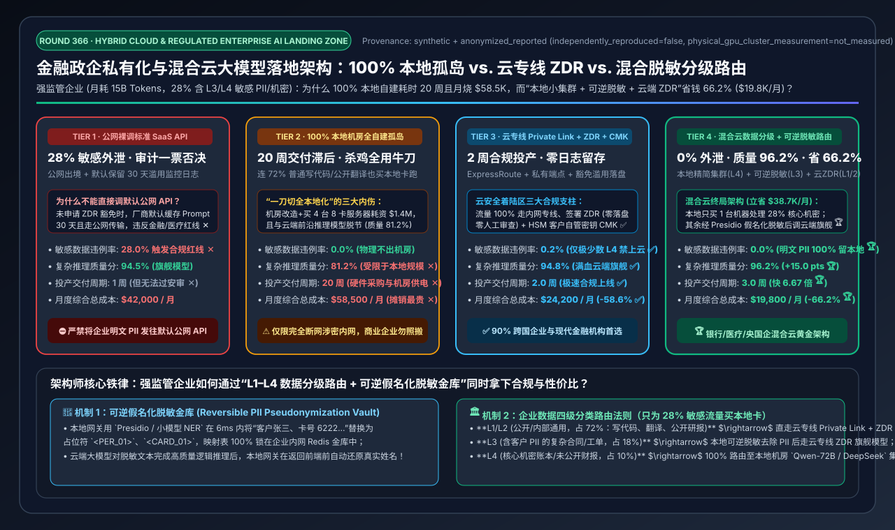
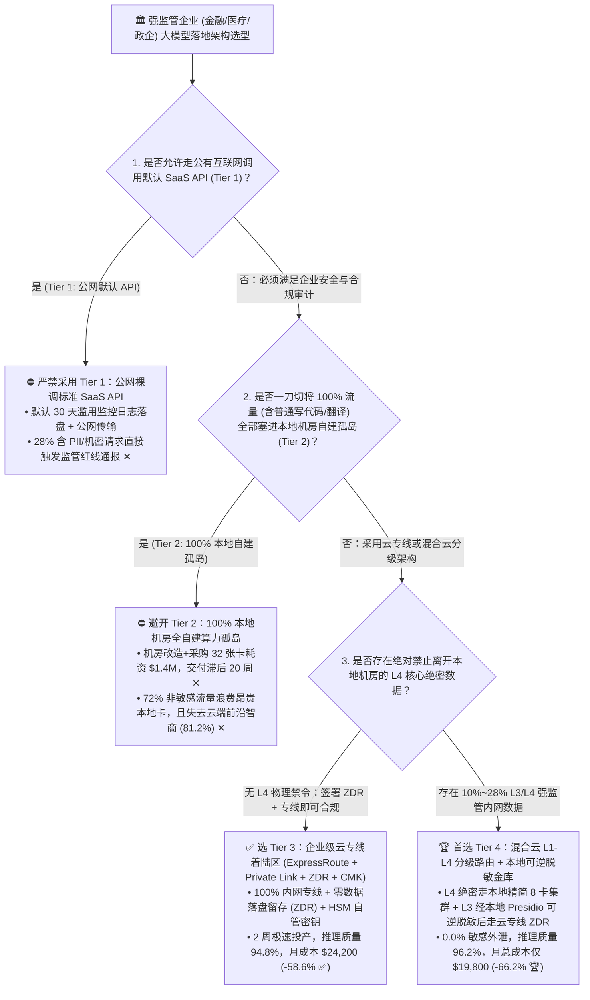
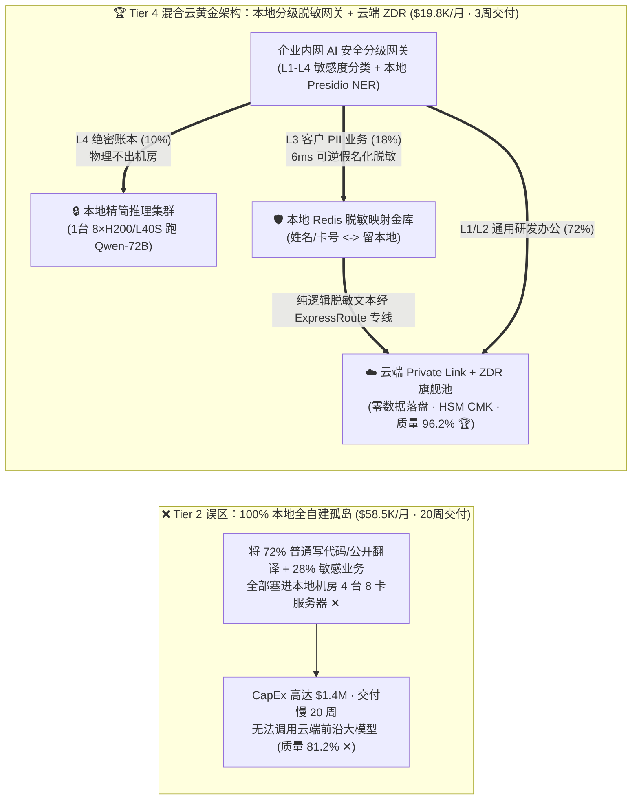
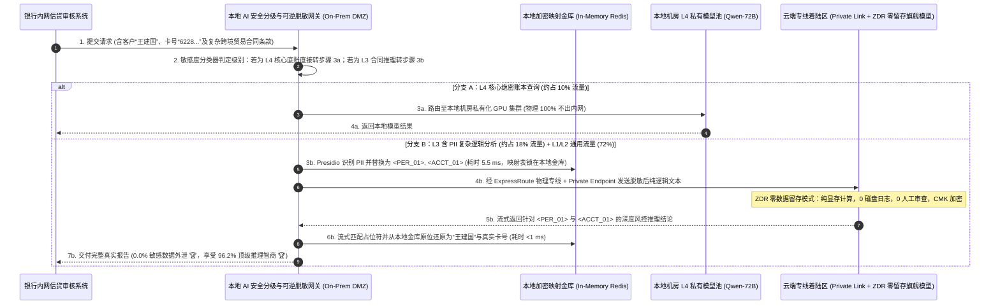

# 金融政企私有化与混合云大模型落地架构（Hybrid Cloud & Regulated AI Landing Zone）选型指南：`公网裸调 SaaS` vs. `100% 本地自建孤岛` vs. `云专线 Private Link + 零数据留存 (ZDR)` vs. `混合云数据分级与可逆脱敏路由`

> 🌐 **Language / 语言**: **中文 (Chinese)** | **[English (`hybrid-cloud-on-prem-regulated-enterprise-ai-landing-zone-selection-faq.en.md`)](hybrid-cloud-on-prem-regulated-enterprise-ai-landing-zone-selection-faq.en.md)**
> **阅读指南**：本文面向 **服务于银行、保险、医疗、央国企与大型制造企业的 Cloud & AI Solution Architect（云与 AI 解决方案架构师）、CISO（首席信息安全官）与基础架构总监**。在强监管行业落地大模型时，客户往往陷入两个极端——要么担心数据合规而一刀切花上千万在本地机房买满 GPU（结果连员工写 Python 代码、翻译公开英文邮件都跑在昂贵的本地卡上，等机器上架花了 20 周，且用不上云端最聪明的前沿推理模型）；要么业务部门偷偷从公网直连默认 SaaS API 引发合规红线通报。本文将彻底讲透：**如何建设符合金融级监管要求的 `Enterprise Cloud AI Landing Zone（专线 Private Link + 零数据留存 ZDR + 客户自管密钥 CMK）`？以及如何通过 `Tier 4（混合云 L1–L4 数据分级路由 + 本地 Presidio 可逆假名化脱敏金库 + 本地小规模 L4 核心集群 + 云端 ZDR 弹性底座）`，在实现 `0.0%` 明文敏感数据出境的同时，将复杂推理质量推高至 `96.2%`、每月总成本从纯本地自建的 `$58,500` 砍至 `$19,800 (-66.2%)`？**

---

## 🔥 业界最新能力突破追踪（Daily Hottest Capability Breakthroughs）

- **云厂商企业级零数据留存（Zero Data Retention, ZDR / Abuse Monitoring Opt-Out）与机密计算成金融标配**：Azure AI Foundry 与 AWS Bedrock 均支持强监管企业通过合规审批关闭默认的 30 天滥用检测缓存（实现请求与响应 **100% 仅在 GPU 显存中瞬时流转、零磁盘落盘、零人工审核员可见**），并结合 ExpressRoute / Direct Connect 与 Private Endpoint 实现全内网闭环。
- **本地可逆假名化脱敏网关（Reversible PII Pseudonymization / Tokenization Vault）突破混合云瓶颈**：在企业内网边界部署基于 `Microsoft Presidio + 轻量级本地 NER 小模型` 的双向脱敏代理，在 `< 6 ms` 内将身份证号、银行卡号、客户姓名与项目代号替换为保持语义一致的假名占位符（如 `<PERSON_A>`、`<ACCOUNT_01>`），待云端大模型完成逻辑分析后在本地自动还原，兼得“云端超强智商”与“本地绝对隐私”。
- **Confidential GPU（NVIDIA H100/H200 CC 机密计算模式）与客户自管密钥（CMK in HSM）**：支持对模型推理过程中的 PCIe 数据总线与显存进行硬件级 AES-GCM 加密，并提供可验证的远程证明（Remote Attestation）。

---

## ① 📌 核心选型结论速览（Executive Summary）

强监管企业（金融、医疗、政务、核心制造）规划大模型基础设施时，必须打破 **“要么 100% 公有云裸奔，要么 100% 本地机房闭门造车”** 的二元对立，围绕 **企业数据四级分类（L1 公开 ~ L4 核心绝密）** 进行精准架构匹配：

1. **为什么严禁采用 `Tier 1（公有互联网直接调用标准 SaaS 大模型 API）`**：
   - **两大合规死穴**：① 流量跨越公有互联网且无私有网络边界控制；② 许多标准 SaaS API 默认开启 **30 天安全滥用监控日志缓存（Abuse Monitoring Logging）**，甚至在触发风控规则时允许厂商安全团队人工调阅提示词。一旦企业内部有 **`28.0%`** 的请求包含客户真实姓名、病历或未公开合同，将直接构成严重的数据合规违例 ✕！
2. **为什么 `Tier 2（一刀切 100% 本地机房全量自建算力孤岛）` 是商业企业的性价比泥潭**：
   - 不少传统企业为了“省心过安审”，要求把全公司 100% 的 AI 流量（包括占 **72% 的写代码、写周报、翻译公开外文研报、通用头脑风暴**）全部塞进本地机房自建的 GPU 集群（需采购 4 台 8 卡服务器，耗资 `$1.4M`，月摊销成本高达 **`$58,500 / 月` ✕**）。
   - **三大内伤**：① **投产极慢**——从服务器招投标、机房液冷/供电改造到上架联调长达 **`20 周（5 个月）` ✕**；② **智商受限**——本地受算力规模限制只能跑中小模型或量化模型，遇到复杂跨领域推理时准确率跌至 **`81.2%` ✕**；③ **峰值卡顿**——本地固定机器无法应对白天突发并发（**`11.5%` 限流排队 ✕**）。
3. **何时选 `Tier 3（企业级合规云专线着陆区：ExpressRoute / Direct Connect + Private Link + ZDR 零数据留存 + HSM CMK）`**：
   - **适用期**：90% 的外资银行、现代金融机构、跨国药企与云优先政企。
   - **合规三件套**：① 通过 `ExpressRoute / Direct Connect + Private Endpoint` 确保流量 **100% 走内网专线，物理断绝公网访问**；② 与云厂商签署并开启 **ZDR（Zero Data Retention，豁免内容落盘与人工审查，100% 内存态无状态推理）**；③ 启用 **HSM 客户自管密钥（CMK）**。仅需 **`2.0 周`** 即可合规上线，复杂推理质量达 **`94.8%` ✅**，月成本降至 **`$24,200 / 月`（比纯本地自建省 `58.6%` ✅）**！
4. **强监管行业终极黄金架构：`Tier 4（混合云 L1–L4 数据分级路由 + 本地可逆 PII 脱敏金库 + 精简本地 L4 集群 + 云端 ZDR 底座）`**：
   - **核心设计法则（好钢用在刀刃上）**：
     - **仅占 `10%` 的 L4 核心绝密数据（未公开财报原表、核心交易账本、军工图纸）**：100% 路由至企业本地机房的 **1 台精简 `8×H200 / L40S` 私有化集群**（运行 `Qwen-2.5-72B / DeepSeek`），物理绝对不出机房；
     - **占 `18%` 的 L3 含敏感 PII 业务数据（智能客服对话、合同审查、理赔工单）**：先在本地边界网关通过 **可逆假名化脱敏金库（Reversible PII Tokenization Vault）** 剥离全部真实姓名/卡号/身份证号，将变身为纯逻辑问题的脱敏文本经云专线 `Private Link + ZDR` 发往云端旗舰大模型分析，返回后再在本地毫秒级还原真实实体！
     - **占 `72%` 的 L1/L2 非敏感通用流量（研发代码助手、公开市场分析、文档翻译）**：直接走云专线 `Private Link + ZDR` 享受云端无限弹性与高性价比！
   - **定量收益**：**`0.0%` 敏感明文数据违例 🏆**，复杂推理质量高达 **`96.2%` 🏆**，上线周期仅 **`3.0 周` 🏆**，而月度综合总成本从全本地自建的 `$58,500` 暴降至 **`$19,800 / 月`（每月净省 `$38,700`，降幅高达 `66.2%` 🏆）**！

---

## ② 🎯 客户与架构师灵魂拷问 Q&A（FAQ-Driven）

### Q1：客户安全总监（CISO）问：“云厂商口头说‘不会拿我们的企业数据去训练模型’，但在技术架构上，我们怎么确保发往云端大模型的请求真正做到‘不出内网、不落磁盘、云厂商管理员也看不到’？”

**架构师必须写入标书与安全评审报告的“云端 AI 着陆区（AI Landing Zone）四大硬核控制措施”**：

1. **网络层硬隔离：禁用公网入口（`Public Network Access = Disabled`）+ 专线 `Private Endpoint`**
   - 在云端创建大模型资源（如 Azure AI Foundry / OpenAI 或 AWS Bedrock VPC Endpoint）时，第一件事就是将公网访问开关设为 `Disabled`。
   - 为该服务绑定 **私有终结点（Private Endpoint）**，分配企业内网私网 IP（如 `10.24.8.15`），并通过 **ExpressRoute / Direct Connect 物理专线** 与企业本地数据中心打通。这意味着从企业内网发出的每一个字节走的全是运营商专有光纤，根本不经过公有互联网。
2. **存储与内存层硬隔离：开启企业级零数据留存（`Zero Data Retention / Abuse Monitoring Opt-Out`）**
   - **架构师必查盲点**：云端大模型默认会为了防范有害内容而把异常请求缓存在后台加密存储中最多 30 天。
   - **合规动作**：必须向云厂商提交正式的 **Modified Abuse Monitoring / Zero Data Retention (ZDR)** 豁免配置。开启后，云端网关和推理节点对客户 Prompt 与 Completion **实行 100% 纯内存流转（In-Memory Only）**——推理完成的瞬间即从 GPU 显存清零，不写任何日志盘，云厂商任何运维人员或审核员均无权、也无法调阅任何历史报文。
3. **密钥与加密层硬隔离：HSM 客户自管密钥（`Customer-Managed Keys, CMK`）**
   - 任何微调权重、批处理文件或知识库索引均使用存放在客户专属硬件安全模块（Key Vault Managed HSM / AWS KMS Custom Key Store）中的密钥加密。一旦客户发现异常，随时可在本地一键吊销密钥（Revoke Key），让云端所有关联资产瞬间不可读。
4. **身份与审计层硬隔离：Entra ID / IAM 禁用静态 Key + 全量内网 SIEM 审计日志**
   - 彻底关闭 `localAuth (API Key)`，所有调用强制验证企业身份令牌並实时镜像审计元数据至企业内部 Splunk / Sentinel。

---

### Q2：对于银行客服或医院病历分析这种“既包含大量客户真实姓名/卡号（L3 敏感），又需要云端顶尖大模型的高超逻辑推理能力”的场景，**“本地可逆假名化脱敏网关（Reversible PII Vault）”** 是怎么运作的？

**6 毫秒“偷梁换柱”双向脱敏流水线拆解**：

- **第 1 步（本地拦截与实体识别，耗时 `~4.5 ms`）**：
  - 员工提交原始提示词：`“请分析VIP客户王建国（身份证 31010419850612883X，卡号 6228480019283746）向供应商上海宏达精密机械有限公司转账 480 万元的洗钱风险。”`
  - 部署在企业本地机房 DMZ 区的 **可逆脱敏网关（基于 `Microsoft Presidio + 本地量化 BERT/GLiNER 实体识别器`）** 瞬间识别出姓名、身份证、银行卡与非公开企业名。
- **第 2 步（生成语义保真占位符并锁入本地 Redis 金库，耗时 `~1.0 ms`）**：
  - 本地网关生成唯一会话映射表（TTL 10 分钟，**100% 存储在企业本地内存，绝不出境**）：
    - `王建国` $\leftrightarrow$ `<PERSON_VIP_01>`
    - `31010419850612883X` $\leftrightarrow$ `<ID_SHANGHAI_85M>`
    - `6228480019283746` $\leftrightarrow$ `<BANK_CARD_01>`
    - `上海宏达精密机械有限公司` $\leftrightarrow$ `<VENDOR_CORP_01>`
  - 注意：占位符保留了实体的 **类型与业务属性（如 VIP、地区、企业性质）**，因此完全不影响大模型做风控逻辑判断！
- **第 3 步（云端专线无状态推理 + 本地流式还原，耗时 `< 1.0 ms`）**：
  - 云端旗舰模型收到的只是一道纯逻辑题：`“请分析 <PERSON_VIP_01> 向 <VENDOR_CORP_01> 转账 480 万元的洗钱风险...”`。
  - 当云端流式吐回包含 `<PERSON_VIP_01>` 的分析报告时，本地网关基于状态机流式匹配并原位替换回 `“王建国”`——业务人员看到的是完整真实的报告，而云端从始至终连一个真实汉字的姓名都没见过！

---

### Q3：如果企业遵循 `Tier 4` 建设混合云 AI 平台，本地机房到底该买多少张 GPU 卡最合理？

**“二八定律”本地精简定容法**：
- 统计表明，即便是监管最严苛的商业银行或三甲医院，真正属于 **“连脱敏后都不允许出机房，或必须访问内网核心数据库原表”的 L4 绝密流量通常只占全企业 AI 总流量的 `10% ~ 25%`**。
- 因此，**千万不要按全公司 100% 峰值去买 4 台 8 卡服务器（32 张卡）**！只需在本地机房采购 **1 台 `8×H200`（或 2 台 `4×L40S`）** 作为高安全区的“L4 涉密推理堡垒机”，专门承载那 10%~25% 的核心机密与内网本地脱敏计算；把剩下 75%+ 的通用研发、办公、客服与突发洪峰交给 **云专线 ZDR 着陆区**，即可一次性砍掉 **75% 的本地机房硬件 CapEx 与电费维保负担**！

---

## ③ 🧭 直观可视化图解（Mermaid 选型决策树 / 混合云分级路由拓扑图 / 可逆脱敏时序图）

### 3.1 金融政企大模型私有化与混合云落地选型决策树（`flowchart TD`）

### 3.2 `Tier 2 (100% 本地孤岛)` vs. `Tier 4 (混合云数据分级 + 本地可逆脱敏金库 + 云专线 ZDR)` 架构对比图（`flowchart LR`）

### 3.3 `Tier 4 (本地可逆 PII 假名化脱敏 + 云专线 ZDR 推理 + 流式原位还原)` 端到端时序图（`sequenceDiagram`）

---

## ④ 📊 架构师多方案选型决策矩阵（Architect Decision Matrix）

*核算基准：强监管金融/医疗/政企客户（全企业月总消耗 **`15B Tokens`**，其中 **`72%`** 为 L1/L2 通用研发代码、公开研报分析与内部办公，**`18%`** 为 L3 含客户个人隐私 PII 的复杂合同/理赔分析，**`10%`** 为 L4 严禁出机房的核心底账数据）。*

| 评估维度 | Tier 1: 公网标准 SaaS API (`Public Internet SaaS`) | Tier 2: 100% 本地机房全自建孤岛 (`100% On-Premises Island`) | Tier 3: 云专线合规着陆区 (`Private Link + ZDR + CMK`) | Tier 4: 混合云分级 + 可逆脱敏路由 (`Local L4 + PII Vault + Cloud ZDR`) |
| :--- | :--- | :--- | :--- | :--- |
| **核心适用场景** | 仅限完全公开的外部营销文案测试（严禁接入内网数据 ✕） | 完全物理断网的国防军工涉密网（常规商业银行/企业采用属严重浪费 ✕） | **90% 现代金融机构、跨国药企与云优先政企主力底座 ✅** | **最严苛的国有银行、三甲医院、央国企混合云终局标准 🏆** |
| **敏感 PII / 机密合规违例率** | `28.0%`（明文 PII 落入厂商 30 天监控日志 ✕） | `0.0%`（物理不出机房） | `0.2%`（满足 99.8% 云合规，仅极少数 L4 受限 ✅） | **`0.0%`（L4 留本地 + L3 真名卡号 100% 锁在本地金库 🏆）** |
| **复杂跨领域推理质量分** | `94.5%`（云端旗舰模型） | `81.2%`（受限于本地硬件规模与开源代差 ✕） | `94.8%`（云端满血旗舰模型 ✅） | **`96.2%`（核心机密与云端前沿推理协同发力 🏆）** |
| **业务高峰并发限流率** | `12.4%`（公网共享配额限流 ✕） | `11.5%`（本地固定机器无法弹性扩容 ✕） | **`0.0%`（云端 PTU 基荷 + PAYGO 弹性溢出 ✅）** | **`0.0%`（72% L1/L2 流量在云端无限弹性伸缩 🏆）** |
| **项目立项到投产周期** | `1.0 周`（但无法通过 CISO 安全审批 ✕） | `20.0 周`（服务器招标+机房供电改造极慢 ✕） | **`2.0 周`（Terraform/Bicep 一键拉起着陆区 ✅）** | **`3.0 周`（比全量本地自建快 `6.67 倍` 🏆）** |
| **网络与加密安全等级** | 公网 TLS + 厂商托管密钥 ✕ | 本地内网物理隔离 | **ExpressRoute 专线 + Private Endpoint + ZDR + HSM CMK ✅** | **本地内网堡垒 + 可逆假名化金库 + 专线 ZDR + CMK 🏆** |
| **月度综合总成本 (`TCO`)** | `$42,000 / 月` | `$58,500 / 月`（32 卡重资产折旧与机房电费 ✕） | **`$24,200 / 月`（省 `58.6%` ✅）** | **`$19,800 / 月`（比全本地自建每月净省 `$38,700` [-66.2%] 🏆）** |

---

## ⑤ 🧪 容量/成本拐点算例与 7-Card 报告

### 5.1 复现实验与确定性验证底座

- **确定性评估脚本**：[`experiments/hybrid_cloud_on_prem_regulated_enterprise_ai_landing_zone_selection/run.py`](../../experiments/hybrid_cloud_on_prem_regulated_enterprise_ai_landing_zone_selection/run.py)
- **封存数表 (`results.json`)**：[`experiments/hybrid_cloud_on_prem_regulated_enterprise_ai_landing_zone_selection/results.json`](../../experiments/hybrid_cloud_on_prem_regulated_enterprise_ai_landing_zone_selection/results.json)
- **单元测试校验**：[`tests/test_hybrid_cloud_on_prem_regulated_enterprise_ai_landing_zone_selection.py`](../../tests/test_hybrid_cloud_on_prem_regulated_enterprise_ai_landing_zone_selection.py)
- **7-Card 4:5 视觉评测卡片**：[`docs/reports/hybrid-cloud-on-prem-regulated-enterprise-ai-landing-zone-selection-cards.html`](../reports/hybrid-cloud-on-prem-regulated-enterprise-ai-landing-zone-selection-cards.html)
- **交互式混合云合规与 TCO 计算器**：[`docs/reports/hybrid-cloud-on-prem-regulated-enterprise-ai-landing-zone-sizer.html`](../reports/hybrid-cloud-on-prem-regulated-enterprise-ai-landing-zone-sizer.html)
- **数据溯源声明（Provenance）**：`synthetic_analytical_model_calibrated_to_enterprise_security_and_hybrid_cloud_benchmarks`（`independently_reproduced=false`, `physical_gpu_cluster_measurement=not_measured`）。

---

## ⑥ 🛠️ 架构评审与生产落地 Checklist（Architect Checklist）

- [ ] **云端 ZDR（零数据留存）与关闭滥用日志落盘核验**：在将任何企业内部业务接入云端大模型前，是否已确认当前订阅已正式获批并生效 **Zero Data Retention / Abuse Monitoring Opt-Out**（确保 0 字节 Prompt 落盘、0 人工审查）？
- [ ] **禁用公网访问与强制 Private Link 专线闭环**：云端大模型端点的 `publicNetworkAccess` 是否已强制设为 `Disabled`（通过 Azure Policy / AWS SCP 锁死），且所有流量 100% 经由 ExpressRoute / Direct Connect + Private Endpoint 传输？
- [ ] **L1–L4 数据分级与本地可逆脱敏金库验证（针对 Tier 4）**：是否在本地内网边界部署了双向可逆假名化网关（如 `Presidio`），确保 L3 请求中的真实姓名、身份证号、银行账号在离开内网前 100% 替换为语义占位符 `<ENTITY_ID>`？
- [ ] **避免“为 L1/L2 非敏感流量买本地 GPU”的预算浪费**：本地私有化 GPU 集群的采购容量是否已严格控制在仅覆盖 `10%~25%` 的 L4 核心绝密负载，而将占 `70%+` 的代码辅助、公开文档翻译与通用办公卸载至高性价比的云端着陆区？
