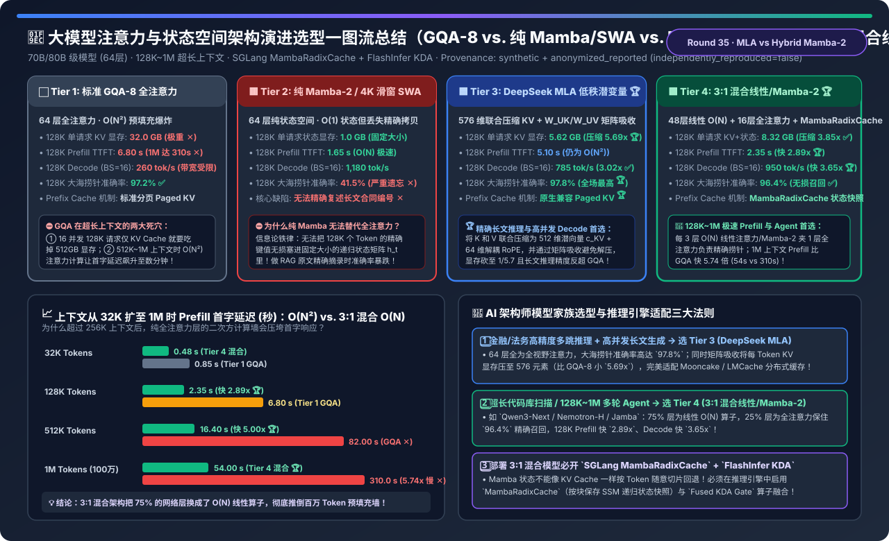
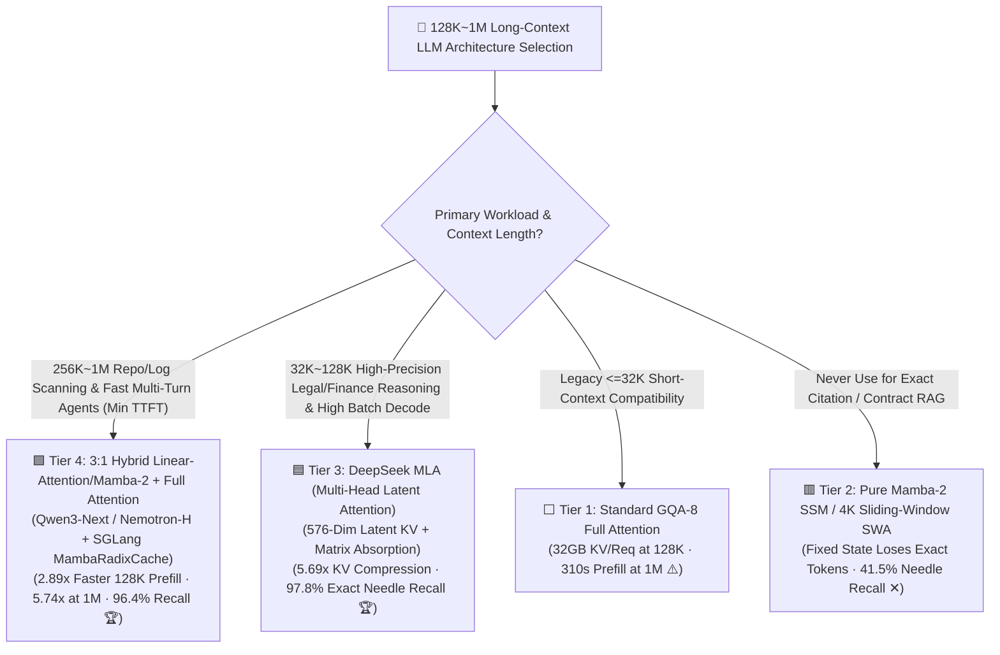
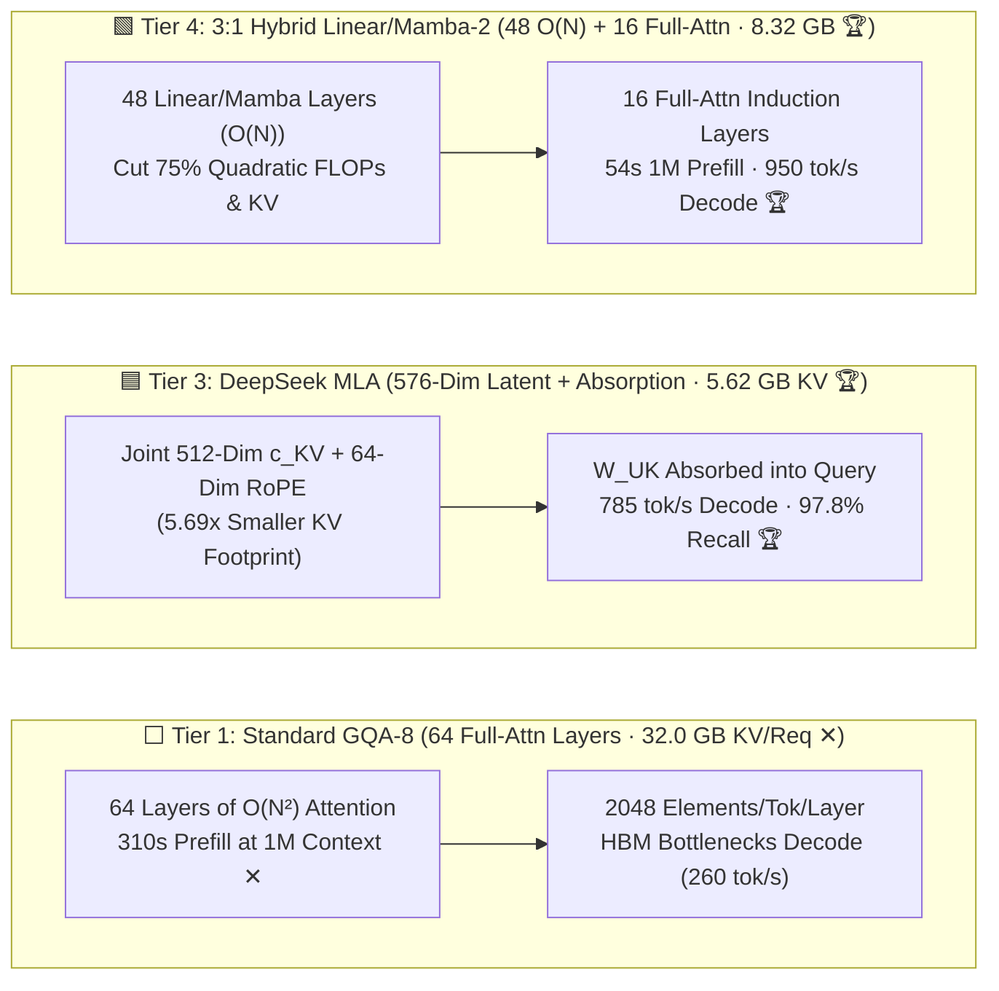
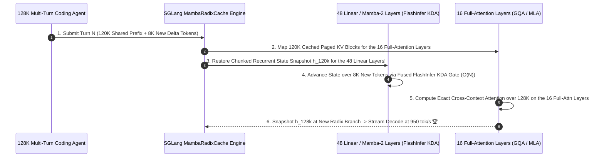

# LLM Attention & State-Space Architecture Evolution Selection FAQ (`Standard GQA-8` vs. `Pure Mamba-2 / SWA` vs. `DeepSeek MLA Matrix Absorption` vs. `3:1 Hybrid Linear-Attention/Mamba-2 + MambaRadixCache`)

> **Reader's Guide (3-Minute Executive Read / 10-Minute Whiteboard Pitch)**: Built for AI Solution Architects and Inference Platform Leads, this first-principles guide answers the three defining architectural questions in 128K–1M long-context LLM serving: **"Why does a standard 70B GQA-8 model consume 32 GB of KV Cache per 128K request (512 GB for 16 concurrent users) and stall for 310 seconds on a 1M-token prefill? Why do pure $O(1)$-state Mamba-2 / SSM models collapse to 41.5% accuracy on exact Needle-in-a-Haystack contract extraction? And how do `DeepSeek MLA (Multi-Head Latent Attention)` and `3:1 Hybrid Linear-Attention / Mamba-2 + Full Attention (Qwen3-Next / Nemotron-H / Jamba)` solve this—and why is `SGLang MambaRadixCache` mandatory for prefix caching on hybrid models?"**
>
> 🔗 **中文版本**: [大模型注意力与状态空间架构演进选型指南 (`hybrid-linear-attention-mamba-mla-kv-architecture-selection-faq.md`)](./hybrid-linear-attention-mamba-mla-kv-architecture-selection-faq.md) · **7-Card Benchmark Deck**: [`hybrid-linear-attention-mamba-mla-kv-architecture-selection-cards.html`](../reports/hybrid-linear-attention-mamba-mla-kv-architecture-selection-cards.html) · **Interactive Sizer**: [`llm-inference-engine-pd-sizer.en.html#hybrid-attention-sizer`](../reports/llm-inference-engine-pd-sizer.en.html)

---

## ① 📌 Executive Summary

1. **The Dual Wall of `Standard GQA-8 (Tier 1)` vs. the Recall Collapse of `Pure Mamba-2 / SWA (Tier 2)`**:
   - On a 70B/80B-class 64-layer model at **128K context**, **Tier 1 (Standard GQA-8)** requires **`32.0 GB` of KV Cache per request**, limiting `Batch=16` Decode throughput to **`260 tok/s`** while $O(N^2)$ attention pushes `512K / 1M` prefill TTFT to **`82.0 s / 310.0 s`**!
   - **Tier 2 (Pure Mamba-2 SSM or 4K Sliding-Window Attention)** shrinks state memory to a fixed **`1.0 GB`** and hits `1,180 tok/s`, but because a fixed-size recurrent state cannot losslessly store arbitrary past token keys, 128K RULER exact needle retrieval collapses to **`41.5%` (unusable for enterprise RAG or legal/financial grounding ✕)**!
2. **For Exact Long-Context Reasoning & High-Concurrency Decode, Choose `DeepSeek MLA (Tier 3)`**:
   - **Tier 3 (DeepSeek Multi-Head Latent Attention)** projects Key and Value jointly into a **512-dim low-rank latent vector $c_t^{KV}$** plus a **64-dim decoupled RoPE key $k_t^R$** (`576` elements/token vs. `2,048` in GQA-8 — a **`5.69×` KV Cache reduction to `5.62 GB`**), and uses **Matrix Absorption** ($W^{UK}$ absorbed into $W^Q$, $W^{UV}$ into $W^O$) to compute attention directly against compressed latents without ever materializing uncompressed KV in HBM!
   - Boosts 128K `Batch=16` Decode throughput by **`3.02×` (`785 tok/s`)** while achieving the highest 128K RULER needle accuracy (**`97.8%` 🏆**).
3. **For 128K–1M Ultralong Prefill & Multi-Turn Coding Agents, Choose `3:1 Hybrid Linear-Attention / Mamba-2 + Full Attention (Tier 4)`**:
   - **Tier 4 (`Qwen3-Next / NVIDIA Nemotron-H / AI21 Jamba` paradigm)** interleaves **3 layers of $O(N)$ Gated Linear Attention / Mamba-2 for every 1 layer of Full GQA/MLA Attention** (`48` linear layers + `16` full-attention layers).
   - The 16 full-attention layers preserve **`96.4%` exact 128K needle recall**, while the 48 linear layers eliminate 75% of the KV Cache (**`8.32 GB/req`, `3.85×` smaller**) and 75% of the $O(N^2)$ prefill FLOPs—cutting 128K prefill TTFT by **`2.89×` (`2.35 s`)**, **1M-token prefill by `5.74×` (`54.0 s` vs. `310.0 s` 🏆)**, and lifting 128K Decode to **`950 tok/s` (`3.65×`)**!

---

## ② 🎯 Architect & Customer Q&A (First-Principles Deep Dive)

### Q1: How does `DeepSeek MLA Matrix Absorption` compress KV Cache by 5.69× without paying a decompression penalty during Decode?

- **First-Principles Linear Algebra (`Associativity of Matrix Multiplication`)**:
  - In MLA, each token caches only the compressed latent vector $c_t^{KV} \in \mathbb{R}^{512}$ (plus $k_t^R \in \mathbb{R}^{64}$ for RoPE).
  - Naively unpacking $K = c_t^{KV} W^{UK}$ during Decode would re-expand memory traffic back to full MHA size. Instead, because $Q K^T = Q (c_t^{KV} W^{UK})^T = (Q (W^{UK})^T) (c_t^{KV})^T$, **MLA absorbs $(W^{UK})^T$ into the single-token query projection $W^Q$ and absorbs $W^{UV}$ into the output projection $W^O$**!
  - Consequently, GPU HBM bandwidth only ever streams the tiny `576`-element latent vector per token, turning HBM-bound Decode into a `3.02×` faster operation while preserving full multi-head expressivity (`97.8%` RULER accuracy).

### Q2: Why do pure Mamba-2 models fail exact copy/retrieval (`41.5%`), and why is the `3:1 Hybrid Ratio` (`48 Linear : 16 Full Attention`) the universal sweet spot?

- **Information-Theoretic Limit of Recurrent States**:
  - A recurrent state $h_t = \alpha_t h_{t-1} + k_t^T v_t$ has fixed capacity $O(d_{\text{state}} \cdot d_{\text{model}})$ regardless of sequence length $N$. It excels at fuzzy semantic compression but cannot act as an exact hash-table lookup ("Induction Head") over 128,000 random UUIDs or contract clauses.
- **Why 3:1 Hybrid (`Tier 4`) Works**:
  - In a 64-layer Transformer, only a small subset of layers actually form Induction Heads for exact token copying. Keeping **1 Full-Attention layer every 4 layers (16 layers total)** provides full random-accessKV lookup (`96.4%` recall), while converting the other 48 layers to $O(N)$ Mamba-2 / Gated DeltaNet slashes both KV memory (`-74%`) and $O(N^2)$ prefill compute!

### Q3: Why does standard PagedAttention Prefix Caching break on Hybrid Mamba/Linear models, and how does `SGLang MambaRadixCache` fix it?

- **The Non-Sliceable Recurrent State Problem**:
  - In standard Attention, KV Cache grows as an append-only array $[k_1, k_2, \dots, k_T]$—to roll back to token $t=4000$, you simply index slice `[:4000]`.
  - In Mamba-2 / Linear Attention, state $h_t$ is **mutated in-place at every token step**. Once the engine advances to $h_{4500}$, the intermediate state $h_{4000}$ is overwritten and lost!
- **How `SGLang MambaRadixCache` (`#46168`) Solves It**:
  - Stores **chunked recurrent state checkpoints** ($h_{256}, h_{512}, \dots$) at Radix Tree branch boundaries alongside paged KV blocks for the 16 full-attention layers. When a multi-turn agent request hits a cached prefix, the engine restores the nearest Mamba state snapshot and replays only the remaining tail tokens using fused **`FlashInfer KDA Gate` (`#9263`)** kernels!

---

## ③ 🧭 Visual Architecture Diagrams (Decision Tree / Datapath / MambaRadixCache Sequence)

### 3.1 Long-Context Attention & Hybrid SSM Selection Decision Tree

### 3.2 Standard GQA-8 (Tier 1) vs. DeepSeek MLA (Tier 3) vs. 3:1 Hybrid Mamba-Attention (Tier 4)

### 3.3 Multi-Turn Prefix Reuse with `SGLang MambaRadixCache` + `FlashInfer KDA Gate`

---

## ④ 📊 Architect Decision Matrix

*Baseline: **70B/80B-Class LLM (`64 layers`, `hidden_dim=8192`)** on **4×NVIDIA H200 SXM** at **128K (`131,072`) context length**.*

| Evaluation Dimension | ⬜ Tier 1: Standard GQA-8 Full Attention | 🟥 Tier 2: Pure Mamba-2 / 4K SWA | 🟦 Tier 3: DeepSeek MLA Latent Attention | 🟩 Tier 4: 3:1 Hybrid Linear/Mamba-2 + Full Attn |
| :--- | :--- | :--- | :--- | :--- |
| **64-Layer Topology** | 64 × GQA-8 Full Attention | 64 × Pure SSM or 4K Window | **64 × MLA Low-Rank Latent Attention** | **48 × $O(N)$ Linear/Mamba-2 + 16 × Full Attn 🏆** |
| **128K KV + State Memory / Req** | `32.00 GB` (`512 GB` @ BS=16 ✕) | `1.00 GB` (Fixed state) | **`5.62 GB` (`5.69×` compression 🏆)** | **`8.32 GB` (`3.85×` compression ✅)** |
| **128K Prefill TTFT Latency** | `6.80 s` ($O(N^2)$ compute bound) | `1.65 s` ($O(N)$ scan) | `5.10 s` (64 full-context layers) | **`2.35 s` (`2.89×` faster than GQA 🏆)** |
| **1M-Token Prefill TTFT** | `310.00 s` (`5m 10s` stall ✕) | `12.50 s` | `215.00 s` | **`54.00 s` (`5.74×` faster than GQA 🏆)** |
| **128K Decode (`Batch=16`)** | `260.0 tok/s` (`1.00x`) | `1,180.0 tok/s` | **`785.0 tok/s` (`3.02×` speedup ✅)** | **`950.0 tok/s` (`3.65×` speedup 🏆)** |
| **128K RULER Needle Accuracy** | `97.2%` ✅ | **`41.5%` (Severe recall loss ✕)** | **`97.8%` (Best exact recall 🏆)** | **`96.4%` (Lossless via 16 Attn layers ✅)** |
| **Prefix Cache Mechanism** | Standard Paged KV Table | Cannot slice in-place state ✕ | **Standard Paged Latent $c_t^{KV}$ 🏆** | **Requires `SGLang MambaRadixCache` snapshots ✅** |

---

## ⑤ 🧪 Quantitative Example & Benchmark Insights (32K → 1M Context Scaling)

> 📁 **Sealed Source Data & Reproducible Script**: [`experiments/hybrid_linear_attention_mamba_mla_selection/run.py`](../../experiments/hybrid_linear_attention_mamba_mla_selection/run.py) · [`experiments/hybrid_linear_attention_mamba_mla_selection/results.json`](../../experiments/hybrid_linear_attention_mamba_mla_selection/results.json) · Unit Test [`tests/test_hybrid_linear_attention_mamba_mla_selection.py`](../../tests/test_hybrid_linear_attention_mamba_mla_selection.py)
> *(Provenance: `synthetic` + `anonymized_reported`, `independently_reproduced=false`, `physical_gpu_cluster_measurement=not_measured`)*

### 5.1 Prefill TTFT Scaling Across Context Lengths (`32K → 1M Tokens`)

| Context Length | Tier 1: Standard GQA-8 | Tier 3: DeepSeek MLA | Tier 4: 3:1 Hybrid Linear/Mamba-2 | Tier 4 Speedup vs. GQA-8 |
| :--- | :--- | :--- | :--- | :--- |
| **`32K Tokens`** | `0.85 s` | `0.72 s` | **`0.48 s` 🏆** | **`1.77×` faster** |
| **`128K Tokens`** | `6.80 s` | `5.10 s` | **`2.35 s` 🏆** | **`2.89×` faster** |
| **`512K Tokens`** | `82.00 s` ✕ | `58.50 s` | **`16.40 s` 🏆** | **`5.00×` faster** |
| **`1M Tokens (1,048,576)`** | **`310.00 s` ✕** | `215.00 s` | **`54.00 s` 🏆** | **`5.74×` faster 🏆** |

### 5.2 Companion 7-Card 4:5 Visual Report & Interactive Sizer

- 🃏 **7-Card 4:5 Visual Benchmark Report (Self-Contained CSP)**: [`docs/reports/hybrid-linear-attention-mamba-mla-kv-architecture-selection-cards.html`](../reports/hybrid-linear-attention-mamba-mla-kv-architecture-selection-cards.html)
- 🧮 **Standalone Interactive Attention & Hybrid SSM Sizer**: [`docs/reports/hybrid-linear-attention-mamba-mla-kv-architecture-sizer.html`](../reports/hybrid-linear-attention-mamba-mla-kv-architecture-sizer.html) (integrated into [`docs/reports/llm-inference-engine-pd-sizer.en.html#hybrid-attention-sizer`](../reports/llm-inference-engine-pd-sizer.en.html))

---

## ⑥ 🛠️ Appendix: Production Architect Verification Checklist

- [ ] **1. Never Deploy Pure SSM / Pure Mamba Models (Tier 2) on Citation-Critical RAG**: Require either DeepSeek MLA (Tier 3) or a 3:1 Hybrid architecture with $\ge 20\%$ full-attention layers (Tier 4).
- [ ] **2. Verify `Matrix Absorption` (`FlashMLA`) Is Enabled When Serving DeepSeek MLA**: Ensure the serving engine absorbs $W^{UK}$ into $W^Q$ rather than decompressing $c_t^{KV}$ back to full KV tensors.
- [ ] **3. Enable `MambaRadixCache` When Serving 3:1 Hybrid Models (`Qwen3-Next / Nemotron-H / Jamba`)**: Without chunked recurrent state snapshots, multi-turn prefix caching is disabled or corrupts SSM states.
- [ ] **4. Enable Fused Linear-Attention Kernels (`FlashInfer Fused KDA Gate` / `Triton SSDChunkScan`)**: Prevents memory-bandwidth stalls on recurrent gate updates.
- [ ] **5. Prioritize Architectural KV Compression (MLA / 3:1 Hybrid) Before Scaling Out Ring-Attention Nodes**: Shrinking per-request KV from `32 GB` to `5.6–8.3 GB` avoids costly cross-node Context Parallelism up to `256K–512K` tokens.
