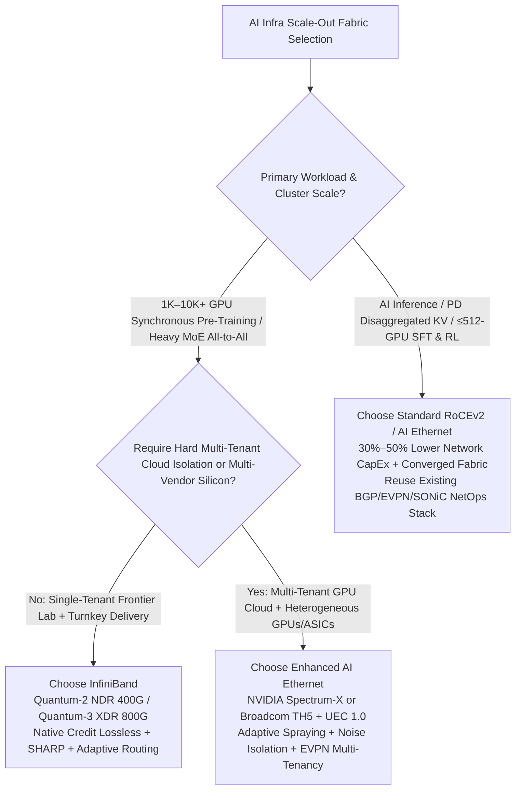
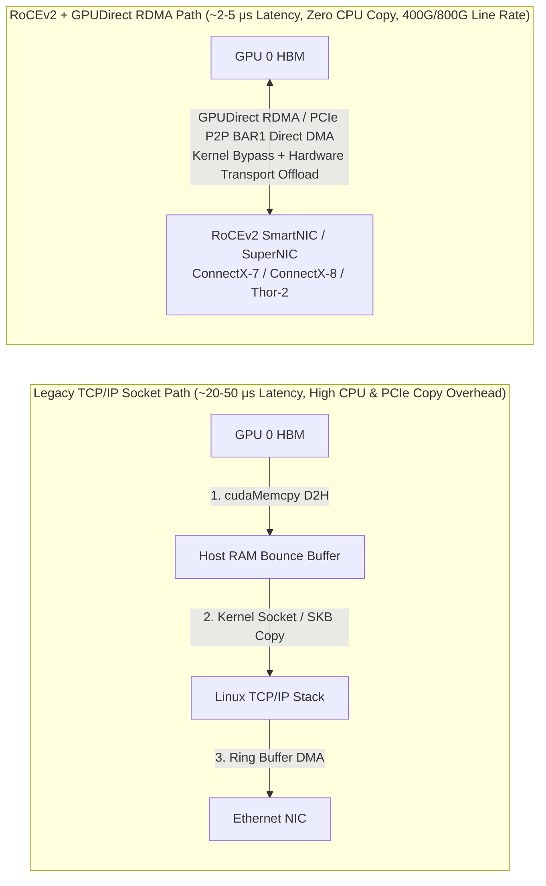

# AI Infrastructure Networking Selection & RoCEv2 Architecture FAQ: InfiniBand (IB) vs. Ethernet

> 🌐 **Language / 语言**: **[中文 (`ib-vs-ethernet-roce-selection-faq.md`)](ib-vs-ethernet-roce-selection-faq.md)** | **English**
> 🔗 **Related Deep Dives**: [Interconnect & Network Hierarchy](interconnect-network.md) · [RDMA Verbs Lifecycle](rdma-lifecycle.md) · [GPU-Initiated RDMA (`IBGDA` / `GDAKI`)](ibgda-gpu-initiated-rdma.md) · [UEC 1.0 Packet Trimming & Buffering](uec-packet-trimming-switch-buffering.md) · [UEC 1.1 Transport & Congestion Control](uec-transport-congestion.md) · [In-Network SHARP Collectives](in-network-collectives-sharp.md)

---

## 📌 Executive Summary

In 100-GPU to 100,000-GPU AI cluster architecture design, choosing a Scale-Out fabric is not a binary ideological debate between protocols—it is a systems-engineering trade-off across **collective synchronization tightness (`All-Reduce` / MoE `All-to-All`), multi-tenant cloud isolation boundaries, compute-inference-storage fabric convergence, multi-vendor supply-chain decoupling, and NetOps operational maturity**:

1. **When to Choose InfiniBand (IB)**: **Large-scale synchronous frontier pre-training (1,000–10,000+ GPUs)**, high-frequency **MoE All-to-All expert parallelism**, and single-tenant dedicated clusters prioritizing **fastest Time-to-Market (turnkey NVIDIA DGX/HGX SuperPOD)**. IB's link-layer credit-based lossless flow control, `~1–2 μs` switch forwarding latency, hardware Adaptive Routing, and **SHARP in-network reduction** minimize straggler-induced Model FLOPs Utilization (MFU) degradation.
2. **When to Choose or Prefer Ethernet (RoCEv2 / Enhanced AI Ethernet)**: **AI inference & disaggregated Prefill-Decode (PD) clusters**, **small-to-medium training/SFT/RL post-training clusters (≤ 256–512 GPUs)**, **multi-tenant GPU clouds**, **converged compute + inference + storage fabrics**, **cross-datacenter (Cross-DC) long-haul training**, and **multi-vendor heterogeneous compute or merchant-silicon fabrics (Broadcom Tomahawk 5 + SONiC / NVIDIA Spectrum-X / UEC 1.0)**.
3. **What is RoCE / RoCEv2**: **RoCE (RDMA over Converged Ethernet)** preserves InfiniBand's high-performance RDMA Verbs API, kernel bypass, zero CPU copy, and **GPUDirect RDMA** semantics while running over standard Ethernet physical and link layers. Modern AI datacenters exclusively deploy **Layer-3 routable RoCEv2 over UDP/IP (UDP destination port `4791`)**, and are rapidly evolving from legacy **PFC + ECN/DCQCN** lossless tuning toward **Spectrum-X and Ultra Ethernet Consortium (UEC 1.0)** fabrics featuring multi-path packet spraying and 64B packet trimming.

---

## Q1: When Deploying AI Infrastructure, When Should Customers Choose InfiniBand (IB) vs. Ethernet?

When designing an AI Scale-Out compute fabric, architects evaluate four primary dimensions: **workload communication patterns (synchronous pre-training vs. post-training/inference), cluster scale, CapEx/TCO constraints, and NetOps team expertise**:



### 1. When to Choose InfiniBand (IB) (e.g., NVIDIA Quantum-2 NDR 400G / Quantum-3 XDR 800G)

InfiniBand is a purpose-built, natively lossless fabric engineered for tightly coupled HPC and ultra-large-scale synchronous AI training. IB remains the gold standard in three core scenarios:

1. **Large-Scale Synchronous Frontier Pre-Training (1,000 to 10,000+ GPUs)**
   - **Extreme Sensitivity to the Straggler Effect**: Every training step executes tightly synchronized global collectives (DP `All-Reduce`, FSDP `All-Gather` / `Reduce-Scatter`, and Pipeline Parallelism activations). A single micro-burst queue stall or packet retransmission on one NIC out of thousands stalls the entire synchronous barrier and directly erodes cluster MFU.
   - **Native Link-Layer Credit-Based Lossless Flow Control**: IB prevents buffer overflow drops at Layer 2 via hardware flow-control credits—an upstream port never transmits a flit unless the downstream switch buffer has advertised available credit. This eliminates Ethernet's reliance on reactive pause frames (PFC) and complex buffer watermark tuning.
   - **Ultra-Low Switch Latency & In-Network Computing (SHARP)**: IB switches deliver **`~0.6–1.5 μs`** port-to-port latency, fine-grained hardware Adaptive Routing, and **SHARP (Scalable Hierarchical Aggregation and Reduction Protocol)**, offloading collective floating-point reductions directly into the switch silicon tree and improving large-scale collective goodput by **10%–20%+**.
2. **High-Frequency MoE (Mixture-of-Experts) All-to-All Expert Parallelism (EP)**
   - Frontier MoE architectures (such as DeepSeek-V3, Mixtral, and Qwen-MoE) execute two all-to-all token dispatch and combine collectives per layer. Because dynamic token routing creates skewed, bursty many-to-one (incast) traffic matrices, IB's native hardware Adaptive Routing paired with GPU-Initiated RDMA (`IBGDA`) handles transient congestion far more predictably than traditional static-ECMP RoCEv2 fabrics.
3. **Fastest Time-to-Market with Turnkey Reference Architectures**
   - When deploying standardized NVIDIA DGX / HGX SuperPOD blueprints without dedicated lossless-Ethernet specialists (experienced in tuning ECN watermarks, PFC headroom, and deadlock watchdogs), IB + UFM (Unified Fabric Manager) delivers deterministic, out-of-the-box NCCL performance.

### 2. When to Choose Ethernet (RoCEv2 / AI Ethernet)

1. **AI Inference Clusters & Disaggregated Prefill-Decode (PD) Serving**
   - Production inference workloads (online LLM serving, RAG pipelines, agentic workflows) inherently interface with North-South HTTP/gRPC traffic. Even in disaggregated Prefill-Decode architectures (**Mooncake Transfer Engine / NVIDIA Dynamo / NIXL**), cross-node KV Cache handoff consists of asynchronous **point-to-point `RDMA Write` / `RDMA Read` streams** rather than 10,000-GPU synchronous `All-Reduce` barriers. Standard 400G/800G RoCEv2 easily saturates line rate (`350+ Gbps` per NIC) without the cost premium of an InfiniBand fabric.
2. **Small-to-Medium Training, Fine-Tuning (SFT), and RL Post-Training Clusters (≤ 256–512 GPUs)**
   - Within a 2-tier Leaf-Spine Clos topology (8 to 64 8-GPU nodes), a properly tuned RoCEv2 fabric stays within **`3%–5%` end-to-end training throughput** of InfiniBand while reducing switch, optics, and support **CapEx by `30%–50%`**.
3. **Reusing Existing Enterprise & Cloud NetOps Toolchains**
   - Organizations with mature Ethernet automation, observability, and routing stacks (`BGP/EVPN`, open-source `SONiC`, `Prometheus/gNMI` telemetry, standard SDN controllers) avoid introducing a siloed InfiniBand management plane (`OpenSM` / `UFM`) and specialized IB operations staff.

---

## Q2: Under What Circumstances Is Ethernet Strictly More Suitable (or Superior to InfiniBand)?

In five major architectural scenarios, modern 400G/800G Ethernet is not merely a lower-cost alternative—it is **architecturally superior to InfiniBand**:

### 1. Multi-Tenant GPU Clouds & Neo-Cloud Providers
- **Why Ethernet Wins**: Cloud providers partitioning a shared GPU pool across dozens of external tenants or business units require **strict tenant isolation, blast-radius containment, and noisy-neighbor congestion isolation**.
- Ethernet provides battle-tested **VXLAN / BGP EVPN overlays, VLANs, hardware ACLs, micro-segmentation, and granular QoS scheduling**. By contrast, InfiniBand relies on limited `P_Key` (Partition Key) tables and a centralized Subnet Manager (SM); tenant-induced fabric churn or cloud-orchestrator integration (Kubernetes CNI / OpenStack Neutron) is significantly harder to isolate in IB.

### 2. Converged "Training + Inference + High-Performance Storage" Fabrics
- **Why Ethernet Wins**: End-to-end AI pipelines require high-bandwidth dataset ingestion, frequent distributed checkpointing (e.g., PyTorch DCP bursting into WEKA, Lustre, GPFS, or 3FS parallel filesystems), and elastic reallocation of GPUs between training and inference.
- Choosing InfiniBand for the GPU backend forces operators to build **two or three physically separate networks** (an IB backend fabric + an Ethernet frontend/K8s fabric + an Ethernet/storage fabric) or deploy costly IB-to-Ethernet gateways. A unified RoCEv2 Ethernet fabric carries **GPU-to-GPU RDMA collectives, storage RDMA I/O, and frontend inference traffic** over the same switch architecture and optical spares.

### 3. Cross-Datacenter (Cross-DC) / Long-Haul Distributed Training
- **Why Ethernet Wins**: When single-campus power ceilings (e.g., 50 MW–100 MW limits) requirefederating training clusters across multiple datacenters separated by kilometers or tens of kilometers (Data Center Interconnect, DCI), InfiniBand's physical reach, optical ecosystem, and buffer credit loops become prohibitive beyond intra-building distances.
- Ethernet natively integrates with **coherent optical transceivers (400ZR / 800ZR), DWDM transport systems, deep-buffer WAN routers, and long-haul congestion control**, making it the sole viable standard for multi-campus scale-across training.

### 4. Supply-Chain Decoupling & Heterogeneous Compute Ecosystems
- **Why Ethernet Wins**: InfiniBand is a single-vendor proprietary ecosystem controlled exclusively by NVIDIA (Mellanox).
- Whenever an enterprise deploys **AMD Instinct (`MI300X` / `MI325X` / `MI355X`)**, hyperscaler custom AI ASICs (Google TPU, AWS Trainium, Meta MTIA), or domestic AI accelerators—or wants multi-vendor switch supply-chain leverage using merchant silicon (**Broadcom Tomahawk 5 `51.2 Tbps` / Cisco Silicon One / Marvell Teralynx** running open-source **SONiC**)—Ethernet (RoCEv2 and **Ultra Ethernet Consortium, UEC**) is the universal open standard.

### 5. Enhanced AI Ethernet Fabrics at 1K–100K GPU Scale (NVIDIA Spectrum-X & UEC 1.0)
- **Why Modern AI Ethernet Matches or Beats IB**: Next-generation AI Ethernet platforms—such as **NVIDIA Spectrum-X (`Spectrum-4` switch + `BlueField-3 SuperNIC`)** and **Broadcom Tomahawk 5 / Thor-2 / UEC 1.0 fabrics**—have closed the historical gap with InfiniBand by adding:
  - **Fine-Grained Adaptive Routing / Packet Spraying**: Eliminates static ECMP 5-tuple hash polarization on elephant flows by spraying packets across all available spine links;
  - **Hardware Out-of-Order Direct Data Placement & Telemetry-Driven Congestion Control**: The SuperNIC reorders sprayed packets in hardware before delivering completions to the GPU and throttles senders using real-time switch telemetry, achieving **1.6x higher effective bandwidth** than traditional RoCEv2 and superior multi-tenant noise isolation at thousand-GPU scale.

### 📊 AI Infrastructure Architect Decision Matrix

| Evaluation Dimension | Standard RoCEv2 Ethernet | Enhanced AI Ethernet (Spectrum-X / UEC 1.0) | InfiniBand (Quantum-2 NDR / Quantum-3 XDR) |
| :--- | :--- | :--- | :--- |
| **Primary Target Workloads** | AI Inference, PD Disaggregated KV, ≤512-GPU Training/SFT/RL, High-Speed Storage | Multi-Tenant GPU Clouds, 1K–100K GPU Mixed Training + Inference, Heterogeneous GPUs | 1K–100K GPU Single-Tenant Synchronous Pre-Training, Heavy MoE All-to-All, HPC |
| **Single-Hop Switch Latency** | `~1.5 – 3.5 μs` | `~1.0 – 2.0 μs` | **`~0.6 – 1.5 μs` (Lowest)** |
| **Lossless Delivery Mechanism** | PFC (`802.1Qbb`) + ECN / DCQCN (Requires Careful Tuning) | Hardware Telemetry CC + 64B Packet Trimming + Out-of-Order DDP | **Native Link-Layer Credit-Based Flow Control (Zero Drops)** |
| **Multi-Path Load Balancing** | Static 5-Tuple ECMP (Prone to Hash Polarization) or DLB | **Per-Packet Dynamic Spraying + NIC Hardware Reordering** | **Native Hardware Adaptive Routing** |
| **In-Network Collectives** | Not Supported (Endpoint GPU/NIC Reduction) | Emerging Vendor Extensions | **Native SHARP v3/v4 In-Switch Reduction Trees** |
| **Multi-Tenant Cloud Isolation** | **Excellent (`BGP EVPN` / `VXLAN` / `ACL` / Hardware `QoS`)** | **Excellent (`EVPN` + Hardware Congestion/Noise Isolation)** | Limited (`P_Key` Partitions + Monolithic Subnet Manager) |
| **Ecosystem & Supply Chain** | **Fully Open (Broadcom / Arista / Cisco / SONiC)** | Semi-Open (Spectrum-X) to Fully Open (UEC 1.0 Standard) | **Proprietary Single-Vendor (NVIDIA Exclusive)** |
| **Relative Network TCO** | **Lowest (`1.0x` Baseline)** | Moderate (`~1.2x – 1.4x`) | **Highest (`~1.4x – 1.8x+`)** |

---

## Q3: What Is RoCE? How Does RoCEv2 Differ from RoCEv1, and How Does It Work Under the Hood?

### 1. What Is RoCE (RDMA over Converged Ethernet)?

**RoCE (RDMA over Converged Ethernet)** is an open standard defined by the InfiniBand Trade Association (IBTA) that **runs the InfiniBand RDMA transport and Verbs programming model directly on top of standard Ethernet switches and cabling**.

#### Why AI Training & Inference Require RDMA Instead of Traditional TCP/IP



1. **The Three Bottlenecks of Legacy TCP/IP**: Sending tensors between GPUs over standard TCP/IP forces data through `GPU HBM → Host Pinned RAM → Linux Kernel Socket Buffer (SKB) → Software TCP Segmentation → NIC DMA`. This inflates end-to-end latency to **`20–50+ μs`** and saturates host CPU cores and DRAM bandwidth well before reaching `400 Gbps / 800 Gbps`.
2. **The Three Breakthroughs of RoCE + GPUDirect RDMA**:
   - **Kernel Bypass**: Libraries such as NCCL, Mooncake, and DeepEP post Work Queue Elements (WQEs) directly to NIC hardware Queue Pairs (`QP`) from user space (or directly from GPU SMs via `IBGDA`), bypassing the OS kernel entirely on the data path;
   - **Zero-Copy GPUDirect RDMA**: Using PCIe Peer-to-Peer (`BAR1` mapping / `nvidia-peermem` / `dma-buf`) or ConnectX-8 `Data Direct` engines, the RDMA NIC reads tensor slices directly out of source GPU HBM and writes them directly into destination GPU HBM across the network with **zero CPU intervention and zero host-memory bounce copies**;
   - **Hardware Transport Offload**: Packet sequence numbering, ACK/NAK generation, and retransmission state machines execute entirely inside the NIC ASIC, cutting end-to-end latency to **`~2–5 μs`**.

---

### 2. RoCEv1 vs. RoCEv2: Protocol Stack Comparison

The IBTA defined two generations of RoCE. **Every modern AI datacenter exclusively deploys RoCEv2**:

```text
+-----------------------------------------------------------------------------------+
|                Application & Collectives: NCCL / RCCL / DeepEP / Mooncake / NIXL  |
+-----------------------------------------------------------------------------------+
|                Verbs API & RDMA Transport: IB Verbs / Queue Pair (QP) / IB BTH    |
+-------------------------+----------------------------+----------------------------+
|      InfiniBand (IB)    |          RoCEv1            |          RoCEv2            |
+-------------------------+----------------------------+----------------------------+
| IB Network Layer (GRH)  |   No IP Layer (L2 Only)    | UDP Header (Dst Port: 4791)|
|                         |                            | IPv4 / IPv6 Header (DSCP/ECN)|
+-------------------------+----------------------------+----------------------------+
| IB Link Layer (Credit)  | Ethernet MAC (Type 0x8915) | Ethernet MAC (802.1Q / PFC)|
+-------------------------+----------------------------+----------------------------+
| IB Physical (NDR / XDR) | Ethernet PHY (100G - 800G) | Ethernet PHY (100G - 800G) |
+-------------------------+----------------------------+----------------------------+
```

| Dimension | RoCEv1 (Deprecated) | RoCEv2 (Universal Standard in Modern AI Datacenters) |
| :--- | :--- | :--- |
| **Encapsulation Layer** | **Layer 2 (Data Link)**: Encapsulates IB transport headers directly inside Ethernet frames using EtherType `0x8915` | **Layer 3/4 (UDP/IP)**: Encapsulates IB Base Transport Headers (BTH) inside standard **UDP/IP** packets (destination **UDP port `4791`**) |
| **Layer-3 Routability** | **Non-Routable**: Restricted to a single L2 broadcast domain / VLAN; cannot scale across multi-rack Leaf-Spine topologies | **Fully Routable**: Native compatibility with Layer-3 Leaf-Spine Clos fabrics, BGP routing, and ECMP multipathing |
| **Congestion Control & QoS** | Limited to L2 `802.1p` CoS bits and PFC | Supports L3 **IP DSCP classification** and **ECN (Explicit Congestion Notification)** bits for end-to-end **DCQCN** rate control |

---

### 3. Operational Mechanics of Lossless RoCEv2: ECN/DCQCN, PFC, and Next-Gen UEC Evolution

Because standard RDMA NIC hardware relies on simple Go-Back-N retransmission state machines, **even a `0.1%` packet drop rate can collapse effective RDMA goodput by more than `50%`**. Since standard Ethernet drops packets when switch buffers fill, production RoCEv2 fabrics rely on a two-layer **Lossless Ethernet** defense—and are now evolving toward third-generation AI Ethernet transports:

```mermaid
sequenceDiagram
    participant Src as Sender GPU + RoCEv2 NIC
    participant Sw as Leaf/Spine Ethernet Switch
    participant Dst as Receiver RoCEv2 NIC + GPU

    Note over Src,Dst: Defense Tier 1 (Proactive Rate Control): ECN + DCQCN Closed-Loop Congestion Control
    Src->>Sw: 1. Transmit RoCEv2 (UDP 4791) burst at line rate (ECT=1)
    Note over Sw: Egress queue depth crosses watermark K_min..K_max<br/>Switch ASIC probabilistically marks IP ECN field = CE (11)
    Sw->>Dst: 2. Forward packet with ECN=CE mark (zero drops)
    Dst->>Src: 3. Receiver NIC hardware immediately generates a CNP (Congestion Notification Packet)
    Note over Src: 4. Sender NIC hardware receives CNP and throttles QP injection rate<br/>Smoothly recovers rate via byte counters and alpha timers

    Note over Src,Dst: Defense Tier 2 (Last-Resort Backpressure): PFC (IEEE 802.1Qbb) Per-Priority Pause
    Note over Sw: If sudden incast outpaces ECN reaction, ingress headroom hits XOFF threshold
    Sw->>Src: 5. Transmit L2 PFC Pause frame for lossless RDMA priority class (e.g., Priority 3)
    Note over Src: 6. Upstream port pauses Priority 3 transmission (zero buffer overflow); resumes at XON
```

1. **First Line of Defense: ECN (Explicit Congestion Notification) + DCQCN Proactive Rate Control**
   - When switch egress queues build up during synchronized bursts (such as MoE `All-to-All` incast) and cross the shallow watermark `$K_{\min}$`, the switch ASIC **neither drops packets nor pauses links immediately**. Instead, it sets the IP header's ECN bits to `CE` (Congestion Experienced).
   - Upon receiving a `CE`-marked packet, the destination NIC hardware immediately returns a **CNP (Congestion Notification Packet)** to the source NIC, which throttles the offending Queue Pair's transmission rate in microseconds—draining the switch queue before buffer exhaustion occurs.
2. **Second Line of Defense: PFC (Priority Flow Control, IEEE 802.1Qbb)**
   - If an instantaneous micro-burst fills the switch ingress buffer faster than the ECN/CNP round-trip loop can react, the switch transmits a Layer-2 **PFC Pause Frame** to the upstream port once buffer occupancy hits the `XOFF` headroom threshold. PFC pauses only the designated lossless RDMA priority queue (typically `Priority 3` or `Priority 4`) while leaving management (`SSH`/`BGP`) traffic unaffected.
   - **Operational Pitfalls & Mitigations**: Hop-by-hop PFC backpressure can trigger **PFC pause storms, head-of-line (HoL) blocking across unrelated flows, or cyclic buffer deadlocks**. Production AI fabrics mitigate this via hardware **PFC Deadlock Watchdogs** and **Rail-Optimized topologies** that keep same-index GPUs under the same Leaf switch.
3. **Third-Generation Evolution: Spectrum-X & Ultra Ethernet Consortium (UEC 1.0)**
   - To eliminate fragile PFC watermark tuning at 10,000+ GPU scale, **NVIDIA Spectrum-X** and **UEC 1.0** redesign the Ethernet RDMA transport layer:
     - **Multi-Path Packet Spraying + Hardware Out-of-Order Placement**: Every RDMA message is sprayed packet-by-packet across all parallel Leaf-Spine paths and reassembled in NIC hardware;
     - **64B Packet Trimming**: Instead of halting upstream links with PFC pause frames when shallow 800G switch buffers fill during extreme incast, the switch trims the payload and forwards only the **64-byte header** at high priority to trigger a `0.5-RTT` selective retransmission—cutting 32-to-1 incast P99 tail latency by **`69.9%`**.

---

## 🛠️ Appendix: Production AI Fabric Verification Checklist

Use this checklist when reviewing customer AI networking architectures or troubleshooting collective stragglers:

- [ ] **Topology & NUMA Affinity**: Is the fabric wired in a **Rail-Optimized topology**? Are each node's 8 GPUs and 8 RDMA NICs paired 1:1 under the same PCIe Root Complex / NUMA node (eliminating cross-socket UPI/QPI traversal)?
- [ ] **GPUDirect RDMA Health**: Is `nvidia-peermem` or `dma-buf` loaded and active? Has `NCCL_NET_GDR_LEVEL` been verified in NCCL initialization logs so transfers never fall back to host DRAM bounce buffers?
- [ ] **RoCEv2 GID & End-to-End QoS Alignment**: Is `NCCL_IB_GID_INDEX` pinned to the **RoCEv2 IPv4/IPv6 GID** (avoiding Docker bridge or deprecated RoCEv1 GIDs)? Are NIC `DSCP -> Priority` mappings, switch `ECN (K_min / K_max / P_max)` profiles, `PFC XOFF/XON` headroom buffers, and `PFC Watchdog` timers consistent across every Leaf and Spine switch?
- [ ] **Collective & Fabric Telemetry**: Are switch ECN marking counters, PFC pause counters, and `NCCL RAS / FlightRecorder` enabled to isolate degraded optical transceivers (grey failures / symbol errors) in sub-second windows?
