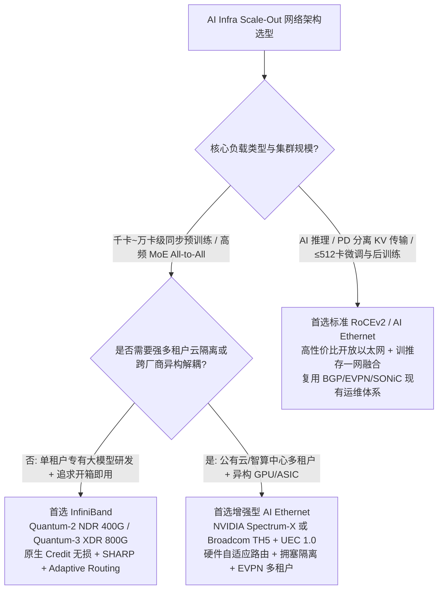
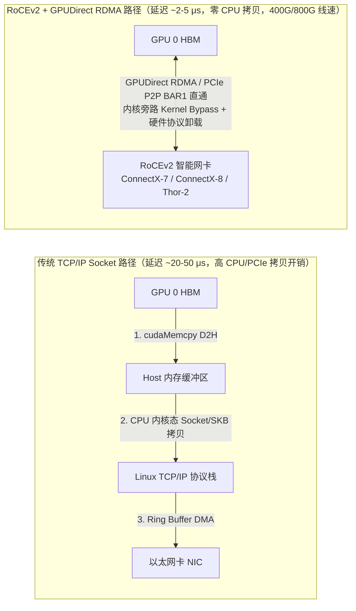
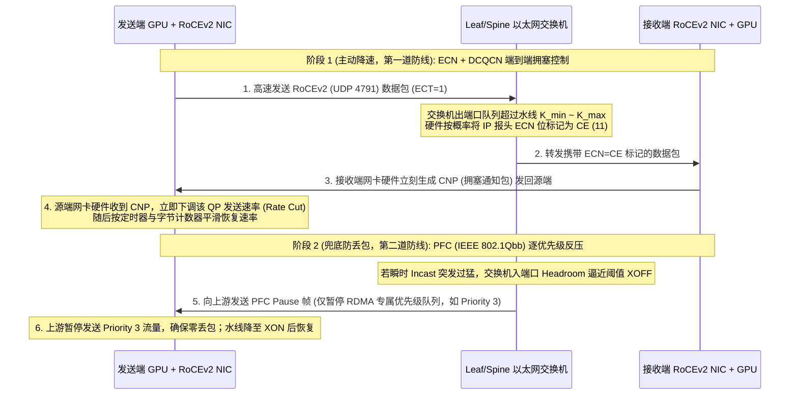

# AI Infra 网络架构选型与 RoCEv2 核心原理 FAQ：InfiniBand (IB) vs. Ethernet

> 🌐 **Language / 语言**: **中文 (Chinese)** | **[English (`ib-vs-ethernet-roce-selection-faq.en.md`)](ib-vs-ethernet-roce-selection-faq.en.md)**
> 🔗 **关联专题 (Related Deep Dives)**: [互连与网络分层](interconnect-network.md) · [RDMA Verbs 生命周期](rdma-lifecycle.md) · [GPU 直发 RDMA (`IBGDA` / `GDAKI`)](ibgda-gpu-initiated-rdma.md) · [UEC 1.0 数据包裁剪与缓冲](uec-packet-trimming-switch-buffering.md) · [UEC 1.1 传输与拥塞控制](uec-transport-congestion.md) · [SHARP 网内集合通信](in-network-collectives-sharp.md)

---

## 📌 核心结论速览（Executive Summary）

在百卡至万卡级 AI 智算集群架构设计中，Scale-Out（跨节点横向扩展）网络选型并非“非黑即白”的协议争论，而是围绕 **集合通信同步紧耦合度（All-Reduce / MoE All-to-All）、多租户云隔离边界、存储与推理网络融合度、供应链异构解耦及网络运维（NetOps）技术栈** 的工程权衡：

1. **何时首选 InfiniBand (IB)**：**千卡至万卡级前沿基础大模型同步预训练**、高频 **MoE All-to-All 专家并行**，以及追求 **最快交付周期（Turnkey DGX/HGX SuperPOD）** 的专有单租户集群。IB 凭借链路层原生基于信用的无损流控（Credit-based Flow Control）、`~1–2 μs` 极低交换机转发延迟、硬件自适应路由（Adaptive Routing）与 **SHARP 网内归约**，可将严苛同步训练的有效算力利用率（MFU）抖动压至最低。
2. **何时首选或更适用 Ethernet（RoCEv2 / 增强型 AI 以太网）**：**大规模 AI 推理与 Prefill-Decode (PD) 分离架构**、**中小规模训练/微调/RL 后训练集群（≤ 256–512 卡）**、**多租户 GPU 算力云**、**训推存一网融合**、**跨数据中心（Cross-DC）长距分布式训练** 以及 **多厂商异构算力/开放交换机底座（Broadcom Tomahawk 5 + SONiC / NVIDIA Spectrum-X / UEC 1.0）**。
3. **什么是 RoCE / RoCEv2**：**RoCE（RDMA over Converged Ethernet）** 允许在不更换以太网物理交换底座的前提下，通过内核旁路（Kernel Bypass）、零拷贝（Zero-Copy）与 **GPUDirect RDMA** 实现 GPU HBM 显存跨机直通。现代 AI 数据中心 100% 采用基于 **UDP/IP（UDP 端口 `4791`）的三层可路由 RoCEv2**，并正从依赖复杂 **PFC + ECN/DCQCN** 无损调优的传统 RoCEv2，向支持逐包喷洒（Packet Spraying）与 64B 包裁剪（Packet Trimming）的 **Spectrum-X / UEC 1.0 新一代 AI 以太网** 演进。

---

## Q1：客户部署 AI Infra 时，什么时候选 InfiniBand (IB)，什么时候选 Ethernet？

在 AI 基础设施（AI Infra）建设中，Scale-Out 计算网络选型主要围绕 **业务负载特征（大参数同步预训练 vs. 后训练/推理）、集群规模、TCO 预算以及网络运维团队基因** 四大维度展开：



### 一、什么时候首选 InfiniBand (IB)？（如 NVIDIA Quantum-2 NDR 400G / Quantum-3 XDR 800G）

InfiniBand 是专为高性能计算（HPC）与超大规模紧耦合同步训练设计的原生无损网络。在以下三类核心场景中，IB 依然是确定性最高的首选方案：

1. **千卡至万卡级前沿大模型同步预训练（1,000 ~ 10,000+ GPUs）**
   - **同步桶效应（Straggler Effect）敏感**：大规模预训练每一步迭代（Step）都包含高频的全局集合通信（DP `All-Reduce` / FSDP `All-Gather` & `Reduce-Scatter` / PP 跨层激活传递）。只要全网数千张网卡中出现一次微突发（Micro-burst）拥塞重传或长尾延迟，整个训练步就会被最慢的 Rank 拖慢，直接拉低集群 MFU。
   - **链路层原生无损（Credit-based Flow Control）**：IB 在物理/链路层通过硬件发送信用（Credit）机制天然保证零丢包——下游交换机缓冲区无空闲 Credit 时上游绝不发包，从根源上消除了以太网靠暂停帧（PFC）反压带来的队列死锁与配置复杂度。
   - **极致延迟与 SHARP 网内计算**：IB 交换机端口转发延迟低至 **`~1–2 μs`**（甚至百纳秒级），并原生支持硬件级自适应路由（Adaptive Routing）和 **SHARP（Scalable Hierarchical Aggregation and Reduction Protocol，网内集合通信归约）**，由交换机 ASIC 直接在网络树中完成浮点归约，可将大规模集合通信有效吞吐提升 **10% ~ 20%+**。
2. **高频 MoE（混合专家模型）All-to-All 专家并行（EP）通信**
   - DeepSeek-V3 / Mixtral / Qwen-MoE 等大专家并行（Expert Parallelism）模型在每个 Transformer 层都需要执行两次全网 `All-to-All` Dispatch 与 Combine。由于 Token 路由分布天然偏斜且呈高并发随机多对一（Incast）突发，IB 原生的硬件级细粒度自适应路由与 GPU 直发 RDMA（`IBGDA`）结合，抗抖动能力显著优于传统静态哈希（ECMP）的普通 RoCEv2 网络。
3. **追求最短投产周期（Time-to-Market）与开箱即用参考架构**
   - 客户采购 NVIDIA DGX / HGX SuperPOD 标准参考架构，且基础设施团队缺乏资深 RoCE 无损网络调优专家（熟悉 PFC 死锁看门狗、ECN 水位线与 QoS 队列调参）。IB 配合 UFM（Unified Fabric Manager）与 NCCL 默认插件即可实现开箱即用、确定性达标。

### 二、什么时候首选 Ethernet（RoCEv2 / AI Ethernet）？

1. **AI 推理集群（Inference）与 Prefill-Decode (PD) 分离架构**
   - 推理业务（包括大模型在线 Serving、RAG、Agent 工作流）天然与业务南北向 HTTP/gRPC 流量耦合。即使采用 **Mooncake / NVIDIA Dynamo** 等 Prefill-Decode 分离架构，其跨机 KV Cache 传输本质上是 **点对点单向 `RDMA Write` / `RDMA Read`**，而非数千卡严格同步屏障的 `All-Reduce`。标准 400G/800G RoCEv2 即可轻松跑满线速（如单卡 `350+ Gbps` 有效吞吐），完全无需昂贵的 IB 专网。
2. **中小规模训练、微调（SFT）与 RL 后训练集群（≤ 256 ~ 512 GPUs）**
   - 在单两层 Leaf-Spine（叶脊）拓扑（例如 8~64 台 8 卡服务器）内，经过规范 ECN + PFC 调优的 RoCEv2 网络与 InfiniBand 的端到端训练吞吐差距通常在 **`3% ~ 5%` 以内**，但网络交换机、光模块及维保的 **CapEx 采购成本可降低 `30% ~ 50%`**。
3. **复用企业现有数据中心网络运维（NetOps）底座**
   - 客户拥有成熟的以太网运维体系（BGP/EVPN、SONiC 开源网络操作系统、Prometheus/gNMI 遥测监控、标准 SDN 控制器），不希望为了 AI 集群单独引入一套封闭的 InfiniBand OpenSM / UFM 管理平面和专职 IB 运维人员。

---

## Q2：什么情况下 Ethernet 会更加适用（甚至优于 InfiniBand）？

随着 400G/800G 高性能 AI 以太网的发展，在以下 **五大核心场景** 中，Ethernet 不仅“够用”，而且在架构契合度与工程落地性上 **严格优于 InfiniBand**：

### 1. 多租户 GPU 算力云 / 智算中心运营（Multi-Tenant AI Cloud）
- **为什么 Ethernet 更优**：智算中心需要将同一个万人卡池切分给数十个外部租户或内部独立部门，对 **租户级安全隔离、爆炸半径控制与嘈杂邻居（Noisy Neighbor）拥塞隔离** 要求极高。
- Ethernet 拥有极其成熟的 **VXLAN / BGP EVPN 虚拟化、VLAN、硬件 ACL、微分段与精细化 QoS 队列策略**；而 InfiniBand 的多租户隔离仅依赖有限的 `P_Key`（Partition Key），且全网共享单一中心化 Subnet Manager（SM），一旦某个租户任务触发极端异常或拓扑震荡，故障隔离与多租户云管平台（OpenStack / Kubernetes CNI）的集成远不如以太网成熟。

### 2. “训 + 推 + 高性能存储”一网融合架构（Converged Fabric）
- **为什么 Ethernet 更优**：AI 训练全生命周期包含海量数据集预取、高频 Checkpoint 落盘（如 PyTorch DCP 写入 WEKA / Lustre / GPFS / 3FS 并行文件系统）以及训练转推理部署。
- 如果计算网采用 InfiniBand，客户往往被迫建设 **两到三张物理隔离的网络**（IB 后端计算网 + Ethernet 前端推理/K8s 管理网 + 存储网），或者额外部署昂贵且易成瓶颈的 IB-to-Ethernet 网关。采用全以太网（RoCEv2）底座，可以用同一套 400G/800G 交换架构同时承载 **后端 GPU RDMA 通信、高性能并行存储 RDMA 访问与前端推理业务流量**，大幅简化机柜布线与网卡配置。

### 3. 跨机房 / 跨数据中心（Cross-DC / Long-Haul）分布式协同训练
- **为什么 Ethernet 更优**：当单一园区受限于电力容量（如 50MW~100MW 上限）需要将训练集群分布在相距数公里至数十公里的多个机房（Data Center Interconnect, DCI）时，InfiniBand 的物理传输距离、长距光模块生态与广域缓冲能力受到严格限制（通常局限于机房内部百米级范围）。
- Ethernet 原生支持 **相干光模块（Coherent Optics，如 400ZR / 800ZR）、DWDM 波分复用传输、长距深缓冲交换机与广域拥塞控制**，是跨园区/跨数据中心算力联邦的唯一可行标准。

### 4. 供应链解耦、防单一厂商锁定与异构算力底座（Multi-Vendor & Heterogeneous Compute）
- **为什么 Ethernet 更优**：InfiniBand 实质上是 NVIDIA（原 Mellanox）独家垄断的封闭生态。
- 当客户引入 **AMD Instinct（MI300X / MI325X / MI355X）**、云厂商自研 AI ASIC（Google TPU、AWS Trainium、Meta MTIA）或国产算力芯片时，或者希望采用 **Broadcom Tomahawk 5 (`51.2 Tbps`) / Cisco Silicon One / Marvell Teralynx + 开源 SONiC** 构建多供应商议价体系时，开放以太网（RoCEv2 及 **Ultra Ethernet Consortium, UEC**）是唯一通用的标准底座。

### 5. 采用增强型 AI 以太网（NVIDIA Spectrum-X 或 Broadcom AI Fabric / UEC）的千卡/万卡集群
- **为什么现代 AI Ethernet 已追平甚至反超 IB**：以 **NVIDIA Spectrum-X（Spectrum-4 交换机 + BlueField-3 SuperNIC）** 和 **UEC 1.0 架构** 为代表的新一代 AI 以太网，已经在以太网层补齐了 IB 的核心绝技：
  - **硬件级逐包自适应路由（Packet-by-Packet Adaptive Routing）**：突破传统以太网 ECMP 静态五元组哈希导致的链路负载不均（Hash Polarization）；
  - **基于硬件遥测的端到端拥塞控制（Telemetry-based Congestion Control）**：BlueField-3 SuperNIC 根据交换机实时队列深度动态完成乱序重排（Direct Data Placement）与精准限速，在多租户混合负载下性能比传统 RoCEv2 提升 **1.6x**，并在多项千卡/万卡基准上达到与 InfiniBand 同等甚至更优的多租户稳定性。

### 📊 AI Infra 网络架构师选型决策矩阵（Architect Decision Matrix）

| 评估维度 | 标准 RoCEv2 以太网 | 增强型 AI 以太网（Spectrum-X / UEC 1.0） | InfiniBand（Quantum-2 NDR / Quantum-3 XDR） |
| :--- | :--- | :--- | :--- |
| **核心适用场景** | AI 推理、PD 分离 KV 传输、≤512 卡训练/微调/RL、高性能存储网 | 多租户智算云、千卡~万卡大模型训练 + 推理混合池、异构 GPU 集群 | 千卡~万卡级单租户极限同步预训练、重度 MoE All-to-All、HPC 超算 |
| **单跳交换延迟** | `~1.5 – 3.5 μs` | `~1.0 – 2.0 μs` | **`~0.6 – 1.5 μs`（极低）** |
| **无损防丢包机制** | PFC（802.1Qbb）+ ECN / DCQCN（需精细调优） | 硬件遥测拥塞控制 + 64B 包裁剪（Packet Trimming）+ 乱序直写 | **物理/链路层原生 Credit-based 流控（天然零丢包）** |
| **多路径负载均衡** | 传统静态 ECMP（易受大象流哈希极化影响）或 DLB | **逐包动态喷洒（Packet Spraying）+ 网卡硬件乱序重排** | **原生硬件级 Adaptive Routing（自适应路由）** |
| **网内集合通信计算** | 不支持（依赖 GPU/NIC 端归约） | 部分厂商定制扩展探索中 | **原生支持 SHARP v3/v4 网内硬件归约** |
| **多租户云隔离能力** | **极强（BGP EVPN / VXLAN / ACL / 硬件 QoS）** | **极强（EVPN + 硬件级拥塞噪声隔离）** | 较弱（基于 `P_Key` 与单一中心化 Subnet Manager） |
| **供应链与生态开放度** | **完全开放（Broadcom / Arista / Cisco / H3C / 华为 + SONiC）** | 半开放（Spectrum-X 绑定 NVIDIA NIC）至完全开放（UEC 标准） | **封闭单一厂商（NVIDIA / Mellanox 独占）** |
| **综合网络 TCO 成本** | **最低（基准 `1.0x`）** | 中等（`~1.2x – 1.4x`） | **最高（`~1.4x – 1.8x+`）** |

---

## Q3：什么是 RoCE？RoCEv1 与 RoCEv2 有何区别？底层是如何运作的？

### 一、什么是 RoCE（RDMA over Converged Ethernet）？

**RoCE** 全称是 **RDMA over Converged Ethernet（基于融合以太网的远程直接内存访问）**，是由 IBTA（InfiniBand 贸易协会）制定的开放网络标准。它的核心目标是：**保留 InfiniBand 上层高效的 RDMA Verbs 编程接口与零拷贝传输语义，但将底层的物理层和链路层替换为无处不在的标准以太网（Ethernet）**。

#### 为什么 AI 训练和推理必须用 RDMA（而不是传统 TCP/IP）？



1. **传统 TCP/IP 的三大瓶颈**：数据从一张 GPU 显存发往另一台服务器的 GPU，需要经历 `GPU HBM → Host 锁页内存 → Linux 内核 Socket 缓冲区（SKB） → TCP/IP 软中断封包 → 网卡 DMA`，不仅端到端延迟高达 **`20 ~ 50+ μs`**，而且在 `400Gbps / 800Gbps` 带宽下会瞬间耗尽服务器 CPU 核与内存总线带宽。
2. **RoCE + GPUDirect RDMA 的三大突破**：
   - **内核旁路（Kernel Bypass）**：用户态应用（如 NCCL / Mooncake / DeepEP）通过 `libibverbs`（或 GPU SM 直接发起的 `IBGDA`）直接读写网卡硬件队列（Send/Receive Queue Pair, QP），数据面完全不经过操作系统内核；
   - **零拷贝与 GPUDirect RDMA（Zero-Copy）**：借助 PCIe Peer-to-Peer（BAR1 映射）或 ConnectX-8 `Data Direct` DMA 引擎，网卡直接从源 GPU 的 HBM 显存读取张量数据，封装为以太网帧发送，对端网卡收到后直接写入目标 GPU 的 HBM 显存，**全程零 CPU 干预、零主存中转**；
   - **传输层硬件卸载（Hardware Offload）**：包序列号校验、ACK/NAK 确认、重传状态机全部固化在 RDMA 网卡 ASIC 硬件中执行，端到端传输延迟压降至 **`~2 – 5 μs`**。

---

### 二、RoCEv1 与 RoCEv2 的本质区别（协议栈分层对比）

RoCE 标准演进出了两个版本，**当今所有现代数据中心 100% 部署的都是 RoCEv2**：

```text
+-----------------------------------------------------------------------------------+
|                   上层应用与通信库: NCCL / RCCL / DeepEP / Mooncake / NIXL         |
+-----------------------------------------------------------------------------------+
|                   编程接口与传输语义: IB Verbs API / Queue Pair (QP) / BTH         |
+-------------------------+----------------------------+----------------------------+
|      InfiniBand (IB)    |          RoCEv1            |          RoCEv2            |
+-------------------------+----------------------------+----------------------------+
| IB 网络层 (GRH, 可选)   |   无 IP 层 (仅 L2 寻址)    | UDP 报头 (Dst Port: 4791)  |
|                         |                            | IPv4 / IPv6 报头 (含 DSCP/ECN)|
+-------------------------+----------------------------+----------------------------+
| IB 链路层 (LRH + Credit)| 以太网 MAC 层 (0x8915)     | 以太网 MAC 层 (802.1Q/PFC) |
+-------------------------+----------------------------+----------------------------+
| IB 物理层 (NDR/XDR)     | 以太网物理层 (100G-800G)   | 以太网物理层 (100G-800G)   |
+-------------------------+----------------------------+----------------------------+
```

| 对比维度 | RoCEv1（已淘汰） | RoCEv2（现代 AI 数据中心绝对主流） |
| :--- | :--- | :--- |
| **协议封装层级** | **链路层（Layer 2）封装**：直接将 IB 传输层报文封装在以太网二层帧中（专用 EtherType `0x8915`） | **网络/传输层（Layer 3 / UDP）封装**：将 IB 传输层报文封装在标准 **UDP/IP** 包中（固定目的 **UDP 端口 `4791`**） |
| **跨网段三层路由** | **不支持**：受限于二层 MAC 广播域（同一 VLAN 内），无法跨 Leaf-Spine 三层路由扩展 | **原生支持 L3 路由**：完全兼容现代数据中心 Leaf-Spine（叶脊）三层 Clos 架构、BGP 路由与 ECMP 负载均衡 |
| **拥塞控制与 QoS** | 仅能依赖二层 CoS（802.1p）与 PFC | 支持三层 **IP DSCP 优先级标记** 与 **ECN（显式拥塞通知）**，可构建端到端 DCQCN 拥塞控制闭环 |

---

### 三、RoCEv2 的核心技术挑战与“无损以太网（Lossless Ethernet）”三大支柱

由于 RoCEv2 网卡硬件中的 Go-Back-N 重传状态机对丢包极其敏感（**哪怕 `0.1%` 的丢包率都会导致有效 RDMA 吞吐暴跌 `50%` 以上**），而传统以太网默认是“尽力而为、队列满了即丢包（Tail Drop）”的有损网络，因此部署生产级 RoCEv2 必须配置 **无损以太网（Lossless Ethernet）** 机制：



1. **第一道防线：ECN（Explicit Congestion Notification）+ DCQCN 主动拥塞控制**
   - 当交换机端口队列深度由于多卡并发汇聚（如 MoE `All-to-All` Incast）超过浅水线 `$K_{\min}$` 时，交换机 **不丢包、也不立刻发暂停帧**，而是将经过的 IP 数据包头部 ECN 字段修改为 `CE`（Congestion Experienced）。
   - 接收端网卡收到 `CE` 标记后，立刻向发送端回传一个 **CNP（Congestion Notification Packet）**；发送端网卡硬件收到 CNP 后微秒级主动降低发送速率，从而把队列深度控制在触发 PFC 暂停之前。
2. **第二道防线：PFC（Priority Flow Control，基于优先级的流量控制，IEEE 802.1Qbb）**
   - 当瞬时微突发过快、ECN 降速来不及生效，交换机缓冲区即将溢出的最后关头，交换机向上游端口发送 **PFC Pause 帧**，精确暂停承载 RoCE 流量的特定优先级队列（通常配置在 `Priority 3` 或 `Priority 4`），而不会阻塞其他优先级上的 SSH 管理或 BGP 心跳流量。
   - **运维痛点与规避**：如果拓扑存在环路或光模块物理闪断，PFC 反压逐跳向上游蔓延时可能引发 **PFC 暂停风暴（Pause Storm）、队头阻塞（Head-of-Line Blocking）甚至全网 PFC 死锁（Deadlock）**。因此生产环境必须启用交换机 **PFC 死锁检测看门狗（PFC Watchdog）**，并采用 **Rail-Optimized（轨道优化）拓扑** 减少跨脊（Cross-Spine）流量冲突。
3. **第三代演进：从“无损 RoCEv2”走向“容忍乱序与浅缓冲的增强型 AI 以太网（Spectrum-X / UEC 1.0）”**
   - 为了彻底摆脱传统 RoCEv2 对 PFC 参数调优的严苛依赖，**NVIDIA Spectrum-X** 与 **Ultra Ethernet Consortium (UEC 1.0)** 正在重构底层传输语义：
     - **逐包喷洒（Multi-Path Packet Spraying）+ 网卡硬件乱序重排（Out-of-Order Direct Data Placement）**：将单条大象流均匀打散到所有 Leaf-Spine 链路上，消除 ECMP 哈希碰撞；
     - **数据包裁剪（64B Packet Trimming）**：当 800G 交换机缓冲区满时，不再盲目发送 PFC 锁死全网，而是直接裁掉数据包负载、仅保留 **64 字节报头** 快速转发给接收端，实现 `0.5-RTT` 极速精准重传，在 32-to-1 极端 Incast 下可将 P99 尾延迟降低 **`69.9%`**。

---

## 🛠️ 附录：生产环境 AI 网络快速核验清单（Architect Checklist）

在交付客户 AI Infra 网络方案或排查训练通信性能瓶颈时，建议按以下清单逐项核验：

- [ ] **物理与拓扑层**：是否采用 **Rail-Optimized（同号卡汇聚同一组 Leaf 交换机）** 拓扑？机内 `NVLink/NVSwitch` 与机间 `NIC` 的 PCIe Root Complex / NUMA 亲和性是否一一对齐（避免跨 Socket UPI/QPI 绕行）？
- [ ] **GPUDirect RDMA 状态**：`nvidia-peermem` 内核模块（或 Linux `dma-buf`）是否正常加载？`NCCL_NET_GDR_LEVEL` 是否生效且未退回 Host Bounce Buffer？
- [ ] **RoCEv2 GID 与 DSCP/QoS 一致性**：容器环境是否规避了 Docker 网桥虚地址或 RoCEv1 GID 误选（固定选取 `RoCEv2 IPv4/IPv6 GID`）？网卡 `DSCP -> Priority` 映射与交换机队列的 `ECN (K_min/K_max/P_max)`、`PFC XOFF/XON` 及 `PFC Watchdog` 是否全网端到端一致？
- [ ] **集合通信可观测性**：是否开启交换机 ECN 标记计数、PFC Pause 帧计数与 `NCCL RAS / FlightRecorder` 监控，确保单链路光模块劣化（Grey Failure / 误码重传）能在亚秒级被定位隔离？
