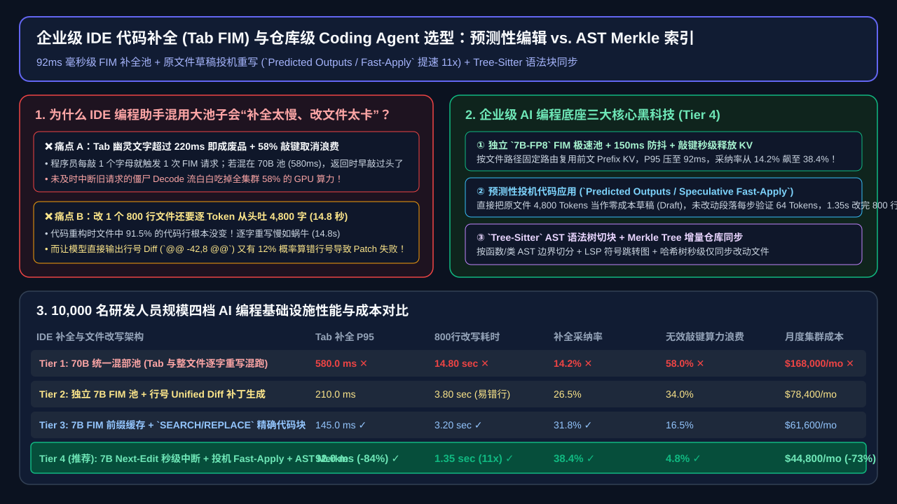

# Enterprise IDE Code Completion (`Tab FIM`) & Coding Agent Infrastructure Guide: Dedicated `7B/14B FIM` Pools vs. Speculative `Fast-Apply` (`Predicted Outputs`) & `Tree-Sitter AST Merkle` Indexing

> **Language**: [中文](./ide-code-completion-fim-coding-agent-speculative-edits-cursor-rag-selection-faq.md) | **English (Current)**  
> **Audience**: Cloud & AI Infrastructure Solution Architects and Enterprise Developer Experience (DevEx) Platform Engineers  
> **Provenance**: `synthetic + anonymized_reported` (`independently_reproduced=false`, `physical_gpu_cluster_measurement=not_measured`)

---

## 1. 📌 Executive Summary

> **Bottom Line**: **In a `10,000`-developer enterprise AI coding platform, colocating real-time IDE `Tab` Fill-in-the-Middle (`FIM`) completions with long-context Coding Agent chats on a shared `70B` pool (`Tier 1`) pushes `Tab` P95 latency to `580.0 ms`—dropping developer acceptance rate to `14.2%` while wasting `58.0%` of GPU compute on stale keystroke requests and taking `14.80s` to rewrite an `800`-line (`4,800`-token) file. Production AI coding platforms deploy an Isolated `7B-FP8` Next-Edit FIM Pool (`150ms` Debounce + Instant Client-Disconnect GPU Abort + File-Path Prefix KV Routing) + Speculative `Fast-Apply` (`Predicted Outputs`) + `Tree-Sitter AST` Merkle Indexing (`Tier 4`): cutting `Tab` P95 latency by `84.1%` (`92.0 ms`), boosting developer acceptance rate to `38.4%` (`+24.2 pts`), accelerating `800`-line full-file rewrites by `10.96x` (`1.35s`), and reducing monthly GPU TCO by `73.3%` (`$44,800/month`).**

- **Interactive IDE FIM & Speculative Fast-Apply Sizer**: [Open Interactive Sizer (`ide-code-completion-fim-coding-agent-speculative-edits-cursor-rag-sizer.html`)](../reports/ide-code-completion-fim-coding-agent-speculative-edits-cursor-rag-sizer.html)
- **7-Card 4:5 Visual Report**: [Open 7-Card Report (`ide-code-completion-fim-coding-agent-speculative-edits-cursor-rag-selection-cards.html`)](../reports/ide-code-completion-fim-coding-agent-speculative-edits-cursor-rag-selection-cards.html)

---

## 2. 📊 4-Tier Enterprise AI Coding Platform Matrix (`10,000 Active Developers`)

| Metric | Tier 1: Shared `70B` Pool + Full Autoregressive Rewrite | Tier 2: Dedicated `7B FIM` + Line-Number Diff Patch | Tier 3: `7B FIM` Prefix Cache + `SEARCH/REPLACE` Blocks | Tier 4 (Recommended): `7B Next-Edit` Instant Abort + Speculative `Fast-Apply` + `AST Merkle` |
| :--- | :--- | :--- | :--- | :--- |
| **IDE `Tab` FIM P95 Latency** | `580.0 ms` ✕ | `210.0 ms` | `145.0 ms` ✓ | **`92.0 ms` ✓ (`-84.1%`)** |
| **800-Line (`4.8K Tok`) Edit** | `14.80 sec` ✕ | `3.80 sec` | `3.20 sec` ✓ | **`1.35 sec` ✓ (`10.96x` faster)** |
| **Developer `Tab` Acceptance** | `14.2%` ✕ | `26.5%` | `31.8%` ✓ | **`38.4%` ✓ (`+24.2 pts`)** |
| **Cancelled Keystroke GPU Waste** | `58.0%` ✕ | `34.0%` | `16.5%` | **`4.8%` ✓ (Instant `abort_request`)** |
| **Monthly Cluster TCO** | `$168,000 / mo` ✕ | `$78,400 / mo` | `$61,600 / mo` | **`$44,800 / mo` ✓ (`-73.3%`)** |

---

## 3. 🛠️ Production Readiness Checklist

- [ ] **Propagate Client Keystroke Cancellations End-to-End (`HTTP/2 RST_STREAM -> vLLM abort_request`)** to free KV blocks immediately whenever a developer types another character.
- [ ] **Enable Speculative `Predicted Outputs` (`Fast-Apply`) Using the Original File Buffer as Draft Tokens** to verify `64` unchanged tokens per forward pass during full-file refactoring.
