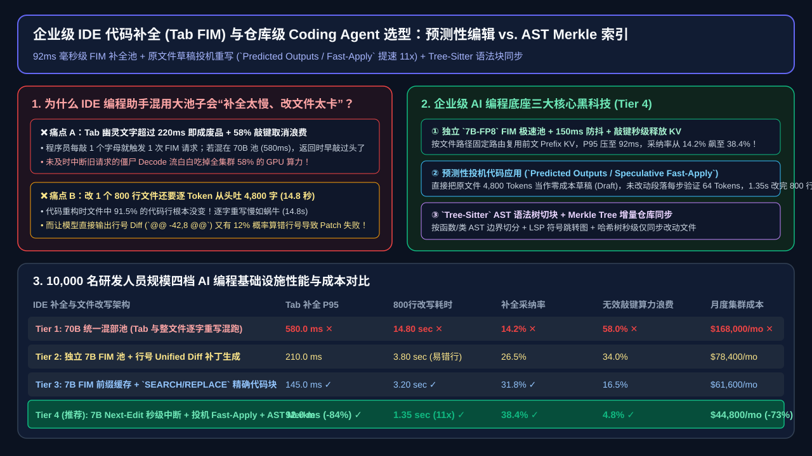
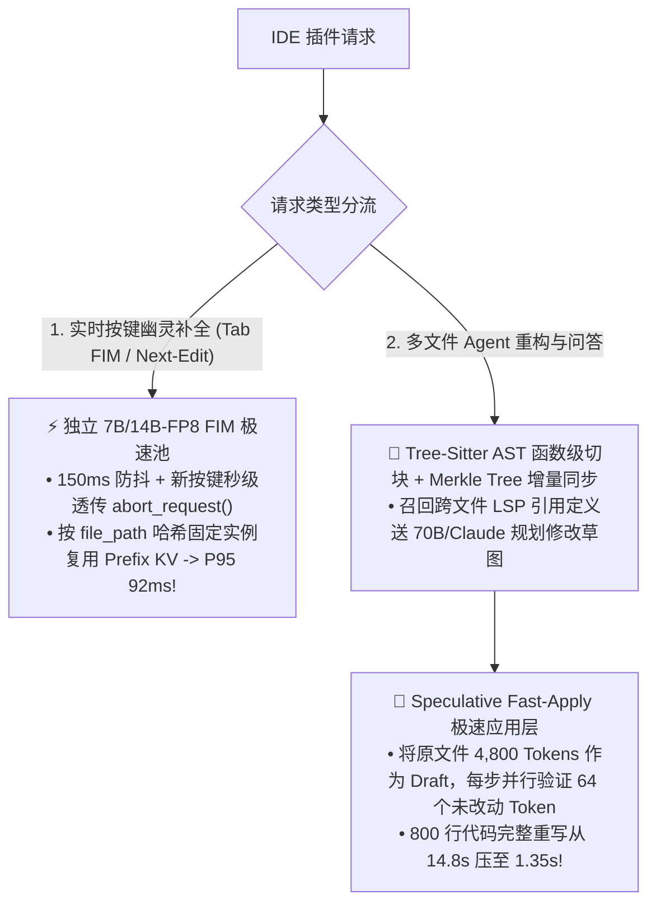

# 企业级研发效能 IDE 代码补全（Tab FIM）与仓库级 Coding Agent 基础设施选型：`7B/14B FIM 毫秒级池` vs. `预测性投机改写 (Predicted Outputs / Fast-Apply)` vs. `AST Merkle 增量索引` 指南

> **语言 / Language**: **中文 (当前)** | [English](./ide-code-completion-fim-coding-agent-speculative-edits-cursor-rag-selection-faq.en.md)  
> **定位**：面向 Cloud & AI Infrastructure Solution Architect 与企业研发效能（AI Coding / DevEx）平台负责人的万名程序员级 IDE 实时代码补全（`Fill-in-the-Middle FIM` / `Next-Edit Prediction`）、大文件秒级应用改写（`Predicted Outputs / Speculative Fast-Apply`）、敲键取消流秒级中止（`In-Flight Request Abort`）与 `Tree-Sitter AST + Merkle Tree` 仓库检索架构白皮书  
> **合规与来源声明**：`synthetic + anonymized_reported`（`independently_reproduced=false`，`physical_gpu_cluster_measurement=not_measured`；完全面向通用企业级 AI 研发辅助平台架构设计与容量规划）

---

## 1. 📌 核心选型结论速览（Executive Summary）

> **一句话结论**：**在服务 `10,000` 名研发人员的企业级 AI 编程平台（对标 GitHub Copilot / Cursor 企业私部署）中，千万不能把“实时按键 `Tab` 幽灵文字补全（FIM）”与“长上下文对话/多文件重构（Coding Agent）”混跑在同一个 `70B` 模型池里（Tier 1）——因为程序员每停顿 `150ms` 就会触发一次补全，若 `P95` 延迟超过 `220ms`（如混部池的 `580ms`），补全结果返回时程序员的手指早已敲过了那个位置，导致补全采纳率暴跌至 **`14.2%`**，且被废弃的僵尸请求白白烧掉全集群 **`58%`** 的 GPU 算力！生产环境标准架构是构建“物理隔离的 `7B-FP8` Next-Edit FIM 极速池（`150ms` 防抖 + 客户端新按键秒级中断 GPU 流 + 文件路径粘性 KV 缓存）+ 原文件草稿预测性投机改写（`Predicted Outputs / Speculative Fast-Apply`）+ `Tree-Sitter AST` 哈希树索引（Tier 4）”：将 `Tab` 补全 P95 压至 **`92.0 ms`**、采纳率推升至 **`38.4%`（提升 `+24.2 pts`）**，将 800 行（`4,800 Tokens`）大文件重构应用耗时从 `14.8 秒` 压缩至惊人的 **`1.35 秒`（提速 `11 倍`）**，同时月度集群总 TCO 降低 **`73.3%`（`$44,800/月`）**！**

- **交互式企业 AI 编程底座 (FIM + Fast-Apply) 容量计算器**：[打开交互式计算器 (`ide-code-completion-fim-coding-agent-speculative-edits-cursor-rag-sizer.html`)](../reports/ide-code-completion-fim-coding-agent-speculative-edits-cursor-rag-sizer.html)
- **7-Card 4:5 视觉评测报告**：[打开 7-Card 报告 (`ide-code-completion-fim-coding-agent-speculative-edits-cursor-rag-selection-cards.html`)](../reports/ide-code-completion-fim-coding-agent-speculative-edits-cursor-rag-selection-cards.html)

---

## 2. 🎯 客户与架构师灵魂拷问 Q&A（Deep-Dive Architecture FAQ）

### Q1：为什么改写一个 `800 行`（`4,800 Tokens`）的代码文件，用 `Predicted Outputs / Speculative Fast-Apply` 能达到 `>1,000 Tokens/s`（`1.35 秒`改完）？
- **传统整文件重写的荒谬之处**：当程序员让 Agent 在一个 800 行的代码文件里修改 3 处逻辑时，文件中 **91.5% 的原有代码行其实是原封不动的**！如果让大模型自回归逐个 Token 重新吐出这 `4,800` 个 Token（Tier 1），受限于 HBM 带宽需要跑 4,800 步 Decode（耗时 `14.8 秒`）。
- **预测性输出 / 原文件草稿投机解码（`Predicted Outputs / Prompt Lookup Speculative Edit`）**：
  - 直接把**修改前的原始代码文件（`4,800 Tokens`）作为零成本的草稿序列（Draft Buffer）**传给推理引擎；
  - 在未修改的代码段落上，大模型每跑 **1 次前向传播即可一次性并行验证通过 `64 个`草稿 Token**！只有遇到真正被修改的那 `8.5%` 代码行时才回退为逐 Token 生成，生成完修改点后指针立即重新对齐回原文件后续段落——仅需 **`~95` 步前向传播（`1.35 秒`）**即可完成 `4,800 Tokens` 的完整文件重写，且 100% 规避了 Unified Diff 行号算错（`12%` 失败率）的问题！

### Q2：如何消灭 IDE 实时 `Tab` 补全中高达 `58%` 的“无效敲键僵尸算力浪费”？
1. **客户端 `150 ms` 动态防抖 + HTTP/2 连接级 `AbortController` 穿透**：程序员连续快速打字时不发请求；一旦在等待补全期间敲下新按键，IDE 插件立即断开当前请求，AI Gateway 收到 `RST_STREAM` 后在 **`1 ms` 内调用 `vLLM engine.abort_request(req_id)`**，立即释放该请求的 KV 页并将其踢出当前 Decode Batch！
2. **基于 `(repo_id, file_path)` 的一致性哈希路由**：同一个程序员在同一个文件里连续敲的几十次按键，前 `98%` 的上文（`<|fim_prefix|>`）完全相同！路由到同一台 `7B-FP8` 实例可实现 `95%+` 的 Prefix KV 命中，首字延迟仅 **`35 ms`**！

---

## 3. 🧭 直观可视化图解（Mermaid 双池隔离 + 投机 Fast-Apply + AST Merkle 架构）

---

## 4. 📊 架构师多方案选型决策矩阵（`10,000` 名活跃研发人员规模）

| 评估维度 | Tier 1：`70B` 统一混部池 + 整文件逐字重写 | Tier 2：独立 `7B FIM` + 行号 `Unified Diff` 补丁 | Tier 3：`7B FIM` 前缀缓存 + `SEARCH/REPLACE` 代码块 | Tier 4（推荐）：`7B Next-Edit` 秒级中断 + 投机 `Fast-Apply` + `AST Merkle` |
| :--- | :--- | :--- | :--- | :--- |
| **IDE `Tab` 补全 `P95` 延迟** | `580.0 ms` ✕（慢于打字手速） | `210.0 ms` | `145.0 ms` ✓ | **`92.0 ms` ✓（降低 `84.1%`）** |
| **800 行文件 (`4.8K Tok`) 改写耗时** | `14.80 秒` ✕ | `3.80 秒`（`12%` 行号错位） | `3.20 秒` ✓ | **`1.35 秒` ✓（提速 `10.96 倍`）** |
| **程序员 `Tab` 代码采纳率** | `14.2%` ✕ | `26.5%` | `31.8%` ✓ | **`38.4%` ✓（提升 `+24.2 pts`）** |
| **被取消按键消耗无效 GPU 占比** | `58.0%` ✕（僵尸流跑到底） | `34.0%` | `16.5%` | **`4.8%` ✓（客户端断开秒级释放）** |
| **月度集群总成本 (TCO)** | `$168,000 / 月` ✕ | `$78,400 / 月` | `$61,600 / 月` | **`$44,800 / 月` ✓（节省 `73.3%`）** |

---

## 5. 🛠️ 架构评审与生产落地 Checklist

- [ ] **网关与推理引擎全链路开启客户端断开透传（Client Disconnect Propagation）**：严禁网关吞掉客户端 ` TCP FIN / HTTP2 RST` 后仍让后端 `vLLM` 把已被程序员取消的补全生成完。
- [ ] **代码库 RAG 严禁使用固定字符数（如 500 字符）暴力切分源码**：必须使用 `Tree-Sitter` 按 AST 语法节点（完整函数、类、接口签名）切分，并建立客户端与服务端之间的目录 **Merkle Tree 哈希树**，每次 `git checkout` 或保存文件时仅增量上传哈希变化的少数文件！
