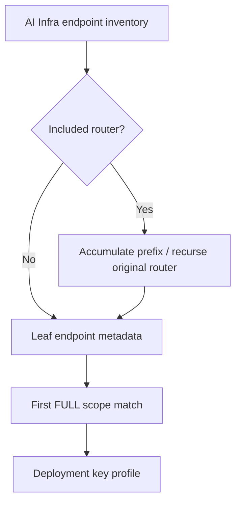
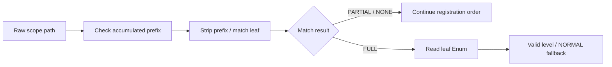
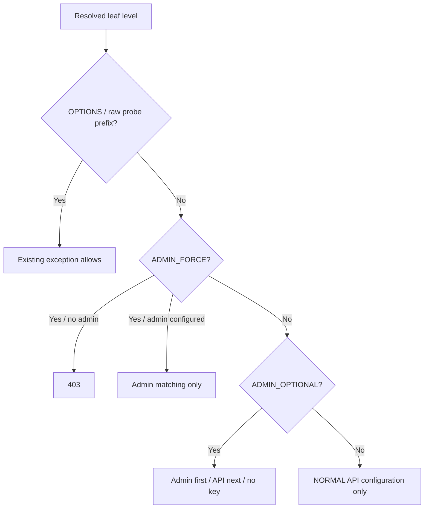

# AI Infra Control-plane Selection FAQ: Included Routers,Leaf Auth Levels and Key Profiles

> **Language**: English · [中文](included-router-auth-level-leaf-resolution-policy-selection-faq.md)  
> **Round 167 / daytime44**: [pinned same-day SGLang source](https://github.com/sgl-project/sglang/commit/cb551180329b719f892580fe21d3534b45fbcbe6),2026-11-14 06:03:38 UTC /14:03:38BJT.No popularity claim,vulnerability discovery or security certification.  
> [H5](../reports/included-router-auth-level-leaf-resolution-policy-sizer.html) · [Seven cards](../reports/included-router-auth-level-leaf-resolution-policy-selection-cards.html) · [SVG](../../assets/svg/included-router-auth-level-leaf-resolution-policy-selection-faq-summary.svg) · [Experiment](../../experiments/included_router_auth_selection/README.md)

## Executive Summary

**Auth metadata belongs to actual leaf endpoints,not merely top-level included-router containers.** The change recursively visits `original_router.routes`,accumulates `include_context.prefix`,strips that prefix for leaf matching,and takes endpoint `AuthLevel` from the first FULL match in registration order.It does not sort by longest path or strictest level;PARTIAL does not select metadata.

Resolution precedes existing key policy.NORMAL looks only at API configuration.ADMIN_OPTIONAL requires admin when configured,otherwise API,otherwise no key.ADMIN_FORCE rejects403when admin is unset.OPTIONS and raw-path health/ready/metrics prefix exceptions still precede level policy.These are pinned source observations,not recommendations to relax production access.

Our five-leaf/two-include case resolves `/api/control/pause` to admin_optional and denies an API-only matching witness401with both key profiles configured.A wrong top-only registry retains two root leaves,falls back to normal and accepts that witness.**Synthetic,independently_reproduced=false**;this counterfactual is not old-framework execution,real token checking or an exploit proof.

## Q1: When must control-plane inventory include actual leaves?

| Object | Insufficient proxy | Required contract |
| :--- | :--- | :--- |
| Included router | Container name or broad URL group | Recursive leaves,prefixes and actual FULL matching |
| Endpoint metadata | A string saying admin_optional | Actual endpoint `AuthLevel` Enum |
| Key configuration | Admin key means all routes protected | Separate NORMAL/OPTIONAL/FORCE rules |
| Cross-runtime tables | Some Rust paths appear in Python | Subset is not full route/method equivalence |
| WebSocket | HTTP decision status | Native handshake/close semantics |

This is relevant to profiling,elastic EP,weights,LoRA and cache-management inventories.Source reading and a model do not constitute security/compliance approval.Real gateway,network,credential and route registration review remains separate.

## Q2: Why separate prefixes,FULL/PARTIAL and Enum metadata?

Pinned [auth utilities](https://github.com/sgl-project/sglang/blob/cb551180329b719f892580fe21d3534b45fbcbe6/python/sglang/srt/utils/auth.py) accumulate includes and modify only the matching scope path.Traversal order is preserved;the first FULL match wins.A method mismatch yielding PARTIAL continues.

`_auth_level` is honored only as an actual `AuthLevel` instance;otherwise it becomes NORMAL.Native matcher exceptions are best-effort skipped.Our explicit `MATCHER_ERROR` witness is not a real framework exception.The original model excludes templates,root_path,mounts,redirects,URL decoding and framework-version semantics.

Reversing two duplicate FULL leaves can change the result;there is no specificity sort.NORMAL after no FULL does not establish route existence.Native handling may subsequently return404/405.The workbench represents only a literal-route subset.

## Q3: How do NORMAL,ADMIN_OPTIONAL and ADMIN_FORCE select credentials?

| Level | No keys | API only | Admin only | Both configured |
| :--- | :--- | :--- | :--- | :--- |
| NORMAL | No required key | API required | No API requirement;policy allows | API required |
| ADMIN_OPTIONAL | No required key | API required | Admin required | Admin required;API-only match insufficient |
| ADMIN_FORCE | 403 | No admin,403 | Admin required | Admin required |

This table excludes probes/OPTIONS.A configured required key with a nonmatching witness yields logical401.Optional refers to configuration,not unconditional anonymous access.ADMIN_FORCE is a source policy capability;our `/weights` example is not a claim about a deployed forced-level route at this pin.

H5 accepts no keys,only `none/api/admin/both/other` matching witnesses.API/admin mean exclusive matches;both covers matching both keys,including identical configured key strings.No bearer parsing,empty-key handling or constant-time comparison is executed.Native WebSocket denial closes1008before accept,resulting in403handshake;our logical decision status is not wire status.

## Q4: What do the tests,timing bars and native inventory evidence cover?

Eight tests cover nested prefixes,five versus two leaves,60key/level/witness combinations,first FULL/PARTIAL,metadata type,explicit matcher error,protocol/probe prefixes,immutable snapshot rebuild and invalid inputs.Additional64seeded profiles plus default compare130Python/Node outcomes.Node runs through stdin to avoid Windows command-line limits.

Probe bypass uses raw request-path `startswith`,not arbitrary nested health-like leaves.`/api/health` does not inherit the `/health` bypass in this model.This is an existing policy boundary,not new gateway design advice.

Pinned [inventory tests](https://github.com/sgl-project/sglang/blob/cb551180329b719f892580fe21d3534b45fbcbe6/test/registered/unit/entrypoints/test_http_server_auth_levels.py) use one chosen method/protocol per leaf and require Rust ADMIN_OPTIONAL paths to be a subset of Python's table.They do not prove every method,path/protocol or runtime equivalent.These native tests were read,not executed.

`latency.json` compares original compiled immutable literal registries with rebuilding per lookup at64/256/1024/4096leaves.Both include trace allocation;rebuild includes our deepcopy compilation.Two warmups,seven alternating repeats,three batches/sample,median repeat means.Native source still dynamically traverses without this deepcopy compilation;bars do not estimate framework acceleration,TLS,HTTP or real auth latency.Numeric bars use sealed CPUevidence,unknowns remain null;seven strict-CSPcards have no scripts/network.The register cabinet SVG is an original metaphor;visual acceptance is unknown.

## Q5: How should production acceptance remain separate from the model?

Pin framework/SGLang/registration versions.Inventory actual leaves and prefixes;verify Enum declarations,every method/protocol,duplicate order,404/405,root_path/mount/redirect,matcher errors and WebSocket denial.Have control-plane owners/security reviewers assess actual key policy,probes,gateway and credential comparisons.Source observations are not formal approval.

If compiling inventories,use versioned immutable metadata snapshots,rebuild and atomically publish on changes.Do not cache stale levels and assume dynamic routes synchronized.If compatibility is unresolved,stop rollout and retain the existing reviewed service path;do not let this toy choose broader access fallback.

Recheck `python -m unittest discover -s tests -p test_included_router_auth_selection.py -q` and `python -m experiments.included_router_auth_selection.run --check`.No real tokens,auth service,exploit execution or security audit.Apache-2.0rights retained;upstream is linked,not mirrored.AI-assisted original research requires human/native acceptance.
