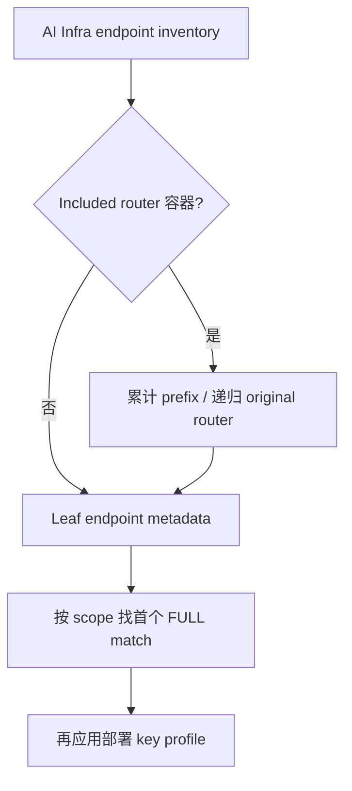
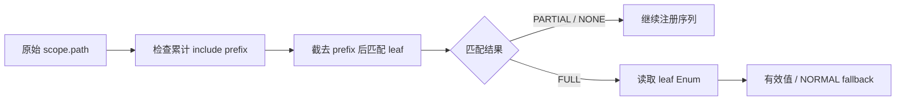
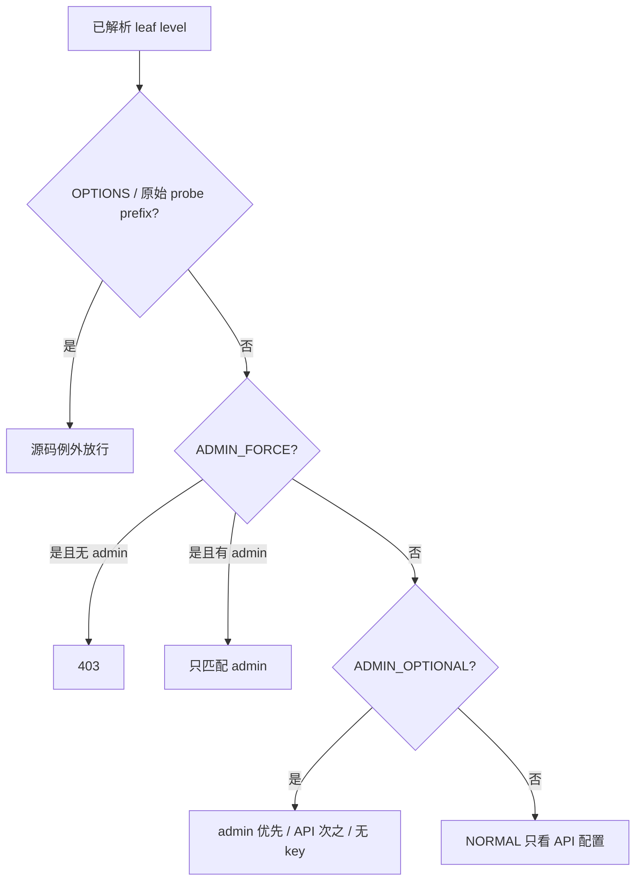

# AI Infra 控制面选型 FAQ：Included Router、Leaf Auth Level 与 Key Profile

> **语言**：中文 · [English](included-router-auth-level-leaf-resolution-policy-selection-faq.en.md)  
> **Round 167 / 白班 44**：固定 [SGLang 当日提交](https://github.com/sgl-project/sglang/commit/cb551180329b719f892580fe21d3534b45fbcbe6)，2026-11-14 06:03:38 UTC / 14:03:38 BJT。关注 included-router 的控制面 metadata 能力，不声明热度、漏洞发现或安全认证。  
> [H5](../reports/included-router-auth-level-leaf-resolution-policy-sizer.html) · [七卡](../reports/included-router-auth-level-leaf-resolution-policy-selection-cards.html) · [高清 SVG](../../assets/svg/included-router-auth-level-leaf-resolution-policy-selection-faq-summary.svg) · [实验](../../experiments/included_router_auth_selection/README.md)

## 核心结论速览

**权限标签属于实际 leaf endpoint，不能只枚举顶层 included-router 容器。** 本次变更递归走 `original_router.routes`，累计 `include_context.prefix`，对 scope path 去掉相应 prefix 后匹配；按注册顺序取第一个 FULL match 的 endpoint `AuthLevel`。不按“最长路径/最严格标签”重新排序；PARTIAL 不确定 level。

路由解析与既有 key policy 是两个阶段。`NORMAL` 只看 API key；`ADMIN_OPTIONAL` 在 admin key 配置时要求 admin，否则才看 API，均未配置则放行；`ADMIN_FORCE` 在 admin 未配置时拒绝 403。OPTIONS 与原始 request path 的 health/ready/metrics prefix 例外仍先执行。**这些是固定源码行为，不是本研究建议生产放宽控制面。**

原创 five-leaf/two-include case 用 `/api/control/pause` 演示：两种 key profile 均配置，API-only matching witness 在 `admin_optional` 下被拒绝 401；错误 top-only registry 只剩两个 root leaves，落为 normal 并接受 API witness。模型为 **synthetic、independently_reproduced=false**；这是结构化 counterfactual，不是旧框架运行、真实 token 校验或可利用漏洞证明。

## Q1：什么时候应把控制面权限审查下沉到 leaf registry？

| 检查对象 | 不充分的代理指标 | 应验证的合同 |
| :--- | :--- | :--- |
| Included router | 顶层容器名字、URL 粗分组 | 递归 leaf + 累计 prefix + 实际 FULL match |
| Leaf endpoint | 看到字符串 `admin_optional` | endpoint metadata 为实际 `AuthLevel` Enum |
| Key profile | “配置了 admin key，所以都受保护” | NORMAL/OPTIONAL/FORCE 的不同选择规则 |
| 跨 runtime 表 | 部分 Rust 路径在 Python 表里 | 不把 subset 测试说成所有 route/method 等价 |
| WebSocket | 复用 HTTP decision status 数字 | native handshake/close 的实际传输语义 |

适用于把弹性 EP、profiling、权重更新、LoRA、缓存管理等 API 纳入统一控制面 inventory。不能将源码 inventory 的读取当成正式安全评审或上线合规结论；真实服务需单独审查网关、网络隔离、凭据与 route 注册。

## Q2：Prefix、FULL/PARTIAL 与 Enum metadata 为什么是独立边界？

固定 [auth utilities](https://github.com/sgl-project/sglang/blob/cb551180329b719f892580fe21d3534b45fbcbe6/python/sglang/srt/utils/auth.py) 对 include 逐层累计 prefix，然后传给 leaf 的匹配 scope 只修改 path。遍历顺序保留；取第一个 FULL，方法不匹配的 PARTIAL 不返回权限等级。

leaf endpoint 的 `_auth_level` 只有是 `AuthLevel` 实例才生效，否则回落 NORMAL。原生 matcher 异常被 best-effort 跳过；本实验显式显示 `MATCHER_ERROR` witness，**不是制造或捕获真实框架异常**。模型没有模板路由、root_path、mount、trailing-slash redirect、URL 解码或 FastAPI 版本行为。

同一路径两个 FULL leaf 时，颠倒注册顺序可改变结果；这不是 specificity 排序。没有 FULL 时解析出的 NORMAL 也不证明 route 存在，之后 native handler 可能给出 404/405。工作台只提供原始 literal-route subset 的抽象解析。

## Q3：NORMAL、ADMIN_OPTIONAL、ADMIN_FORCE 如何与凭据组合？

| Level | 无 key | API only | Admin only | 两者都有 |
| :--- | :--- | :--- | :--- | :--- |
| NORMAL | 不要求 key | 要求 API | 不要求 API，因此该 policy 放行 | 要求 API |
| ADMIN_OPTIONAL | 不要求 key | 要求 API | 要求 admin | 要求 admin，不接受仅匹配 API 的凭据 |
| ADMIN_FORCE | 403 | admin 未配置，403 | 要求 admin | 要求 admin |

表格针对非 probe/non-OPTIONS 请求。配置要求存在但 witness 不匹配时逻辑状态 401。`optional` 表示部署配置可选，不是任何配置下都可匿名。`ADMIN_FORCE` 是 native policy 可表达的等级；原创 `/weights` leaf 不声称就是该 pin 的生产 route 声明。

H5 绝不输入 key，只接受 `none/api/admin/both/other` 匹配 witness：api/admin 意为只匹配对应 key，both 可覆盖相同 key 字符串导致的双匹配。真实 bearer parsing、空 key 处理、constant-time compare 未执行。源码 WebSocket 拒绝会在 accept 前 close code1008，handshake 为 403；模型的 logical decision status 不是 WebSocket wire status。

## Q4：原创测试、性能条与源码 inventory 证据覆盖多大？

八项本地测试覆盖 nested prefix、five-leaf 与 top-only 差异，60 组 key/level/witness 组合，first FULL/PARTIAL、Enum witness、显式 matcher-error、protocol、probe raw prefix、compiled snapshot 修改后需 rebuild、非法输入。另用固定 seed64随机 profile 加默认，共65配置/130Python-Node输出；Node 通过 stdin 执行，避免 Windows 长命令行限制。

`/health`、`/ready`、`/metrics` 例外基于**原始 request path startswith**，不是“任意嵌套 leaf 名称像 health”。所以 `/api/health` 在这个模型里没有相同 bypass。它是现有 policy 的精确边界，不是新增代理路由设计建议。

固定 [native inventory tests](https://github.com/sgl-project/sglang/blob/cb551180329b719f892580fe21d3534b45fbcbe6/test/registered/unit/entrypoints/test_http_server_auth_levels.py) 用每个 leaf 的一个所选 method/protocol 查表，并要求 Rust `ADMIN_OPTIONAL_PATHS` 为 Python 表的 subset；**不是所有 methods、所有协议、所有路径与 Rust runtime 的完整等价证明**。这些测试只读取，未在本机执行。

`latency.json` 的 64/256/1024/4096 literal leaves 对比原创 immutable registry lookup 与每次重建 registry；两者含 trace allocation，后者还含原创 deepcopy 编译。2 warmup、7 组交替重复、3 batches/sample，median repeat means。Native 新源码仍动态遍历，并不做本模型的 deepcopy 编译；条图**不能估算框架加速、TLS、HTTP 或真实 auth latency**。所有条宽取 sealed CPU evidence，unknown null；七卡 strict CSP，无脚本/网络。高清 SVG 用 register cabinet 隐喻；浏览器验收未知。

## Q5：如何验证生产边界而不把模型认证当部署认证？

固定 FastAPI/Starlette/SGLang 与注册表版本；枚举实际 leaf + prefix，逐项确认 Enum 标签、每个 method/protocol、重复路由顺序、404/405、root_path/mount/redirect、matcher failure 与 WebSocket deny。将真实 NORMAL/OPTIONAL/FORCE key 配置交给控制面 owner 与安全人员复核，单独验证 probes、网关和凭据比较。源码 observations 不能代替正式评审。

若实现 compiled inventory，必须将 router/endpoint metadata 当成版本化 snapshot，变更后重建并原子发布；不能缓存旧 level 然后宣称动态路由已同步。若兼容性未通过，应停止发布并保留原有受审查服务路径，不由 H5 模型选择更宽权限 fallback。

复验 `python -m unittest discover -s tests -p test_included_router_auth_selection.py -q` 与 `python -m experiments.included_router_auth_selection.run --check`。本轮不接触真实 token、不启动 auth service、不执行 exploit/security audit。Apache-2.0 权利保留，源实现链接而非镜像；AI 辅助原创研究，需要人工/native acceptance。
