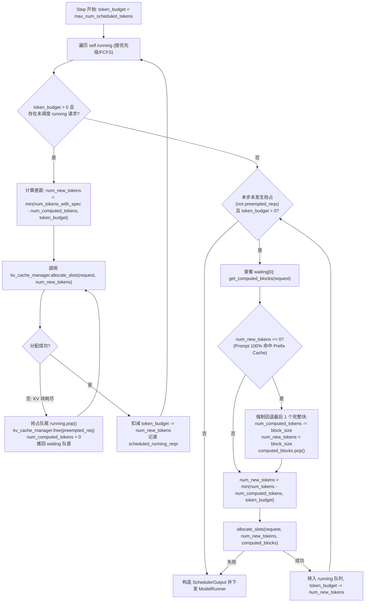

# Prefill/Decode 分离、Continuous Batching 与 TTFT/TPOT/吞吐权衡：vLLM V1 统一调度与 KV 块管理源码深挖

- **组件归属**：AI Infra 全栈研究第 8 层（推理系统：KV Cache、PagedAttention、Continuous Batching、Prefill/Decode 分离、Speculative Decoding、SLO 工程）
- **面向对象**：需要设计生产级 LLM 推理集群、量化 TTFT/TPOT 尾延迟边界并理解调度器与 KV 显存池内部机制的解决方案架构师
- **核验日期**：`2026-10-16`（UTC+08:00）
- **证据等级**：
  - `implementation`：固定版本 `vllm-project/vllm@25f560a62c4f955672e2c6080b17ab3a48f96201`（`v0.8.2`，发布日期 `2025-03-25`）`vllm/v1/core/` 源码
  - `own-offline`：本仓库原创标准库解析算例 [`experiments/inference_slo_scheduler/`](../../experiments/inference_slo_scheduler/README.md)
  - **未包含**：真实 GPU 服务压测或 RDMA KV 传输实测（`own-hardware` 未执行）

---

## 1. 一手源码锚点

| 来源 ID | 仓库与固定版本 | 源码路径与 Git Blob SHA | 核心核验内容 |
|---|---|---|---|
| `vllm-v1-scheduler` | `vllm-project/vllm@25f560a62c4f955672e2c6080b17ab3a48f96201` (`v0.8.2`, `2025-03-25`) | `vllm/v1/core/sched/scheduler.py` (`blob: c71eb9a0445c7c6d8d52bd6d4185c2ab8d34cef4`, `L106–490`) | `Scheduler.schedule()` 无 Prefill/Decode 阶段区分的统一 `token_budget` 循环、抢占回退与 Prefix Cache 100% 命中时整块重算不变量 |
| `vllm-v1-kv-cache-manager` | `vllm-project/vllm@25f560a62c4f955672e2c6080b17ab3a48f96201` (`v0.8.2`, `2025-03-25`) | `vllm/v1/core/kv_cache_manager.py` (`blob: 5cfe2b96865a226ab9418f8388aa80214c751a60`, `L19–309`) | `KVCacheManager` 默认 `num_preallocate_tokens = 64` 预分配、`allocate_slots` 中 `num_evictable_computed_blocks` 扣减守卫、`free` 逆序归还 |
| `vllm-v1-block-pool` | `vllm-project/vllm@25f560a62c4f955672e2c6080b17ab3a48f96201` (`v0.8.2`, `2025-03-25`) | `vllm/v1/core/block_pool.py` (`blob: 394b47fddf0c9a00d0e94f2f425c998908a3dfbc`, `L17–286`) | `BlockPool` 双向链表 `FreeKVCacheBlockQueue`、`touch` 引用计数救活、`_maybe_evict_cached_block` 哈希驱逐与 Append-Only 块表不去重策略 |

---

## 2. vLLM V1 统一调度器（Unified Token-Budget Scheduler）实现深挖

### 2.1 取消显式 Prefill / Decode 阶段：以 `(num_computed_tokens, num_tokens_with_spec)` 统一驱动

在早期推理框架（如 vLLM V0 默认策略）中，调度器在每个 step 要么优先执行一批新请求的完整 Prefill（阻塞所有在跑 Decode 请求，造成严重的 TPOT 尖峰），要么执行一批 Decode。在 `vllm/v1/core/sched/scheduler.py`（`L106–116`）中，作者用一段核心注释定义了 V1 的统一抽象：

> *"There's no 'decoding phase' nor 'prefill phase' in the scheduler. Each request just has the `num_computed_tokens` and `num_tokens_with_spec`... At each step, the scheduler tries to assign tokens to the requests so that each request's `num_computed_tokens` can catch up its `num_tokens_with_spec`."*



### 2.2 源码揭示的四个关键不变量与边界行为

1. **RUNNING 优先与抢占抑制 WAITING 准入（`scheduler.py:139–221`）**：
   - 调度器首先遍历 `self.running`（包含正在逐 token Decode 的请求，以及上一 step 尚未完成全部 Prompt 的 Chunked Prefill 请求）。
   - 若某个 `running` 请求在调用 `allocate_slots` 时因 KV 块不足返回 `None`，调度器循环弹出 `self.running.pop()`（最低优先级/最晚到达的在跑请求），调用 `kv_cache_manager.free(preempted_req)` 释放其全部 KV 块，将其 `num_computed_tokens` 重置为 `0`，并塞回 `self.waiting.appendleft(preempted_req)`。
   - **硬门控**：阶段二（从 `self.waiting` 准入新请求）被包裹在 `if not preempted_reqs:`（`L221`）下——一旦本 step 发生过任何 KV 抢占，即使剩余 `token_budget > 0`，也**绝不准入任何 `waiting` 请求**，防止刚抢占释放的 KV 块被新请求挪用而引发抖动（Thrashing）。

2. **Prefix Cache 100% 整块命中时的“强制末块重算”不变量（`scheduler.py:265–275`）**：
   - 当 `waiting` 队列首部请求的 Prompt 长度恰好是 `block_size` 的整数倍，且所有块全部命中 Prefix Cache 时，`request.num_tokens - num_computed_tokens` 为 `0`。
   - 但模型前向需要至少计算最后一个 token 的 logits 才能采样出第一个输出 token，且 `allocate_slots()` 假定 `num_computed_tokens` 必须是 `block_size` 的整数倍。因此 `scheduler.py:265–275` 执行：
     ```python
     num_new_tokens = request.num_tokens - num_computed_tokens
     if num_new_tokens == 0:
         num_computed_tokens -= self.block_size
         num_new_tokens = self.block_size
         computed_blocks.pop()
     ```
   - **架构含义**：当 `block_size = 16`、`prompt_tokens = 4096` 且 256 个块 100% 命中 Prefix Cache 时，vLLM V1 实际有效复用 `255` 个块（`4080` tokens），并强制重新调度最后 `1` 个完整块（`16` tokens）的 Prefill 计算。

3. **待驱逐缓存块（`ref_cnt == 0`）的可用容量扣减守卫（`kv_cache_manager.py:168–186`）**：
   - 在 `BlockPool`（`block_pool.py:41–48, 211–244`）中，当一个请求完成并调用 `free_blocks` 时，引用计数降为 `0` 的块会被追加到 `free_block_queue` 尾部，但**保留其 `block_hash` 与在 `cached_block_hash_to_block` 中的映射**（直到该块被 `get_new_blocks` 真正分配给其他请求时才通过 `_maybe_evict_cached_block` 抹除哈希）。
   - 因此，`free_block_queue.num_free_blocks` 既包含从未使用的空白块，也包含 `ref_cnt == 0` 的 Prefix Cache 候选驱逐块。
   - 当新请求在 `get_computed_blocks` 中命中了若干处于 `ref_cnt == 0` 的缓存块（`new_computed_blocks`），随后调用 `allocate_slots` 申请额外的 `num_new_blocks` 时，如果直接比较 `num_new_blocks > get_num_free_blocks()`，就会把即将被 `touch()` 从空闲队列摘除的命中块误算作可分配新块！为此 `kv_cache_manager.py:175–180` 设置了精确守卫：
     ```python
     num_evictable_computed_blocks = sum(1 for blk in new_computed_blocks if blk.ref_cnt == 0)
     if (num_new_blocks > self.block_pool.get_num_free_blocks() - num_evictable_computed_blocks):
         return None
     ```

4. **预分配空块（`num_preallocate_tokens = 64`）与逆序释放（`kv_cache_manager.py:42–53, 198–206, 239–256`）**：
   - 为避免 Decode 请求每生成 16 个 token 就修改一次块表与引用计数，`KVCacheManager` 默认设置 `num_preallocate_tokens = 64`（当 `block_size = 16` 时，`num_preallocate_blocks = 4`）。每次请求需要新块时，实际从池中申请 `min(num_new_blocks + 4, get_num_free_blocks(), max_num_blocks_per_req - len(req_blocks))` 个块。这减少了调度器 CPU 开销，但使每个活跃请求最多多占 `4` 个未写满的预分配块（容量规划时须计入该内部碎片余量）。
   - 当请求结束或被抢占调用 `free(request)` 时，若 `enable_caching = True`，`kv_cache_manager.py:251–254` 按 **`reversed(blocks)`（从序列尾部向头部逆序）**将块推入 `free_block_queue`（FIFO 驱逐队列）：
     ```python
     if self.enable_caching:
         ordered_blocks = reversed(blocks)
     self.block_pool.free_blocks(ordered_blocks)
     ```
     这样下次分配新块从队首 `popleft()` 时，**优先驱逐请求特有的尾部生成块，而将所有请求共享的 System Prompt / 公共前缀头部块留在队列最末端最后驱逐**。

---

## 3. 同机混部 Chunked Prefill vs Prefill/Decode（P/D）分离的定量权衡

### 3.1 解析公式与单位定义

设当前服务实例上有 $B_{\text{dec}}$ 个正在运行的 Decode 请求（每步每请求需调度 $1$ 个 token），此时到达一个长度为 $L_{\text{prompt}}$ tokens、有效 Prefix Cache 命中为 $L_{\text{cached}}$ tokens 的新请求，待计算 Prefill token 数为 $L_{\text{prefill}} = L_{\text{prompt}} - L_{\text{cached}}$。

1. **同机混部（Colocated Chunked Prefill，全局预算 $B_{\text{budget}} = \text{max\_num\_batched\_tokens}$）**：
   - 每个调度 step 先扣除在跑 Decode 预算，留给 Prefill 的单步最大 token 配额为：
     $$C_{\text{chunk}} = \max(0,\; B_{\text{budget}} - B_{\text{dec}})$$
   - 完成该长 Prompt 所需的混合 step 数（Chunk 数）为：
     $$N_{\text{chunks}} = \left\lceil \frac{L_{\text{prefill}}}{C_{\text{chunk}}} \right\rceil$$
   - 设纯 Decode 步（处理 $B_{\text{dec}}$ 个 token，主要由 HBM 权重读取决定）耗时为 $T_{\text{dec,base}}$（`ms`），混入 Prefill token 后的边际算力耗时斜率为 $\alpha_{\text{prefill}}$（`ms/token`）。则在混部 Prefill 期间，**所有在跑 Decode 请求的单步间隔（TPOT）被拉长至**：
     $$\text{TPOT}_{\text{colocated}} = T_{\text{dec,base}} + C_{\text{chunk}} \cdot \alpha_{\text{prefill}}$$
   - 新请求的首 token 延迟（TTFT）跨越全部 $N_{\text{chunks}}$ 个混合步：
     $$\text{TTFT}_{\text{colocated}} = (N_{\text{chunks}} - 1) \cdot T_{\text{dec,base}} + T_{\text{dec,base}} + L_{\text{prefill}} \cdot \alpha_{\text{prefill}} = N_{\text{chunks}} \cdot T_{\text{dec,base}} + L_{\text{prefill}} \cdot \alpha_{\text{prefill}}$$
   - **同机混部的结构性两难（The Colocated Dilemma）**：
     - 若调大 $B_{\text{budget}}$（减少 $N_{\text{chunks}}$ 以降低 TTFT），单步混入的 $C_{\text{chunk}}$ 增大，导致在跑 Decode 请求的 $\text{TPOT}_{\text{colocated}}$ 突破 SLO；
     - 若调小 $B_{\text{budget}}$（限制 $C_{\text{chunk}}$ 以保护 Decode TPOT），$N_{\text{chunks}}$ 剧增，每个 Chunk 都必须陪跑一次完整的模型权重读取 $T_{\text{dec,base}}$，导致长 Prompt 的 $\text{TTFT}_{\text{colocated}}$ 恶化。

2. **Prefill/Decode（P/D）分离架构**：
   - 专用 Prefill 节点（算力导向，无在跑 Decode 干扰）以单步（或大 Chunk）完成 $L_{\text{prefill}}$ 计算，耗时 $T_{\text{prefill\_node}} = T_{\text{base}} + L_{\text{prefill}} \cdot \alpha_{\text{prefill}}$；
   - 随后通过单向有效带宽为 $BW_{\text{RDMA}}$（`bytes/s`）的 RDMA 网络，将 $L_{\text{prompt}}$ 个 token 的 KV Cache（每 token 跨全层 KV 字节数为 $B_{\text{kv/tok}}$）传输至 Decode 节点：
     $$T_{\text{kv\_xfer}} = \frac{L_{\text{prompt}} \cdot B_{\text{kv/tok}}}{BW_{\text{RDMA}}}$$
   - Decode 节点的 TPOT 保持恒定 $\text{TPOT}_{\text{PD}} = T_{\text{dec,base}}$，而新请求总 TTFT（不计层间流水重叠时的保守上界）为：
     $$\text{TTFT}_{\text{PD}} = T_{\text{prefill\_node}} + T_{\text{kv\_xfer}}$$

---

### 3.2 原创 CPU/Offline 算例验证结果

运行 `python experiments/inference_slo_scheduler/run.py --check`（详见 [`experiments/inference_slo_scheduler/results.json`](../../experiments/inference_slo_scheduler/results.json)），在 `block_size = 16`、`num_gpu_blocks = 4096`、`running_decode_requests = 64`、单 token KV 体积 `131,072 B`（`128 KiB/token`，对应 32 层 GQA 或 64 层紧凑 KV）、$T_{\text{dec,base}} = 18.0\text{ ms}$、$\alpha_{\text{prefill}} = 0.025\text{ ms/token}$、RDMA 单向有效带宽 `50 GB/s`、目标 SLO（$\text{TPOT} \le 35\text{ ms},\; \text{TTFT} \le 350\text{ ms}$）下验证 5 个场景：

| 场景 ID (`case_id`) | `max_num_batched_tokens` | 待算 Prefill Tokens | Chunk 数 | 同机混部 TPOT (ms) | 同机混部 TTFT (ms) | P/D KV 传输耗时 (ms) | P/D 分离 TPOT / TTFT (ms) | 核心源码不变量验证结果 |
|---|---:|---:|---:|---:|---:|---:|---:|---|
| `colocated_large_chunk_tpot_violation` | `2048` | `8192` | `5` | **`67.6`** (违背 SLO) | `294.8` (达标) | `21.4748` (`1.0 GiB`) | **`18.0` / `244.2748`** (双达标) | 大 Chunk 虽保住 TTFT，但使 64 个在跑 Decode 请求 TPOT 翻 3.75 倍 |
| `colocated_small_chunk_tpot_safe_ttft_inflated` | `512` | `8192` | `19` | `29.2` (达标) | **`546.8`** (违背 SLO) | `21.4748` (`1.0 GiB`) | **`18.0` / `244.2748`** (双达标) | 小 Chunk 保住 TPOT，但 19 次陪跑权重读取令 TTFT 超标 56% |
| `full_prefix_cache_hit_last_block_recompute` | `512` | `16` (原 `4096` 全命中) | `1` | `18.4` | `18.4` | `10.7374` (`0.5 GiB`) | `18.0` / `29.1374` | 验证 `scheduler.py:273`：`256` 块全命中时强制弹出末块重算 `16` tokens，并附带预分配 `4` 块（共分配 `5` 块） |
| `evictable_prefix_hit_blocks_new_allocation` | `512` | `512` (`32` 块命中含 `20` 待驱逐) | `2` | `29.2` | `48.8` | `2.6844` | `18.0` / `33.4844` | 验证 `kv_cache_manager.py:175`：空闲池 `40` 块减去 `20` 个 `ref_cnt=0` 命中块后仅剩 `20` 块 `< 28` 块，拒绝本次分配 (`can_allocate=False`) |
| `zero_free_blocks_running_preemption` | `512` | `1024` | `3` | `29.2` | `79.6` | `2.6844` | `18.0` / `46.2844` | 验证 `scheduler.py:165`：空闲块为 `0` 时触发 `running.pop()` 抢占，回收 `128` 块并禁止本步调度 `waiting` |

---

## 4. 架构影响与反例边界（何时 P/D 分离会失去收益？）

1. **P/D 分离并非无条件优于同机 Chunked Prefill**：
   - 当互联并非 RDMA（如跨可用区 TCP 或 PCIe 受限主机网络，有效带宽降至 `5 GB/s`），`8192` tokens（`1.0 GiB` KV）的传输耗时将从 `21.47 ms` 暴涨至 `214.7 ms`，若采用未压缩 MHA（如 `400 KiB/token`）更会突破 `650 ms`，反而慢于同机 Chunked Prefill；
   - 当请求几乎全部命中本地 Prefix Cache（如 `full_prefix_cache_hit_last_block_recompute` 仅需重算 `16` tokens）时，同机直接复用本地 HBM 中的缓存块仅需 `18.4 ms`，而跨节点传输完整 KV Cache 反而引入 `10.74 ms` 额外网络开销。
2. **Decode 节点 KV 容量规划必须扣除 `num_preallocate_blocks`**：
   - 在 vLLM V1 中，每个活跃请求在跨越块边界时会多抓 `cdiv(64, block_size)` 个预分配块；若并发 `256` 个请求且 `block_size = 16`，最多有 $256 \times 4 = 1024$ 个块（占 `4096` 块池的 **25%**）处于预分配占用态，直接压缩可接纳的最大并发序列数。
3. **后续可证伪问题**：
   - 在 `scheduler.py:265–275` 中，若后续版本支持仅对最后一个 token（而非整个 `block_size`）执行增量 KV 槽位追加，100% Prefix Cache 命中场景在小 `block_size = 16` 与大 `block_size = 128`（如 SM100 块稀疏内核）下分别能减少多少无效算力？
   - 在 P/D 分离架构下，按 Transformer 层流水线式发送 KV（Layer-wise Pipelined KV Transfer）相比整批 Prefill 结束后一次性发送，能隐藏多少比例的 $T_{\text{kv\_xfer}}$？
