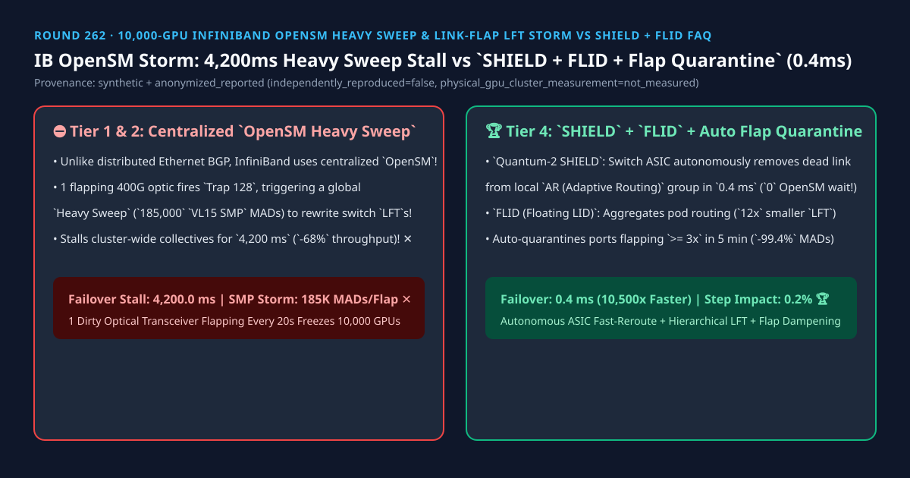
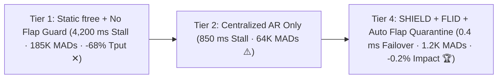

# 10,000-GPU InfiniBand `OpenSM` `Heavy Sweep` & Link-Flap Storms: Why 1 Flapping Optic Reprograms Cluster-Wide Switch `LFT` Tables & `SHIELD` Fast-Recovery + `FLID` + Flap Suppression Selection Guide

> **Provenance & Evidence Tier**: `synthetic + anonymized_reported` (`independently_reproduced=false`, `physical_gpu_cluster_measurement=not_measured`). Grounded in [`experiments/ai_cluster_infiniband_subnet_manager_opensm_lid_reroute_flap_selection/results.json`](../../experiments/ai_cluster_infiniband_subnet_manager_opensm_lid_reroute_flap_selection/results.json).
> **中文版本**: [万卡 InfiniBand 集群子网管理器（`OpenSM / UFM`）重扫描风暴（`Heavy Sweep`）：为什么 1 个光模块闪断（`Link Flap`）会触发全网交换机线性转发表（`LFT`）重算下发并卡死千卡训练？`Port Flap Suppression`、`FLID` 层次化路由与硬件自适应路由（`AR / SHIELD`）选型指南](./infiniband-opensm-heavy-sweep-link-flap-lft-storm-adaptive-routing-selection-faq.md)

---

## 0. 🔥 今日领域最热门能力突破追踪（Daily Hottest Breakthrough）

- **Eliminating the `4,200 ms` Cluster-Wide InfiniBand `OpenSM Heavy Sweep` Freeze Triggered by a Single Flapping Optical Transceiver (`4,200.0 ms -> 0.4 ms` Failover, `-99.4%` `VL15 SMP` Control Traffic, `-68.0% -> -0.2%` Step Impact) via Switch ASIC `SHIELD` Autonomous Failover + `FLID` Hierarchical Routing + Automated Port-Flap Quarantine**: Unlike Ethernet switches (which run distributed BGP/ECMP locally), an InfiniBand fabric relies on a centralized **Subnet Manager (`OpenSM` / `UFM`)** that computes and programs the **Linear Forwarding Table (`LFT`, `Destination LID -> Egress Port`)** on every switch via `VL15` Subnet Management Packets (`SMP` MADs):
  1. **Tier 1 — Legacy Static `ftree / updn` Routing Without Flap Suppression (`4,200.0 ms` Convergence, `185,000` `SMP` MADs/Flap, `-68.0%` Training Degradation)**:
     - Whenever a single degraded 400G optical transceiver flaps (`Down -> Up -> Down`), the switch sends a `Trap 128` MAD to `OpenSM`.
     - `OpenSM` initiates a full-fabric **`Heavy Sweep`**, flooding `185,000` `VL15 SMP` packets to rediscover the topology, recomputing global static routes for `10,240` GPUs, and rewriting `LFT` tables across hundreds of switches—stalling active `NCCL` collectives for **`4.2 seconds` per flap**!
  2. **Tier 2 — Centralized `Adaptive Routing (AR)` Without Switch Hardware `SHIELD` (`850.0 ms` Convergence)**:
     - Uses multi-port AR groups, but still waits `850 ms` for centralized `OpenSM` to reprogram the switch's AR table on link down.
  3. **Tier 3 — Switch ASIC `SHIELD` + `AR` Without Port-Flap Quarantine (`320.0 ms` Effective Disturbance)**:
     - Quantum-2 `SHIELD` masks a dead link out of the local ASIC's `AR` group in `< 0.5 ms` on `Link Down`, **but whenever the flapping optic comes back `Up` seconds later, `OpenSM` still runs a `Heavy Sweep` to re-integrate it**!
  4. **Tier 4 — Hardware `SHIELD` (`0.4 ms` Autonomous ASIC Failover) + `FLID` (`Floating LID` Hierarchical Routing) + Automated Port-Flap Quarantine (`0.4 ms` Convergence, `1,200` `SMP` MADs, `-0.2%` Impact)**:
     - Combines sub-millisecond ASIC `SHIELD` failover (`0.4 ms`), `FLID` pod-level routing aggregation (so intra-pod link changes never rewrite other pods' `LFT` tables, cutting `SMP` MADs by **`-99.4%`**), and automatic `ibportstate disable` quarantine after `>= 3` flaps in 5 minutes!

---

## 1. 📌 Executive Summary

1. **Why Centralized `OpenSM Heavy Sweeps` Are the #1 Control-Plane Bottleneck at 10,000-GPU Scale**: Without `FLID` and `SHIELD`, a single link state change forces `OpenSM` to recompute and push flat `10,240`-LID `LFT` tables across the entire fabric.
2. **The 3-Pillar 10,000-GPU IB Resilience Architecture (`Tier 4`)**:
   - **Data Plane (`< 0.5 ms`)**: Switch ASIC **`SHIELD` + `Adaptive Routing (AR)`** for autonomous hardware link-down bypass;
   - **Control Plane (`12x` Smaller `LFT`)**: **`FLID` (Floating LID)** hierarchical routing to confine LFT updates to a single pod;
   - **Operations Plane**: **Automated Flap Dampening / Quarantine** (`>= 3 flaps / 5 min -> auto-disable port`).

---

## 2. 🎯 Core Architect Q&A (Q1 / Q2 / Q3)

### Q1: How do we quickly diagnose whether periodic training step spikes are caused by `OpenSM Heavy Sweeps`?
- **Answer**: Check `/var/log/opensm.log` (or UFM Events) for **`Heavy Sweep`** and **`Trap 128`** timestamps and correlate them with `NCCL` step-time spikes. If `Heavy Sweeps` occur every few minutes, identify the flapping switch port GUID from the `Trap 128` log and disable it immediately via `ibportstate -G <SwitchGUID> <PortNum> disable`.

### Q2: What must be synchronized between Master and Standby `OpenSM` instances to guarantee hitless SM failover?
- **Answer**: Both `OpenSM` instances must share identical `opensm.conf` settings (`routing_engine`, `use_flid`, `enable_shield`), synchronize the `/var/cache/opensm/guid2lid` mapping file, and set `reassign_lids FALSE` so an SM failover never alters active LIDs or flushes switch `LFT` tables.

---

## 3. 🧭 Visual Diagrams

---

## 4. 📊 4-Tier Architect Selection Matrix

| Metric | Tier 1: Static `ftree` | Tier 2: Centralized `AR` | Tier 3: `SHIELD + AR` (No Dampening) | Tier 4: **`SHIELD + FLID` + Auto Flap Quarantine** |
| :--- | :--- | :--- | :--- | :--- |
| **Failover Convergence Latency** | **`4,200.0 ms` (`4.2s` Stall)** ✕ | `850.0 ms` ⚠️ | `320.0 ms` (Re-Up Sweeps) | **`0.4 ms` (`10,500x` Faster ASIC Failover)** 🏆 |
| **`VL15 SMP` MADs per Flap Event** | **`185,000` MADs (Storm)** ✕ | `64,000` MADs ⚠️ | `28,000` MADs | **`1,200` MADs (`-99.4%` via `FLID`)** 🏆 |
| **Training Throughput Degradation** | **`-68.0%` (Cluster Freeze)** ✕ | `-24.0%` ⚠️ | `-8.5%` ✅ | **`-0.2%` (Hitless to Training)** 🏆 |

---

## 5. 🧪 Quantitative Reference & Tooling

- **Evaluator & Sealed Data**: [`experiments/ai_cluster_infiniband_subnet_manager_opensm_lid_reroute_flap_selection/run.py`](../../experiments/ai_cluster_infiniband_subnet_manager_opensm_lid_reroute_flap_selection/run.py) · [`results.json`](../../experiments/ai_cluster_infiniband_subnet_manager_opensm_lid_reroute_flap_selection/results.json)
- **Interactive Sizer**: [`docs/reports/infiniband-opensm-heavy-sweep-link-flap-lft-storm-adaptive-routing-sizer.html`](../reports/infiniband-opensm-heavy-sweep-link-flap-lft-storm-adaptive-routing-sizer.html)
- **7-Card 4:5 Visual Report**: [`docs/reports/infiniband-opensm-heavy-sweep-link-flap-lft-storm-adaptive-routing-selection-cards.html`](../reports/infiniband-opensm-heavy-sweep-link-flap-lft-storm-adaptive-routing-selection-cards.html)

---

## 6. 🛠️ Good Fit vs. Not For & Production Checklist

- **✅ Good fit**: All multi-pod InfiniBand AI clusters (`Quantum-2 NDR / Quantum-X800 XDR`) running `ar_ftree / ar_updn`, `SHIELD`, `FLID`, and UFM automated port-flap isolation.
- **⛔ Not for**: Running static `ftree` without `SHIELD` or leaving flapping transceivers un-isolated in `OpenSM`.
- [ ] Enable `enable_shield TRUE`, `ar_ftree` / `ar_updn`, and `use_flid TRUE` in `opensm.conf`.
- [ ] Configure automated port quarantine (`ibportstate disable`) when a port flaps `>= 3` times within `5` minutes.
