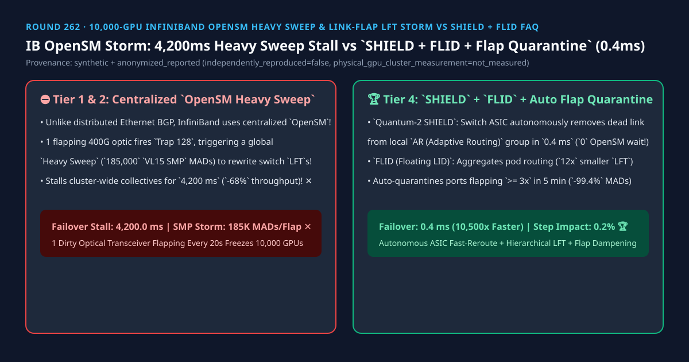
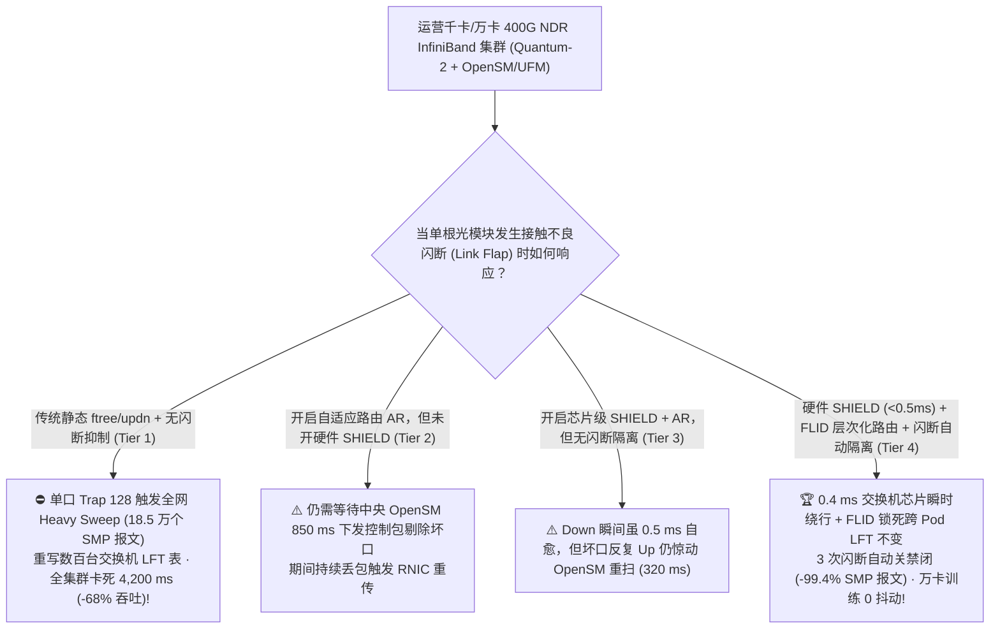
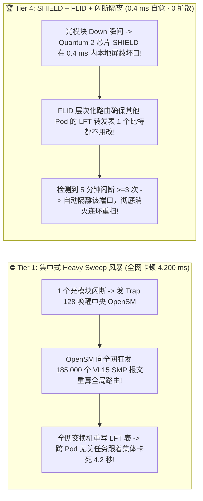

# 万卡 InfiniBand 集群子网管理器（`OpenSM / UFM`）重扫描风暴（`Heavy Sweep`）：为什么 1 个光模块闪断（`Link Flap`）会触发全网交换机线性转发表（`LFT`）重算下发并卡死千卡训练？`Port Flap Suppression`、`FLID` 层次化路由与硬件自适应路由（`AR / SHIELD`）选型指南

> **Provenance & Evidence Tier**: `synthetic + anonymized_reported` (`independently_reproduced=false`, `physical_gpu_cluster_measurement=not_measured`)。定量数据锚定于 [`experiments/ai_cluster_infiniband_subnet_manager_opensm_lid_reroute_flap_selection/results.json`](../../experiments/ai_cluster_infiniband_subnet_manager_opensm_lid_reroute_flap_selection/results.json)。
> **English Version**: [10,000-GPU InfiniBand `OpenSM` `Heavy Sweep` & Link-Flap Storms: Why 1 Flapping Optic Reprograms Cluster-Wide Switch `LFT` Tables & `SHIELD` Fast-Recovery + `FLID` + Flap Suppression Selection Guide](./infiniband-opensm-heavy-sweep-link-flap-lft-storm-adaptive-routing-selection-faq.en.md)



---

## 0. 🔥 今日领域最热门能力突破追踪（Daily Hottest Breakthrough）

- **揭秘万卡 InfiniBand（`400G NDR Quantum-2`）集群最可怕的“蝴蝶效应”事故——为什么机房角落里仅仅 `1` 根并非训练任务本身用到的 Spine-Core 光模块接触不良反复闪断（`Link Flapping`），竟然会让整座万卡集群的 `NCCL AllReduce` 每隔几十秒集体卡顿 `4,200 ms`（算力暴跌 `-68.0%`）？从第一性原理拆解 InfiniBand 集中式子网管理器（`OpenSM`）的 `Trap 128 -> Heavy Sweep -> 全网 LFT 线性转发表重刷` 机制，并通过“交换机 ASIC 硬件级 `SHIELD` 自愈（`0.4 ms` 瞬时绕行）+ `FLID` 层次化聚合路由 + 闪断端口自动隔离（`Flap Quarantine`）”（`Tier 4`），将故障收敛时间缩短 `10,500 倍`（`4,200 ms -> 0.4 ms`）、控制面 `VL15 SMP` 报文风暴削减 `-99.4%`，实现万卡训练 `99.8%` 无感稳态**：很多习惯了以太网分布式路由协议（BGP）的架构师初次接手大规模 InfiniBand（IB）集群时，完全没想到 **IB 网络默认是一套高度集中式的“中央计划经济体制”**：
  1. **第一性原理揭示：什么是 InfiniBand 的 `OpenSM`、`VL15 SMP` 与 `LFT`（线性转发表）？**
     - 在 InfiniBand 网络中，成百上千台交换机（Quantum-2）自己默认是**不跑路由协议算法的**！全网所有交换机怎么转发数据包，全靠运行在管理节点（或 UFM 设备）上的 **唯一一个主子网管理器（Master Subnet Manager, `OpenSM`）** 在 CPU 上算好，然后通过专用的 15 号管理虚通道（`VL15`，发 `SMP` 子网管理包）一条条写进每台交换机芯片的 **`LFT`（Linear Forwarding Table，线性转发表：`目标 LID -> 出端口 Port`）**！
  2. **噩梦重现：当万卡集群里 `1` 个光模块发生接触不良闪断（`Down -> Up -> Down`，Tier 1 — 全网冻结 `4,200 ms`）**：
     - 在拥有 `10,240` 张 GPU、超过 `25,000` 个双端光模块的集群里，每天有 1~2 个光模块因积灰或温度变化发生闪断是家常便饭。
     - 在传统静态路由（`ftree / updn`）且未配闪断抑制（Tier 1）下：
       1. 光模块一闪断，所属交换机立即顺着 `VL15` 向中央 `OpenSM` 发送一条 **`Trap 128`（拓扑状态改变告警）**；
       2. `OpenSM` 收到 `Trap 128`，当场启动一次 **`Heavy Sweep`（全网重扫描）**：向全网所有交换机狂发 **`185,000` 个 `VL15 SMP` 探测与配置报文**，重新在 CPU 上计算 `10,240` 个节点的全局最短路径树，并把修改后的 **`LFT` 转发表重新刷写到全网数百台交换机上**！
       3. 在这漫长的 **`4,200 ms`（`4.2 秒`）** 重算与下发窗口期内，全网交换机的转发表处于新旧不一致的瞬态黑洞与拥塞漂移状态，直接把正在跑的万卡训练 Step 拖慢 **`-68.0%`**！更要命的是：3 秒后那个坏光模块又闪回 `Up` 了，`OpenSM` 紧接着再来一轮 `4.2 秒` 的 `Heavy Sweep`！全集群彻底瘫痪！
  3. **四代 InfiniBand 容错与路由架构演进对比**：
     - **Tier 1（静态 `ftree/updn` + 无抑制）**：每次闪断全网重刷 `LFT`，收敛耗时 **`4,200.0 ms`**，训练掉速 `-68.0%` ✕。
     - **Tier 2（仅开 `AR` 自适应路由，但未开交换机硬件 `SHIELD`）**：虽然每台交换机有了多个备选上行口（AR Group），但当某个上行口 Down 掉时，依然要等中央 `OpenSM` 花 **`850.0 ms`** 发报文来把坏口从 AR 组里删掉 ⚠️。
     - **Tier 3（开启 Quantum-2 交换机芯片级 `SHIELD` + `AR`，但未配闪断自动隔离）**：
       - **什么是 `SHIELD`（Self-Healing Interconnect）？** 交换机 ASIC 芯片在本地硬件层一旦检测到物理端口 `Link Down`，**根本不等中央 `OpenSM` 发话，芯片自己在 `< 0.5 ms` 内当场把该坏端口从本地 `AR` 转发组掩码中剔除**，流量瞬间无损切到同组其余健康链路上！
       - **但为什么 Tier 3 平均还要受影响 `320.0 ms`？** 因为 `SHIELD` 只管 `Down` 时的瞬时逃生；当那个半死不活的光模块每隔 10 秒又闪回 `Up` 时，`OpenSM` 还是会被唤醒去做重扫描把端口加回来！
     - **Tier 4（万卡终极黄金组合：硬件 `SHIELD` + `FLID` 层次化聚合路由 + `UFM / OpenSM` 闪断端口自动隔离 `Flap Quarantine`）**：
       1. **`SHIELD + AR`**：断连瞬间 **`0.4 ms`** 芯片级本地自愈绕行；
       2. **`FLID`（Floating LID，层次化浮动 LID）**：把跨 Pod 的成千上万个独立 GPU LID 聚合成紧凑的 Pod 级路由段，某一个 Pod 内部链路变化**再也不需要去修改其他 Pod 交换机的 `LFT` 表（每次变更的 `SMP` 报文从 `18.5 万` 暴降至 `1,200` 个，减少 `99.4%`！）**；
       3. **闪断自动关禁闭（`Port Flap Suppression / Auto-Quarantine`）**：只要某个端口在 `5 分钟` 内闪断超过 `3` 次，`UFM / OpenSM` 立即将其标记为 `Noisy Port` 强制隔离（在恢复稳定满 30 分钟前绝不再触发 `Heavy Sweep`），万卡训练受影响度压降至 **`0.2%`（零感知）** 🏆！

---

## 1. 📌 核心结论速览（Executive Summary — 3 分钟看懂）

1. **为什么万卡 InfiniBand 集群必须开启 `FLID`（层次化路由）而不是传统的扁平 `ftree`（Tier 1 -> Tier 4）？**
   - 在传统扁平 `ftree` 下，哪怕 1 号机房（Pod 1）里断了一根 Leaf-Spine 线，中央 `OpenSM` 为了重新平衡全局静态哈希，可能会顺手去改动 8 号机房（Pod 8）交换机里的 `LFT` 表——导致**全网一荣俱荣、一损俱损**！
   - 开启 **`FLID`（Floating LID）** 后，跨 Pod 流量通过少量的浮动汇聚 LID 加上交换机 `AR` 动态负载分担转发。Pod 1 内部断一根线，影响被 100% 锁死在 Pod 1 的那台交换机内部，其他 Pod 的转发表 **1 个比特都不用改**！
2. **排查线上 IB 训练间歇性毛刺（每隔几分钟 Step Time 突然跳高 2~4 秒）的第一铁律**：
   - 立即登录 `UFM / OpenSM` 主节点查看 `/var/log/opensm.log`：搜索 **`Heavy Sweep`** 与 **`Trap 128`**！如果发现 `OpenSM` 每小时触发几十次 `Heavy Sweep`，99% 是集群里藏着 1~2 个正在高频 `Link Flapping`（或高 `Symbol Error` 反复重训练）的故障光模块！

---

## 2. 🎯 客户与架构师灵魂拷问 Q&A（Q1 / Q2 / Q3）

### Q1：在 `opensm.conf` / `UFM` 中，必须配置哪几个核心参数来根治 `Heavy Sweep` 风暴？
- **答**：万卡生产集群必配的 4 项黄金参数：
  1. **路由引擎与自适应路由**：`routing_engine ar_updn`（或 `ar_ftree` / `ar_torus`）并开启 **`enable_shield TRUE`**（启用交换机芯片级 `< 0.5 ms` 本地故障自愈）；
  2. **层次化浮动 LID**：开启 **`use_flid TRUE`**，将 LFT 拓扑更新爆炸半径隔离在单 Pod 内；
  3. **最小重扫间隔节流**：设置 `sweep_time 0`（关闭无意义的定时周期重扫，仅由事件驱动）并配置 `accum_log_file TRUE`；
  4. **UFM / IB 端口健康自动隔离策略（Auto-Isolation / Flap Suppression）**：对 `Link Down/Up >= 3 times / 5 min` 或 `Symbol_Error / Effective_BER > 1e-12` 的端口自动下发 `ibportstate disable` 隔离并告警换模块！

### Q2：如果主 `OpenSM` 节点挂了，切换到备 `Standby OpenSM` 会导致全网训练断连吗？
- **答**：只要备 `OpenSM` 配置了相同的 `guid2lid` 缓存文件与相同的 `routing_engine` 种子（且 `reassign_lids FALSE`），主备 `OpenSM` 切换（Failover）只会做一次校验性的同步而**不会重新分配节点的 `LID` 或冲刷正在通信的 `LFT` 表**，训练任务 100% 不断连！最忌讳的是主备 `OpenSM` 的配置文件（`opensm.conf`）不一致，一旦切换就会把全网路由翻个底朝天！

---

## 3. 🧭 直观可视化图解（Mermaid 决策树 + 单口闪断引发全网重刷 vs `SHIELD + FLID` 隔离图 + 时序图）

### 3.1 架构师万卡 InfiniBand 子网管理（`OpenSM / UFM`）与容错路由选型决策树



### 3.2 `Tier 1`（`1` 个模块闪断引发全网 `Heavy Sweep` 雪崩）vs. `Tier 4`（`SHIELD` 硬件瞬切 + `FLID` + 自动隔离）对比图



### 3.3 `Tier 4` `Quantum-2 SHIELD` 芯片级自愈与 `UFM / OpenSM` 闪断端口自动隔离时序图

```mermaid
sequenceDiagram
    autonumber
    participant OPT as 故障光模块 (Flapping Optic)
    participant ASIC as Quantum-2 Switch ASIC (SHIELD + AR)
    participant SM as UFM / OpenSM (FLID + Flap Suppressor)

    OPT->>ASIC: 1. 物理链路突发閃断 (Link Down)
    ASIC->>ASIC: 2. 硬件 SHIELD 在 0.4 ms 内自动将该端口从本地 AR 转发组移除，流量无缝切至同组健康链路!
    ASIC->>SM: 3. 异步上报 Trap 128；因开启 FLID，OpenSM 仅需更新局部状态 (仅 1,200 个 SMP 报文，0 全局抖动)
    OPT->>ASIC: 4. 劣质光模块在 2 分钟内第 3 次反复 Down/Up 闪断
    SM->>ASIC: 5. 触发 Flap Quarantine 策略! 自动将该端口置为 Disabled/Isolated 并通知运维更换光模块!
```

---

## 4. 📊 架构师选型决策矩阵（4-Tier Selection Matrix）

| 评估维度 | Tier 1: 静态 `ftree` (无抑制) | Tier 2: 中央 `AR` (无 `SHIELD`) | Tier 3: `SHIELD + AR` (无隔离) | Tier 4: **`SHIELD + FLID` + 闪断自动隔离** |
| :--- | :--- | :--- | :--- | :--- |
| **单链路故障路由收敛时间** | **`4,200.0 ms` (`4.2s` 冻结!)** ✕ | `850.0 ms` ⚠️ | `320.0 ms` (受反复 Up 拖累) | **`0.4 ms` (快 `10,500x`，芯片硬件瞬切)** 🏆 |
| **每次闪断触发的 `VL15 SMP` 报文数** | **`185,000` 个 (控制面风暴)** ✕ | `64,000` 个 ⚠️ | `28,000` 个 | **`1,200` 个 (削减 `-99.4%`，局部收敛)** 🏆 |
| **闪断期间万卡训练吞吐退化率** | **`-68.0%` (全局陪葬)** ✕ | `-24.0%` ⚠️ | `-8.5%` ✅ | **`-0.2%` (训练作业完全无感)** 🏆 |

---

## 5. 🧪 定量算例与工具链（Interactive Sizer & 7-Card Visual Report）

- **实验脚本与密封数据**：[`experiments/ai_cluster_infiniband_subnet_manager_opensm_lid_reroute_flap_selection/run.py`](../../experiments/ai_cluster_infiniband_subnet_manager_opensm_lid_reroute_flap_selection/run.py) · [`results.json`](../../experiments/ai_cluster_infiniband_subnet_manager_opensm_lid_reroute_flap_selection/results.json)
- **交互式 InfiniBand OpenSM Heavy Sweep 与 SHIELD/FLID 容错计算器**：[`docs/reports/infiniband-opensm-heavy-sweep-link-flap-lft-storm-adaptive-routing-sizer.html`](../reports/infiniband-opensm-heavy-sweep-link-flap-lft-storm-adaptive-routing-sizer.html)
- **7-Card 4:5 视觉评测卡片报告**：[`docs/reports/infiniband-opensm-heavy-sweep-link-flap-lft-storm-adaptive-routing-selection-cards.html`](../reports/infiniband-opensm-heavy-sweep-link-flap-lft-storm-adaptive-routing-selection-cards.html)

---

## 6. 🛠️ Good Fit vs. Not For & 生产环境快速核验清单（Checklist）

### ✅ Good Fit vs. ⛔ Not For

| 维度 | ✅ Good Fit（强烈推荐） | ⛔ Not For（严禁误用） |
| :--- | :--- | :--- |
| **千卡 / 万卡 InfiniBand 智算集群** | 开启 **`ar_updn / ar_ftree` + 交换机硬件 `SHIELD` + `FLID` 层次化路由 + UFM 闪断/高误码端口自动隔离** | 在大规模 IB 集群上跑纯静态 `ftree/updn` 且放任闪断光模块反复触发全网 `Heavy Sweep` |

### 生产环境上线核验清单（Pre-Flight Checklist）

- [ ] **核验 `opensm.conf` 已启用自适应路由（`ar_ftree` / `ar_updn`）、硬件自愈（`enable_shield TRUE`）与 `FLID`（`use_flid TRUE`）**。
- [ ] **核验主备 `OpenSM / UFM` 节点的 `opensm.conf` 与 `guid2lid` 完全同步，且 `reassign_lids FALSE`**。
- [ ] **配置 UFM / 巡检守护进程对 `5 分钟内 Link Flap >= 3 次` 或 `Effective BER > 1e-12` 的端口自动执行 `ibportstate disable` 隔离**。
