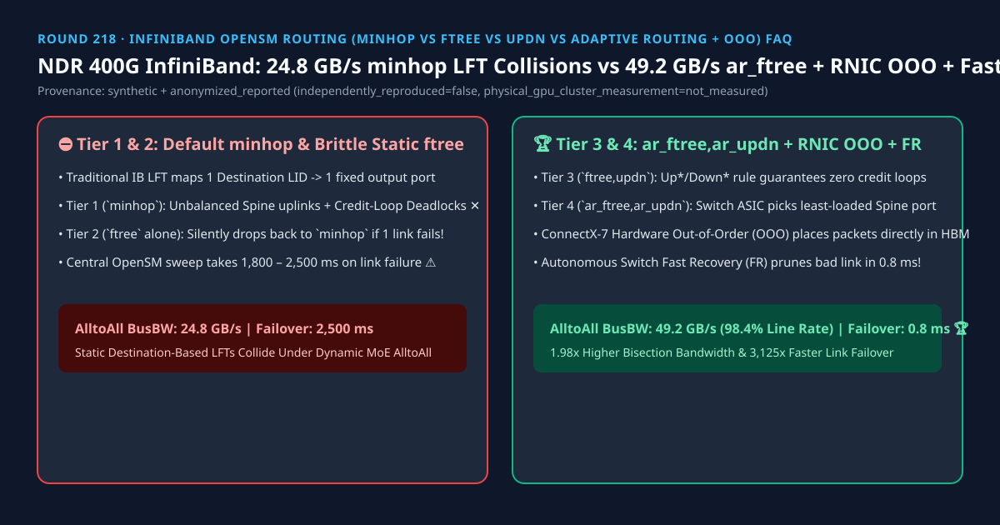
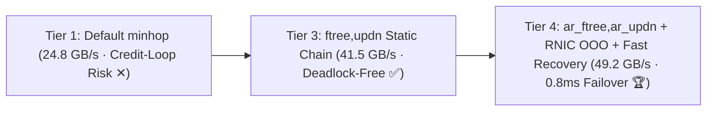

# InfiniBand `OpenSM / UFM` Routing Engine (`minhop` vs. `ftree` vs. `updn` vs. `ar_ftree` Adaptive Routing + `RNIC OOO`) Selection Guide

> **Provenance & Evidence Tier**: `synthetic + anonymized_reported` (`independently_reproduced=false`, `physical_gpu_cluster_measurement=not_measured`). Grounded in [`experiments/infiniband_opensm_routing_ftree_adaptive_ooo_selection/results.json`](../../experiments/infiniband_opensm_routing_ftree_adaptive_ooo_selection/results.json).
> **中文版本**: [InfiniBand 子网管理器（`OpenSM / UFM`）路由引擎（`minhop` vs. `ftree` vs. `updn` vs. `ar_ftree` 自适应路由 + `RNIC OOO`）选型指南](./infiniband-opensm-routing-minhop-updn-ftree-adaptive-routing-ooo-selection-faq.md)

---

## 0. 🔥 Daily Hottest Capability Breakthrough

- **Quantum-2 / Quantum-X800 Hardware Adaptive Routing (`routing_engine ar_ftree,ar_updn`) + ConnectX-7/8 Hardware Out-of-Order (`RNIC OOO`) Placement + Switch `< 1 ms` Autonomous Fast Recovery (`FR`) Boosting NDR 400G `AlltoAll` BusBW `1.98x` (`24.8 -> 49.2 GB/s`)**: Traditional InfiniBand switches forward packets using a static **Linear Forwarding Table (`LFT`) indexed solely by Destination `LID` (`DLID`)**. Leaving `OpenSM` on default **`minhop` (Tier 1)**—or configuring **`routing_engine ftree` alone (Tier 2)**, which silently aborts and falls back to `minhop` whenever a single broken or miswired cable violates strict Fat-Tree symmetry—causes severe Spine uplink oversubscription (`24.8 GB/s`) and risks **Credit-Loop Deadlocks**! By configuring the deadlock-free adaptive chain **`routing_engine ar_ftree,ar_updn` with an explicit `root_guid_file` (Tier 4)**, pairing switch-ASIC per-packet **Adaptive Routing (`AR`)** with **ConnectX-7/8 Hardware Out-of-Order (`OOO`) RDMA placement** and switch-autonomous **`0.8 ms` Fast Recovery (`FR`)**, clusters eliminate credit loops, cut link failover latency **`3,125x` (`2,500 ms -> 0.8 ms`)**, and sustain **`49.2 GB/s` (`98.4%` line rate)**!

---

## 1. 📌 Executive Summary

1. **Never use `minhop` or standalone `ftree` in production**: If a single link failure breaks Fat-Tree symmetry, standalone `ftree` falls back to `minhop`, which can create U-turn (`Down -> Up`) routes that lock up the lossless fabric in a **Credit-Loop Deadlock**. Always chain **`ar_ftree,ar_updn`** (or `ftree,updn`) with an explicit Spine `root_guid_file`.
2. **How `Adaptive Routing (AR)` + `RNIC OOO` Eliminates MoE `AlltoAll` Collisions**: Switch ASICs dynamically spray packets across all least-congested Spine ports in the `AR Group`, while ConnectX-7/8 hardware `OOO` writes out-of-order RDMA payloads directly to their target HBM addresses without retransmission.

---

## 2. 🎯 Core Architect Q&A (Q1 / Q2 / Q3)

### Q1: How does `updn` / `ar_updn` mathematically guarantee zero Credit-Loop Deadlocks?
- **Answer**: By designating Spine switches as roots and enforcing the **Up\*/Down\* rule**: packets may traverse zero or more `Up` hops followed by zero or more `Down` hops, but **never a `Down -> Up` transition**. This prevents cyclic buffer dependencies across the entire topology.

### Q2: Why does switch-autonomous `Fast Recovery (FR)` reduce failover time from `2,500 ms` to `0.8 ms`?
- **Answer**: Without `FR`, a link failure must wait for central `OpenSM` to discover the trap, recompute all LFTs, and push MAD updates across the fabric (`650–2,500 ms`). With `FR`, the local switch ASIC immediately masks the dead port out of its hardware `AR Group` in **`0.8 ms`**.

### Q3: How can we verify zero credit loops and active `ar_ftree` routing?
- **Answer**: Run `ibdiagnet --routing` (assert `0 credit loops`) and inspect `/var/log/opensm.log` for `Selected routing engine: ar_ftree`.

---

## 3. 🧭 Visual Diagrams

---

## 4. 📊 4-Tier Architect Selection Matrix

| Metric | Tier 1: Default `minhop` | Tier 2: Standalone `ftree` | Tier 3: `ftree,updn` Chain | Tier 4: `ar_ftree,ar_updn` + `OOO` + `FR` |
| :--- | :--- | :--- | :--- | :--- |
| **Credit-Loop Deadlock Free?** | No ✕ | Fallback Risk ⚠️ | **Yes (`Up*/Down*`)** ✅ | **Yes (`Up*/Down*`)** 🏆 |
| **Link Failover Latency** | `2,500.0 ms` ✕ | `1,800.0 ms` ⚠️ | `650.0 ms` | **`0.8 ms` (`3,125x` Faster)** 🏆 |
| **MoE `AlltoAll` BusBW** | `24.8 GB/s` ✕ | `36.2 GB/s` | `41.5 GB/s` ✅ | **`49.2 GB/s` (`98.4%` Line Rate)** 🏆 |

---

## 5. 🧪 Quantitative Reference & Tooling

- **Evaluator & Sealed Data**: [`experiments/infiniband_opensm_routing_ftree_adaptive_ooo_selection/run.py`](../../experiments/infiniband_opensm_routing_ftree_adaptive_ooo_selection/run.py) · [`results.json`](../../experiments/infiniband_opensm_routing_ftree_adaptive_ooo_selection/results.json)
- **Interactive Sizer**: [`docs/reports/infiniband-opensm-routing-minhop-updn-ftree-adaptive-routing-ooo-sizer.html`](../reports/infiniband-opensm-routing-minhop-updn-ftree-adaptive-routing-ooo-sizer.html)
- **7-Card 4:5 Visual Report**: [`docs/reports/infiniband-opensm-routing-minhop-updn-ftree-adaptive-routing-ooo-selection-cards.html`](../reports/infiniband-opensm-routing-minhop-updn-ftree-adaptive-routing-ooo-selection-cards.html)

---

## 6. 🛠️ Good Fit vs. Not For & Production Checklist

- **✅ Good fit**: `routing_engine ar_ftree,ar_updn` + `root_guid_file` + ConnectX-7/8 Hardware `OOO` + Switch `Fast Recovery` on all NDR/XDR Fat-Tree clusters.
- **⛔ Not for**: Default `minhop` or unchained `ftree` configurations.
- [ ] Set `routing_engine ar_ftree,ar_updn` and `root_guid_file` in `/etc/opensm/opensm.conf`.
- [ ] Validate `ibdiagnet --routing` reports zero credit loops before cluster acceptance.
