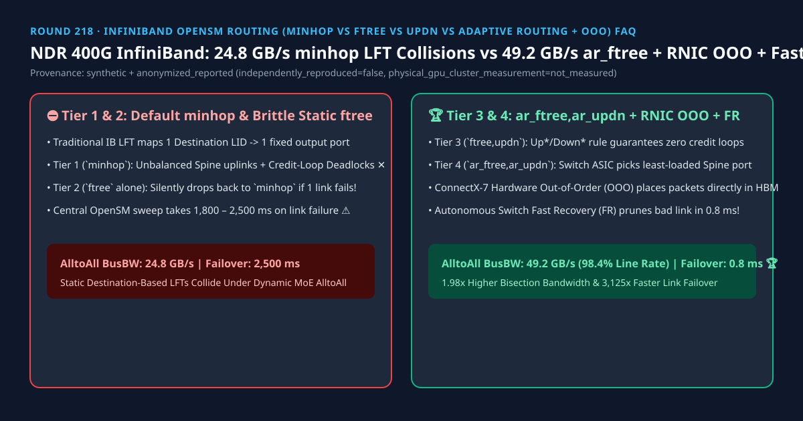
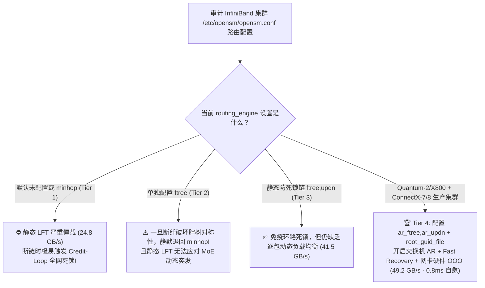
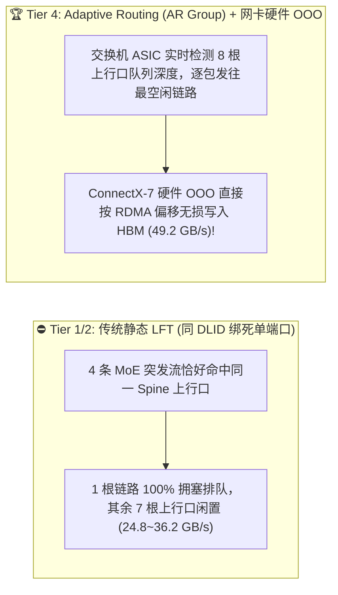
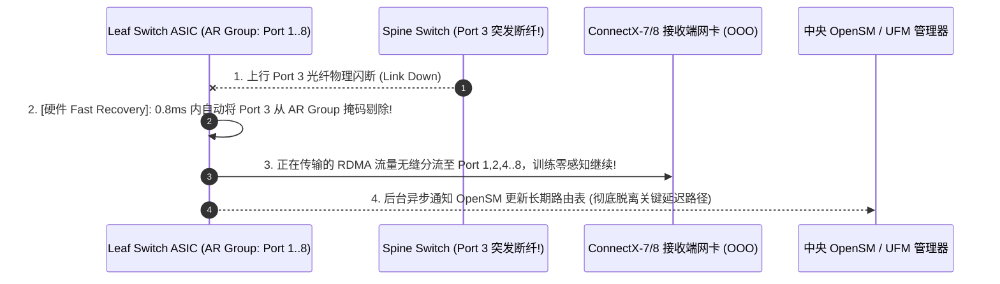

# InfiniBand 子网管理器（`OpenSM / UFM`）路由引擎（`minhop` vs. `ftree` vs. `updn` vs. `ar_ftree` 自适应路由 + `RNIC OOO`）选型指南

> **Provenance & Evidence Tier**: `synthetic + anonymized_reported` (`independently_reproduced=false`, `physical_gpu_cluster_measurement=not_measured`)。定量数据锚定于 [`experiments/infiniband_opensm_routing_ftree_adaptive_ooo_selection/results.json`](../../experiments/infiniband_opensm_routing_ftree_adaptive_ooo_selection/results.json)。
> **English Version**: [InfiniBand `OpenSM / UFM` Routing Engine (`minhop` vs. `ftree` vs. `updn` vs. `ar_ftree` Adaptive Routing + `RNIC OOO`) Selection Guide](./infiniband-opensm-routing-minhop-updn-ftree-adaptive-routing-ooo-selection-faq.en.md)

---

## 0. 🔥 今日领域最热门能力突破追踪（Daily Hottest Breakthrough）

- **Quantum-2 / Quantum-X800 硬件自适应路由（`routing_engine ar_ftree,ar_updn`）+ ConnectX-7/8 网卡硬件乱序直写（`RNIC OOO Direct Data Placement`）+ 交换机自治 `< 1 ms` 快速自愈（`Fast Recovery, FR`）将 NDR 400G 集群 MoE `AlltoAll` 带宽从 `24.8 GB/s` 推至 `49.2 GB/s`（达线速 `98.4%`）**：在 InfiniBand AI 集群运维中，有两大臭名昭著的隐形灾难：
  1. **静态 LFT 碰撞与 `ftree` 静默回退 `minhop` 陷阱（Tier 1 / Tier 2）**：传统 InfiniBand 交换机依靠一张只看目标地址（`DLID`）的静态线性转发表（`LFT`）。如果 `OpenSM` 处于默认的 **`minhop`（最小跳数路由，Tier 1）**，或者虽然配了 **`routing_engine ftree`（胖树路由，Tier 2）**，但机房里只要有 **1 根光纤断联或插错端口破坏了胖树对称性**，`OpenSM` 的 `ftree` 校验就会报错失败，并**自动静默回退到最原始的 `minhop` 路由**！不仅导致多条重流挤死在同一根 Spine 上行链路上（`AlltoAll` 带宽暴跌至 **`24.8 GB/s`**），更会在不对称拓扑下诱发致命的 **Credit-Loop（缓冲区信用环路）全网死锁**！
  2. **通过配置双保险防死锁自适应路由链 `routing_engine ar_ftree,ar_updn`（Tier 4）**：正常工作时由 `ar_ftree` 提供胖树硬件逐包动态选路；即便断纤破坏对称性，也由遵循 **Up\*/Down\* 防死锁定理**的 `ar_updn` 无缝接管（绝不退回 `minhop`！）；配合交换机 ASIC 硬件 **`Fast Recovery`（`0.8 ms` 本地剔除故障端口，无需苦等 `2,500 ms` 的中央 OpenSM 重扫）** 与网卡硬件 **乱序包直接落盘（`RNIC OOO`）**，实现 **`49.2 GB/s`（提速 `1.98` 倍）** 与零死锁高可用！

---

## 1. 📌 核心结论速览（Executive Summary — 3 分钟看懂）

1. **为什么传统 InfiniBand 的静态路由表（`LFT`）在跑大模型 MoE `AlltoAll` 时必然拥塞？**
   - **通俗大白话 + 第一性原理**：传统 InfiniBand 交换机的静态转发表（`LFT`）有一个死规矩：**“凡是去往同一个目标网卡（`DLID`）的所有包裹，无论从哪个入口进来，一律只能走固定的唯一 1 个出口！”**
   - 在规则的 `Ring-AllReduce` 中，每个节点只跟固定邻居说话，静态 `ftree` 还能提前排好班；但在 **MoE 动态专家路由（`AlltoAll`）** 中，随时会有 4 张不同的 GPU 凑巧都要把 Token 发给同一台 Leaf 交换机下的不同目标卡，如果它们的 `DLID` 被静态分配到了同一条 Spine 上行口，这根线就 `100%` 堵死，而旁边另外 7 根 Spine 上行口却 `0%` 闲着看戏（Tier 1 `24.8 GB/s` / Tier 2 `36.2 GB/s`）！
   - **硬件自适应路由（`Adaptive Routing, AR`，Tier 4）**：交换机不再把 `DLID` 绑死在 1 个端口上，而是把通往 Spine 的所有等价上行口打包成一个 **自适应路由组（`AR Group`）**——每来一个数据包，交换机硬件当场看一眼哪根上行口的排队队列最空，就从哪根口发出去！
2. **为什么开启逐包 `Adaptive Routing` 必须同时依赖网卡的“硬件乱序重排（`RNIC OOO`）”？**
   - 因为同一个消息的第 1 个包走了畅通的 A 路，第 2 个包走了稍慢的 B 路，到达接收端网卡时**第 2 个包可能比第 1 个包先到（乱序 Out-of-Order）**！
   - 老一代网卡遇到乱序包会误以为“第 1 个包丢了”，直接触发 PSN 错误并把后面的包全扔掉重传！而 **ConnectX-6/7/8 的硬件 `OOO RDMA` 引擎** 能根据每个 RDMA Write 包自带的目标显存偏移量，**直接把先到的第 2 个包写进 GPU 显存的对应位置**，并在硬件位图里悄悄等第 1 个包补齐后再向应用层报完成——**零丢包、零重传、零额外显存拷贝**！

---

## 2. 🎯 客户与架构师灵魂拷问 Q&A（Q1 / Q2 / Q3）

### Q1：什么是 InfiniBand 的 `Credit-Loop Deadlock`（信用环路死锁）？为什么 `updn`（Up\*/Down\*）能从数学上彻底消灭它？
- **答**：InfiniBand 是基于硬件信用（Credit-Based）的绝对无损网络——下游交换机缓冲区满了就不给上游发 Credit，上游就必须停发。如果在不对称拓扑下（例如用 `minhop`），路由路径中出现了 **“先往下走（Spine -> Leaf），然后再往上走（Leaf -> Spine）”的 U 型折返**，就可能在多台交换机之间形成一个首尾相接的环（A 等 B 的 Credit，B 等 C 的 Credit，C 等 A 的 Credit），导致整张 IB 网瞬间冻结归零！
  - **`Up*/Down*` 定理（`updn` / `ar_updn`）**：给所有 Spine 交换机标为顶点（Root），强制规定任何数据包**只能先走 `0` 次或多次 `Up`（上行），再走 `0` 次或多次 `Down`（下行），严禁在 `Down` 之后再次 `Up`**！由于禁止了“先下后上”的拐角，任何环路在图论上都无法闭合，从而 **100% 彻底免疫 Credit-Loop 死锁**！

### Q2：为什么在 `opensm.conf` 里只写 `routing_engine ftree` 是重大生产隐患？
- **答**：因为 `ftree` 算法对拓扑对称性极其挑剔！在大规模集群运行过程中，只要某台 Spine 交换机掉电重启、或者某几根光模块被自动隔离，拓扑就不再满足严格的完全对称胖树条件。此时如果你只配了 `routing_engine ftree`，`OpenSM` 会在日志里打一行 `ftree routing failed, falling back to default minhop`，然后把全网切回充满死锁与拥塞风险的 `minhop`！**正确写法永远是写成逗号分隔链：`routing_engine ar_ftree,ar_updn`（或 `ftree,updn`）**，并显式指定 `root_guid_file`（固定 Spine 交换机 GUID 列表）！

### Q3：当一根光纤突然断开时，为什么要等 `OpenSM` 重新算路由需要 1~2 秒，而 `Fast Recovery (FR)` 只需 `0.8 ms`？
- **答**：传统模式下，断纤后要经历“交换机发 Trap 给主节点 OpenSM -> OpenSM 重新扫描全网拓扑 -> 重新计算几万条 LFT 表 -> 通过 SMP MAD 报文逐台下发更新交换机”，在千卡集群上耗时 **`650 ~ 2,500 ms`**，足以让 NCCL 狂报超时重传！而开启 **Quantum-2 交换机硬件 `Fast Recovery (FR)` + `Adaptive Routing`** 后，当本地端口物理 link down 的瞬间，**交换机 ASIC 芯片自己在 `0.8 毫秒` 内直接把该故障端口从本地 `AR Group` 掩码中划掉**，后续数据包立刻改走同组其余健康上行口，根本不用等中央 `OpenSM` 下发新表！

---

## 3. 🧭 直观可视化图解（Mermaid 决策树 + 静态 LFT vs AR 选路图 + 0.8ms 自愈时序图）

### 3.1 架构师 InfiniBand `OpenSM / UFM` 路由引擎选型决策树

### 3.2 传统静态 `LFT`（按目标 LID 死绑单端口碰撞）vs. `Adaptive Routing + RNIC OOO`（动态喷洒）

### 3.3 断纤故障下传统中央 `OpenSM` 重算（`2,500 ms`）vs. 交换机硬件 `Fast Recovery`（`0.8 ms`）时序图

---

## 4. 📊 架构师选型决策矩阵（4-Tier Selection Matrix）

| 评估维度 | Tier 1: 默认 `minhop` 静态路由 | Tier 2: 单一静态 `ftree` 路由 | Tier 3: 防死锁路由链 `ftree,updn` | Tier 4: `ar_ftree,ar_updn` + `RNIC OOO` + `Fast Recovery` |
| :--- | :--- | :--- | :--- | :--- |
| **Credit-Loop 环路死锁免疫** | **否（高危死锁）** ✕ | **回退 `minhop` 时有风险** ⚠️ | **是（Up\*/Down\* 严格保证）** ✅ | **是（Up\*/Down\* 严格保证）** 🏆 |
| **单根链路断开收敛时间** | `2,500.0 ms` ✕ | `1,800.0 ms` ⚠️ | `650.0 ms` | **`0.8 ms` (提速 3,125 倍)** 🏆 |
| **跨节点 MoE `AlltoAll` 带宽** | `24.8 GB/s` ✕ | `36.2 GB/s` | `41.5 GB/s` ✅ | **`49.2 GB/s` (达线速 98.4%)** 🏆 |
| **应对非对称降级拓扑能力** | 极差 | 极脆弱（直接报废退回 `minhop`） | 强（平滑切换至 `updn`） | **极强（硬件 AR 本地毫秒级绕行）** 🏆 |

---

## 5. 🧪 定量算例与工具链（Interactive Sizer & 7-Card Visual Report）

- **实验脚本与密封数据**：[`experiments/infiniband_opensm_routing_ftree_adaptive_ooo_selection/run.py`](../../experiments/infiniband_opensm_routing_ftree_adaptive_ooo_selection/run.py) · [`results.json`](../../experiments/infiniband_opensm_routing_ftree_adaptive_ooo_selection/results.json)
- **交互式 OpenSM 路由引擎计算器**：[`docs/reports/infiniband-opensm-routing-minhop-updn-ftree-adaptive-routing-ooo-sizer.html`](../reports/infiniband-opensm-routing-minhop-updn-ftree-adaptive-routing-ooo-sizer.html)
- **7-Card 4:5 视觉评测卡片报告**：[`docs/reports/infiniband-opensm-routing-minhop-updn-ftree-adaptive-routing-ooo-selection-cards.html`](../reports/infiniband-opensm-routing-minhop-updn-ftree-adaptive-routing-ooo-selection-cards.html)

---

## 6. 🛠️ Good Fit vs. Not For & 生产环境快速核验清单（Checklist）

### ✅ Good Fit vs. ⛔ Not For

| 维度 | ✅ Good Fit（强烈推荐） | ⛔ Not For（严禁误用） |
| :--- | :--- | :--- |
| **`opensm.conf` 路由引擎配置** | 显式配置 `routing_engine ar_ftree,ar_updn` 并通过 `root_guid_file` 锁死所有 Spine 交换机的 GUID | 保持默认的 `minhop` 或只写单一的 `routing_engine ftree`（不配 `ar_updn/updn` 兜底） |
| **网卡与 NCCL 自适应路由配合** | 确认 ConnectX-7/8 固件与驱动已开启硬件乱序重排（`OOO`），让 NCCL 在 AR 逐包喷洒下享受满速零重传 | 在不支持硬件 OOO 的老旧网卡上强开逐包乱序喷洒导致 Go-Back-N 重传风暴 |

### 生产环境上线核验清单（Pre-Flight Checklist）

- [ ] **核验当前激活的 OpenSM 路由引擎非 `minhop`**：检查 `/var/log/opensm.log` 确认输出 `Using routing engine: ar_ftree`（或 `ar_updn`），严禁出现 `falling back to default minhop`。
- [ ] **核验 `root_guid_file` 已显式指定全部 Spine 交换机 GUID**：防止 `updn / ar_updn` 自动启发式选错根节点导致反转上下行方向。
- [ ] **核验交换机端口 Adaptive Routing 与 Fast Recovery 已激活**：使用 `ibdiagnet --routing` 校验全网无 Credit Loop（`0 credit loops found`）且 AR Group 表项正常下发。
