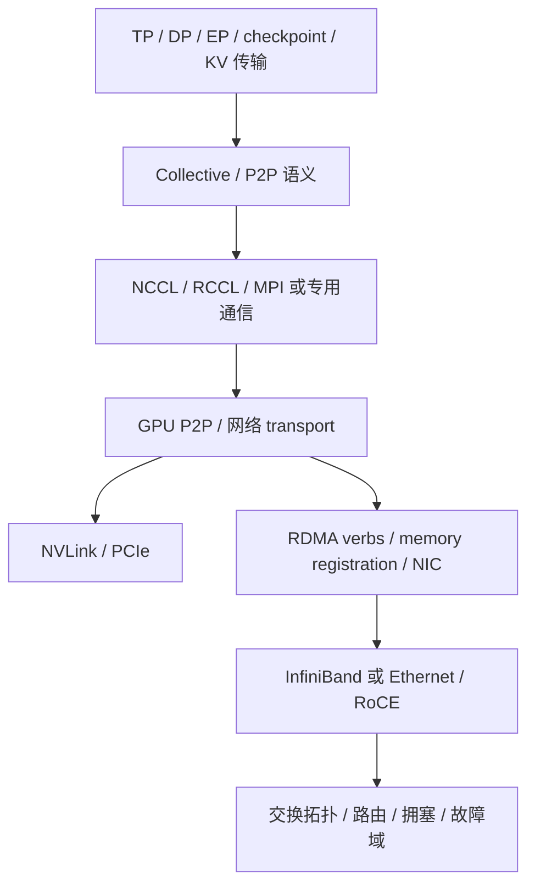

# 互连、网络与通信库：先分层，再讨论性能

状态：公开文档、固定源码/手册的静态阅读；无网络/GPU 执行。证据：`nccl-collective-contract`、`nccl-ring-path`、`rdma-registration-contract`。完整 NIC provider、NCCL transport 和拥塞控制实现尚未读完。

## 1. 一张分层图

这是研究路径，不保证每个框架使用相同库或传输。NCCL 的已读概述列出 PCIe、NVLink、InfiniBand verbs 与 IP sockets；应用“用了 NCCL”并不证明它走 RDMA。

| 名称 | 所在层 | 要核验什么 |
|---|---|---|
| NVLink | 互连 | 代际、方向、链路/设备聚合、可达性、访问/一致性契约 |
| NVSwitch | 交换实现 | 端口/拓扑、交换带宽、可用 collective/offload、故障域 |
| InfiniBand | 网络技术/协议体系 | 链路/交换、路由、传输、管理及端到端配置 |
| Ethernet + RoCE | Ethernet 上的 RDMA 路径 | 具体 RoCE 版本、NIC/交换配置、拥塞和端到端语义 |
| RDMA | 远程内存访问能力/语义 | 注册、权限、地址/key、队列、完成与同步 |
| NCCL/RCCL | GPU 通信库 | collective/P2P、算法/协议、拓扑、transport 和回退 |

Scale-up/scale-out 是系统通信域与访问/扩展问题，不是固定机箱边界。Hopper 历史结构文章描述跨节点 NVLink 系统，这是不能机械等同于“NVLink 只在机内”的例子；不代表其当时全部功能已交付。

## 2. 从并行方式确定通信需求

TP 在算子分割处频繁协调；DP 同步梯度/分片状态；PP 传激活并受流水 bubble 影响；EP/MoE 有专家 dispatch/combine、负载不均和 all-to-all 压力。通信大小、频率、参与者与同步位置不同，不能只比较一项峰值带宽。

先画 rank/layout 与模型状态，再映射物理互连域；TP/EP 是否应限制在某个高带宽域，需要 workload 和具体拓扑验证。

## 3. 已读 collective 契约

NCCL 官方 collective 页面要求每个 rank 使用匹配的 count/datatype；不匹配可能导致 hang/crash/corruption，不是“性能稍差”。

- AllReduce：每 rank 得到跨 ranks 的归约结果。
- AllGather：每 rank 收到按 rank 排列的全部块；rank mapping 会影响布局。
- ReduceScatter：归约后按 rank 分块。
- ReduceScatter + AllGather 可表达 AllReduce 的语义，但不保证是每次 runtime 的算法选择。

应用正确性要先于性能：参与者、count、datatype、rank/layout、stream 和生命周期不一致时先排错，不应继续调带宽参数。

## 4. 固定 Ring 实现：读取范围与推导

固定 [NCCL commit](https://github.com/NVIDIA/nccl/commit/3e46c089f4ae4732722a419eb6096aead7e47a30) 的 [src/device/all_reduce.h](https://github.com/NVIDIA/nccl/blob/3e46c089f4ae4732722a419eb6096aead7e47a30/src/device/all_reduce.h)，读取文件开头约 180 行：`runRing`、`runTreeUpDown` 和 `runTreeSplit` 开始部分。

`runRing` 从 channel/ring 取 rank 与相邻关系，按 channel/chunk 划分数据；先 send，再逐步 recv/reduce/send，在归约完成时写本地结果并转发，随后传播完整归约块。与 “reduce-scatter + all-gather” 的 Ring 数据流一致。

`runTreeUpDown` 则把归约向上和广播向下分为不同 fan-in/fan-out 路径。这说明同一 AllReduce 文件存在多种实现，而不是“所有 AllReduce 永远用 Ring”。

理想均匀大块 Ring，p ranks、每 rank 输入 S bytes：

`sent_bytes_per_rank = 2 × (p-1)/p × S`

近似时间模型：

`T ≈ 2(p-1)α + [2(p-1)/p × S]/B`

其中 α 是单 step 的有效延迟，B 是模型匹配的单方向有效带宽。不是双向聚合、不是整个 fabric 总吞吐。此式忽略 protocol/chunk padding、channel 并行、拓扑共享、归约计算、拥塞与其他开销；不是源代码 trace 测量，也不是 runtime 算法选型模型。

源码读到 primitives 调用不代表已经读过其 NIC 传输。后续必须追踪 algorithm/protocol selection、primitives、connection 与 transport；不能从 `directSend` 名称推断 GPUDirect RDMA 生效。

## 5. RDMA 的第一道契约：内存注册

固定 [rdma-core commit](https://github.com/linux-rdma/rdma-core/commit/bd3282a1cf1025c7869a8664c2d54266a4dded44) 的 [ibv_reg_mr 手册](https://github.com/linux-rdma/rdma-core/blob/bd3282a1cf1025c7869a8664c2d54266a4dded44/libibverbs/man/ibv_reg_mr.3)，已读整份手册，不是 provider 实现。

MR 关联 protection domain、地址、长度和 access flags。lkey/rkey 分别参与本地缓冲描述与远端操作授权/定位；能远端写不表示拥有任意进程内存访问权。

已读契约的架构影响：

- Remote write/atomic 所需权限与 local write 有组合约束，注册失败必须显式检查。
- Relaxed ordering 改变网络写到达的顺序保证，但不能凭这个选项取消 completion/数据可见性契约。
- 注销 MR 不能早于仍使用它的操作/绑定；错误生命周期可能造成正确性问题。
- dma-buf 注册接口存在，不表示任何 GPU/driver/NIC 都已支持相同路径；兼容、同步和 provider 行为另核验。

QP/CQ 创建、发送/接收/完成、内存 pin/ODP、连接管理和 GPU 同步仍是下一题。此处不能声称完成“RDMA 全流程实现”。

## 6. 架构选型不做无条件排行榜

| 需求 | 先找证据 | 不能直接下结论 |
|---|---|---|
| 低延迟多 GPU TP | 小消息延迟、同步频率、通信域、实际 P2P/transport | NVLink 峰值大就一定更低的端到端 TPOT |
| 大规模 DP | 大块 collective、拓扑、超售、有效带宽、checkpoint | 标称 NIC 速率就是 AllReduce throughput |
| MoE | All-to-all、负载不均、拥塞、专家布局、dispatch/combine | 只看 average utilization 就能扩展 |
| 多租户 RoCE | NIC/交换配置、拥塞、隔离、公平性、尾延迟 | 任何场景必须无损或一种 PFC 配置万能 |
| 网络内归约 | 数据类型/精度、实现支持、算法/拓扑、失败回退 | 宣称 payload 减半就等于训练快两倍 |

故障诊断要区分：软件 fallback、rank/collective 不匹配、NIC/NUMA/拓扑问题、拥塞与负载不均。没有日志/计时/运行环境时不能称已定位生产根因。

## 下一步

[UEC 1.1](../trends/uec-1-1.md) 让开放 scale-up 与 in-network collective 成为重点跟踪对象，但当前只核验发布正文。Queue 优先继续 RDMA 生命周期与 NCCL transport，用固定代码把控制路径、数据路径和同步完整连起来。

自测见 [练习 3、6、7](../learning/exercises.md)。

同日续接已完成 [RDMA 接口生命周期研究](rdma-lifecycle.md)，新增 PD/CQ/QP/post/poll 的固定手册证据；QP state/连接、provider 与 GPU 同步仍不在完成范围。
