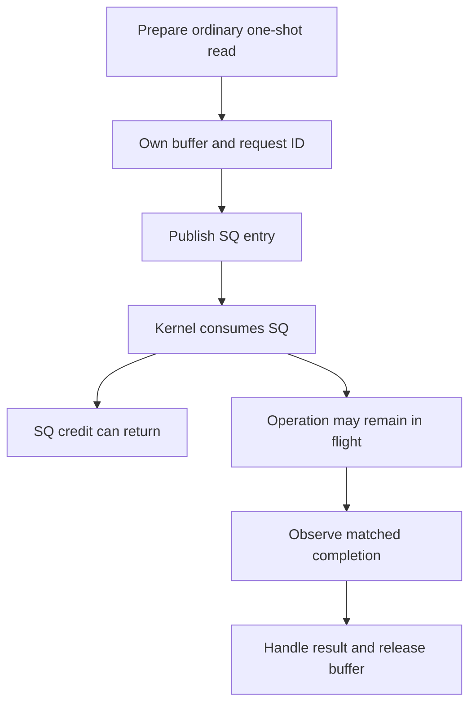
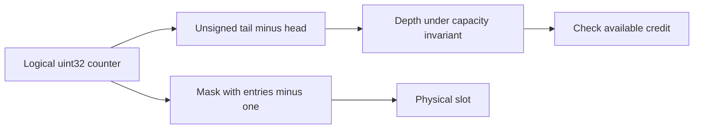
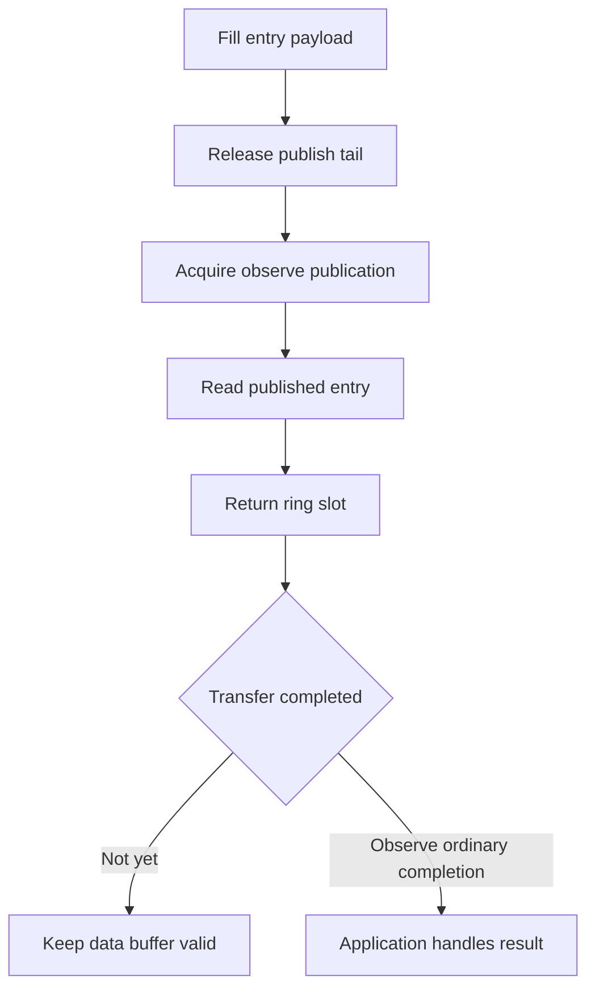

# AI Infra async-I/O FAQ: io_uring ring credits, counter wraparound and buffer lifetime

> **Language**: English | [中文](io-uring-ring-credits-wraparound-buffer-lifetime-selection-faq.md)  
> **Round 140 · 2026-11-14 daytime**: ordinary one-shot read contracts in training-data/weight storage paths—not a Linux benchmark.  
> **Related**: [Multipart completion boundaries](checkpoint-multipart-completion-etag-integrity-selection-faq.en.md) · [DLPack ownership](dlpack-versioned-capsule-strides-stream-lifetime-selection-faq.en.md)

**Executive finding:** **SQ credit, operation completion and buffer reuse are different states**. Kernel consumption can return submission credit while ordinary READ/WRITE transfer buffers must remain valid until completion. Our original two-slot SQ can be empty while all three buffers remain owned. Slot0 already contains new request102; its current contents cannot identify old request100's CQE. Explicitly assign/match `user_data` and inspect the result.

**Artifacts**: [state workbench](../reports/io-uring-ring-credits-wraparound-buffer-lifetime-sizer.html) · [seven cards](../reports/io-uring-ring-credits-wraparound-buffer-lifetime-selection-cards.html) · [1600px SVG](../../assets/svg/io-uring-ring-credits-wraparound-buffer-lifetime-selection-faq-summary.svg) · [sealed report](../../experiments/uring_ring_lifetime_selection/report.json)

## Q1: Which capacities and lifetimes must an asynchronous AI storage path distinguish?

Separate SQ submission entries, CQ completion entries, pending operations, data-buffer pools and auxiliary submission metadata. SQ capacity limits entries awaiting consumption at a point in time, not every unfinished I/O. As the kernel consumes entries, new requests can enter the SQ while earlier buffers remain in flight.



Do not size all pending-buffer memory from SQ depth alone. Shared rings also do not establish zero-copy for every storage data path. Opcode, device, kernel, caches, filesystem and call path matter; this repository does not execute native io_uring.

## Q2: How does ring indexing survive 2³² wraparound?

Our original model uses bounded uint32 head/tail with depth=`(tail−head) mod2³²`; a power-of-two capacity uses slot=`counter & (entries−1)`. The invariant keeps valid outstanding depth within the small capacity. The formula does not recover arbitrarily many unknown full counter laps.

Starting head=tail=4294967294, four submissions to a four-slot ring leave head4294967294 and tail2. Plain unbounded/signed subtraction gives−4294967292, while unsigned depth is4; slot order is2,3,0,1. Counters encode logical progress modulo their width, not just array positions.



The liburing manual distinguishes SQ index indirection from directly indexed CQEs. Our sequential power-of-two slot model does not reproduce the full SQ array, NO_SQARRAY, SQE128/CQE32 or setup-flag layouts.

## Q3: Why can a slot be reused before its request ID or buffer?

Submit request100→buffer0 and101→buffer1. After the kernel consumes100, the original model reuses slot0 for102→buffer2, while100 still owns buffer0. After consuming all SQ entries, depth is zero but none of the three reads has completed; all three buffers remain owned.

| State or shortcut | Original result | Decision |
| :--- | :--- | :--- |
| Current SQslot0 | request102 / buffer2 | Not old request100 |
| Match CQE request100 | buffer0 | Route by opaque operation identity |
| Complete101,100,102 | Release buffers1,0,2 | Submission order is not completion order |
| result−5 | Explicit error | Lifetime release does not mean success |
| result2/requested4 | short_or_eof | Nonnegative does not imply all4B transferred |

The actual `io_uring_get_sqe` and `io_uring_sqe_set_data` manuals say get/prep helpers do not set or clear user_data; an unset value can remain from a previous use. Our session uses never-reused request IDs within the exact JS integer domain. **That is an original policy, not automatic liburing generation allocation**, and not the full uint64 ID domain.

## Q4: How do release/acquire publication and metadata/data stability differ?

Shared rings need correct visibility order. The manual fills entries/indexes before a release tail store and includes acquire-load helpers. Seeing an available tail must not permit reading an unfilled payload. Our “publish tail→read unfilled entry→fill payload” is an **original erroneous-order witness**, not hardware weak-memory simulation or a measured race probability.



The documentation distinguishes auxiliary structs read at submission from transfer data. With applicable submit-stable semantics and ordinary non-SQPOLL submission, some metadata can be released after successful submission; READ/WRITE data buffers remain valid until completion. SQPOLL, very early kernels and `IORING_FEAT_SUBMIT_STABLE` add conditions. Metadata's shorter lifetime cannot be applied to transfer buffers.

The model covers single-producer ordinary one-shot reads and conservatively releases ownership at matched CQE reaping. Multishot/F_MORE, CQE_SKIP_SUCCESS, zero-copy-send notifications, cancellation races, CQ overflow/backlog and multithreading are excluded. A “one CQE ends a request” teaching rule does not certify those other modes.

## Q5: How should memory and CPU timing be budgeted?

The independent budget selects SQ8×64B and CQ16×16B, totaling768B of entry payload, plus32×1MiB=33554432B of buffers. Those selected entry sizes do not cover every flag. Ring head/tail/index arrays, SQ indirection, page-rounded mappings, kernel state, pinning and allocation are excluded: this is not native total memory.

| Copied-list entries consumed | Original head cursor (ms) | Original pop(0) shifting (ms) |
| ---: | ---: | ---: |
| 64 | 0.004500 | 0.003800 |
| 256 | 0.017100 | 0.018433 |
| 1024 | 0.078133 | 0.138933 |
| 4096 | 0.329200 | 1.724900 |

The cursor is **slower at64entries**, retained honestly. Both include list copying, two warmups, seven alternating repeats and three operations per sample, reporting medians. These original Python loops/C-backed list movements do not even time the Ring class bookkeeping. Atomics, Linux, syscalls, storage, transfers and IOPS are excluded; this is not io_uring versus epoll/read.

## Q6: How can the study be reproduced and production boundaries checked?

```powershell
python -m unittest discover -s tests -p test_uring_ring_lifetime_selection.py -q
python -m experiments.uring_ring_lifetime_selection.run --check
# --measure deliberately replaces original local CPU samples.
```

Eight tests cover uint32 wrap/full credits, SQ reuse while buffers remain owned, a160-step independent deque/identity oracle, negative/short/full results, invalid IDs/state/capacity, payloads, Node/Python trace parity and sealed timing. H5 accepts at most128bounded commands and displays errors. Prior browser refusal remains respected; visual browser inspection was not performed.

Sources: [pinned io_uring.7](https://github.com/axboe/liburing/blob/a10946dc51eeababc48ee10baf0d17489f647a80/man/io_uring.7), [get_sqe](https://github.com/axboe/liburing/blob/a10946dc51eeababc48ee10baf0d17489f647a80/man/io_uring_get_sqe.3), [set_data](https://github.com/axboe/liburing/blob/a10946dc51eeababc48ee10baf0d17489f647a80/man/io_uring_sqe_set_data.3), [submission stability](https://github.com/axboe/liburing/blob/a10946dc51eeababc48ee10baf0d17489f647a80/man/io_uring_submit.3) and read/readv manuals. Read manpages specify LGPL-2.0-or-later; repository LICENSE(MIT) and COPYING(LGPL-2.1) were separately checked rather than assigning a blanket license. The Nov12 tree change fixes SQPOLL test setup output pointers, not the invention of ring semantics.

Models, prose and visuals are original, with no native-source mirror. Production needs kernel features, opcode/flags, visibility barriers, user_data generations, buffer-pool protocols, CQ pressure, short/error handling and close/cancellation protocols. Provenance is `synthetic`, `independently_reproduced=false`, with original CPU records separately `measured`. Native IOPS/latency/memory and race probability remain unknown/null.
