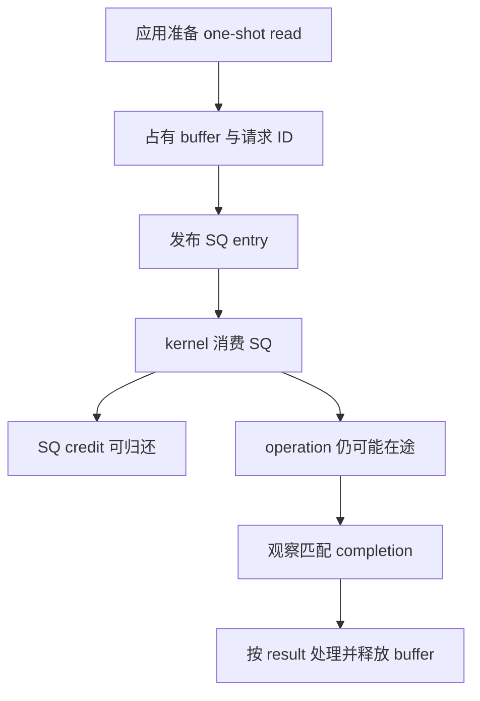
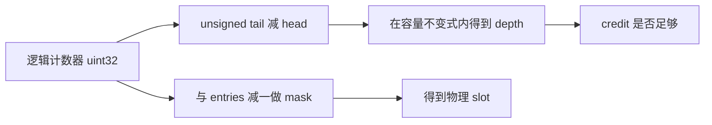
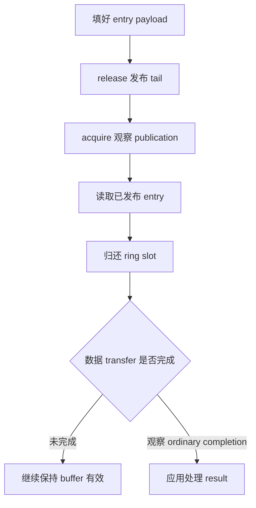

# AI Infra 异步 I/O 选型 FAQ：io_uring 环形队列 credit、计数器回绕与 Buffer 生命周期

> **语言**：中文 | [English](io-uring-ring-credits-wraparound-buffer-lifetime-selection-faq.en.md)  
> **Round 140 · 2026-11-14 白班**：训练数据/权重存储路径中的 ordinary one-shot read 状态契约；不是 Linux 实机 benchmark。  
> **关联**：[Checkpoint Multipart 完成边界](checkpoint-multipart-completion-etag-integrity-selection-faq.md) · [DLPack 所有权](dlpack-versioned-capsule-strides-stream-lifetime-selection-faq.md)

**结论速览**：**SQ 空位、operation 完成、buffer 可复用是不同状态**。kernel 消费 SQ entry 可归还 submission credit，但普通 READ/WRITE 的数据 buffer 仍须有效直到操作完成。原创2槽 SQ 可在3个 buffer 都仍被占用时已经为空；slot0 已经属于新请求102，不能再用“当前slot0”识别旧请求100的 CQE。必须显式赋值/匹配 `user_data`，并检查 completion result。

**交付**：[交互状态工作台](../reports/io-uring-ring-credits-wraparound-buffer-lifetime-sizer.html) · [7-Card](../reports/io-uring-ring-credits-wraparound-buffer-lifetime-selection-cards.html) · [1600px SVG](../../assets/svg/io-uring-ring-credits-wraparound-buffer-lifetime-selection-faq-summary.svg) · [封存数据](../../experiments/uring_ring_lifetime_selection/report.json)

## Q1：AI Infra 存储异步化前，应先区分哪些容量和生命周期？

至少分清 SQ submission entries、CQ completion entries、在途请求数、数据 buffer pool，以及提交时需要的辅助 metadata。SQ entries 限制某时刻待消费的队列项，不等于所有尚未完成的 I/O。随着 kernel 消费，SQ可以不断接受新请求，而旧请求的数据仍在流转。



不要仅按 queue depth 估算所有在途 buffer 内存，也不要从共享 ring 接口推导“所有 storage data path 零拷贝”。真实性能还受 opcode、设备、内核、缓存、文件系统和调用路径影响，本仓库没有执行 native io_uring。

## Q2：环形索引怎样跨越 2³²，为什么不能普通相减？

原创模型使用有界 uint32 head/tail，depth=`(tail−head) mod2³²`；power-of-two capacity 的 slot=`counter & (entries−1)`。不变式是有效 outstanding depth 不超过小容量；不是任意相距数十亿圈的计数器都能靠该式恢复历史。

起始 head=tail=4294967294，向4槽 ring 提交4项后，head=4294967294、tail=2。普通 Python有符号/无界相减是−4294967292，正确 unsigned depth为4；槽序为2、3、0、1。计数器是单调逻辑进度的模表示，而不是直接的数组下标。



liburing 文档还说明 submission 一侧存在 SQ index indirection，completion 一侧直接索引 CQE。原型只模拟显式 power-of-two顺序槽位，没有完整重现 SQ array、NO_SQARRAY、SQE128/CQE32或各 setup flag 布局。

## Q3：slot 可以复用，为什么 request ID 和 buffer 还不能复用？

默认先提交 request100→buffer0、101→buffer1。kernel 消费100后 slot0可用，原创模型将 request102→buffer2 放入 slot0；此时100仍拥有buffer0。之后消费全部 SQ，SQ depth0，但三个 read 都尚未完成，三个 buffer 都仍被占有。

| 状态或做法 | 原创结果 | 决策 |
| :--- | :--- | :--- |
| SQslot0 当前内容 | request102 / buffer2 | 不代表旧 request100 |
| 匹配 CQE request100 | buffer0 | 根据 opaque operation identity 路由 |
| completion顺序101、100、102 | 正确归还buffer1、0、2 | 不假定提交顺序就是完成顺序 |
| result−5 | 显式 error | 释放生命周期不等于请求成功 |
| result2/requested4 | short_or_eof | 非负结果也不等于完整4B |

实际读取 `io_uring_get_sqe` 与 `io_uring_sqe_set_data` 文档：get/prep helper 不负责设置或清除 user_data，未赋值可能保留旧用途值。原型采用会话内不复用、JS精确整数域的 request ID，**这是原创策略，不是 liburing 自动分配 generation**，也未实现完整64-bit ID空间。

## Q4：release/acquire 与 metadata/data 的稳定期有什么区别？

共享 ring 需要正确发布与读取顺序。文档示例在填好 entry/索引后 release-store tail，并展示 acquire-load helper；消费方不能只看见“tail可用了”却读取未填好的 payload。报告给出“先发布tail→读取未填项→最后填payload”的**原始错误顺序 witness**，不是硬件弱内存模拟或竞态发生概率。



文档区分提交时读取的辅助 struct metadata 与 transfer data：普通 non-SQPOLL 且具备适配 submit-stable语义时，某些辅助 metadata 成功提交后可释放；普通 READ/WRITE 的数据 buffer 必须有效直到 completion。SQPOLL、很早内核与 `IORING_FEAT_SUBMIT_STABLE` 有额外条件。不能把 metadata 的早释放规则推广到实际数据 buffer。

模型仅覆盖 single-producer、ordinary one-shot read，并保守地在匹配 CQE 被 reap 时归还 buffer。multishot/F_MORE、CQE_SKIP_SUCCESS、zero-copy send 的 notification、取消竞态、CQ overflow/backlog与多线程全部未实现；不能用“一次CQE就结束”的教学模型认证这些模式。

## Q5：内存和 CPU timing 应怎样预算？

独立预算选择 SQ8×64B、CQ16×16B，entry payload 共768B；buffer pool32×1MiB为33554432B。64B/16B是本预算所选entry大小，不覆盖所有 flags。没有计算 ring head/tail/index arrays、SQ indirection、page-rounded mmap、kernel state、pinning或allocator，因此不是 native总内存。

| 复制 list 的消费项数 | 原创 head cursor（ms） | 原创 pop(0) shifting（ms） |
| ---: | ---: | ---: |
| 64 | 0.004500 | 0.003800 |
| 256 | 0.017100 | 0.018433 |
| 1024 | 0.078133 | 0.138933 |
| 4096 | 0.329200 | 1.724900 |

64项时 cursor **更慢**，如实保留。两路都含 list copy，两次warmup、七轮交替repeat、每样本三操作，报告中位数；这是 Python 循环与 C-backed list移动的原始对照，连 Ring class bookkeeping都不在 timing里。没有测 atomics、Linux、syscalls、storage、buffer transfer或IOPS，更不是io_uring对epoll/read的性能比较。

## Q6：如何复现、跟踪源变更并设定上线边界？

```powershell
python -m unittest discover -s tests -p test_uring_ring_lifetime_selection.py -q
python -m experiments.uring_ring_lifetime_selection.run --check
# --measure 主动替换本机原创 CPU samples
```

八项测试覆盖uint32回绕/full credits、SQslot复用但buffer仍锁定、独立deque/identity oracle的160步确定性事件、负值/短读/完整result、错误ID/状态/容量、payload、Node/Python trace parity与sealed timing。H5最多128个有界命令，错误可见；此前浏览器拒绝仍受尊重，未执行视觉浏览器检查。

来源：[固定 io_uring.7](https://github.com/axboe/liburing/blob/a10946dc51eeababc48ee10baf0d17489f647a80/man/io_uring.7)、[get_sqe](https://github.com/axboe/liburing/blob/a10946dc51eeababc48ee10baf0d17489f647a80/man/io_uring_get_sqe.3)、[set_data](https://github.com/axboe/liburing/blob/a10946dc51eeababc48ee10baf0d17489f647a80/man/io_uring_sqe_set_data.3)、[submit稳定期](https://github.com/axboe/liburing/blob/a10946dc51eeababc48ee10baf0d17489f647a80/man/io_uring_submit.3) 及 read/readv文档。所读man页SPDX为LGPL-2.0-or-later；另检查repository LICENSE(MIT)与COPYING(LGPL-2.1)，不把整个仓库误标为单一许可。11月12日tree变更是SQPOLL测试setup输出指针修正，不是新发明ring算法。

原型/文档/图均原创，无native代码镜像。生产必须验证内核feature、具体opcode/flags、可见性屏障、user_data代际、buffer-pool协议、CQ回压、result/short-I/O与关闭/取消协议。本报告`synthetic`、`independently_reproduced=false`；原创CPU记录单独`measured`。native IOPS/latency/memory与race probability均保留未知/null。
