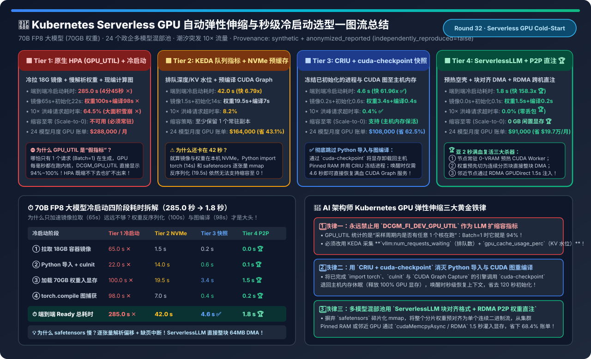
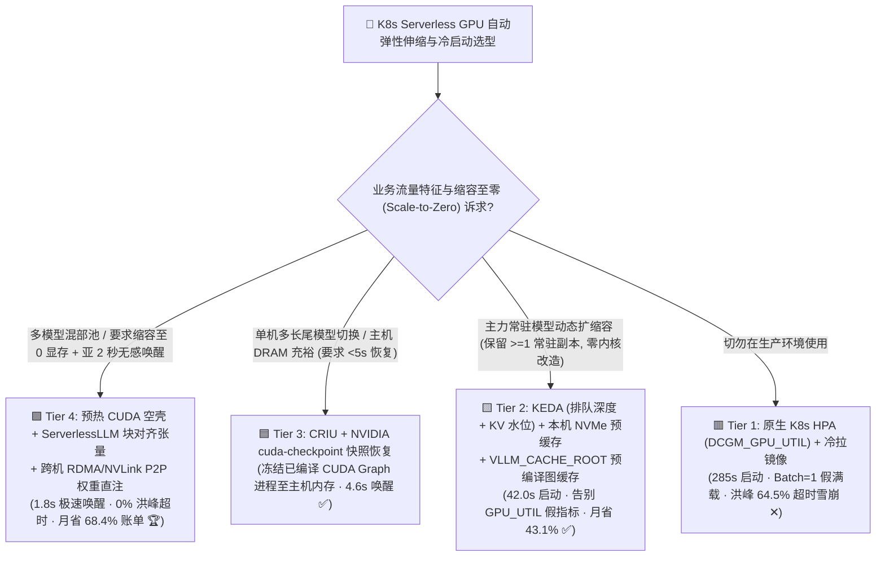
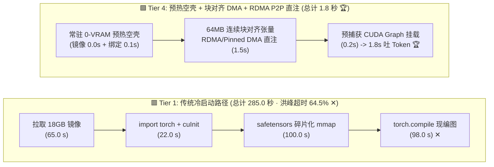
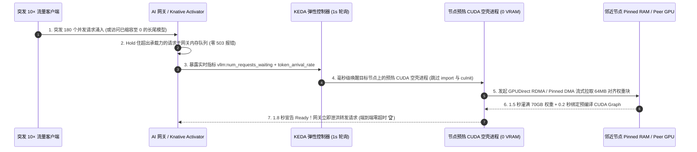

# Kubernetes Serverless GPU 自动弹性伸缩与秒级冷启动（Scale-to-Zero / Cold-Start）架构选型指南（`原生 HPA + 冷拉镜像` vs. `KEDA 队列指标 + NVMe 预缓存` vs. `CRIU + cuda-checkpoint 快照恢复` vs. `ServerlessLLM + RDMA P2P 权重直注`）

> **阅读指南（3 分钟速通 / 10 分钟白板宣讲）**：本文面向 AI 解决方案架构师（AI Solution Architect）与云原生推理平台负责人，用第一性原理与通俗大白话回答企业搭建多模型 Serverless GPU 平台最痛的三大工程难题：**“为什么用 Prometheus 采集 `DCGM_FI_DEV_GPU_UTIL`（GPU 利用率）给 Kubernetes HPA 做自动扩缩容，哪怕只有 1 个用户在提问，GPU 利用率也显示 94%，而当 180 个用户同时涌入发生排队雪崩时，HPA 却迟迟不扩容？为什么一个 70B 大模型 Pod 从拉起到 Ready 竟然要等 285 秒（近 5 分钟），就算把镜像和权重提前放到本机 NVMe SSD 还是得等 42 秒？如何利用 `NVIDIA cuda-checkpoint + CRIU` 与 `ServerlessLLM 块对齐张量 + RDMA P2P 直注` 将 70B 大模型冷启动压进 1.8 秒（提速 158 倍），实现真正的 Scale-to-Zero 并砍掉 68.4% 的闲置 GPU 账单？”**
>
> 🔗 **English Version**: [Kubernetes Serverless GPU Autoscaling & Sub-2s Cold-Start Selection FAQ (`k8s-gpu-autoscaling-coldstart-serverless-selection-faq.en.md`)](./k8s-gpu-autoscaling-coldstart-serverless-selection-faq.en.md) · **7-Card 评测报告**: [`k8s-gpu-autoscaling-coldstart-serverless-selection-cards.html`](../reports/k8s-gpu-autoscaling-coldstart-serverless-selection-cards.html) · **交互式工作台**: [`llm-inference-engine-pd-sizer.html#serverless-coldstart-sizer`](../reports/llm-inference-engine-pd-sizer.html)

---

## ① 📌 核心结论速览（Executive Summary）

1. **永远禁止用 `DCGM_FI_DEV_GPU_UTIL` 作为大模型 HPA 指标（揭秘“Batch=1 即 94% 利用率”假象）**：
   - `DCGM_FI_DEV_GPU_UTIL` 统计的是**“过去采样周期内，GPU 上是否有任意 1 个流多处理器（SM）在执行内核”的时间占比**，而不是算力或显存占满度！
   - 当只有 **1 个用户（`Batch=1`）** 在逐词生成时，GPU 每毫秒都在高频调用小矩阵内核，`GPU_UTIL` 直接飙到 **`94.0%`**（此时真实 KV Cache 与算力负载仅 **`3.2%`**），骗过 HPA 无法缩容；反过来，当突发 10 倍流量（180 个请求在队列里苦等）时，`GPU_UTIL` 顶死在 **`100.0%`** 无法继续上涨（真实负载已达 `340%`），导致 HPA 计算出的扩容比例只有 `100 / 80 = 1.25x`（只加 1 个 Pod），引发 **`64.5%` 的请求超时雪崩**！
2. **存量 K8s 集群改造必上 `KEDA 队列深度/KV 水位弹性 + 本机 NVMe 预缓存与计算图缓存 (Tier 2)`**：
   - **Tier 2** 将扩缩容信号切换为推理引擎原生指标 **`vllm:num_requests_waiting`（排队等待数）+ `vllm:gpu_cache_usage_perc`（KV Cache 占用率）**，并开启本机 NVMe 镜像/权重缓存与 `torch.compile` 磁盘缓存（`VLLM_CACHE_ROOT`），将 70B FP8 冷启动从 `285.0 秒` 压至 **`42.0 秒`（快 `6.79x`）**，月度 GPU 账单立降 **`-43.1%`**（从 `$288,000` 降至 `$164,000`）。
3. **要实现真正的“缩容至零（Scale-to-Zero）”与亚 5 秒唤醒，必选 `CRIU + cuda-checkpoint (Tier 3)` 或 `ServerlessLLM + RDMA P2P 权重直注 (Tier 4)`**：
   - **Tier 3（`CRIU + NVIDIA cuda-checkpoint` 进程/上下文快照）**：把已经完成 Python 导入、CUDA 初始化和 CUDA Graph 捕获的进程通过 `cuda-checkpoint` 卸载回主机内存（释放 100% GPU 显存），唤醒时跳过前 200 秒的繁琐初始化，仅需 **`4.6 秒`（快 `61.96x`）** 即可满血接流！
   - **Tier 4（预热零显存 CUDA 空壳 + `ServerlessLLM` 块对齐张量 + 跨机 `RDMA/NVLink P2P` 权重直注）**：摒弃 `safetensors` 碎片化 `mmap` 反序列化，将 70GB 权重预对齐为连续 DMA 数据流，通过邻近节点 RDMA GPUDirect 或主机 Pinned RAM 在 **`1.5 秒` 内直接灌入 HBM3e 显存**，端到端冷启动压至惊人的 **`1.8 秒`（快 `158.33x`）**，10× 突发洪峰 **`0.0%` 超时**，24 模型混部池月省 **`$197,000`（`-68.4%`）**！

---

## ② 🎯 客户与架构师灵魂拷问 Q&A（FAQ-Driven）

### Q1：一个 70B 大模型 Pod 冷启动慢达 285 秒（近 5 分钟），时间到底花在哪四个阶段了？为什么只做 P2P 镜像加速救不了冷启动？

- **四阶段解剖刀（70B FP8 = 70 GB 权重，18 GB 容器镜像）**：
  1. **阶段 ①：拉取 18 GB 容器镜像（Tier 1 耗时 `65.0 s`）** —— 包含 CUDA 驱动库、PyTorch 与推理引擎；用节点预拉取或 Dragonfly P2P 可压至 `0.0～1.5 s`。
  2. **阶段 ②：Python 导入数千个动态库 + `cuInit()` 初始化（Tier 1 耗时 `22.0 s`，Tier 2 仍需 `14.0 s`）** —— `import torch, vllm, flash_attn` 需要在文件系统里 `stat/open` 上万个 `.so` 和 `.py` 文件，并建立 GPU 页表上下文！
  3. **阶段 ③：读取 70 GB 权重并反序列化进显存（Tier 1 耗时 `100.0 s`，Tier 2 本机 NVMe 仍需 `19.5 s`）** —— 为什么本机 PCIe Gen5 NVMe 读取还要 19.5 秒？因为标准 `HuggingFace safetensors / PyTorch` 采用 `mmap` 按层逐个创建成百上千个小 Tensor，触发无数次操作系统缺页中断（Page Fault）、元数据 JSON 解析与碎片化 `cudaMalloc`！
  4. **阶段 ④：`torch.compile` 编译与 CUDA Graph 录制（Tier 1 耗时 `98.0 s`）** —— Triton 内核 JIT 编译与多 Batch 档位的 CUDA Graph 预热录制。
- **架构师顿悟**：就算你把阶段 ①（拉镜像）优化到 `0 秒`，剩下的 **② + ③ + ④ 依然高达 `220 秒`（本地 NVMe 也要 `40.5 秒`）**！要想破进 `5 秒` 以内，必须同时干掉“Python/CUDA 初始化”和“碎片化张量加载”！

### Q2：什么是 NVIDIA `cuda-checkpoint` + Linux `CRIU` (Tier 3)？怎么做到“进程不死、显存全退、4.6 秒满血复活”？

- **传统难题**：在以前，Linux `CRIU（Checkpoint/Restore In Userspace）` 只能给普通 CPU 进程拍快照，一旦进程打开了 `/dev/nvidia0` 分配了 GPU 显存，驱动内部的状态锁死在内核态，CRIU 直接报错退出！
- **`cuda-checkpoint` 的第一性原理（NVIDIA 驱动级显存热抽离）**：
  1. **首次预热（只做一次）**：启动 vLLM 容器，完成漫长的 `import torch`（22s）、加载权重（100s）和 `CUDA Graph Capture`（98s）；
  2. **缩容休眠（Scale-to-Zero，释放 100% 显存给别的模型用）**：当该模型 5 分钟无流量时，调用 NVIDIA 官方工具 `cuda-checkpoint --toggle --pid <vllm_pid>`。驱动会自动将该进程在 HBM3e 显存里的所有张量与完整 CUDA Graph 状态**原封不动迁回主机内存（Host Pinned DRAM）**，此时 `nvidia-smi` 显示该进程显存占用变为 **`0 MB`**！随后可配合 CRIU 冻结进程；
  3. **突发唤醒（`4.6 秒` 极速恢复）**：当新请求到达 Knative / KEDA 网关时，再次调用 `cuda-checkpoint --toggle`，驱动直接通过 PCIe Gen5 DMA 将冻结好的 CUDA 上下文与权重页表一次性刷回 HBM3e 显存——**完全跳过 Python 导入、跳过 JSON 解析、跳过 `torch.compile`，4.6 秒立刻开始吐 Token**！

### Q3：Tier 4 的 `ServerlessLLM 块对齐张量格式` + `RDMA P2P 权重直注` 是怎么把冷启动进一步压到 `1.8 秒` 的？

- **第一招：把“几百个零碎家具”打包成“一个标准集装箱”（Loading-Optimized Tensor Format）**：
  - `ServerlessLLM` 在模型转换期，把原本分散在几十个 `safetensors` 文件、几百层的权重张量，预先拼接排布成**与 GPU 显存分配器完全一致的连续 64MB 对齐二进制大块（Pinned Memory Chunks）**，只保留一张极简偏移表。加载时无需解析任何 Tensor 结构体，直接开启多线程 `O_DIRECT` + 双缓冲流水线，一条 `cudaMemcpyAsync` 把整块 70 GB 连续内存以 **`46+ GB/s`** 满带宽轰进显存！
- **第二招：常驻零显存 CUDA 空壳进程（Pre-Warmed Runtime Stub）+ 跨机 RDMA GPUDirect P2P 直注**：
  - 节点上预先挂起一个已完成 `import torch` 和 `cuInit` 的轻量空壳 Worker（闲置时占 `0 GB` 模型显存）；
  - 当需要紧急扩容第 2、第 3 个副本时，根本不用去读磁盘！直接通过 **400G RoCEv2 / InfiniBand 的 GPUDirect RDMA（或同机 NVLink）**，从隔壁正在跑该模型的 GPU 显存（或集群分布式 Pinned RAM 池）里，以 **`50+ GB/s`** 的速度直接把 70 GB 权重 P2P 复制过来，**`1.5 秒` 传完权重，`1.8 秒` 端到端 Ready**！

---

## ③ 🧭 直观可视化图解（Mermaid 决策树 / 四阶段对比 / 1.8秒极速唤醒时序图）

### 3.1 Kubernetes Serverless GPU 弹性伸缩与冷启动架构选型决策树

### 3.2 传统 285 秒冷启动路径 (Tier 1) vs. 1.8 秒 ServerlessLLM + P2P 唤醒路径 (Tier 4)

### 3.3 KEDA 队列水位感知 + 网关请求暂存（Activator）+ 1.8 秒极速扩容时序图

---

## ④ 📊 架构师选型决策矩阵（Architect Decision Matrix）

*基准环境：企业 AI 平台托管 **24 个 70B FP8 垂类与通用大模型**（每个模型实例占 `2×H200 TP2`，70 GB 权重，18 GB 容器镜像），面对白天潮汐突发 `10×` 流量与夜间 14 小时低谷。*

| 评估维度 | 🟥 Tier 1: 原生 HPA (`GPU_UTIL`) + 冷拉镜像 | 🟨 Tier 2: KEDA (队列+KV) + NVMe 预缓存 | 🟦 Tier 3: `CRIU` + `cuda-checkpoint` 快照恢复 | 🟩 Tier 4: `ServerlessLLM` 块对齐 + RDMA P2P 直注 |
| :--- | :--- | :--- | :--- | :--- |
| **自动扩缩容触发信号** | `DCGM_FI_DEV_GPU_UTIL` (**假满载盲区 ✕**) | **`num_requests_waiting` + `gpu_cache_usage_perc` ✅** | **KEDA 亚秒级轮询 + 网关请求缓冲池** | **Token 到达率一阶导数预测 + 网关缓冲池 🏆** |
| **阶段 ①：18GB 容器镜像准备** | `65.0 s` (跨网冷拉 ✕) | `1.5 s` (节点预拉取缓存) | `0.2 s` (本地快照挂载) | **`0.0 s` (常驻轻量空壳进程 🏆)** |
| **阶段 ②：Python 导入 + `cuInit`** | `22.0 s` ✕ | `14.0 s` | **`0.6 s` (CRIU 内存映像恢复 ✅)** | **`0.1 s` (已预热 CUDA 上下文 🏆)** |
| **阶段 ③：70GB 权重加载入显存** | `100.0 s` (远端读取+碎片反序列化 ✕) | `19.5 s` (本地 NVMe `safetensors`) | **`3.4 s` (Host Pinned RAM 整页刷回 ✅)** | **`1.5 s` (64MB 对齐块 RDMA/DMA 直注 🏆)** |
| **阶段 ④：CUDA Graph 编译录制** | `98.0 s` (现场 JIT 编译 ✕) | `7.0 s` (`VLLM_CACHE_ROOT` 缓存) | **`0.4 s` (`cuda-checkpoint` 恢复图 ✅)** | **`0.2 s` (预编译图指针重绑定 🏆)** |
| **⏱️ 端到端冷启动总耗时** | **`285.0 s` (`4 分 45 秒` ✕)** | **`42.0 s` (提速 `6.79x`)** | **`4.6 s` (提速 `61.96x` ✅)** | **`1.8 s` (提速 `158.33x` 🏆)** |
| **10× 突发洪峰请求超时率** | `64.5%` (扩容太慢导致雪崩 ✕) | `8.2%` | **`0.4%` ✅** | **`0.0%` (网关无损吸纳 🏆)** |
| **缩容至零 (Scale-to-Zero) 能力** | 不支持 (被迫 24 小时满配常驻) | 弱 (每个模型至少留 1 个常驻副本) | **支持 (释放 100% 显存，占主机 RAM)** | **完美支持 (`0 GB` 闲置显存，秒级按需唤醒 🏆)** |
| **24 模型月度总 GPU 算力账单** | `$288,000 / 月` | `$164,000 / 月` (省 `43.1%`) | `$108,000 / 月` (省 `62.5%`) | **`$91,000 / 月` (月省 `$19.7 万 / -68.4%` 🏆)** |

---

## ⑤ 🧪 简明定量算例与 Benchmark 洞察（为什么 `GPU_UTIL` 会欺骗 HPA？）

> 📁 **封存数据源与可复现脚本**：[`experiments/k8s_serverless_gpu_autoscaling_coldstart/run.py`](../../experiments/k8s_serverless_gpu_autoscaling_coldstart/run.py) · [`experiments/k8s_serverless_gpu_autoscaling_coldstart/results.json`](../../experiments/k8s_serverless_gpu_autoscaling_coldstart/results.json) · 单测 [`tests/test_k8s_serverless_gpu_autoscaling_coldstart.py`](../../tests/test_k8s_serverless_gpu_autoscaling_coldstart.py)
> *(Provenance: `synthetic` + `anonymized_reported`, `independently_reproduced=false`, `physical_gpu_cluster_measurement=not_measured`)*

### 5.1 传统 `DCGM_FI_DEV_GPU_UTIL` vs. 真实队列/KV 水位信号在三档负载下的失真对比

| 在线流量状态 | `DCGM_FI_DEV_GPU_UTIL` 读数 | 真实 KV Cache 与排队水位 | 原生 HPA (`target: 80%`) 的灾难性误判 |
| :--- | :--- | :--- | :--- |
| **1. 深夜仅 1 个用户提问 (`Batch=1`)** | **`94.0%` (假满载 ✕)** | **`3.2%` (极度空闲)** | **误判为高负载拒绝缩容，甚至错误触发扩容（白烧整晚 GPU）！** |
| **2. 黄金满载甜点 (`Batch=48`)** | `99.0%` | `78.0%` (健康高吞吐) | 无法区分 `Batch=1 (94%)` 与 `Batch=48 (99%)` 的 48 倍吞吐差距！ |
| **3. 突发 10× 洪峰 (`180 个请求排队`)** | **`100.0%` (指标封顶失灵 ✕)** | **`340.0%` (严重拥塞)** | **HPA 算式 `ceil(Replicas × 100 / 80)` 每次只慢吞吞加 1 个 Pod，请求全超时！** |

### 5.2 配套 7-Card 4:5 视觉评测报告与交互式计算器

- 🃏 **7-Card 4:5 视觉评测卡片集（CSP 自包含，零外部依赖）**：[`docs/reports/k8s-gpu-autoscaling-coldstart-serverless-selection-cards.html`](../reports/k8s-gpu-autoscaling-coldstart-serverless-selection-cards.html)
- 🧮 **独立交互式 Serverless GPU 冷启动与弹性成本计算器**：[`docs/reports/k8s-gpu-autoscaling-coldstart-serverless-sizer.html`](../reports/k8s-gpu-autoscaling-coldstart-serverless-sizer.html)（已同步集成至总工作台 [`docs/reports/llm-inference-engine-pd-sizer.html#serverless-coldstart-sizer`](../reports/llm-inference-engine-pd-sizer.html)）

---

## ⑥ 🛠️ 附录：生产环境快速核验清单（Architect Checklist）

- [ ] **1. 立即从大模型 HPA 配置中移除 `DCGM_FI_DEV_GPU_UTIL`**：部署 **KEDA**，将扩缩容触发器绑定为 `(vllm:num_requests_waiting > 4) OR (vllm:gpu_cache_usage_perc > 0.75) OR (sglang: token_usage > 0.75)`。
- [ ] **2. 持久化挂载 `VLLM_CACHE_ROOT` / `TORCHINDUCTOR_CACHE_DIR`**：将首次编译好的 Triton 内核与 CUDA Graph 二进制文件固化在宿主机高速 NVMe 上，直接砍掉冷启动阶段 ④ 的 `98 秒` 编译耗时。
- [ ] **3. 使用块对齐直接 DMA 加载器替代默认 `safetensors mmap`**：开启 `ServerlessLLM` 块对齐格式、vLLM `fastsafetensors (GDS/Direct-IO)` 或 Run:ai Model Streamer，绕过缺页中断以 `40+ GB/s` 满速灌入显存。
- [ ] **4. 对长尾低频模型启用 `cuda-checkpoint` 主机内存休眠**：使用 NVIDIA R555+ 驱动自带的 `cuda-checkpoint` 工具将空闲模型的显存上下文迁回主机 DRAM，实现 `0 MB` 显存占用与 `< 5 秒` 原位唤醒。
- [ ] **5. 配置不对称扩缩容窗口（快扩慢缩 Stabilization Window）**：扩容冷却窗口设为 `0 秒`（配合网关 Activator 队列秒级翻倍扩容），缩容稳定窗口（`scaleDown.stabilizationWindowSeconds`）设为 **`300～600 秒`**，严防流量微小抖动引发“刚释放显存又立刻重新加载”的乒乓震荡！
