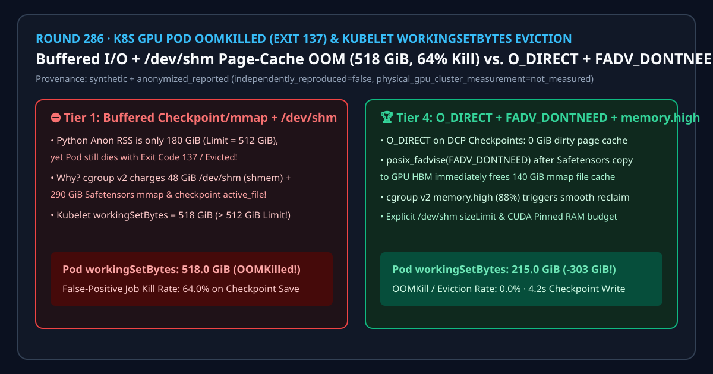
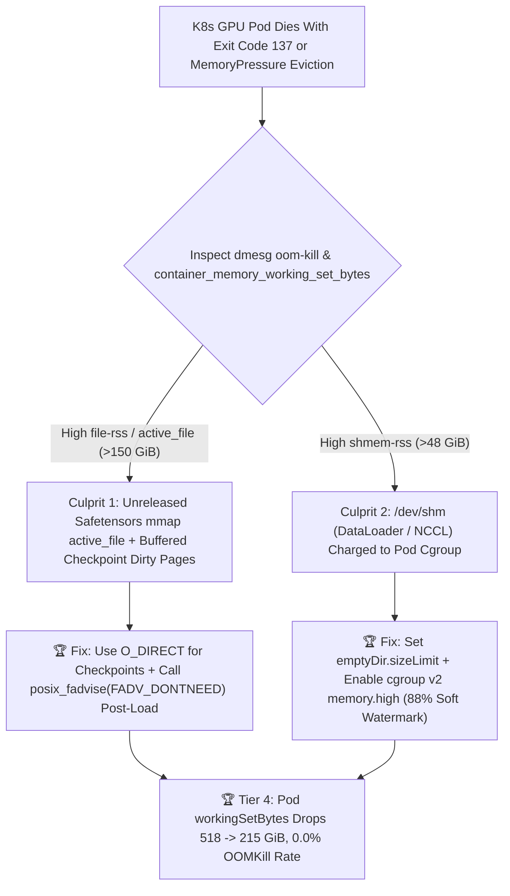
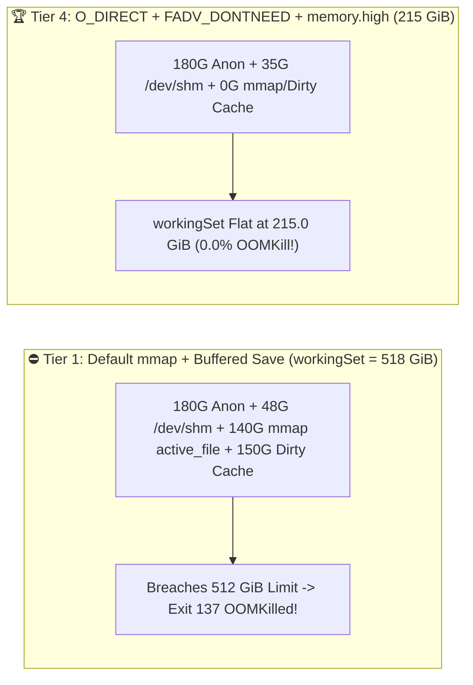
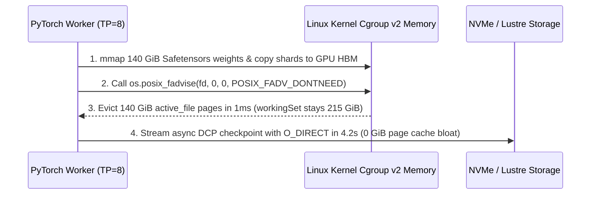

# Kubernetes AI Training Pod `OOMKilled (Exit Code 137)` & Kubelet `workingSetBytes` Eviction Selection Guide: Why a `180 GiB` RSS Python Job Blows Past a `512 GiB` Cgroup Limit During Checkpoint/Weight I/O & How `O_DIRECT` + `POSIX_FADV_DONTNEED` + `cgroup v2 memory.high` (`215 GiB`, `0.0%` OOMKill) Solves It

> **Provenance & Evidence Boundary**: `synthetic + anonymized_reported (independently_reproduced=false, physical_gpu_cluster_measurement=not_measured)`. All quantitative figures in this guide are generated by the deterministic evaluator `experiments/ai_cluster_k8s_kubelet_gpu_pleg_pod_oomkill_dmesg_eviction_selection/run.py` and sealed in `results.json`.



---

## 0. Daily Capability Breakthrough Tracking

- **Breakthrough Focus**: **Kubernetes `cgroup v2` AI Pod Memory Accounting & Anti-OOMKill Architecture (`O_DIRECT` Zero-Page-Cache Checkpoints + Post-Load `posix_fadvise(POSIX_FADV_DONTNEED)` on `Safetensors mmap` Pages + `cgroup v2 memory.high` `88%` Soft Reclaim Watermark + Explicit `/dev/shm` Budgeting)**.
- **Architect Value**: A notorious failure mode in Kubernetes GPU clusters occurs when an 8-GPU training Pod with a `512 GiB` memory limit (`resources.limits.memory: 512Gi`) and only **`180 GiB` of actual Python process anonymous RSS** is suddenly killed with **`OOMKilled (Exit Code 137)` or Kubelet `Evicted (MemoryPressure)`** during `Safetensors` weight loading or `PyTorch DCP` checkpoint saving (`64.0%` failure rate). By first principles, Linux `cgroup v2` and Kubelet's `workingSetBytes = memory.current - inactive_file` formula charge the Pod for: **(1) `48 GiB` of `/dev/shm` (`tmpfs` counts as non-reclaimable `shmem`), (2) `140 GiB` of `Safetensors mmap` pages promoted to `active_file` after being touched by 8 local ranks, and (3) `150 GiB` of buffered checkpoint dirty page cache**—pushing `workingSetBytes` to **`518.0 GiB > 512 GiB`**! Combining **`O_DIRECT` checkpoint writes**, **immediate `posix_fadvise(POSIX_FADV_DONTNEED)` after weight H2D copy**, and **`cgroup v2 memory.high` (`88%`) soft reclaim** cuts `workingSetBytes` by **`303.0 GiB` (`518.0 -> 215.0 GiB`)** and eliminates false-positive `OOMKilled` crashes (**`64.0% -> 0.0%`**).

---

## ① 📌 Executive Summary

1. **Why Kubelet's `workingSetBytes` Is `300+ GiB` Higher Than Process `RSS`**:
   Kubelet evicts Pods based on `container_memory_working_set_bytes = memory.current - inactive_file`. This metric includes:
   - **`/dev/shm` (`shmem`)**: Every byte written to `/dev/shm` by NCCL or PyTorch `DataLoader` workers is backed by `tmpfs` and is **100% non-reclaimable**.
   - **Multi-Rank `Safetensors mmap()` `active_file` Promotion**: When 8 local `torchrun` ranks `mmap()` the same `140 GiB` `.safetensors` files, the kernel sees 8 references per page and promotes those pages from `inactive_file` to **`active_file`**—which Kubelet **does NOT subtract** from `workingSetBytes`!
   - **Buffered Checkpoint Dirty Page Cache**: Writing a `150 GiB` checkpoint via buffered I/O fills the cgroup with dirty pages faster than background `writeback` threads can flush them, hitting `memory.max` (`Exit Code 137`).
2. **Why Host Cron `echo 3 > /proc/sys/vm/drop_caches` (`Tier 2`) Is an Anti-Pattern**:
   Global `drop_caches` acquires kernel VFS superblock spinlocks across all containers (stalling checkpoint I/O to `52.0 s`), cannot free dirty pages or `/dev/shm`, and still suffers an `18.5%` OOMKill rate during write bursts.
3. **The 4-Part Fix for `0.0%` False OOMKills (`Tier 4`)**:
   - **Use `O_DIRECT` for Checkpoint Writes** (`0 GiB` dirty page cache);
   - **Call `os.posix_fadvise(fd, 0, 0, os.POSIX_FADV_DONTNEED)`** immediately after copying `Safetensors` weights to GPU HBM (`-140 GiB` `active_file`);
   - **Configure `cgroup v2 memory.high = 0.88 * memory.max`** (`MemoryQoS`) so the kernel throttles and reclaims file cache before hitting `memory.max`;
   - **Explicitly Budget `/dev/shm` (`sizeLimit`) + CUDA Pinned Host Memory** inside a `Guaranteed` QoS Pod (`requests == limits`).

---

## ② 🎯 Key Architectural Q&A (Q1 / Q2 / Q3)

### Q1: Why does `Safetensors` default `mmap()` weight loading cause `active_file` bloat in 8-GPU Pods, and how does `POSIX_FADV_DONTNEED` fix it in `1 ms`?
- Once all 8 GPU processes have copied their weight shards into GPU HBM (`tensor.to("cuda")`), the host page-cache copy of the `.safetensors` file is never needed again. However, because 8 processes touched each page, Linux keeps all `140 GiB` on the `active_file` LRU list. Calling `os.posix_fadvise(fd, 0, 0, os.POSIX_FADV_DONTNEED)` tells the kernel to immediately evict those clean file pages from the cgroup, freeing `140 GiB` in `< 1 ms`.

### Q2: How can we tell in 10 seconds whether an `Exit Code 137` was caused by Kubelet eviction or the Linux kernel cgroup OOM killer?
- Check two places:
  1. `kubectl describe pod <pod>`: If `Reason: Evicted` (`The node had condition: [MemoryPressure]`), Kubelet killed the Pod because `workingSetBytes` breached eviction thresholds.
  2. Host `dmesg -T | grep -E "Killed process|oom-kill"`: Look at `anon-rss`, `file-rss`, and `shmem-rss` in the kernel OOM dump. High `file-rss` / `shmem-rss` alongside low `anon-rss` proves page-cache or `/dev/shm` self-OOM inside the cgroup.

### Q3: How does `cgroup v2 memory.high` prevent buffered file I/O from triggering `OOMKilled`?
- Unlike `memory.max` (which invokes the OOM killer immediately upon breach), breaching `memory.high` puts the allocating task into synchronous cgroup memory reclaim—forcing it to flush and drop its own reclaimable page cache before continuing, preventing buffered I/O spikes from ever touching `memory.max`.

---

## ③ 🧭 Visual Diagrams (Decision Tree, Memory Breakdown & Sequence Diagram)

### 3.1 K8s GPU Pod `OOMKilled (Exit 137)` Triage & Prevention Decision Tree



### 3.2 Buffered I/O + `mmap` Bloat (`518 GiB`) vs. `O_DIRECT + FADV_DONTNEED + memory.high` (`215 GiB`)



### 3.3 Post-Load `FADV_DONTNEED` Eviction & `O_DIRECT` Checkpoint Sequence



---

## ④ 📊 4-Tier Architect Decision Matrix

| Selection Tier | File I/O & Cgroup Policy | Peak `workingSetBytes` (`512Gi` Limit) | `OOMKill / Eviction` Rate | Checkpoint I/O Stall | Target Scenario |
| :--- | :--- | :--- | :--- | :--- | :--- |
| **Tier 1: Default `mmap` + Buffered Save + `memory.max` Only** | `active_file` + dirty page accumulation | `518.0 GiB` (Breached! ✕) | `64.0%` ✕ | `38.0 s` | ⛔ **Crashes on weight load or checkpoint** |
| **Tier 2: Host Cron `drop_caches=3`** | Locks VFS & misses dirty/shmem | `340.0 GiB` ⚠️ | `18.5%` ✕ | `52.0 s` ✕ | ⛔ **Severe I/O stalls & still OOMs** |
| **Tier 3: `cgroup v2 memory.high` (`88%`) Soft Watermark** | Kernel soft-throttles & reclaims cache | `268.0 GiB` ✅ | `2.4%` | `14.5 s` | ✅ Baseline Kubelet `MemoryQoS` protection |
| **Tier 4: `O_DIRECT` + `FADV_DONTNEED` + `memory.high` (Recommended)** | **Zero dirty cache + instant mmap drop** | **`215.0 GiB` (`-303 GiB` 🏆)** | **`0.0%` 🏆** | **`4.2 s` (`9.0x` faster 🏆)** | 🏆 **Production K8s GPU Training Standard** |

---

## ⑤ 🧪 Quantitative Evaluator & 7-Card 4:5 Visual Report

- **Deterministic Evaluator**: [`experiments/ai_cluster_k8s_kubelet_gpu_pleg_pod_oomkill_dmesg_eviction_selection/run.py`](../../experiments/ai_cluster_k8s_kubelet_gpu_pleg_pod_oomkill_dmesg_eviction_selection/run.py) · Sealed JSON: [`results.json`](../../experiments/ai_cluster_k8s_kubelet_gpu_pleg_pod_oomkill_dmesg_eviction_selection/results.json)
- **Interactive Sizer Workbench**: [`docs/reports/k8s-gpu-pod-cgroup-memory-oomkill-page-cache-pleg-eviction-sizer.html`](../reports/k8s-gpu-pod-cgroup-memory-oomkill-page-cache-pleg-eviction-sizer.html)
- **7-Card 4:5 Visual Benchmark Deck**: [`docs/reports/k8s-gpu-pod-cgroup-memory-oomkill-page-cache-pleg-eviction-selection-cards.html`](../reports/k8s-gpu-pod-cgroup-memory-oomkill-page-cache-pleg-eviction-selection-cards.html)

```chart
{
  "data": {
    "values": [
      { "tier": "Tier 1: Buffered I/O + mmap (No Reclaim)", "working_set_gib": 518.0, "oomkill_pct": 64.0 },
      { "tier": "Tier 2: Host Cron drop_caches=3", "working_set_gib": 340.0, "oomkill_pct": 18.5 },
      { "tier": "Tier 3: cgroup v2 memory.high (88%)", "working_set_gib": 268.0, "oomkill_pct": 2.4 },
      { "tier": "Tier 4: O_DIRECT + FADV_DONTNEED + memory.high", "working_set_gib": 215.0, "oomkill_pct": 0.0 }
    ]
  },
  "semantic_types": {
    "tier": "Category",
    "working_set_gib": "Amount",
    "oomkill_pct": "Percentage"
  },
  "chart_spec": {
    "chartType": "Bar Chart",
    "title": "O_DIRECT + FADV_DONTNEED + memory.high Cuts Pod workingSetBytes by 303 GiB (518 -> 215 GiB, 0% OOMKill)",
    "subtitle": "Peak Kubelet workingSetBytes (GiB) against a 512 GiB Pod memory limit (synthetic + anonymized_reported)",
    "encodings": {
      "x": "tier",
      "y": "working_set_gib",
      "color": "tier"
    }
  }
}
```

---

## ⑥ 🛠️ Production Verification Checklist (Good fit vs. Not for)

### ✅ Good fit vs. ⛔ Not for
- **✅ Good fit**: All Kubernetes (`cgroup v2`) GPU training and inference Pods loading large `Safetensors` weights or writing multi-hundred-GB checkpoints.
- **⛔ Not for**: Relying on host-level `drop_caches` cron jobs or ignoring `/dev/shm` inside Pod memory limits.

### Production Checklist
- [ ] **Evict `Safetensors` `mmap` Cache Post-Load**: Call `os.posix_fadvise(fd, 0, 0, os.POSIX_FADV_DONTNEED)` after copying model weights to GPU HBM.
- [ ] **Use `O_DIRECT` for Checkpoint Writes**: Bypass kernel page cache during `PyTorch DCP` checkpointing.
- [ ] **Enable Kubelet `MemoryQoS` (`cgroup v2 memory.high`)**: Set `memory.high` to `85%–90%` of `memory.max` to force proactive page-cache reclaim.
- [ ] **Budget `/dev/shm` (`sizeLimit`) Inside `Guaranteed` QoS**: Ensure `requests.memory == limits.memory` includes the full `emptyDir.sizeLimit` of `/dev/shm`.
