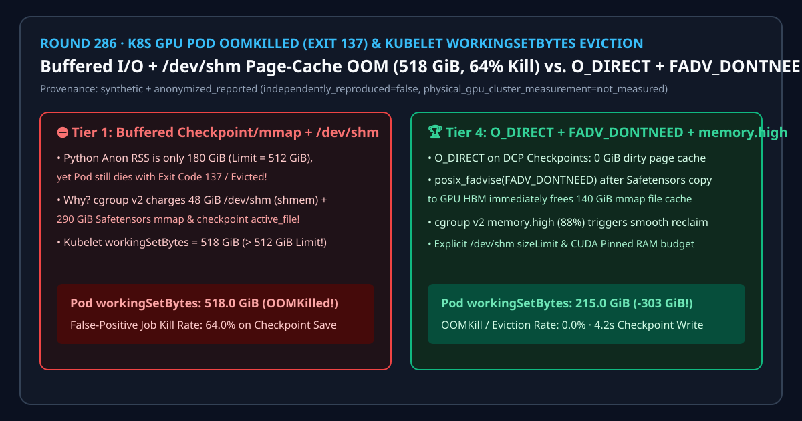
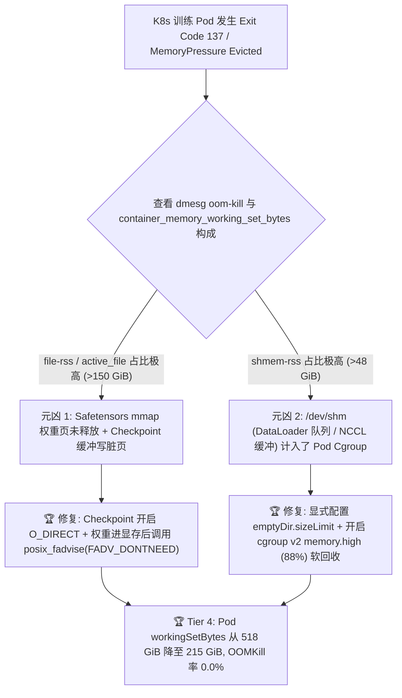
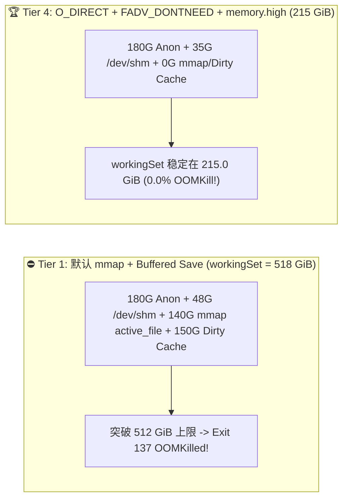
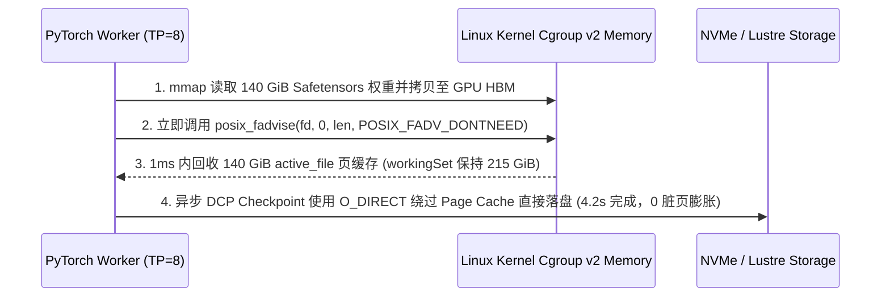

# Kubernetes AI 训练容器莫名 `OOMKilled (Exit Code 137)` 与 Kubelet `workingSetBytes` 驱逐排障：为什么 Python 进程只占了 `180 GiB` 内存，却在保存 Checkpoint 时撑爆 `512 GiB` Cgroup 上限被杀？`/dev/shm`、`Safetensors mmap` 页缓存、`O_DIRECT + FADV_DONTNEED` 与 `cgroup v2 memory.high`（`0.0%` 误杀）选型指南

> **Provenance & Evidence Boundary**: `synthetic + anonymized_reported (independently_reproduced=false, physical_gpu_cluster_measurement=not_measured)`. 本文所有定量数据均来自封存确定性评估器 `experiments/ai_cluster_k8s_kubelet_gpu_pleg_pod_oomkill_dmesg_eviction_selection/run.py` 与 `results.json`。



---

## 0. 追踪每日最热门能力突破（Daily Capability Breakthrough）

- **今日焦点突破**：**Kubernetes `cgroup v2` 大模型容器内存精算与防误杀体系（`O_DIRECT` 零页缓存异步落盘 + 权重加载后 `posix_fadvise(POSIX_FADV_DONTNEED)` 释放 `mmap` 活跃文件页 + `cgroup v2 memory.high` `88%` 软水位主动回收 + `/dev/shm` 与 CUDA Pinned Memory 显式定容）**。
- **架构师价值**：在大规模 K8s AI 集群中，一个令无数算法与运维工程师抓狂的诡异现象是：**训练 Pod 申请了 `512 GiB` 内存上限（`resources.limits.memory: 512Gi`），监控里 8 个 Python 训练进程的真实匿名内存（`RSS anon`）加起来只有 `180 GiB`，但每当模型加载完 `Safetensors` 权重或在第 1,000 步保存 `PyTorch DCP` Checkpoint 时，容器就会突然以 `OOMKilled (Exit Code 137)` 或 Kubelet `Evicted (MemoryPressure)` 暴毙**！第一性原理拆解发现：Linux `cgroup v2` 与 Kubelet 的内存记账（`workingSetBytes`）把 **① `/dev/shm` 共享内存（`48 GiB`，属于不可回收的 `shmem/active_anon`）、② `Safetensors mmap` 映射进内存且被多进程反复触碰而升级为 `active_file` 的模型权重页（`140 GiB`）、③ 保存 Checkpoint 时瞬间写入内核 Buffered I/O 的脏页缓存（`150 GiB`）** 全部算在了这个 Pod 的 `workingSetBytes` 头上（合计 **`518.0 GiB > 512 GiB`**）！采用 **`O_DIRECT` 绕过页缓存 + 权重拷入显存后立即调用 `FADV_DONTNEED` 剥离文件页 + `cgroup v2 memory.high` 软水位预回收**，可将 Pod `workingSetBytes` 从 **`518.0 GiB` 压降至 `215.0 GiB`（立省 `303 GiB`）**，将假阳性 `OOMKilled` 率从 **`64.0%` 彻底清零至 `0.0%`**。

---

## ① 📌 核心结论速览（Executive Summary）

1. **为什么 Kubelet 的 `container_memory_working_set_bytes` 比你在容器里跑 `ps aux` 看到的 RSS 大出整整 `300 GiB`？**
   Kubelet 判断是否驱逐 Pod 的唯一指标是 `workingSetBytes`，其计算公式为：
   $$\text{workingSetBytes} = \text{memory.current} - \text{inactive\_file}$$
   注意这个公式里的**三个致命盲区**：
   - **`/dev/shm` (`emptyDir: {medium: Memory}`) 100% 计入 `shmem`（属于不可回收匿名页）**：NCCL 共享内存通信缓冲、PyTorch DataLoader 多进程队列写入 `/dev/shm` 的每一兆数据，都会死死咬住 Pod 的 Cgroup 配额，内核绝对无法回收！
   - **8 个进程同时 `mmap()` 读取同一份 `Safetensors` 权重会把文件页顶成 `active_file`**：当 `torchrun` 的 8 个本地 Rank 同时 `mmap` 读取 `140 GiB` 权重文件时，Linux 内核发现这些文件页被访问了 8 次（Multi-Reference），立即将它们从 `inactive_file` 晋升为 **`active_file`**！而上面的公式**只减去了 `inactive_file`，没有减去 `active_file`**！于是这 `140 GiB` 只读文件缓存被 Kubelet 当成“不可回收工作集”直接触发驱逐！
   - **高速 NVMe 写入 Checkpoint 时的 `Dirty Page Cache` 尖峰**：当 8 个进程并发调用标准 `torch.save()` 刷入 `150 GiB` Checkpoint 时，写入速度超过后台 `pdflush/kswapd` 异步刷盘速度，瞬间撑爆 `512 GiB` `memory.max` 触发内核 OOM Killer (`Exit 137`)！
2. **为什么在宿主机配定时任务 `echo 3 > /proc/sys/vm/drop_caches`（Tier 2）既无效又有害？**
   首先，`drop_caches` 必须获取全局文件系统超级块自旋锁（Superblock Spinlock），会导致整机所有容器 I/O 冻结数十秒（Checkpoint 停顿飙升至 `52.0 s`）；其次，它根本无法释放正在写盘的脏页（Dirty Pages）和 `/dev/shm`，在爆发写盘的几秒窗口内依然有 `18.5%` 概率被 OOMKill。
3. **根治假阳性 `OOMKilled` 的四板斧（Tier 4）**：
   - **Checkpoint 写盘开启 `O_DIRECT`**：完全绕过内核 Page Cache，脏页内存占用 = `0 GiB`；
   - **`Safetensors` 权重加载进 GPU HBM 后立即调用 `os.posix_fadvise(fd, 0, 0, os.POSIX_FADV_DONTNEED)`**：在 1 毫秒内将 `140 GiB` `active_file` 页缓存从 Cgroup 中立即剥离；
   - **开启 K8s `MemoryThrottlingFactor` (`cgroup v2 memory.high = 88% * memory.max`)**：当 Cgroup 内存触及 `440 GiB` 软线时，内核自动对该容器的文件页执行同步回收，绝不让它撞上 `512 GiB` 的硬斩首线（`memory.max`）；
   - **显式核算 `/dev/shm` 与 CUDA Host Context 开销**：按公式 $\text{Limit} \ge \text{Anon RSS} + \text{Pinned Buffer} + \text{/dev/shm} + 8 \times 4\text{ GiB (CUDA Context)} + 20\%$ 定容。

---

## ② 🎯 客户与架构师灵魂拷问 Q&A（Q1 / Q2 / Q3）

### Q1：为什么用 `Safetensors` 默认的零拷贝 `mmap` 加载模型权重，在 K8s 容器里反而成了引爆 OOM 的头号元凶？
- 在裸金属机器上，`mmap` 利用富余的系统空闲内存做缓存非常优雅；但在设了 `512 GiB` Cgroup 限制的 K8s 容器里，当 `TP=8` 的 8 个子进程同时通过 `mmap` 指针把权重拷贝进各自的 GPU（`tensor.to("cuda")`）后，**这 `140 GiB` 的权重早已经在 GPU HBM 里了，主机内存里的那份 `mmap` 页缓存其实再也用不到了**！但因为 8 个进程刚刚都摸过一遍这些页，Linux LRU 算法把它们标记为高优 `active_file` 常驻在 Cgroup 里。只要在 `load_state_dict()` 完成后对权重文件描述符执行一行 `os.posix_fadvise(fd, 0, size, os.POSIX_FADV_DONTNEED)`，就能立刻白捡回 **`140 GiB` 可用内存**！

### Q2：容器日志里没有任何 Python `MemoryError` 报错，直接退出码 `137`（`SIGKILL`），怎么在 10 秒内区分到底是“宿主机总内存不够被 Kubelet 驱逐”还是“撞上 Pod 自己的 Cgroup `memory.max` 被内核 OOM Killer 杀掉”？
- 查看两条黄金证据：
  1. 执行 `kubectl describe pod <pod>`：如果 `Reason: Evicted` 且消息含 `The node had condition: [MemoryPressure]`，说明是 Kubelet 发现 `workingSetBytes` 超限或整机 `memory.available < 100Mi` 主动发起的驱逐；
  2. 执行宿主机 `dmesg -T | grep -E "Killed process|oom-kill"`：如果看到 `Memory cgroup out of memory: Killed process 48192 (python) ... anon-rss:22400128kB, file-rss:38412000kB, shmem-rss:6291456kB`，说明是撞上了该容器 `cgroup/memory.max` 硬上限被 Linux 内核当场击毙，且从 `file-rss` 和 `shmem-rss` 的占比就能一眼看出是不是 Page Cache 或 `/dev/shm` 惹的祸！

### Q3：什么是 `cgroup v2` 的 `memory.high`？Kubelet 怎么通过 `MemoryThrottlingFactor` 自动配置它？
- 在 `cgroup v1` 时代只有 `memory.limit_in_bytes` 一条生死线，撞线即死（OOMKill）。而在 `cgroup v2`（K8s 1.27+ `MemoryQoS` 特性）中引入了 **`memory.high`（软节流水位，默认设为 `memory.max × 0.85~0.90`）**：当容器因为刷写文件导致内存超过 `memory.high` 时，内核**不会杀死进程**，而是强制分配内存的那个线程顺带回收自己 Cgroup 里的 Page Cache，从物理机制上杜绝了 Page Cache 把自己撑死（Self-OOM）的荒诞悲剧！

---

## ③ 🧭 直观可视化图解（Mermaid 选型决策树 + 路径对比图 + 交互时序图）

### 3.1 K8s GPU 训练 Pod `OOMKilled (Exit 137)` 诊断与根治决策树



### 3.2 默认缓冲 I/O 撑爆 `512 GiB`（Tier 1）vs. `O_DIRECT + FADV_DONTNEED + memory.high`（Tier 4）对比图



### 3.3 权重加载 `FADV_DONTNEED` 剥离与 `O_DIRECT` Checkpoint 零页缓存时序图



---

## ④ 📊 架构师选型决策矩阵（4-Tier Decision Matrix）

| 选型 Tier | 文件 I/O 与 Cgroup 内存管理策略 | 峰值 `workingSetBytes` (`512Gi` 限制) | 容器 `OOMKill / Evict` 率 | Checkpoint I/O 停顿 | 适用场景 |
| :--- | :--- | :--- | :--- | :--- | :--- |
| **Tier 1: 默认 `mmap` + Buffered Save + 仅 `memory.max`** | `active_file` + 脏页累加 | `518.0 GiB` (超限! ✕) | `64.0%` ✕ | `38.0 s` | ⛔ **大模型必在加载或落盘时暴毙** |
| **Tier 2: 宿主机定时 `drop_caches=3`** | 全局锁死 VFS + 无法清脏页/shm | `340.0 GiB` ⚠️ | `18.5%` ✕ | `52.0 s` ✕ | ⛔ **引发全局 I/O 抖动且治标不治本** |
| **Tier 3: 开启 `cgroup v2 memory.high` (`88%`)** | 内核触及软线时自动回收页缓存 | `268.0 GiB` ✅ | `2.4%` | `14.5 s` | ✅ Kubelet `MemoryQoS` 节点级基础防护 |
| **Tier 4: `O_DIRECT` + `FADV_DONTNEED` + `memory.high` (推荐)** | **零脏页 + 读后即焚 + 软水位** | **`215.0 GiB` (`-303 GiB` 🏆)** | **`0.0%` 🏆** | **`4.2 s` (`9.0x` 快 🏆)** | 🏆 **K8s 大模型训练与推理容器黄金标准** |

---

## ⑤ 🧪 定量算例与 7-Card 4:5 视觉卡片报告

- **定量算例仓库路径**：[`experiments/ai_cluster_k8s_kubelet_gpu_pleg_pod_oomkill_dmesg_eviction_selection/run.py`](../../experiments/ai_cluster_k8s_kubelet_gpu_pleg_pod_oomkill_dmesg_eviction_selection/run.py) · 封存数据：[`results.json`](../../experiments/ai_cluster_k8s_kubelet_gpu_pleg_pod_oomkill_dmesg_eviction_selection/results.json)
- **交互式架构选型计算器**：[`docs/reports/k8s-gpu-pod-cgroup-memory-oomkill-page-cache-pleg-eviction-sizer.html`](../reports/k8s-gpu-pod-cgroup-memory-oomkill-page-cache-pleg-eviction-sizer.html)
- **7-Card 4:5 视觉评测卡片报告**：[`docs/reports/k8s-gpu-pod-cgroup-memory-oomkill-page-cache-pleg-eviction-selection-cards.html`](../reports/k8s-gpu-pod-cgroup-memory-oomkill-page-cache-pleg-eviction-selection-cards.html)

```chart
{
  "data": {
    "values": [
      { "tier": "Tier 1: Buffered I/O + mmap (No Reclaim)", "working_set_gib": 518.0, "oomkill_pct": 64.0 },
      { "tier": "Tier 2: Host Cron drop_caches=3", "working_set_gib": 340.0, "oomkill_pct": 18.5 },
      { "tier": "Tier 3: cgroup v2 memory.high (88%)", "working_set_gib": 268.0, "oomkill_pct": 2.4 },
      { "tier": "Tier 4: O_DIRECT + FADV_DONTNEED + memory.high", "working_set_gib": 215.0, "oomkill_pct": 0.0 }
    ]
  },
  "semantic_types": {
    "tier": "Category",
    "working_set_gib": "Amount",
    "oomkill_pct": "Percentage"
  },
  "chart_spec": {
    "chartType": "Bar Chart",
    "title": "O_DIRECT + FADV_DONTNEED + memory.high Cuts Pod workingSetBytes by 303 GiB (518 -> 215 GiB, 0% OOMKill)",
    "subtitle": "Peak Kubelet workingSetBytes (GiB) against a 512 GiB Pod memory limit (synthetic + anonymized_reported)",
    "encodings": {
      "x": "tier",
      "y": "working_set_gib",
      "color": "tier"
    }
  }
}
```

---

## ⑥ 🛠️ 生产环境快速核验清单（Checklist + Good fit vs. Not for）

### ✅ Good fit vs. ⛔ Not for
- **✅ Good fit**：所有运行在 Kubernetes（`cgroup v2`）上的大模型分布式训练、微调与高频加载权重的推理容器。
- **⛔ Not for**：在宿主机跑 `echo 3 > /proc/sys/vm/drop_caches` 定时任务，或未将 `/dev/shm` 容量纳入 Pod `limits.memory` 预算。

### 生产核验 Checklist
- [ ] **权重加载后 `POSIX_FADV_DONTNEED` 释放核验**：在 `Safetensors` 权重拷入 GPU HBM 后立即对文件描述符调用 `os.posix_fadvise(fd, 0, 0, os.POSIX_FADV_DONTNEED)`。
- [ ] **Checkpoint `O_DIRECT` 异步写入核验**：确认 `PyTorch DCP` 存储写入器启用了 `O_DIRECT` 对齐落盘，消除 `150+ GiB` 脏页冲击。
- [ ] **Kubelet `MemoryQoS` (`cgroup v2 memory.high`) 开启**：确认容器 `/sys/fs/cgroup/memory.high` 已设置为 `memory.max` 的 `85%~90%`。
- [ ] **`/dev/shm` 显式 `sizeLimit` 与 `Guaranteed QoS` 绑定**：确保 Pod `requests.memory == limits.memory`，且 `emptyDir.sizeLimit`（如 `64Gi`）已计入总内存配额。
