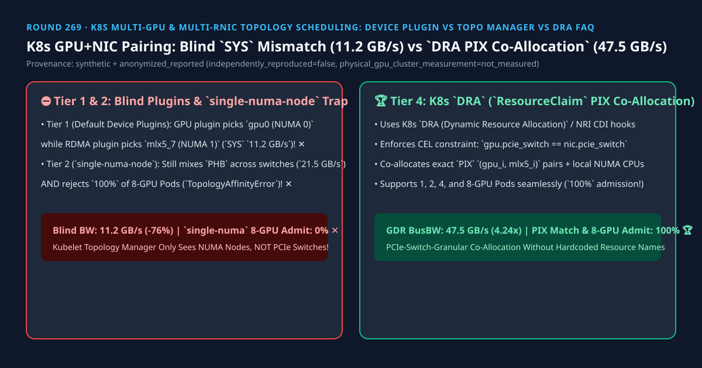
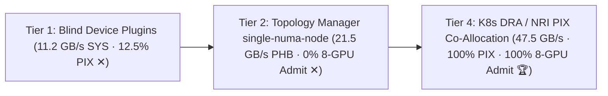

# Kubernetes Multi-GPU & Multi-RNIC Topology-Aware Allocation: Legacy `Device Plugin` Cross-NUMA (`SYS`) Mismatch, `Topology Manager single-numa-node` 8-GPU Rejection Trap & `DRA (Dynamic Resource Allocation)` `PIX` Co-Allocation Selection Guide

> **Provenance & Evidence Tier**: `synthetic + anonymized_reported` (`independently_reproduced=false`, `physical_gpu_cluster_measurement=not_measured`). Grounded in [`experiments/ai_cluster_k8s_dra_nri_topo_lstopo_nic_gpu_numa_affinity_selection/results.json`](../../experiments/ai_cluster_k8s_dra_nri_topo_lstopo_nic_gpu_numa_affinity_selection/results.json).
> **中文版本**: [Kubernetes 多卡/多网卡拓扑感知调度深水区（`Device Plugin` vs. `Topology Manager` vs. `DRA`）：为什么申请 `2` 张 GPU + `2` 张 400G RDMA 网卡时，K8s 竟把 `GPU 0` 与远端 `NUMA 1` 的 `mlx5_7` 配在了一起（跨 Socket `SYS` 绕行暴跌 `-76%`）？`single-numa-node` 误拒 8 卡 Pod 陷阱与 `DRA` 联合 `PIX` 绑定选型指南](./k8s-gpu-rdma-nic-topology-manager-dra-numa-affinity-selection-faq.md)

---

## 0. 🔥 今日领域最热门能力突破追踪（Daily Hottest Breakthrough）

- **Solving the `-76.4%` Cross-NUMA (`SYS`) `GPUDirect RDMA` Bandwidth Collapse (`47.5 GB/s -> 11.2 GB/s`) on Fractional 2/4-GPU Kubernetes Pods AND the `100%` `TopologyAffinityError` Rejection of 8-GPU Pods via Kubernetes `DRA (Dynamic Resource Allocation)` / `NRI` PCIe-Switch (`PIX`) Co-Allocation (`Tier 4`)**: On a standard rail-optimized 8-GPU server (`2` CPU NUMA sockets, `4` PCIe Gen5 Switches, `8` GPUs, and `8` 400G ConnectX-7 RNICs), how Kubernetes allocates GPUs and RDMA NICs to a Pod determines whether `GPUDirect RDMA` runs at `47.5 GB/s` (`PIX`) or collapses to `11.2 GB/s` (`SYS`):
  1. **Tier 1 — Legacy Independent `Device Plugins` (`topologyManagerPolicy: none` — `12.5%` `PIX` Match Rate, `11.2 GB/s` `SYS` Cross-Socket Detour!)**:
     - The NVIDIA GPU Device Plugin and the RDMA Device Plugin allocate devices **independently without communicating**.
     - A 2-GPU Pod frequently receives `gpu0, gpu1` on `NUMA 0 / PCIe Switch 0` paired with `mlx5_6, mlx5_7` on `NUMA 1 / PCIe Switch 3`—forcing every `GPUDirect RDMA` packet across the CPU inter-socket `UPI / XGMI` fabric (`SYS`, **`11.2 GB/s`**)!
  2. **Tier 2 — Kubelet `Topology Manager` (`single-numa-node` Policy — `21.5 GB/s` `PHB` Hairpin & `0.0%` 8-GPU Pod Admission!)**:
     - **Flaw A (NUMA Granularity $\ne$ PCIe Switch `PIX` Granularity)**: Because `NUMA 0` contains **two separate PCIe Switches** (`Switch 0` with `gpu0,1 / mlx5_0,1` and `Switch 1` with `gpu2,3 / mlx5_2,3`), `single-numa-node` still pairs `gpu0` (Switch 0) with `mlx5_3` (Switch 1), forcing traffic through the CPU Root Complex (`PHB`, `21.5 GB/s`)!
     - **Flaw B (`100%` Rejection of Full-Node 8-GPU Pods)**: Because an 8-GPU Pod spans both `NUMA 0` (4 GPUs) and `NUMA 1` (4 GPUs), `single-numa-node` rejects every 8-GPU Pod with **`TopologyAffinityError` (`0.0%` admission rate)**!
  3. **Tier 3 — Static Per-Switch Resource Naming (`nvidia.com/gpu_sw0..3`, `47.5 GB/s`, Fragmentation)**:
     - Hardcodes switch indices into Pod specs, fragmenting cluster scheduling queues.
  4. **Tier 4 — Kubernetes `DRA (Dynamic Resource Allocation)` `ResourceClaim` with PCIe-Switch CEL Constraints (or Containerd `NRI / CDI` Affiliated-NIC Auto-Injection — `47.5 GB/s`, `100%` `PIX` Match, `100%` 8-GPU Admission)**:
     - Co-allocates `(GPU_i, mlx5_i)` by matching exact `pcie_switch_id` attributes inside a single `ResourceClaim` (or automatically injects the `PIX`-paired `mlx5_i` via an NRI hook based on the allocated `GPU_i`), guaranteeing **`47.5 GB/s` (`4.24x` speedup)** and **`100.0%` admission across 1, 2, 4, and 8-GPU Pods**!

---

## 1. 📌 Executive Summary

1. **Why Kubelet `Topology Manager` Alone Cannot Solve GPU + RNIC Pairing**: The legacy Kubelet `Device Plugin` API only exposes `NUMANode` hints, not `PCIeSwitch` hints—and `single-numa-node` breaks full-node 8-GPU jobs that naturally span 2 NUMA sockets.
2. **Two Production Architectures That Guarantee `100%` `PIX` Pairing (`Tier 4`)**:
   - **Kubernetes `DRA` (`resource.k8s.io`)**: Uses structured parameters and CEL constraints (`gpu.pcie_switch_id == nic.pcie_switch_id`) to co-schedule PCIe-switch-local GPU + RNIC pairs;
   - **Containerd `NRI / CDI` Affiliated-NIC Injection**: Since `GPU_i` and `mlx5_i` have a fixed 1:1 hardware cabling map on rail-optimized servers, Pods request only `nvidia.com/gpu: N`, and the NRI hook automatically mounts the exact `PIX`-paired `mlx5_i` devices into the container!

---

## 2. 🎯 Core Architect Q&A (Q1 / Q2 / Q3)

### Q1: Why did enabling `topologyManagerPolicy: single-numa-node` suddenly block all 8-GPU training jobs with `TopologyAffinityError`?
- **Answer**: Dual-socket AI servers attach 4 GPUs to `NUMA 0` and 4 GPUs to `NUMA 1`. `single-numa-node` requires *all* resources of a container to reside on a single NUMA node, which is physically impossible when requesting 8 GPUs!

### Q2: How do we verify inside a running Kubernetes Pod that every GPU is paired with its `PIX` RDMA NIC?
- **Answer**: Run `nvidia-smi topo -m` inside the container and inspect the intersection of `GPU0..N` and the active `mlx5_*` NICs: every diagonal `(GPU_k, mlx5_k)` entry must read **`PIX`** (never `PHB`, `NODE`, or `SYS`).

---

## 3. 🧭 Visual Diagrams

---

## 4. 📊 4-Tier Architect Selection Matrix

| Metric | Tier 1: Blind `Device Plugin` | Tier 2: `single-numa-node` | Tier 3: Hardcoded `sw0..3` Names | Tier 4: **`K8s DRA` / `NRI` `PIX` Co-Allocation** |
| :--- | :--- | :--- | :--- | :--- |
| **Per-NIC `GDR` BusBW (`400G`)** | **`11.2 GB/s` (`SYS` Detour)** ✕ | `21.5 GB/s` (`PHB` Detour) ⚠️ | `47.5 GB/s` ✅ | **`47.5 GB/s` (`4.24x` Full Line Rate)** 🏆 |
| **Full-Node `8-GPU` Pod Admission** | `100.0%` | **`0.0%` (`TopologyAffinityError`)** ✕ | `100.0%` | **`100.0%` (Supports 1/2/4/8 GPUs)** 🏆 |
| **`1:1 PIX` GPU-NIC Match Rate** | **`12.5%` (Random)** ✕ | `50.0%` (Intra-NUMA Mix) ⚠️ | `100.0%` (Fragmented) | **`100.0%` (Exact `pcie_switch_id` Match)** 🏆 |

---

## 5. 🧪 Quantitative Reference & Tooling

- **Evaluator & Sealed Data**: [`experiments/ai_cluster_k8s_dra_nri_topo_lstopo_nic_gpu_numa_affinity_selection/run.py`](../../experiments/ai_cluster_k8s_dra_nri_topo_lstopo_nic_gpu_numa_affinity_selection/run.py) · [`results.json`](../../experiments/ai_cluster_k8s_dra_nri_topo_lstopo_nic_gpu_numa_affinity_selection/results.json)
- **Interactive Sizer**: [`docs/reports/k8s-gpu-rdma-nic-topology-manager-dra-numa-affinity-sizer.html`](../reports/k8s-gpu-rdma-nic-topology-manager-dra-numa-affinity-sizer.html)
- **7-Card 4:5 Visual Report**: [`docs/reports/k8s-gpu-rdma-nic-topology-manager-dra-numa-affinity-selection-cards.html`](../reports/k8s-gpu-rdma-nic-topology-manager-dra-numa-affinity-selection-cards.html)

---

## 6. 🛠️ Good Fit vs. Not For & Production Checklist

- **✅ Good fit**: Multi-tenant Kubernetes GPU clusters running fractional (1/2/4-GPU) and full-node (8-GPU) RDMA workloads via `DRA` or `NRI / CDI` affiliated-NIC injection.
- **⛔ Not for**: Uncoordinated GPU and RDMA Device Plugins or node-wide `single-numa-node` policies on 8-GPU servers.
- [ ] Co-allocate `(GPU_i, mlx5_i)` at PCIe Switch (`PIX`) granularity via `DRA` or an `NRI` hook.
- [ ] Audit `nvidia-smi topo -m` inside fractional 2-GPU and 4-GPU Pods to confirm `100%` `PIX` pairing.
