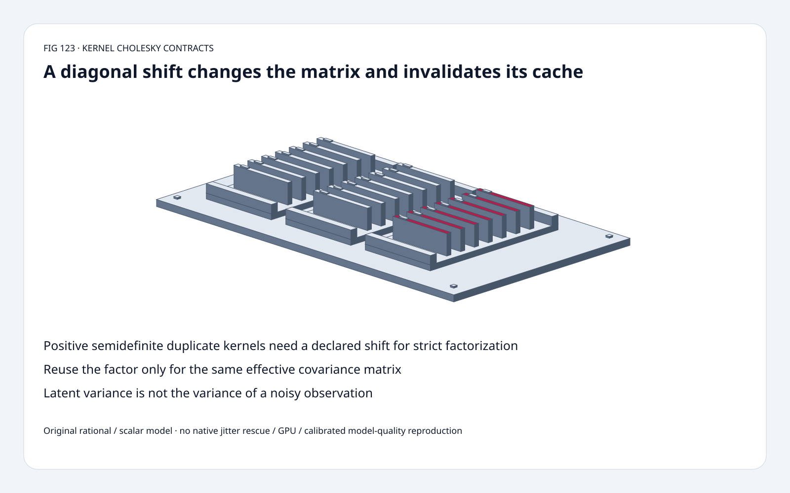
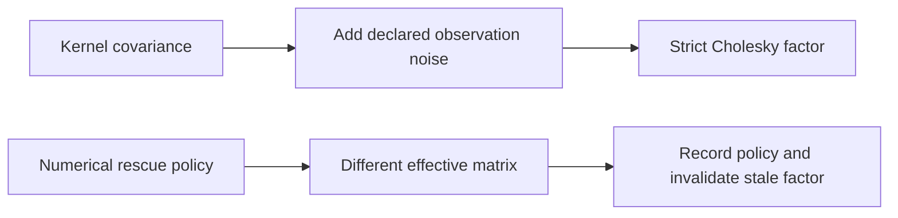
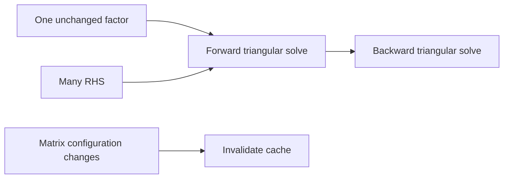
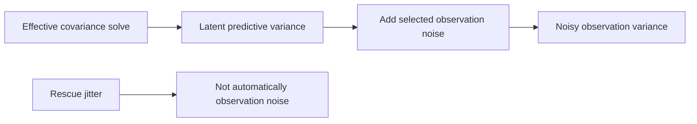

# Kernel factorization FAQ: explicit shifts, factor reuse and latent versus noisy variance

> **Language**: [中文](kernel-cholesky-jitter-factor-reuse-variance-selection-faq.md) | English
>
> **Round 123 · 2026-11-14 (night round 32)** · [SVG](../../assets/svg/kernel-cholesky-jitter-factor-reuse-variance-selection-faq-summary.svg) · [7 cards](../reports/kernel-cholesky-jitter-factor-reuse-variance-selection-cards.html) · [H5](../reports/kernel-cholesky-jitter-factor-reuse-variance-sizer.html) · [Data](../../experiments/kernel_cholesky_contract_selection/report.json)
>
> **Synthetic, `independently_reproduced=false`.** Original scalar Cholesky/triangular solves and independent exact rational elimination, separate CPU timing. No native linear_operator rescue/GPU or calibrated posterior-quality reproduction.



## 1. Executive summary: a diagonal change is not numerically free

Original duplicated-observation kernel `K=[[1,1],[1,1]]` is singular.
With **selected observation-noise variance** 1/10 on the diagonal:
the rational solve is `[10/21,10/21]`, mean **20/21**,
latent variance **1/21**, noisy observation variance **31/210**.

Doubling the diagonal shift changes mean to **10/11** and latent
variance to **1/11**. Reusing the old factor on the changed matrix
leaves residual **0.047619048**, rather than the fresh solve's zero
in this fixture.

Pinned linear_operator's existing normal-mode rescue retries with
visible warnings and incremental jitter deltas. March 4 changed to
modern torch.linalg APIs; it is not new factorization theory.

## 2. Architect Q&A: what matrix and uncertainty are you solving?

### Q1: Why does positive semidefinite not suffice for strict Cholesky?

The duplicate kernel has determinant zero, so a strict positive-
definite factorization fails at a zero pivot.
An explicit positive diagonal shift makes this synthetic matrix
positive definite. It also changes the system being solved.

The original scalar implementation requires a nonempty finite square
matrix and **full symmetry**, rejecting invalid/non-positive pivots.
It has no silent jitter fallback. This stricter symmetry check is
not reproduction of a native routine's trusted-triangle behavior.

### Q2: Is numerical rescue jitter identical to observation noise?

No. In our fixed GP toy the selected shift is explicitly **observation-
noise variance** sigma²=1/10; `A=K+sigma²I`.
The noisy predictive variance adds that selected sigma² to latent
variance. A numerical rescue delta added to A is a different policy,
not automatically observation noise.

The inspected normal-mode helper first tries `cholesky_ex`, then
clones the matrix and increases jitter for failed batch entries.
It adds **new jitter minus previous jitter**, not every retry's full
value again. It warns and eventually raises if unsuccessful.
Its tracing special case and native warnings/rescue are not executed
by the original model.

Keep rescue magnitude visible in provenance: even a numerical delta
changes the effective covariance/factor and can affect predictions.
Do not interpret every positive-definite repair as a statistical
model justification for an arbitrary covariance.

### Q3: When may a factor be reused?

Only while the **effective matrix** is unchanged.
Training data/order, kernel hyperparameters, observation-noise
configuration, added rescue shift and dtype/representation can matter.
Cache identity cannot depend only on matrix shape.

Our original cached path solves eight right-hand sides with one fixed
factor. The baseline rebuilds that same factor per right-hand side.
A changed diagonal with the old factor is intentionally a wrong-system
control, not a harmless approximate cache hit.

### Q4: How are latent and noisy predictive variance different?

For selected test covariance vector k=[1,1] and self covariance 1:

```text
mean = kᵀ * A⁻¹ * y
latent variance = 1 - kᵀ * A⁻¹ * k
noisy observation variance = latent + selected sigma²
```

Original values are **1/21 versus 31/210**.
These are quantities of one synthetic covariance model, not calibrated
coverage or quality of a deployed predictor.
Negative variances from inconsistent covariance inputs or numerical
subtraction must not be silently presented as valid uncertainty.

Independent Fraction Gaussian elimination verifies every solve
coordinate. Scalar log determinant **-1.5606477482646672** agrees with
the rational determinant **21/100** through `2*sum(log(diag(L)))`.

### Q5: What does the memory estimate exclude?

Default selected float64, 1,024 training points, 64 queries:
covariance **8,388,608 bytes**, factor **8,388,608 bytes**,
cross-covariance **524,288 bytes**, RHS **8,192 bytes**.

Separate logical payloads are not automatically simultaneously live,
nor a measured summed peak HBM. Workspace, aliasing, native layout,
batching, approximation and cache lifetime can change allocation.
The H5's fixed two-observation toy is separate from these shape assumptions.

## 3. Visual architecture: effective matrix, factor identity and uncertainty meaning







## 4. Selection matrix: factorization policy is part of the model contract

| Choice | Good fit | Gate |
| :--- | :--- | :--- |
| Strict scalar factor | Small positive-definite audit | Explicit symmetry and pivot failure |
| Selected observation-noise shift | Declared statistical model | Changes mean/variance/system |
| Native numerical rescue | Its supported source policy | Warnings, batch mask, magnitude and failure |
| Factor reuse | Multiple RHS of unchanged A | Effective matrix identity, not just shape |
| Latent uncertainty | Latent function prediction | Do not add rescue as observation noise |
| Noisy uncertainty | Predict an observation | Add the declared observation-noise variance |

## 5. Hands-on evidence: exact elimination, stale-factor and CPU cache controls

```powershell
python -m experiments.kernel_cholesky_contract_selection.run --check
python -m unittest discover -s tests -p test_kernel_cholesky_contract_selection.py -q
```

Eight tests cover rational elimination and factor reconstruction,
multiple matrices, singular/asymmetric/indefinite rejection, mean/
variance/logdet identities, stale factors, matrix permutation,
invalid dimensions/budget, Node/Python parity and sealed samples.

| Dimension | Cached factor, 8 RHS (ms) | Refactor each RHS (ms) |
| :--- | ---: | ---: |
| 4 | 0.048600 | 0.175000 |
| 8 | 0.118967 | 0.572833 |
| 16 | 0.430933 | 2.532400 |
| 32 | 1.162000 | 13.593900 |

Original scalar math; initial cached factor setup excluded.
Two warmups, seven alternating repeats, three operations/sample;
median repeat means. Kernel construction/fitting, initial cache
setup, native linear_operator and GPU excluded.
No browser visual inspection.

## 6. Sources, provenance and readiness

- [Pinned Cholesky helper](https://github.com/cornellius-gp/linear_operator/blob/1c5e24bc774352461be818b9d347e93ddee7d7f7/linear_operator/utils/cholesky.py): normal rescue, incremental jitter, warnings, errors and distinct tracing path.
- [March 4 API migration](https://github.com/cornellius-gp/linear_operator/commit/9261a2644059c63cf37cd9973301bac7a80a055d): modernization, not a new algorithm.
- [MIT license](https://github.com/cornellius-gp/linear_operator/blob/1c5e24bc774352461be818b9d347e93ddee7d7f7/LICENSE): upstream rights retained.
- [Original experiment](../../experiments/kernel_cholesky_contract_selection/README.md): scalar and rational references, sealed CPU samples.

Original factor/solve/oracle/art; no upstream implementation copied.
Native rescue/latency, posterior model quality and peak HBM remain
unreproduced or null.
