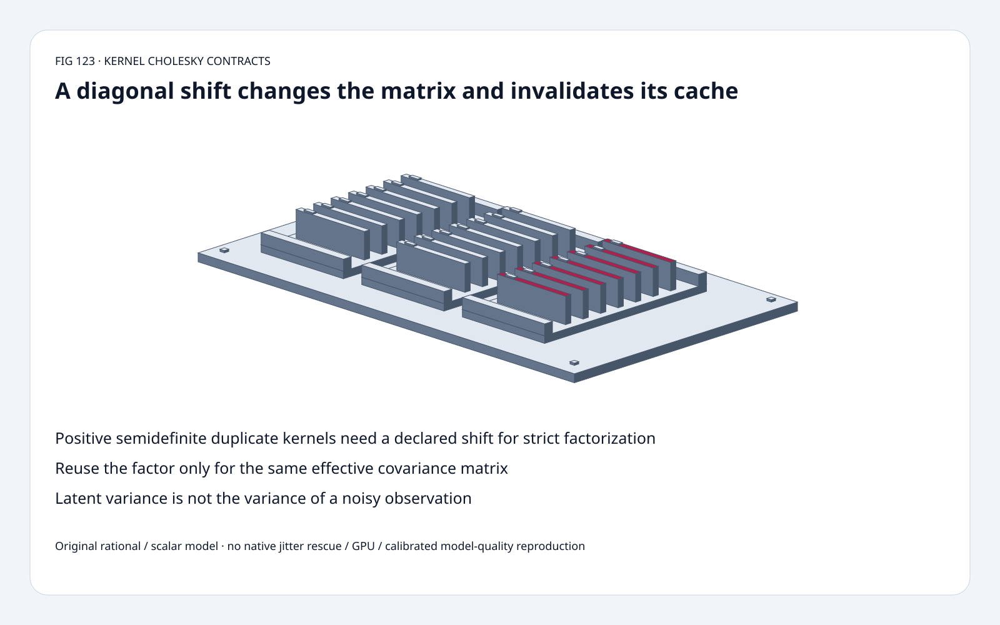
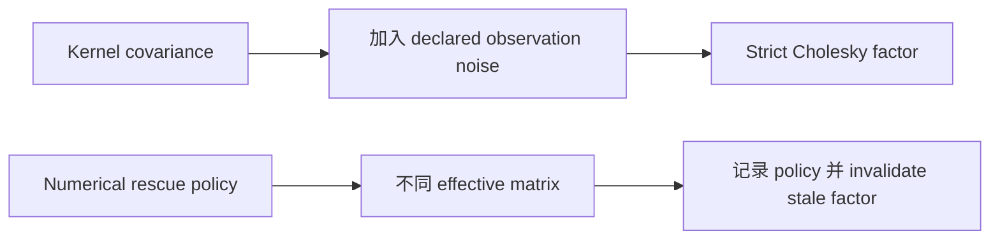
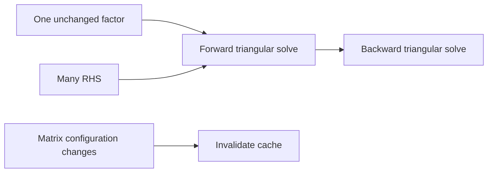
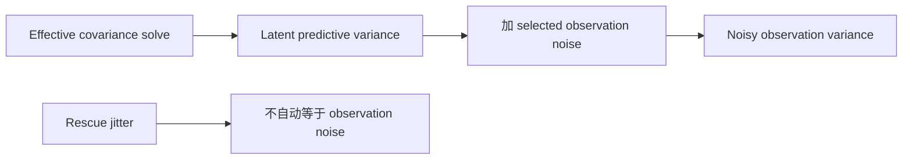

# Kernel Factorization FAQ：Explicit Shift、Factor Reuse 与 Latent/Noisy Variance

> **语言**：中文 | [English](kernel-cholesky-jitter-factor-reuse-variance-selection-faq.en.md)
>
> **Round 123 · 2026-11-14（夜班第 32 轮）** · [高清 SVG](../../assets/svg/kernel-cholesky-jitter-factor-reuse-variance-selection-faq-summary.svg) · [七卡](../reports/kernel-cholesky-jitter-factor-reuse-variance-selection-cards.html) · [H5](../reports/kernel-cholesky-jitter-factor-reuse-variance-sizer.html) · [数据](../../experiments/kernel_cholesky_contract_selection/report.json)
>
> **Synthetic，`independently_reproduced=false`。** 原创 scalar Cholesky/solve、
> exact rational elimination、CPU timing；不复现 native rescue/GPU 或 calibrated quality。



## 一、先看结论：Diagonal Change 不是免费的数值修复

原创 duplicated-observation `K=[[1,1],[1,1]]` 奇异。
明确选定 **observation-noise variance**=1/10 后，
rational solution `[10/21,10/21]`，mean **20/21**，
latent variance **1/21**，noisy variance **31/210**。

Diagonal shift 加倍，mean **10/11**、latent **1/11**；
旧 factor 继续解新 matrix，residual **0.047619048**，
本例 fresh solve 为零。

固定 linear_operator 既有 normal-mode rescue 使用 visible warnings、
incremental jitter deltas；
3 月 4 日是 torch.linalg API migration，不是新 factorization theory。

## 二、架构师 Q&A：解哪个 Matrix、哪种 Uncertainty？

### Q1：Positive Semidefinite 为什么不够 Strict Cholesky？

Duplicate kernel determinant=0，zero pivot 无法 strict factorization。
显式正 diagonal shift 可使本例 positive definite，
但也改了 system。

原创要求 finite nonempty square、**full symmetry**，
不合法/非正 pivot 显式拒绝，无 silent jitter fallback；
此 symmetry check 比 native trusted-triangle 行为更严格，不冒充复现。

### Q2：Numerical Rescue Jitter 就是 Observation Noise 吗？

不是。本 fixed GP toy shift 明确表示 sigma²=1/10，
`A=K+sigma²I`；
noisy variance 加回的是选定 sigma²，不是随便把 numerical rescue delta 当 noise。

所读 normal-mode helper 先 `cholesky_ex`，
再 clone matrix，仅对 failed batch entries 增加 jitter；
每次加 **new−previous**，不是重加每个完整 retry value。
有 warning，最终仍失败会 raise。
Tracing special case/native warnings/rescue 未由原型执行。

Numerical delta 也改变 effective matrix、可能影响预测，
要记录 magnitude；
positive-definite repair 不等于统计上证明任意 covariance 合理。

### Q3：什么时候能 Reuse Factor？

仅 **effective matrix** 不变时。
Training data/order、kernel hyperparameters、observation-noise config、
rescue shift、dtype/representation 都可能影响身份，
不能只用 shape 当 cache key。

原创 cached path 为八个 RHS 复用一 factor；
baseline 每 RHS 重建同一 factor。
改 diagonal 后用旧 factor 是 wrong-system control，不是 harmless cache hit。

### Q4：Latent 与 Noisy Variance 有什么区别？

本例 k=[1,1]、self covariance=1：

```text
mean = kᵀ * A⁻¹ * y
latent variance = 1 - kᵀ * A⁻¹ * k
noisy observation variance = latent + selected sigma²
```

原创 **1/21 与 31/210** 是不同 quantities，
不是部署 predictor 的 calibrated coverage/quality。
不一致 covariance 或数值 subtraction 导致的负 variance
不能静默当 valid uncertainty。

Fraction elimination 验证全部 solve coordinates；
logdet **-1.5606477482646672** 与 rational determinant **21/100**
通过 `2*sum(log(diag(L)))` 一致。

### Q5：Memory Budget 排除了什么？

选定 float64、1,024 training points、64 queries：
covariance **8,388,608 bytes**，
factor **8,388,608 bytes**，
cross-covariance **524,288 bytes**，
RHS **8,192 bytes**。

各自 logical payload 不一定同时存活，不是 summed peak HBM；
workspace/aliasing/layout/batching/approximation/cache lifetime 会改变 allocation。
H5 固定 two-observation toy 与大 shape budget 独立。

## 三、三张架构图：Effective Matrix、Factor Identity、Variance Meaning







## 四、选型矩阵：Factorization Policy 属于 Model Contract

| 选择 | 适合 | Gate |
| :--- | :--- | :--- |
| Strict scalar factor | Small PD audit | Symmetry/pivot errors |
| Observation-noise shift | 明确统计 model | 改 mean/variance/system |
| Native rescue | 对应 source policy | Warning/mask/magnitude/error |
| Factor reuse | Same A、多个 RHS | Effective identity 非 shape |
| Latent uncertainty | Latent function prediction | 不乱加 rescue noise |
| Noisy uncertainty | Predict observation | 加 declared noise variance |

## 五、动手证据：Exact Elimination、Stale Factor、CPU Cache

```powershell
python -m experiments.kernel_cholesky_contract_selection.run --check
python -m unittest discover -s tests -p test_kernel_cholesky_contract_selection.py -q
```

8 tests：rational/factor reconstruction、多 matrix、
singular/asymmetric/indefinite errors、mean/variance/logdet、
stale cache、permutation、invalid input/budget、Node/Python parity、sealed medians。

| Dimension | Cached Factor，8 RHS（ms） | Refactor Each RHS（ms） |
| :--- | ---: | ---: |
| 4 | 0.048600 | 0.175000 |
| 8 | 0.118967 | 0.572833 |
| 16 | 0.430933 | 2.532400 |
| 32 | 1.162000 | 13.593900 |

原创 scalar math，不计 initial cache factor；
2 warmups、7 alternating repeats、3 ops/sample，取 repeat means median；
排除 kernel construction/fitting、cache setup、native library、GPU，
未做浏览器视觉验收。

## 六、来源、许可、溯源与 Readiness

- [固定 Cholesky helper](https://github.com/cornellius-gp/linear_operator/blob/1c5e24bc774352461be818b9d347e93ddee7d7f7/linear_operator/utils/cholesky.py)：normal rescue、incremental jitter、warnings/errors、独立 tracing path。
- [3 月 4 日 API migration](https://github.com/cornellius-gp/linear_operator/commit/9261a2644059c63cf37cd9973301bac7a80a055d)：modernization，非新算法。
- [MIT LICENSE](https://github.com/cornellius-gp/linear_operator/blob/1c5e24bc774352461be818b9d347e93ddee7d7f7/LICENSE)：上游权利保留。
- [原创实验](../../experiments/kernel_cholesky_contract_selection/README.md)：scalar/rational references、sealed timing。

Factor/solve/oracle/视觉原创，未复制上游；
native rescue/latency、posterior quality、peak HBM 未复现或为 null。
