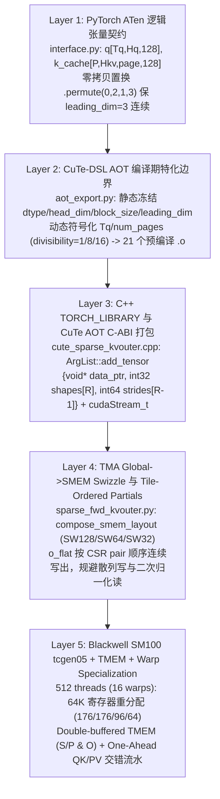

# 张量 Layout/Dtype 到编译器与 SM100 Kernel 的分派链路（Kernel Dispatch & Layout Mapping）

本文以固定 commit `fw-ai/minimax-kernels@b60c3f290f3eb7227d23b50f169e5145d3326288`（Fireworks AI 针对 NVIDIA Blackwell SM100 B200/B300 的 M3 稀疏注意力与 MoE 算子库）作为端到端真实代码标本，回答研究队列中的 `kernel-dispatch-layout` 问题（优先级 5）：

> PyTorch ATen 张量的逻辑 `shape / stride / dtype` 是如何一步步穿过 Python 接口校验、CuTe-DSL AOT C-ABI 参数打包、TMA/Swizzle 共享内存描述符与 Blackwell SM100 `tcgen05` / Tensor Memory (`TMEM`) / Warp Specialization 物理执行管线的？为什么生产级推理算子要严格禁止运行时 JIT 重编译，以及如何通过改变中间张量的排布顺序（Tile-Ordered Partials）消除散列写放大？

## 1. 证据状态与边界声明

| 证据项 | 来源 / 路径 | 证据等级 | 最新源码/发布日期 | 边界说明 |
|---|---|---|---|---|
| ATen 接口契约、步长置换与 8-Kernel 流水线编排 | `fw-ai/minimax-kernels@b60c3f290f3eb7227d23b50f169e5145d3326288` `py/minimax_kernels/m3_sparse_attention/interface.py`、`csrc/m3_sparse_attention/cute_sparse_kvouter.cpp` | `implementation` | `2026-04-06`（commit 日期） | 静态源码审计，不声称在本机执行了 SM100 CUDA kernel |
| CuTe-DSL AOT 编译期特化、C-ABI 布局、TMA Swizzle 与 SM100 `tcgen05`/`TMEM` Warp Specialization | `fw-ai/minimax-kernels@b60c3f290f3eb7227d23b50f169e5145d3326288` `py/minimax_kernels/m3_sparse_attention/aot_export.py`、`sparse_fwd_kvouter.py`、`docs/aot.md`、`docs/m3-sparse-attention.md` | `implementation` | `2026-04-06`（commit 日期） | 静态源码与设计文档核对 |
| B200 / B300 实测吞吐与 `fio1x` / `fioAct` / `cio` 带宽指标 | `fw-ai/minimax-kernels@b60c3f290f3eb7227d23b50f169e5145d3326288` `docs/perf-results-b200.md`、`docs/perf-results-b300.md` | `author-benchmark` | `2026-04-06`（commit 日期） | 作者公布的 B200/B300 测试结果，非本仓库实机重测 |
| `fio1x` / `fioAct` / `cio` / `ioAlt` 字节守恒复现实验 | [`experiments/innovator_arch_tradeoffs/`](../../experiments/innovator_arch_tradeoffs/README.md) | `own-offline` | `N/A`（本项目合成模型） | Python 标准库 CPU/offline 精确重算并对齐作者报告中的分析型 GB 数值 |

## 2. 端到端五层分派与内存布局映射总览

在现代大模型推理栈中，一个算子从 `torch.Tensor` 走到 Tensor Core 并非简单的“传指针”，而是跨越以下五层严格受控的表示变换：



## 3. 逐层源码机制剖析

### 3.1 Layer 1：ATen 张量契约与零拷贝维度置换（`interface.py:55-261`）

`m3_sparse_attn` 接收 Paged KV Cache 与 Varlen Query 输入，在 Python/C++ 入口执行三项关键布局变换：

1. **Query 展平与连续性保证**：
   无论外部传入 3D `q [Tq, Hq, 128]` 还是 4D `[B, S, Hq, 128]`，统一 reshape 为 `q_3d [Tq, Hq, 128]` 并要求最后一维 `D = 128` 步长为 `1`（`contiguous_dim = 2`）。
2. **Paged KV Cache 的零拷贝维度置换（`.permute(0, 2, 1, 3)`）**：
   外部框架（如 vLLM/SGLang）维护的物理页表布局通常为 `k_cache, v_cache: [num_pages, Hkv, page_size, 128]`。在进入 CuTe kernel 前，`interface.py:259-260` 与 `cute_sparse_kvouter.cpp:478-479` 执行：
   ```python
   k_4d = k_cache.permute(0, 2, 1, 3)  # 逻辑形状变为 [num_pages, page_size, Hkv, 128]
   v_4d = v_cache.permute(0, 2, 1, 3)
   ```
   **架构原因**：`.permute(0, 2, 1, 3)` **不发生任何 HBM 数据搬移**（仅交换 ATen `TensorImpl` 中的 `sizes_` 和 `strides_` 元数据），但将物理页内 token 维度 `page_size` 放到了第 1 维、`Hkv` 放到了第 2 维，同时保持第 3 维 `D = 128` 依然是步长为 `1` 的连续主维（`leading_dim = 3`）。这样 TMA 硬件描述符可以沿 `page_size` 与 `D` 构造 2D 块传输，而跨 `Hkv` 或跨物理页则通过显式 `strides[0..2]` 寻址。
3. **Tile-Ordered 中间张量预分配（避免原子写与散列写）**：
   KV-Outer 算法将外层循环反转到唯一的 KV 块上。因此同一个 Query token 的 `topK` 个选中块会由**不同的 CTA** 并行计算。为了避免多个 CTA 对同一 `out[qidx]` 发起慢速 HBM 原子加，也避免在 Forward kernel 内部做非对齐的散列写，`interface.py:242-254` 预分配了**按 CSR Pair 顺序排列**的中间缓冲区：
   - `o_flat`: `[Hkv * Tq * topK * qhead_per_kv, 128]`（类型为 `partial_dtype`，BF16 或 FP32）
   - `m_partial`, `l_partial`: `[Hkv, Tq * topK * qhead_per_kv]`（强制 `FP32` 对数求和指数统计量）
   - `inv`: `[Hkv, Tq, topK]`（`INT32` 反向映射表：`inv[h, q, r] = pair_idx`）

### 3.2 Layer 2 & 3：CuTe-DSL AOT 编译期契约与 C-ABI 内存布局（`aot_export.py` & `cute_sparse_kvouter.cpp`）

为什么推理引擎不能简单依赖 JIT？`docs/aot.md` 与 `cute_sparse_kvouter.cpp` 展示了生产环境对 **Zero-Recompilation（零运行时重编译）** 的工程实现：

1. **静态特化 vs 动态符号维度（`aot_export.py:86-163`）**：
   在编译时，`_make_fake_tensor(dtype, shape, leading_dim, div)` 将两类属性严格分开：
   - **编译期常量（烘焙进 SASS 指令与 TMA 描述符）**：`dtype`（BF16/FP16/FP8）、`head_dim = 128`、`block_size = 128`、`leading_dim`（即哪一维 `stride == 1`）以及向量化对齐因数 `div`（例如 `D=128` 对 BF16 取 `div=8` 即 `16 B` 对齐，对 FP8 取 `div=16`）。
   - **运行时动态符号（`cute.sym_int()`）**：`Tq`、`num_pages`、`rows = Tq * topK * qhead` 等随每个请求 batch 动态变化的维度。
2. **CuTe AOT C-ABI 的精确字节打包规则（`cute_sparse_kvouter.cpp:64-106`）**：
   当 CuTe-DSL 将 Python kernel 导出为 `.h + .o` ELF 目标文件后，生成的 C 包装函数接收一个扁平的 `void* args[]` 指针数组。`ArgList::add_tensor` 揭示了每个动态张量在 ABI 层的精确二进制结构体布局：
   ```cpp
   // 对秩为 R 的张量，其 ABI 结构体按 8 字节对齐打包：
   struct CuteDynamicTensorABI {
       void*   data_ptr;          // 8B: HBM 基地址
       int32_t shapes[R];         // 4B * R: 各维度运行时大小
       // padding to 8B alignment if R is odd
       int64_t strides[R - 1];    // 8B * (R - 1): 除最后一维(stride恒为1)外的运行时步长（以元素为单位）
   };
   ```
   紧随张量描述符之后的是标量参数（`int32_t` / `float`）、`&cudaStream_t` 指针以及末尾用于接收返回码的 `int32_t ret` 槽位。
3. **21 个预编译 Kernel 的确定性分派与 CUDA Context 析构保护（`cute_sparse_kvouter.cpp:133-143, 392-510`）**：
   - `export_all_reachable` 预先导出 **21 个 `.o` 文件**（4 档 `replicas ∈ {16, 32, 64, 128}` $\times$ 4 个索引构建算子 + 2 个串/并行 offsets 算子 + 1 个 LPT 负载均衡调度算子 + 1 个 SM100 Forward 算子 + 1 个 Combine 归约算子）。
   - 在运行时，如果传入的配置不在预编译集合中，`TORCH_CHECK` 立即抛出确定性异常，**绝不触发隐式 JIT 编译导致在线请求出现数十秒卡顿**。
   - **CUDA Context 静态析构顺序陷阱（`cute_sparse_kvouter.cpp:133-143`）**：代码将保存 `CuteDSLRT_Function_Handle*` 的哈希表分配在堆上（`static auto* map = new ...;`）且**故意在进程退出时不调用 `CuteDSLRT_Function_Destroy`**——因为在 C++ 全局静态变量析构阶段，CUDA Driver Context 往往已经先一步销毁，此时若调用 `cuModuleUnload` 会直接触发进程退出崩溃（Segmentation Fault / CUDA Driver Shutdown Error）。

### 3.3 Layer 4：TMA Swizzle 共享内存布局与 Tile-Ordered Partials 的带宽收益（`sparse_fwd_kvouter.py`）

进入 `M3SparseFwdKVOuterKernel` 后，全局内存张量被映射为 TMA（Tensor Memory Accelerator）描述符与 Swizzled Shared Memory (`SMEM`) 布局：

1. **TMA 与 Swizzle 组合布局（`sparse_fwd_kvouter.py:163-177, 198-267`）**：
   `compose_smem_layout(dtype, major_mode, shape, stage)` 根据 Tile 维度自动选取 `SW128 / SW64 / SW32 / SW16` 交错模式（例如 `128x128` BF16 KV Tile 采用 128B Swizzle），消除 Tensor Core 与向量写回时的 Shared Memory Bank Conflict。
2. **为什么要把 `o_partial` 存成 Tile-Ordered（CSR Pair 顺序）而非 Query-Ordered？**
   在 `sparse_fwd_kvouter.py:678-693` 的注释中，作者给出了清晰的带宽账本：
   - 若 Forward kernel 直接把分块结果写回按 `(qidx, rank)` 索引的布局，Epilogue 阶段必须额外从全局内存读取 `qidx` 与 `rank`，并且对 `(m_partial, l_partial)` 发起跨步散列写（Scattered Writes），同时还要在 Forward 内部做 `O /= l` 除法；
   - 改为 **Tile-Ordered Partials** 后，Forward kernel 内的 `softmax0` 与 `softmax1` 两个 warpgroup 直接按当前 CTA 处理的连续 CSR 槽位 `p = base + ql` 发出**合并的 4 字节全局写（Coalesced 4B Stores）**写出未归一化的 `(m~, l)`，将 `O / l` 归一化延迟到下游轻量级的 `Combine` kernel 中一次性完成。

### 3.4 Layer 5：Blackwell SM100 `tcgen05`、Tensor Memory (`TMEM`) 与非对称寄存器重分配

`sparse_fwd_kvouter.py:88-177, 810-965` 展示了 Blackwell SM100 相比 Hopper SM90 (`wgmma`) 的根本性硬件管线演进：

1. **16 Warps（512 线程）五角色 Warp Specialization 与 64K 寄存器池精确切分**：
   CTA 以 `threads_per_block = 512`（16 个 Warp）、每线程初始 `128` 个寄存器启动（刚好占满 SM100 单 SM 的 $512 \times 128 = 65,536$ 个 32-bit 寄存器）。进入 kernel 后，不同 Warp 通过 `cute.arch.setmaxregister_increase` / `decrease` 动态重分配寄存器配额：

   | Warp 编号 | 角色 (`sparse_fwd_kvouter.py:92-104`) | 线程数 | 每线程寄存器数 | 总寄存器消耗 | 核心硬件职责 |
   |---|---|---:|---:|---:|---|
   | Warps `0..3` | `softmax0` Warpgroup | `128` | **`176`** (`increase(176)`) | `22,528` | 从 `TMEM` 读取 Group 0 的 $S = Q_0 K^T$，计算行最大值 $m$ 与指数和 $\exp(S - m)$，写回 $P_0$ |
   | Warps `4..7` | `softmax1` Warpgroup | `128` | **`176`** (`increase(176)`) | `22,528` | 并行处理 Group 1 的 $S = Q_1 K^T$ 在线 Softmax |
   | Warps `8..11` | `correction` Warpgroup | `128` | **`96`** (`decrease(96)`) | `12,288` | 当发现新的更大行最大值 $m_{\text{new}}$ 时，在 `TMEM` 上对历史累加器 $O$ 乘上修正因子 $\exp(m_{\text{old}} - m_{\text{new}})$，并在尾声将 `TMEM` 中的 $O$ 经 `sO` 写出到 HBM |
   | Warp `12` | `mma` Warp（单 Warp 驱动 `tcgen05`） | `32` | **`64`** (`decrease(64)`) | `2,048` | 分配并管理 SM100 `TMEM`，单线程发射 5 代 Tensor Core 异步指令 `tcgen05.mma`（计算 $QK^T$ 与 $PV$） |
   | Warps `13..15` | `load` Warps（3 个协作加载 Warp） | `96` | **`64`** (`decrease(64)`) | `6,144` | Warp 13 通过 TMA 硬件引擎加载连续的 $K, V$ 页块；Warps 13–15（96 线程）通过 `cp.async` 协作收集非连续的散列 Query 行 $Q_0, Q_1$ |
   | **合计** | **全 CTA 寄存器守恒** | **`512`** | 平均 `128` | **`65,536`** | $22528 + 22528 + 12288 + 2048 + 6144 = 65536$（零寄存器溢出到 Local Memory） |

2. **SM100 Tensor Memory (`TMEM`) 双缓冲与 One-Ahead `QK`/`PV` 流水线（`sparse_fwd_kvouter.py:920-965`）**：
   - 在 Hopper SM90 中，`wgmma` 的累加器驻留在线程寄存器中，导致 MMA warpgroup 必须占用大量寄存器；而在 Blackwell SM100 中，Warp 12 调用 `tmem.allocate(cute.arch.get_max_tmem_alloc_cols("sm_100"))` 在独立片上 **Tensor Memory (`TMEM`)** 中分配双缓冲的 `tStS`（存放 $S/P$ 矩阵）和 `tOtO`（存放 $O$ 累加器），故 `mma` 与 `load` 仅需 `64` 个通用寄存器，把省下的寄存器全部让给高算术密度的 `softmax0/1`（`176` regs）。
   - **消除 `VBUF` 死锁的加载顺序（`K -> Q0 -> V -> Q1`）**：
     代码注释（`sparse_fwd_kvouter.py:130-143`）指出了一个微妙的硬件流水线反例：如果加载线程按朴素的 `(Q0..Q_{G-1}, K, V)` 顺序加载，而 `mma` 线程採用“提前一步（One-Ahead）”流水线（即在计算第 $g+1$ 组 `QK` 的同时，交错执行第 $g$ 组延迟的 `PV`），那么 `load` 线程在填完 `V` 之前可能会阻塞在等待 `Q1` 缓冲区释放，而 `mma` 线程又在等待 `V` 到达才能释放 `Q` 阶段，形成 **`load <-> mma` 循环等待死锁**。将加载顺序重排为 **`K, Q0, V, Q1, ...`** 后，一旦 `K` 与 `Q0` 到位，`mma` 即可立即启动 `QK0`，同时 `V` 在 `Q1` 之前加载完毕，彻底打断了 `VBUF` 上的循环依赖。

## 4. 字节流量模型与 CPU/offline 复现验证

在 [`experiments/innovator_arch_tradeoffs/`](../../experiments/innovator_arch_tradeoffs/README.md) 中，我们用纯 Python 标准库精确复现了 `fw-ai/minimax-kernels` 定义的四项 HBM 字节账本（其中 $R = T_q \times \text{topK} \times (H_q / H_{kv})$ 为每个 KV Head 的打包 GQA 行数，$N_{\text{sel}}$ 为去重后被选中的唯一 KV 块数，$M = (T_q \times \text{topK}) / N_{\text{sel}}$ 为平均每个唯一 KV 块的复用次数）：

$$\text{fio1x} = \underbrace{T_q H_q D b_{\text{in}}}_{Q\text{ 理想单次读}} + \underbrace{H_{kv} N_{\text{sel}} (2 B_{\text{blk}} D b_{\text{in}})}_{\text{唯一 }KV\text{ 块读取}} + \underbrace{H_{kv} R (D b_{\text{part}} + 8)}_{\text{Tile-ordered Partials 写出}}$$

$$\text{fioAct} = \underbrace{H_{kv} R D b_{\text{in}}}_{Q\text{ 跨 KV 块重流式读}} + \underbrace{H_{kv} N_{\text{sel}} (2 B_{\text{blk}} D b_{\text{in}})}_{\text{唯一 }KV\text{ 块读取}} + \underbrace{H_{kv} R (D b_{\text{part}} + 8)}_{\text{Tile-ordered Partials 写出}}$$

$$\text{ioAlt (No KV Reuse)} = T_q H_q D b_{\text{in}} + H_{kv} (T_q \cdot \text{topK}) (2 B_{\text{blk}} D b_{\text{in}}) + H_{kv} R (D b_{\text{part}} + 8)$$

$$\text{cio (Combine I/O)} = H_{kv} R (D b_{\text{part}} + 8) + 4 H_{kv} T_q \cdot \text{topK} + T_q H_q D b_{\text{out}}$$

### 本项目 `own-offline` 复现值与作者 B200/B300 `author-benchmark` 对照表

| 场景 (`Tq, KV, distinct_blocks`) | 本项目离线重算 `fio1x` / `fioAct` / `cio` | 无复用基线 `ioAlt`（总前向压缩比） | 作者 B200 实测 (`author-benchmark`) | 作者 B300 实测 (`author-benchmark`) |
|---|---:|---:|---|---|
| `Tq=4096, KV=32768, sel=16` (`M=4096`, 极高热点复用) | `0.295 GB` / `0.546 GB` / `0.294 GB` | `4.588 GB` (**`8.40x`** 节省，KV 读压缩 `4096x`) | `fwd=0.102 ms` (`674 TFLOP/s`, `fbwAct=5.36 TB/s`) | `fwd=0.091 ms` (`758 TFLOP/s`, `fbwAct=6.02 TB/s`) |
| `Tq=4096, KV=65536, sel=480` (`M=136.5`, 中等复用) | `0.325 GB` / `0.577 GB` / `0.294 GB` | `4.588 GB` (**`7.96x`** 节省，KV 读压缩 `136.5x`) | `fwd=0.163 ms` (`421 TFLOP/s`, `fbwAct=3.53 TB/s`) | `fwd=0.145 ms` (`473 TFLOP/s`, `fbwAct=3.97 TB/s`) |
| `Tq=8192, KV=98304, sel=16` (`M=8192`, 超长上下文共享前缀) | `0.588 GB` / `1.092 GB` / `0.588 GB` | `9.175 GB` (**`8.40x`** 节省，KV 读压缩 `8192x`) | `fwd=0.194 ms` (`706 TFLOP/s`, `fbwAct=5.62 TB/s`) | `fwd=0.172 ms` (`799 TFLOP/s`, `fbwAct=6.36 TB/s`) |

> **关键架构洞察**：当多个 Query token 命中相同的热门 KV 块时，KV-Outer 把原本占主导的 `4.29 GB` 重复 KV 读取压缩到了不足 `32 MB`，此时瓶颈反转为 **`Q` 的重流式读取（`q_restream = 0.268 GB`）与 Partial 结果写出（`partials = 0.277 GB`）**。这也解释了为什么 `fioAct`（`0.546 GB`）接近 `fio1x`（`0.295 GB`）的 1.85 倍——因为每个 KV 块无法把所有关联的 Query 一次性驻留在片上，必须按 `G * BM = 128` 行的粒度重读 `Q`。

## 5. 解决方案架构师（SA）选型与排障清单

1. **AOT 编译覆盖率检查（杜绝线上 JIT 抖动）**：
   在部署基于 CuTe-DSL、Triton 或 FlashInfer 的推理镜像时，必须审查其 AOT 导出矩阵是否覆盖了目标模型的全部 `(input_dtype, partial_dtype, out_dtype, head_dim, page_size, replica_bucket)` 组合。
2. **Paged KV Cache 的步长契约（Stride Contract）**：
   自定义 Kernel 往往要求 `head_dim` 维必须满足 `stride == 1` 且基地址按 `16 B`（128-bit TMA 对齐要求）对齐。若上游框架按 `[num_pages, head_dim, page_size]`（Channel-first）存储 K Cache，则 `.permute()` 会导致最后一维步长不为 1，无法直接喂给要求 `leading_dim = 3` 的 TMA 描述符。
3. **Partial 缓冲区的显存峰值预算**：
   KV-Outer 方案虽然大幅降低了 HBM 带宽消耗，但需要一块大小为 $H_{kv} \times T_q \times \text{topK} \times (H_q / H_{kv}) \times (D \cdot b_{\text{part}} + 8)$ 的工作区（例如 `Tq=8192, Hq=16, topK=16, BF16` 时约 `554 MB`）。在规划长上下文并发 Batch 时，必须将该 Workspace 计入动态激活显存预算，详见 [docs/learning/exercises.md](../learning/exercises.md) 练习 13。
