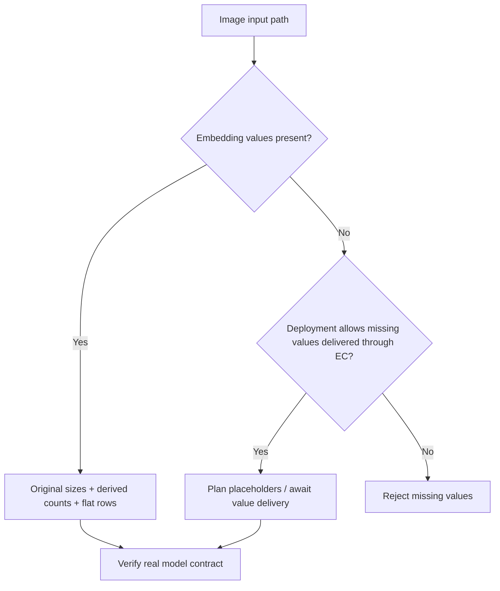
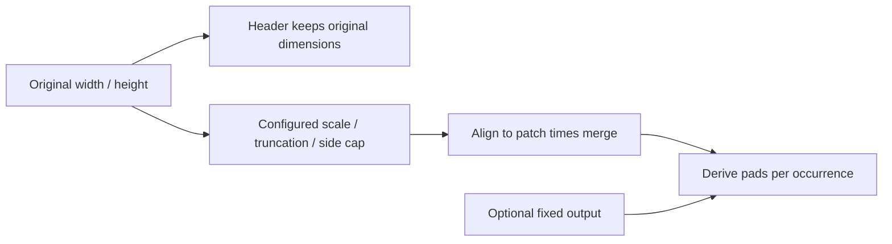
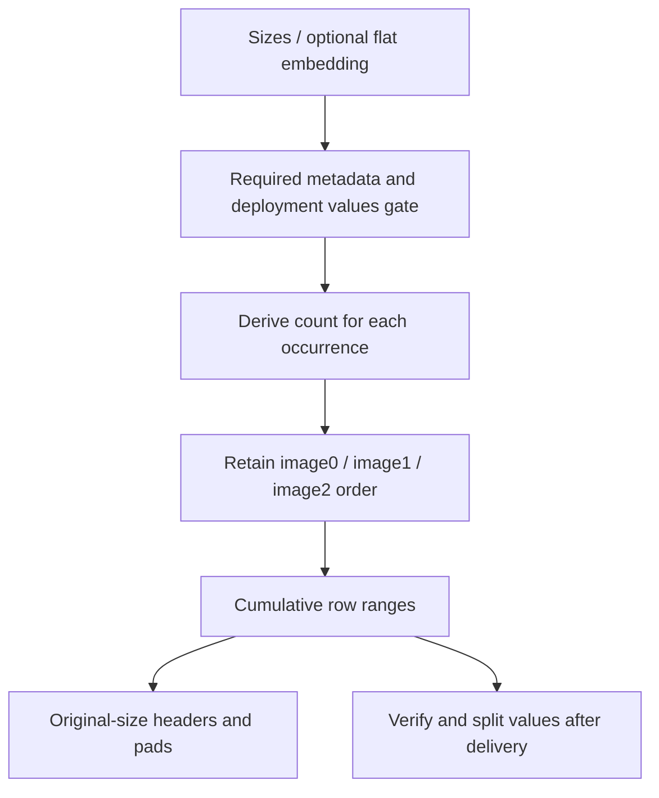

# Kimi-K3 Metadata-only Image and EPD Selection FAQ: Original Dimensions, Placeholders and Embedding Splits

> **Language**: English · [中文](kimi-k3-metadata-only-image-original-dimensions-placeholder-selection-faq.md)  
> **Round 166 / daytime 43**: a verified same-day capability update,not a popularity ranking.[Pinned vLLM commit](https://github.com/vllm-project/vllm/commit/24fe0a99f1062f7351852804f2cd38668f7423bd),2026-11-14 04:13:13 UTC / 12:13:13 BJT.  
> [H5 workbench](../reports/kimi-k3-metadata-only-image-original-dimensions-placeholder-sizer.html) · [Seven cards](../reports/kimi-k3-metadata-only-image-original-dimensions-placeholder-selection-cards.html) · [High-resolution SVG](../../assets/svg/kimi-k3-metadata-only-image-original-dimensions-placeholder-selection-faq-summary.svg) · [Experiment/data](../../experiments/image_metadata_placeholder_selection/README.md)

## Executive Summary

**Encoder-Prefill-Decode separation can plan prompts from image metadata before embedding delivery.It does not eliminate the embeddings needed to execute the model.** This Kimi-K3 change declares `image_sizes` as required metadata and `image_embeds` as values.An EC-consumer deployment may allow missing values;ordinary embedding requests still require them.

Keep three contracts separate:original width/height in media headers,per-occurrence pad counts derived from the shared resize policy,and ordered flat embedding splits using those counts.Equal dimensions do not imply equal content.Even valid payload reuse must preserve every prompt occurrence.

The original `65×33,9×7,65×33` case declares patch8/merge2/side16/budget256 and produces `15/1/15` pads,total31,with exclusive ranges `[0,15),[15,16),[16,31)`.This is a **synthetic,independently_reproduced=false** bounded metadata model,not checkpoint configuration,tokenizer IDs or native image encoding.Original CPUgeometry is separately measured;GPU/EC/network/visual acceptance remain unknown.

## Q1: When should I choose metadata-only versus raw images or complete embeddings?

| Path | Pinned source meaning | Deployment acceptance |
| :--- | :--- | :--- |
| Raw image | HF processor obtains original dimensions and image/count inputs | Verify decoding,resize,encoder and prompt parity |
| Image embeddings supplied | Dimensions remain required;derive counts and split flat rows | Verify row sum,hidden width,dtype/device and model match |
| Metadata-only EC consumer | Deployment permits missing values;metadata determines placeholders | Verify connector delivery and value lifetime |
| Ordinary request without values | Embeddings remain required | Reject explicitly;no fabricated success or silent raw fallback |

The demo's `allow_missing` is a deployment-profile control,not a client permission override.`embedding_shape` is merely declared `[rows,columns]`;the workbench constructs no Torch tensor and does not establish inference readiness.

## Q2: Why do headers use original dimensions while counts use resized geometry?

The pinned [preprocessor](https://github.com/vllm-project/vllm/blob/24fe0a99f1062f7351852804f2cd38668f7423bd/vllm/models/kimi_k3/common/mm_preprocess.py) explicitly retains original `width×height` in media headers.Raw and dictionary paths must reconstruct the same prompt.Substituting resized/padded dimensions changes the header even with correct pad counts.

Counts follow configuration:estimate patch density with `max(1,width//patch) × max(1,height//patch)`,combine total and one-side limits to choose scaling,truncate positive dimensions with a one-pixel minimum,then align to `patch×merge`.Without fixed output,the padded grid divided by this factor determines token count.With fixed output,use the fixed count while retaining independent original dimensions.

Our first `65×33` image is unscaled but padded to `80×48`,giving `5×3=15` tokens;`9×7` pads to `16×16`,giving1.Wrong padded headers miss3/3original descriptors.This is an intentional counterfactual,**not evidence that the old native raw path wrote incorrect headers**.Padding also prevents treating input patch budget as a strict final padded-grid bound:the original budget1small-image case still uses one merged token.

## Q3: How do metadata dictionaries preserve occurrences and embedding splits?

The native parser requires Torch int32/int64 `image_sizes`,two dimensions `[N,2]`,and positive sizes.It does not accept arbitrary JSON lists or floating tensors.JSON reconstruction must build the appropriate tensor.It regenerates `image_num_tokens` rather than trusting supplied counts.

`DictEmbeddingItems` keeps field configurations:CPU-batched sizes/counts and flat embedding segments sized by the derived counts.Optional values still need field configuration for when supplied.The AMD/NVIDIA embedding paths split supplied tensors using those counts instead of entering pixel encoding.

The original three segments contain15,1,15rows.A wrong size-only occurrence collapse retains just16pads/two occurrences.Correct scoped **geometry memoization** reuses size calculations within one configuration but still emits three occurrences.It is not content/embedding deduplication.

## Q4: What exactly do the workbench,tests and cards verify?

The H5 admits only declared fields,1–64size pairs with sides1–8192,positive bounded patch/merge/budget/side,merge-aligned side limits,and null or1–1024fixed counts.**These extra bounds/alignment constraints define our original subset,not the native parser's entire valid domain.** Invalid sizes,row sums and missing-values permission fail explicitly;no zero-filled success.

Eight focused tests cover original headers/31pads/exclusive ranges,permissions,row sums,extreme aspect ratios,fixed counts,small-image padding,wrong headers/collapse,cache/configuration separation,byte provenance and invalid inputs.An additional64seeded random profiles plus default compare195structured Python/Node outcomes across the correct and two incorrect strategies.Native Kimi-K3,PIL,HF tokenizer,Torch and connector integration tests were not executed.

`latency.json` seals64/256/1024/4096occurrence samples:two warmups,seven alternating repeats,three batches/sample,median repeat means.Both original CPUpaths preserve ordered output:one computes geometry directly,the other memoizes sizes per call under one configuration.The three-size input is precreated.This does not measure encoder or EPD throughput.

Compact descriptor packet bytes come from serialization;`13059 B` is declared uncompressed RGB `Σ(width×height×3)`,not a decoded image,JPEG size or native traffic.IDs,framing,connector protocols,embedding payload and compression are excluded.Bars come from sealed evidence;unknown metrics stay null.The seven900×1125cards forbid scripts/network under CSP;H5 separately allows inline local JS.The original ordered cabinet SVG is a metaphor,not memory layout;browser acceptance remains unverified.

## Q5: What are the production selection checklist and fallback boundaries?

Pin model/tokenizer/processor/config versions.Compare encoder and consumer original dimensions,counts,headers,occurrence order,embedding row/hidden/dtype/device and completed connector delivery.Test repeated images,equal dimensions with different contents,extreme aspect ratios,fixed counts,JSON roundtrips,missing-values rejection and retries.Do not use dimensions as content identity.

If metadata is invalid or the deployment does not support missing values,use the existing raw-image/complete-embedding route or reject explicitly.Do not let clients change permission,trust supplied counts,substitute padded headers,remove repeated placeholders or manufacture empty embeddings.Metadata-only separates encoder delivery from prompt planning;network/latency benefits require actual deployment measurement.

Recheck with `python -m unittest discover -s tests -p test_image_metadata_placeholder_selection.py -q` and `python -m experiments.image_metadata_placeholder_selection.run --check`.Pinned sources include the commit above,[dictionary parser](https://github.com/vllm-project/vllm/blob/24fe0a99f1062f7351852804f2cd38668f7423bd/vllm/multimodal/parse.py) and [native processing tests](https://github.com/vllm-project/vllm/blob/24fe0a99f1062f7351852804f2cd38668f7423bd/tests/models/multimodal/processing/test_kimi_k3.py).Apache-2.0rights retained;link upstream without mirroring implementation.AI-assisted research,not native product certification;human review and native evidence are required.
